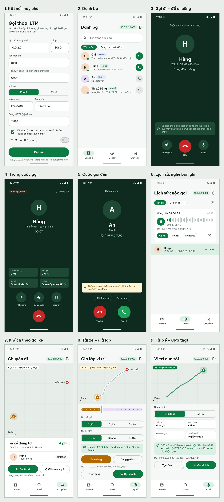

# Bài mở rộng MR6.15 – App Android "Gọi thoại LTM": gọi thoại qua máy chủ và theo dõi tài xế (Kotlin + Jetpack Compose)

| Thông tin | Nội dung |
|---|---|
| Loại | **Bài mở rộng**, không có trong giáo trình. Phần điện thoại của bài MR6.15; máy chủ: [Python](../../../python/Chuong06/BaiMR6.15_GoiThoaiTheoDoiXe/) hoặc [Go](../../../go/Chuong06/BaiMR6.15_GoiThoaiTheoDoiXe/) (cùng giao thức, chọn bản nào cũng được) |
| Nền tảng | Android 7.0 trở lên (minSdk 24, targetSdk 35), Kotlin 2.0.21, Jetpack Compose (BOM 2024.12.01, Material 3), Android Gradle Plugin 8.7.3, Gradle 8.11.1 (wrapper), JDK 17+ |
| Thư viện | `io.github.webrtc-sdk:android` 137.7151.05 (libwebrtc bản dựng sẵn cho Android), OkHttp 4.12 (WebSocket báo hiệu, tải bản ghi), Kotlin coroutines; **MQTT client tự viết** trên `java.net.Socket` (`MqttKhach.kt`), bản đồ tự vẽ bằng Compose `Canvas` (không cần ô bản đồ từ Internet) |
| Phông chữ | Be Vietnam Pro (SIL Open Font License 1.1, xem `FONT_OFL.txt`) |

## Mục tiêu
App đóng hai vai, chọn ở màn hình đầu:
- **Khách**: xem danh bạ (ai trực tuyến), gọi tài xế qua máy chủ; mở thẻ **Chuyến đi**, chọn tài xế của chuyến rồi xem xe đang tới trên bản đồ, còn bao nhiêu km, khoảng mấy phút; **Gọi tài xế**, **Chia sẻ chuyến**.
- **Tài xế**: như khách, thêm thẻ **Vị trí**: gửi vị trí lên máy chủ MQTT bằng **GPS thật** hoặc **giả lập** (chọn tuyến mẫu hoặc nạp tệp GPX, chỉnh tốc độ 5–80 km/h, chu kỳ gửi 1/2/5 s, nhiễu GPS 0/±5/±20 m, tạm dừng, dừng); **Tạm ẩn vị trí**; **Gọi khách** (khách gần nhất trong lịch sử còn trực tuyến).

Cuộc gọi có các màn hình: **gọi đi** (đổ chuông, hồi chuông "tút… tút…"), **cuộc gọi đến** (chuông máy, thông báo nếu cuộc gọi sẽ được ghi âm, trả lời nhanh "Tôi đang tới" / "Gọi lại sau"), **trong cuộc gọi** (đồng hồ, nhãn "Đang ghi âm", chất lượng mạng, RTT, tỉ lệ mất gói, tốc độ bit Opus, đường đi "Qua máy chủ (SFU)", tắt micro, loa ngoài, giữ máy, kết thúc). Thẻ **Lịch sử**: các cuộc gọi của mình (gọi đi/đến/nhỡ, thời lượng), lọc "Có bản ghi", trình phát nghe lại bản ghi trên máy chủ theo kênh **Cả hai / Chỉ tôi / Chỉ <tên bên kia>**.

Giao diện theo bản thiết kế đã duyệt (10 màn hình: kết nối, danh bạ, gọi đi, cuộc gọi đến, trong cuộc gọi, lịch sử và bản ghi, tài xế GPS thật, tài xế giả lập, khách theo dõi, bảng điều khiển máy chủ – màn hình cuối là trang web của máy chủ). Thanh điều hướng dưới có ba thẻ: Danh bạ, Lịch sử (gồm cả bản ghi) và Vị trí (tài xế) hoặc Chuyến đi (khách).

## Kiến thức chính
- **Báo hiệu và đường âm tách riêng.** `BaoHieu.kt` mở WebSocket `ws://<IP>:<cổng>/ws` (OkHttp), gửi/nhận tin JSON đúng giao thức trong [README bản Python](../../../python/Chuong06/BaiMR6.15_GoiThoaiTheoDoiXe/README.md#giao-thức-báo-hiệu-giống-hệt-ở-bản-python-bản-go-và-app-android). Khi máy chủ báo `da_tra_loi`, `AmThanhWebRtc.kt` tạo **một** `PeerConnection` tới máy chủ (Unified Plan, một track âm thanh `mic0`), tạo offer, chờ thu thập ICE xong (trong LAN chỉ có ứng viên *host*, vài trăm ms; quá 2 s thì gửi luôn) rồi gửi offer có sẵn ứng viên; máy chủ trả answer. Âm thanh nhận được tự phát ra loa qua `JavaAudioDeviceModule`, có bật khử vọng (AEC) và khử ồn (NS) phần cứng nếu máy hỗ trợ.
- **Thống kê thật từ `getStats()`.** Mỗi 2 s app đọc báo cáo thống kê WebRTC: RTT từ `remote-inbound-rtp.roundTripTime` (báo cáo RTCP của máy chủ), nếu chưa có thì `candidate-pair.currentRoundTripTime` (gói STUN kiểm tra kết nối); mất gói chiều nhận từ `inbound-rtp` (`packetsLost / (packetsReceived + packetsLost)`); tốc độ bit từ chênh lệch `outbound-rtp.bytesSent`. Số liệu hiện trên màn hình và gửi lên máy chủ bằng tin `thong_ke` (bảng điều khiển hiển thị).
- **Định tuyến âm thanh.** Trong cuộc gọi app đặt `AudioManager.MODE_IN_COMMUNICATION`; loa ngoài dùng `setCommunicationDevice(TYPE_BUILTIN_SPEAKER)` trên Android 12+ (`isSpeakerphoneOn` trên máy cũ). Tắt micro và giữ máy tắt track `mic0` (`setEnabled(false)`) và báo máy chủ (`tat_mic`, `giu_may`) để bên kia thấy trạng thái; giữ máy thì máy chủ ngừng chuyển cả hai chiều.
- **MQTT viết tay.** `MqttKhach.kt` (MQTT 3.1.1, QoS 0) mã hóa CONNECT (kèm Last Will), PUBLISH, SUBSCRIBE, PINGREQ, DISCONNECT đúng định dạng của broker trong máy chủ; đã kiểm thử với broker Python (tin giữ lại khi đăng ký, Last Will khi đóng TCP đột ngột). Tài xế kết nối với di chúc `xe/<mã xe>/trangthai = mat_ket_noi`, gửi `truc_tuyen`, rồi mỗi chu kỳ một điểm lên `xe/<mã xe>/vitri` (QoS 0, retain). **Tạm ẩn vị trí** gửi payload rỗng có retain (broker xóa điểm giữ lại, khách vào sau không thấy vị trí cũ) và trạng thái `nghi`.
- **GPS thật và giả lập.** GPS thật dùng `LocationManager.GPS_PROVIDER` (không cần Google Play Services), mỗi chu kỳ một điểm kèm tốc độ, hướng, độ chính xác. Giả lập (`TaiXeViTri`) chạy dọc tuyến: mỗi chu kỳ tiến thêm tốc độ × chu kỳ mét, cộng nhiễu Gauss (độ lệch chuẩn bằng nửa mức nhiễu), gửi kèm `con_lai_m` và điểm đích; `nguon = "gia_lap"` để khách và bảng điều khiển phân biệt (màu cam). Cách tính trong `HinhHoc.kt` giống `tai_xe_gia.py` (đã so khớp tọa độ).
- **Khách tính thời gian tới.** Có `con_lai_m` thì dùng; không thì đường chim bay (haversine) tới điểm đích × 1,3; thời gian = quãng đường / max(tốc độ, 15 km/h). Dòng "Cập nhật N giây trước" giúp thấy độ trễ và lúc tài xế mất kết nối (nhãn chuyển đỏ khi nhận Last Will).
- **TLS và ghim vân tay.** Bật "Mã hóa TLS (wss://)" khi máy chủ chạy `--tls`. Chứng chỉ tự ký không được CA nào xác nhận, nên app kiểm **vân tay SHA-256** của chứng chỉ (*certificate pinning*): nhập vân tay máy chủ in ra thì chỉ tin đúng máy chủ đó; để trống thì tin lần đầu (TOFU) và lưu lại, lần sau khác vân tay sẽ từ chối với thông báo "SAI vân tay chứng chỉ máy chủ".

## Cấu trúc tệp
```
BaiMR6.15_GoiThoaiTheoDoiXe/
├── settings.gradle.kts, build.gradle.kts, gradle.properties, gradlew, gradlew.bat, gradle/wrapper/
├── FONT_OFL.txt                         giấy phép phông Be Vietnam Pro
└── app/
    ├── build.gradle.kts                 thư viện, minSdk/targetSdk
    └── src/main/
        ├── AndroidManifest.xml          quyền INTERNET, RECORD_AUDIO, MODIFY_AUDIO_SETTINGS, ACCESS_FINE/COARSE_LOCATION
        ├── assets/tuyen_mau.json        tuyến mẫu (chung với bản Python)
        ├── res/                         phông, biểu tượng, màu, theme
        └── java/vn/edu/ltm/goithoai/
            ├── MainActivity.kt          chọn màn hình theo trạng thái, xin quyền, chọn tệp GPX, chia sẻ
            ├── UngDungViewModel.kt      trạng thái app, xử lý tin báo hiệu, cuộc gọi, chuông, trình phát bản ghi
            ├── BaoHieu.kt               WebSocket báo hiệu (OkHttp), ghim vân tay TLS, tải bản ghi
            ├── AmThanhWebRtc.kt         PeerConnection tới máy chủ, offer/answer, getStats, loa ngoài
            ├── MqttKhach.kt             MQTT client tự viết (thuần Kotlin/JVM)
            ├── ViTri.kt                 TaiXeViTri (GPS thật, giả lập, gửi MQTT), KhachTheoDoi (đăng ký, nhận)
            ├── HinhHoc.kt               haversine, hướng, nhiễu GPS, đọc GPX, tuyến (thuần Kotlin)
            ├── MoHinh.kt                kiểu dữ liệu (cài đặt, danh bạ, cuộc gọi, lịch sử)
            └── ui/                      GiaoDien (màu, phông, thành phần chung), ManHinhKetNoi, ManHinhDanhBa,
                                         ManHinhCuocGoi, ManHinhLichSu, ManHinhViTri, BanDo
```

## Cách chạy
1. **Cài Android Studio** (bản 2024.2 "Ladybug" trở lên; có sẵn JDK và trình quản lý Android SDK): `winget install -e --id Google.AndroidStudio`. Lần đầu mở, để trình hướng dẫn cài Android SDK (Platform 35, Build-Tools) và đồng ý giấy phép SDK.
2. **Chép thư mục bài sang đường dẫn chỉ có chữ không dấu**, ví dụ `C:\AndroidLTM\GoiThoaiLTM`. Trên Windows, Gradle và Android Gradle Plugin lỗi khi đường dẫn dự án có ký tự ngoài ASCII (ví dụ thư mục "…\Lập trình mạng\…"): `gradlew.bat` không mở được `gradle-wrapper.jar` và AGP báo *"Your project path contains non-ASCII characters"*.
3. Android Studio → **Open** → chọn thư mục vừa chép → chờ *Gradle Sync* (lần đầu tải Gradle 8.11.1, AGP, Compose, WebRTC, OkHttp – cần mạng, vài phút).
4. Bật **Developer options → USB debugging** trên điện thoại, cắm cáp, bấm **Run ▶** (hoặc dòng lệnh: `gradlew assembleDebug` → `app\build\outputs\apk\debug\app-debug.apk`, cài bằng `adb install -r app-debug.apk`).
5. Trên máy tính chạy máy chủ ([Python](../../../python/Chuong06/BaiMR6.15_GoiThoaiTheoDoiXe/#với-điện-thoại-android-thật) `py -3 may_chu.py 0.0.0.0 8080 1883` hoặc [Go](../../../go/Chuong06/BaiMR6.15_GoiThoaiTheoDoiXe/) `go run . 0.0.0.0 8080 1883 --udp 50000`), mở tường lửa, xem IP bằng `ipconfig`.
6. Trong app: nhập **IP máy chủ**, **Cổng** 8080, tên, mã người dùng (ví dụ số điện thoại 0901), vai trò, **Kết nối**. Cho phép quyền micro (và vị trí nếu là tài xế dùng GPS thật).

Thử với một điện thoại: chạy thêm điện thoại giả và tài xế giả lập trên máy tính (lệnh ở README bản Python) – gọi Hùng (giả) thì nghe tiếng 660 Hz; ở vai khách, thẻ **Chuyến đi** chọn Hùng để xem xe giả lập chạy. Thử với hai điện thoại: một máy vai **Khách**, một máy vai **Tài xế** (bật giả lập), gọi qua lại, khách theo dõi xe của tài xế.

**Máy ảo Android (emulator):** máy ảo thấy máy tính ở địa chỉ `10.0.2.2`; nhập `10.0.2.2` làm IP máy chủ. Chế độ "GPS thật" trên máy ảo nhận vị trí từ *Extended controls → Location* (đặt điểm hoặc phát tệp GPX/KML), tiện thử mà không cần ra đường. Micro máy ảo cần bật *Extended controls → Microphone → Virtual microphone uses host audio input*.

## Kết quả thực thi


Chụp màn hình thật của app (bản debug) trên máy ảo Android 15, máy chủ Python chạy trên cùng máy tính (cổng 18080, MQTT 11883):
1. Màn hình kết nối (vai Khách, có ô cổng MQTT cho bản đồ chuyến đi).
2. Danh bạ do máy chủ gửi: Chi, Hùng (điện thoại giả) trực tuyến; An, Tài xế Dũng ngoại tuyến.
3–4. Gọi Hùng: đổ chuông, rồi trong cuộc gọi có ghi âm. RTT 2 ms, mất gói 0 %, Opus 17 kbit/s là số đo thật từ `getStats()`; máy chủ ghi "WebRTC của Bình: connected".
5. Cuộc gọi đến từ An (điện thoại giả gọi tài xế Dũng), có thông báo ghi âm và trả lời nhanh.
6. Lịch sử: cuộc gọi 47 s, bản ghi 316 kB tải từ máy chủ và phát bằng `MediaPlayer` (Ogg/Opus).
7. Khách theo dõi tài xế Hùng (giả lập): còn 1,6 km, khoảng 4 phút, cập nhật 0 giây trước.
8. Vai tài xế, giả lập tuyến Bến Thành → Thảo Điền: điểm gửi lên `xe/59A11122/vitri`; `khach_theo_doi.py` trên máy tính nhận đúng các điểm này.
9. Vai tài xế, GPS thật: máy ảo nhận tọa độ bằng `adb emu geo fix`, app gửi mỗi giây.

Khi app tài xế bị đóng đột ngột, màn hình khách hiện "Tài xế mất kết nối (Last Will)" – broker đã phát di chúc.

## Ghi chú
- **Chỉ dùng trong mạng lab.** `usesCleartextTraffic="true"` cho phép `ws://` và `http://` tới máy chủ trong LAN; khi cần mã hóa dùng máy chủ `--tls` và vân tay. Ghi âm chỉ diễn ra khi người gọi đã đánh dấu đồng ý; người nghe thấy thông báo trước khi trả lời.
- App **không chạy dịch vụ nền**: tắt màn hình hoặc chuyển app khác lâu thì hệ điều hành có thể đóng kết nối, nên app giữ màn hình sáng khi đang mở (`FLAG_KEEP_SCREEN_ON`). Ứng dụng thật cần *foreground service* (loại `microphone`, `location`), thông báo cuộc gọi đến (Firebase Cloud Messaging hoặc `ConnectionService`) – xem bài tập.
- Phát bản ghi dùng `MediaPlayer` với tệp Ogg/Opus tải về bộ nhớ đệm; nếu máy không phát được, nút "Mở bằng ứng dụng khác" mở đường dẫn `http://<IP>:<cổng>/banghi/<tệp>` bằng trình duyệt.
- Qua Internet (4G) cần thêm máy chủ STUN/TURN vào `RTCConfiguration` (`iceServers`), vì điện thoại nằm sau NAT của nhà mạng.
- Bản đồ là hình chiếu phẳng quanh tâm vùng hiển thị (đủ chính xác cho vài km), không có đường phố; muốn có nền bản đồ thật có thể dùng osmdroid (OpenStreetMap) hoặc Google Maps SDK (cần khóa API, đặt qua biến môi trường/`local.properties`, không ghi vào mã).
- Kiểm thử: biên dịch bằng Gradle 8.11.1 + Android SDK 35 trên Windows 11 (JDK 21), chạy trên máy ảo Android 15 (API 35, x86_64) nối với máy chủ Python qua `10.0.2.2`, cùng điện thoại giả và tài xế giả lập của bản Python.

## Bài tập gợi ý
1. Thêm *foreground service* giữ kết nối báo hiệu khi tắt màn hình và hiện thông báo toàn màn hình khi có cuộc gọi đến (`NotificationCompat.CallStyle`). Cần thêm những quyền nào trên Android 14?
2. Thay việc chờ thu thập ICE xong bằng *trickle ICE*: gửi offer ngay, gửi từng ứng viên bằng tin `ice` trong `onIceCandidate` (máy chủ đã hỗ trợ). Đo thời gian từ lúc bấm trả lời đến khi nghe tiếng ở hai cách.
3. Dùng `FusedLocationProviderClient` (Google Play Services) thay cho `LocationManager`, so sánh độ chính xác và mức tiêu thụ pin trong 10 phút.
4. Cho khách bấm vào bản đồ để chọn **điểm đón**, gửi lên máy chủ (thêm trường `diem_don_toa_do` vào `dang_nhap`), tài xế thấy điểm đón trên bản đồ của mình.

## Đọc thêm
- Tài liệu WebRTC cho Android: [webrtc.github.io/webrtc-org/native-code/android](https://webrtc.github.io/webrtc-org/native-code/android/), mã nguồn bản dựng sẵn [webrtc-sdk/android](https://github.com/webrtc-sdk/android).
- Android Developers ([developer.android.com](https://developer.android.com/)): Jetpack Compose, quyền vị trí (*Request location permissions*), [`AudioManager`](https://developer.android.com/reference/android/media/AudioManager), *Network security configuration*.
- [OkHttp WebSocket](https://square.github.io/okhttp/), chuẩn MQTT 3.1.1 và các RFC WebRTC: xem [README bản Python](../../../python/Chuong06/BaiMR6.15_GoiThoaiTheoDoiXe/README.md#đọc-thêm).

Mã nguồn của bài được viết mới cho kho này.
