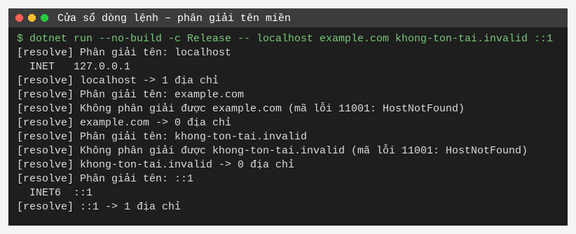

# Bài 1.1 – Phân giải tên miền thành danh sách địa chỉ (C#)

| Thông tin | Nội dung |
|---|---|
| Mã giả tương ứng | Mã giả 1.1 (RESOLVE_HOST – phân giải tên miền thành danh sách địa chỉ) |
| Mục giáo trình | 1.2.3 Địa chỉ IP và tên miền |
| Kế thừa | Không (thủ tục gốc; được dùng lại ở Bài 1.2) |
| Thư viện | .NET 10 BCL: `System.Net.Dns` (`GetHostAddresses`) |

## Mục tiêu
Minh họa lệnh `RESOLVE`: một tên có thể ánh xạ tới nhiều địa chỉ thuộc hai họ INET (`InterNetwork`) và INET6 (`InterNetworkV6`); lỗi phân giải được bắt trong `CATCH` và chuyển thành danh sách rỗng thay vì làm dừng chương trình.

## Tệp
- `Bai1.1_PhanGiaiTenMien.csproj` – dự án console .NET 10.
- `Program.cs` – chương trình chính, phân giải lần lượt các tên nhận từ dòng lệnh.
- `Resolver.cs` – thủ tục `ResolveHost(name)` (Mã giả 1.1).
- `demo.json` – kịch bản chạy minh họa (dùng với `tools/demo.py`).
- `ket_qua.txt`, `ket_qua.png` – kết quả thực thi thật.

## Cách chạy
```bash
dotnet run -- localhost example.com
```
Không có tham số thì chương trình phân giải `localhost`.

## Kết quả thực thi


`localhost` được phân giải thành `127.0.0.1` theo tệp hosts của máy kiểm thử (tệp này không khai báo `::1`). Môi trường kiểm thử chặn truy vấn DNS ra Internet nên `example.com` không phân giải được (`HostNotFound`), giống tên `khong-ton-tai.invalid` vốn được dành riêng để không bao giờ tồn tại (RFC 6761); trên máy có Internet, `example.com` trả về cả địa chỉ IPv4 và IPv6. Chuỗi `::1` là địa chỉ dạng số nên được trả lại nguyên dạng với họ INET6.

## Ghi chú
- `ResolveError` của mã giả tương ứng với `SocketException`; `e.code` tương ứng với `SocketErrorCode`. .NET dùng bộ mã lỗi kiểu Winsock trên mọi hệ điều hành (`HostNotFound` = 11001), khác với mã `EAI_*` mà Python in ra trên Linux.
- `Dns.GetHostAddresses` gọi getaddrinfo của hệ điều hành và chỉ trả mỗi địa chỉ một lần.
- Kiểm thử: Linux, .NET SDK 10.0.114.
