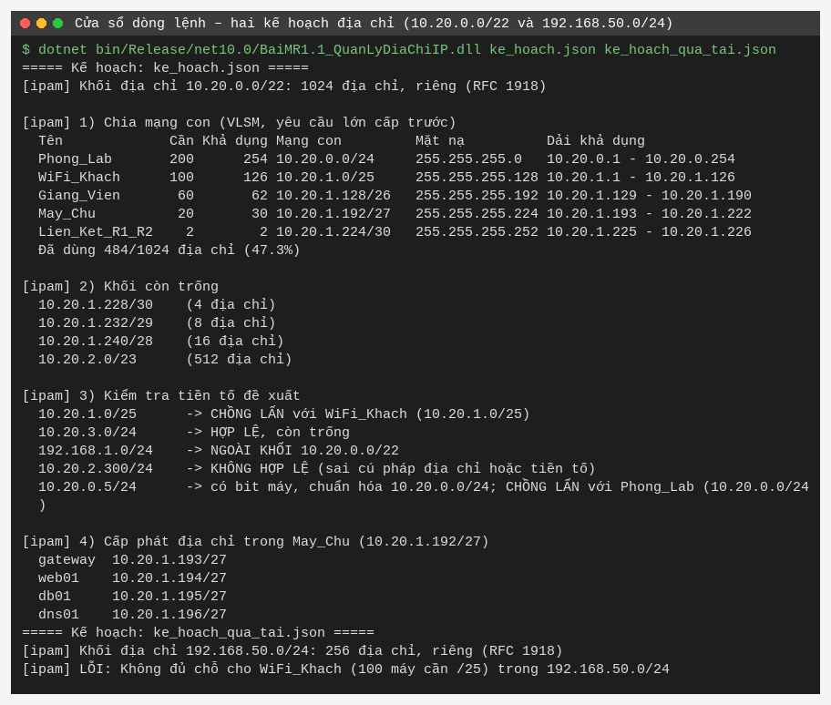

# Bài mở rộng MR1.1 – Quản lý địa chỉ IP (IPAM): chia mạng con, kiểm tra chồng lấn, cấp phát (C#)

| Thông tin | Nội dung |
|---|---|
| Loại | **Bài mở rộng** – không có trong giáo trình, không có mã giả tương ứng |
| Liên hệ với giáo trình | Chương 1, Mục 1.2.3 (địa chỉ IP, tiền tố mạng); Bài 1.1. Kế hoạch địa chỉ được dùng lại ở MR3.2 và MR8.2 |
| Thư viện | .NET 10 BCL: `System.Text.Json`; phép tính khối IPv4 tự viết trên số nguyên 32 bit |
| Bản ngôn ngữ khác | [Python](../../../python/Chuong01/BaiMR1.1_QuanLyDiaChiIP/), [Go](../../../go/Chuong01/BaiMR1.1_QuanLyDiaChiIP/), [Java](../../../java/Chuong01/BaiMR1.1_QuanLyDiaChiIP/), [Rust](../../../rust/Chuong01/BaiMR1.1_QuanLyDiaChiIP/) |

## Mục tiêu
Dùng phép tính trên địa chỉ dạng số thay vì tự cắt chuỗi: đọc một kế hoạch địa chỉ (JSON), chia khối `10.20.0.0/22` thành các mạng con theo số máy cần (VLSM – yêu cầu lớn cấp trước để mọi khối đều thẳng hàng), liệt kê phần còn trống dưới dạng ít khối CIDR nhất, kiểm tra các tiền tố đề xuất (sai cú pháp, có bit máy, ngoài khối, chồng lấn) và cấp phát địa chỉ cho thiết bị. Đây là phần lõi của các công cụ IPAM và là bước đầu tiên của mọi kịch bản tự động hóa mạng.

## Kiến thức chính
- Địa chỉ IPv4 là số 32 bit; mặt nạ `/n` là `n` bit 1 ở đầu. Địa chỉ mạng = `địa_chỉ & mặt_nạ`, địa chỉ quảng bá = địa chỉ mạng + kích thước − 1.
- Khối `/n` phải bắt đầu tại bội của kích thước `2^(32−n)` (thẳng hàng); cấp yêu cầu lớn trước thì không bao giờ phải bỏ phí chỗ để căn lề.
- Một dải bất kỳ được tách thành ít khối CIDR nhất bằng cách tham lam: tại mỗi vị trí chọn khối lớn nhất vừa thẳng hàng vừa nằm gọn trong dải.

## Tệp
- `BaiMR1.1_QuanLyDiaChiIP.csproj` – dự án console `net10.0`.
- `Program.cs` – kiểu `Net4` (địa chỉ mạng + độ dài tiền tố) và lớp `Ipam`: `PrefixForHosts`, `PlanVlsm`, `RangeToCidr`, `FreeBlocks`, `CheckPrefix`, `AssignHosts`, `RunPlan`.
- `ke_hoach.json`, `ke_hoach_qua_tai.json` – giống bản Python.
- `demo.json` – kịch bản chạy minh họa (dùng với `tools/demo.py`).
- `ket_qua.txt`, `ket_qua.png` – kết quả thực thi thật.

## Cách chạy
Trong thư mục bài (lệnh giống nhau trên Windows và Linux):
```bash
dotnet run -- ke_hoach.json ke_hoach_qua_tai.json
# hoặc biên dịch một lần rồi chạy tệp đã biên dịch
dotnet build -c Release
dotnet bin/Release/net10.0/BaiMR1.1_QuanLyDiaChiIP.dll ke_hoach.json ke_hoach_qua_tai.json
```
Chương trình nhận một hoặc nhiều tệp kế hoạch; mã thoát 1 nếu có kế hoạch không thực hiện được.

Tái lập kết quả từ thư mục gốc của kho: `python3 tools/demo.py csharp/Chuong01/BaiMR1.1_QuanLyDiaChiIP`.

## Kết quả thực thi


Năm yêu cầu được cấp từ lớn đến nhỏ: `/24` (254 máy), `/25`, `/26`, `/27` và `/30` cho liên kết điểm–điểm, dùng 484/1024 địa chỉ. Phần còn trống `10.20.1.228 – 10.20.3.255` được biểu diễn bằng bốn khối CIDR. Năm tiền tố đề xuất cho bốn kết luận khác nhau; `10.20.0.5/24` có bit máy nên được chuẩn hóa thành `10.20.0.0/24` rồi mới phát hiện chồng lấn. Kế hoạch thứ hai thất bại vì sau khi cấp `/24` cho Phong_Lab, khối `192.168.50.0/24` không còn chỗ cho `/25`. Bản C# in kết quả giống hệt từng ký tự bản Python và bản Go.

## Ghi chú
- Chỉ xử lý IPv4 cho gọn. .NET 8 trở lên có `System.Net.IPNetwork` (phân tích `địa_chỉ/tiền_tố`, `Contains`) nhưng không có hàm chia mạng con hay loại trừ khối, nên bài đổi địa chỉ sang `uint` như bản Go.
- `IPAddress.TryParse` chấp nhận cả dạng rút gọn như `10.20` hay `10.20.2` (kiểu `inet_aton`), vì vậy bài tự viết `TryParseAddr` chặt chẽ (đúng 4 phần, 0–255) để `10.20.2.300/24` bị coi là sai cú pháp như bản Python.
- Liên kết điểm–điểm dùng `/30`; RFC 3021 cho phép `/31` (không có địa chỉ mạng và quảng bá) nhưng bài không dùng.
- Chương trình đặt `CultureInfo.InvariantCulture` để số thập phân in bằng dấu chấm (`47.3%`) trên mọi máy, kể cả máy đặt vùng Việt Nam.
- Kiểm thử: Linux, .NET SDK 10.0.114.

## Bài tập gợi ý
1. Thêm hỗ trợ `/31` cho liên kết điểm–điểm (RFC 3021) bằng một trường `"diem_diem": true` trong yêu cầu.
2. Mở rộng sang IPv6 bằng `UInt128` và in khối `/64` cho từng mạng con.
3. Cho phép cấp phát "đặt trước" (một tiền tố cố định) rồi mới chạy VLSM cho phần còn lại.

## Đọc thêm
- Claus Töpke, *Network Programming and Automation Essentials*, Packt, 2023, Chương 4 (mục *IP allocation considerations*) và Chương 5 (mục *Use IP libraries*).

Mã nguồn của bài được viết mới cho kho này; sách trên chỉ là tài liệu tham khảo ý tưởng.
