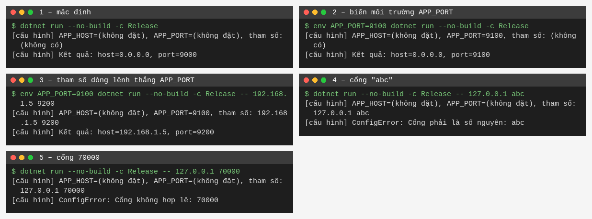

# Bài 2.1 – Đọc cấu hình địa chỉ và cổng (C#)

| Thông tin | Nội dung |
|---|---|
| Mã giả tương ứng | Mã giả 2.1 (PARSE_ENDPOINT – đọc địa chỉ và cổng từ tham số dòng lệnh, biến môi trường) |
| Mục giáo trình | 2.1.3 Tham số hóa địa chỉ và cổng |
| Kế thừa | Không (thủ tục gốc, được dùng lại ở mọi server và client từ Chương 3) |
| Thư viện | .NET 10 BCL: `System.Environment` |

## Mục tiêu
Minh họa thứ tự ưu tiên cấu hình: tham số dòng lệnh > biến môi trường `APP_HOST`, `APP_PORT` > giá trị mặc định (`0.0.0.0`, `9000`), cùng việc chuyển chuỗi sang số và kiểm tra phạm vi cổng 1–65535 với lỗi `ConfigError` rõ ràng.

## Tệp
- `Bai2.1_DocCauHinh.csproj` – dự án console .NET 10.
- `Endpoint.cs` – lớp `ConfigError` và `Endpoint.Parse` (Mã giả 2.1).
- `Program.cs` – in dữ liệu vào và cấu hình nhận được.
- `demo.json` – kịch bản chạy minh họa năm trường hợp (dùng với `tools/demo.py`).
- `ket_qua.txt`, `ket_qua.png` – kết quả thực thi thật.

## Cách chạy
```bash
# Linux/macOS
dotnet run                                           # mặc định
APP_PORT=9100 dotnet run                             # biến môi trường
APP_PORT=9100 dotnet run -- 192.168.1.5 9200
dotnet run -- 127.0.0.1 abc                          # cổng không phải số
dotnet run -- 127.0.0.1 70000                        # cổng ngoài phạm vi
```
```powershell
# Windows PowerShell
$env:APP_PORT = "9100"; dotnet run; Remove-Item Env:APP_PORT
```

## Kết quả thực thi


Năm tiến trình cho đúng kết quả nêu trong giáo trình: giá trị mặc định `0.0.0.0:9000`; cổng 9100 lấy từ `APP_PORT`; tham số `192.168.1.5 9200` thắng `APP_PORT=9100`; cổng `abc` và `70000` bị từ chối bằng `ConfigError` với thông báo cụ thể. Trong `demo.json`, biến môi trường được đặt riêng cho từng tiến trình bằng lệnh `env`.

## Ghi chú
- `TO_INT` được cài bằng `int.TryParse`: chấp nhận khoảng trắng hai đầu và dấu `+`; số vượt quá `int` (ví dụ `99999999999`) bị báo "Cổng phải là số nguyên" thay vì "Cổng không hợp lệ".
- Chương trình trả mã thoát 2 khi gặp `ConfigError`.
- Kiểm thử: Linux, .NET SDK 10.0.114.
