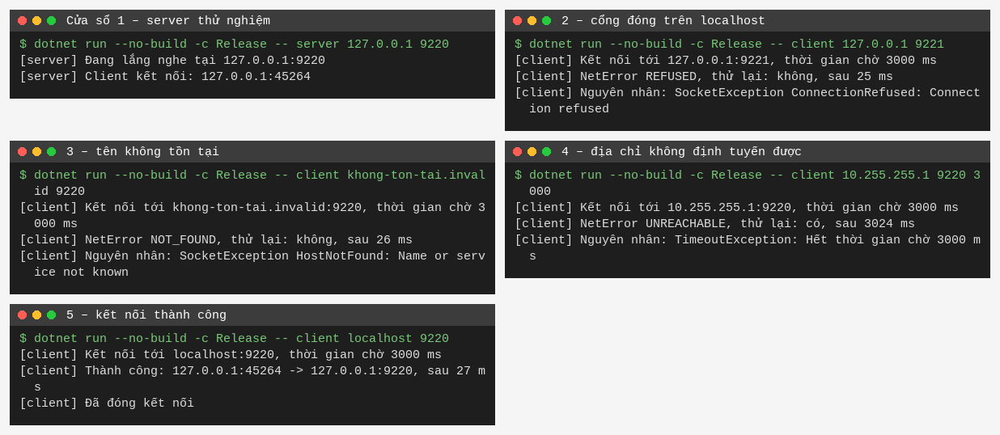

# Bài 2.2 – Kết nối có thời gian chờ và phân loại lỗi (C#)

| Thông tin | Nội dung |
|---|---|
| Mã giả tương ứng | Mã giả 2.2 (SAFE_CONNECT – kết nối có thời gian chờ và phân loại lỗi) |
| Mục giáo trình | 2.2.3 Khung xử lý lỗi dùng chung |
| Kế thừa | Mã giả 1.2 (PORT_CHECK), Mã giả 2.1 (PARSE_ENDPOINT, rút gọn) |
| Thư viện | .NET 10 BCL: `System.Net`, `System.Net.Sockets` |

## Mục tiêu
Cài đặt thủ tục kết nối thử lần lượt các địa chỉ của một tên, luôn đặt thời gian chờ, đóng socket khi thất bại và gom mọi lỗi về `NetError` với ba loại: `NOT_FOUND` (tên không tồn tại, không thử lại), `REFUSED` (mọi địa chỉ trả RST, không thử lại), `UNREACHABLE` (hết thời gian chờ hoặc không có đường đi, có thể thử lại).

## Tệp
- `Bai2.2_KetNoiAnToan.csproj` – dự án console .NET 10.
- `Program.cs` – phân nhánh vai trò `server` / `client`.
- `Endpoint.cs` – `ConfigError`, `Endpoint.Parse` (Mã giả 2.1, rút gọn).
- `SafeConnect.cs` – lớp `NetError` và `Net.SafeConnect` (Mã giả 2.2).
- `Client.cs` – client gọi `SafeConnect` và in kết quả hoặc loại lỗi.
- `TestServer.cs` – server thử nghiệm tối giản: chấp nhận kết nối rồi đóng ngay, chỉ để tạo trường hợp thành công.
- `demo.json` – kịch bản chạy minh họa (dùng với `tools/demo.py`).
- `ket_qua.txt`, `ket_qua.png` – kết quả thực thi thật.

## Cách chạy
```bash
# Cửa sổ 1 – server thử nghiệm
dotnet run -- server 127.0.0.1 9000
# Cửa sổ 2 – client: [host] [port] [timeout_ms]
dotnet run -- client localhost 9000              # thành công
dotnet run -- client 127.0.0.1 9001              # REFUSED
dotnet run -- client khong-ton-tai.invalid 9000  # NOT_FOUND
dotnet run -- client 10.255.255.1 9000 3000      # UNREACHABLE (hết thời gian chờ)
```
Dừng server bằng Ctrl+C.

## Kết quả thực thi


Cổng đóng trên máy cục bộ bị từ chối ngay (`SocketError.ConnectionRefused` → `REFUSED`); tên thuộc miền `.invalid` cho `SocketError.HostNotFound` (`NOT_FOUND`); địa chỉ `10.255.255.1` không phản hồi nên thủ tục dừng sau khoảng 3000 ms (`UNREACHABLE`, có thể thử lại); kết nối tới `localhost` thành công và server ghi nhận đúng cổng nguồn của client.

## Ghi chú
- Lớp `Socket` của .NET không có tùy chọn thời gian chờ cho `Connect`; `CONNECT_TIMEOUT` được cài bằng `ConnectAsync` kèm `CancellationTokenSource(timeoutMs)`. Khi hết giờ, .NET ném `OperationCanceledException`; mã chuyển thành `TimeoutException` để làm nguyên nhân của `UNREACHABLE`.
- Mọi `SocketException` của `Dns.GetHostAddresses` được coi là lỗi phân giải (`ResolveError`).
- `SocketException` với mã khác `ConnectionRefused`, `TimedOut`, `NetworkUnreachable`, `HostUnreachable` được chuyển lên nơi gọi sau khi khối `finally` đóng socket, đúng như mã giả.
- Thời gian (ms) in ra lớn hơn bản Python vài chục ms, chủ yếu do biên dịch JIT ở lần gọi mạng đầu tiên của tiến trình.
- Kiểm thử: Linux, .NET SDK 10.0.114.
