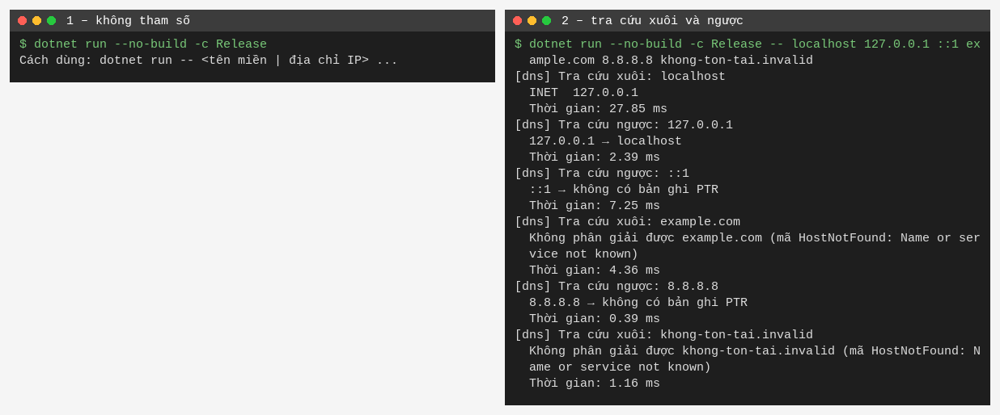

# Bài 2.3 – Client tra cứu DNS (C#)

| Thông tin | Nội dung |
|---|---|
| Mã giả tương ứng | Mã giả 2.3 (client tra cứu DNS dùng bộ phân giải của hệ điều hành) |
| Mục giáo trình | 2.5 Ví dụ: client tra cứu DNS |
| Kế thừa | Mã giả 1.1 (RESOLVE_HOST) |
| Thư viện | .NET 10 BCL: `System.Net.Dns`, `System.Net.IPAddress`, `System.Diagnostics.Stopwatch` |

## Mục tiêu
Nhận một hoặc nhiều tham số; với tên miền, in danh sách địa chỉ IPv4/IPv6 (`Dns.GetHostAddresses`); với địa chỉ IP, tra cứu ngược bản ghi PTR (`Dns.GetHostEntry(IPAddress)`); in thời gian tra cứu của từng tham số. Lỗi của một tham số không làm dừng các tham số còn lại.

## Tệp
- `Bai2.3_ClientDNS.csproj` – dự án console .NET 10.
- `Program.cs` – điểm vào, gọi `DnsClient.Run`.
- `DnsClient.cs` – `ResolveHost` (Mã giả 1.1) và chương trình chính (Mã giả 2.3).
- `demo.json` – kịch bản chạy minh họa (dùng với `tools/demo.py`).
- `ket_qua.txt`, `ket_qua.png` – kết quả thực thi thật.

## Cách chạy
```bash
dotnet run                                                   # in cách dùng
dotnet run -- localhost 127.0.0.1 www.ut.edu.vn 8.8.8.8 khong-ton-tai.invalid
```

## Kết quả thực thi


Không có tham số, chương trình in cách dùng. `localhost` phân giải thành `127.0.0.1` và `127.0.0.1` tra ngược ra `localhost`. Môi trường kiểm thử không truy cập được máy chủ DNS bên ngoài nên `example.com` không phân giải được và `8.8.8.8` không có bản ghi PTR; trên mạng thông thường, `8.8.8.8` cho tên `dns.google`. Tên `khong-ton-tai.invalid` cho mã `HostNotFound` và đi vào nhánh `ResolveError`.

## Ghi chú
- Chương trình in thêm dòng tiêu đề `[dns] Tra cứu xuôi/ngược: …` trước kết quả của mỗi tham số; mã giả không có dòng này.
- `IS_IP_ADDRESS` = `IPAddress.TryParse`; `REVERSE_RESOLVE` = `Dns.GetHostEntry(IPAddress).HostName`; `ResolveError` = `SocketException`, mã lỗi `e.code` = `SocketErrorCode`.
- Lần tra cứu đầu tiên chậm hơn rõ rệt, chủ yếu do biên dịch JIT và khởi tạo lớp `Dns` trong tiến trình, không phải do mạng.
- Kiểm thử: Linux, .NET SDK 10.0.114.
