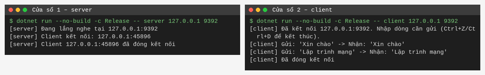

# Bài 3.1 – TCP Echo Server và Echo Client (C#)

| Thông tin | Nội dung |
|---|---|
| Mã giả tương ứng | Mã giả 3.1 (TCP Echo Server tuần tự), Mã giả 3.2 (TCP Echo Client) |
| Mục giáo trình | 3.2.2 Server tuần tự, 3.2.3 Client |
| Kế thừa | Mã giả 2.1 (đọc địa chỉ, cổng), Mã giả 2.2 (kết nối có thời gian chờ), Mã giả 3.3 (SEND_ALL) |
| Thư viện | .NET 10 BCL: `System.Net.Sockets.Socket`, `System.Net.Dns` |

## Mục tiêu
Minh họa vòng đời socket TCP bằng lớp `Socket`: server `Bind` – `Listen` – `Accept` – `Receive`/`Send` – đóng; client `ConnectAsync` (có thời gian chờ) – `Send` – `Receive` – `Shutdown` – đóng.

## Tệp
- `Bai3.1_EchoTCP.csproj` – dự án console `net10.0`.
- `Program.cs` – chọn vai trò theo tham số đầu tiên (`server` hoặc `client`).
- `EchoServer.cs` – server tuần tự, gửi trả nguyên văn dữ liệu nhận được.
- `EchoClient.cs` – client đọc từng dòng từ bàn phím, gửi và in phản hồi; chứa `SafeConnect` (Mã giả 2.2 rút gọn).
- `NetUtil.cs` – `Endpoint.Parse` (Mã giả 2.1) và `NetUtil.SendAll` (Mã giả 3.3).
- `demo.json` – kịch bản chạy minh họa (dùng với `tools/demo.py`).
- `ket_qua.txt`, `ket_qua.png` – kết quả thực thi thật.

## Cách chạy
Mở hai cửa sổ dòng lệnh trong thư mục bài (lệnh giống nhau trên Windows và Linux):
```bash
# Cửa sổ 1 – server
dotnet run -- server 0.0.0.0 9000
# Cửa sổ 2 – client
dotnet run -- client 127.0.0.1 9000
```
Nhập vài dòng ở cửa sổ client; nhấn Ctrl+D (Linux/macOS) hoặc Ctrl+Z rồi Enter (Windows) để kết thúc. Dừng server bằng Ctrl+C.

## Kết quả thực thi


Server in địa chỉ client khi kết nối và khi client đóng kết nối; client nhận lại đúng chuỗi đã gửi, kể cả chuỗi tiếng Việt có dấu (UTF-8). Khác bản Python, nhật ký server không có dòng "Dừng server" vì chương trình không bắt Ctrl+C: tiến trình kết thúc ngay và hệ điều hành giải phóng socket.

## Ghi chú
- Client gọi `Receive` một lần cho mỗi dòng: chấp nhận được với dòng ngắn, nhưng sai khi thông điệp lớn vì TCP là luồng byte không giữ ranh giới thông điệp (Mục 3.4). Bài 3.2 bổ sung định khung.
- `Endpoint.Parse` là bản rút gọn của Mã giả 2.1: chỉ đọc biến môi trường `APP_PORT`, chưa đọc `APP_HOST`. `SafeConnect` là bản rút gọn của Mã giả 2.2: thử lần lượt các địa chỉ với thời gian chờ 3 000 ms nhưng không phân loại lỗi `REFUSED`/`UNREACHABLE`. Các bài từ 3.2 dùng bản đầy đủ.
- `CONNECT_TIMEOUT` được cài đặt bằng `ConnectAsync` kèm `CancellationTokenSource(timeoutMs)`; `RECV_TIMEOUT` là thuộc tính `ReceiveTimeout` (ms).
- Khối `FINALLY CLOSE(conn)` của mã giả tương ứng với câu lệnh `using` trên socket `conn` trong mỗi vòng lặp.
- Server phân tích địa chỉ bằng `IPAddress.Parse`, vì vậy tham số host của server phải là địa chỉ IP (ví dụ `0.0.0.0`, `127.0.0.1`), không phải tên máy.
- Trên Windows, tùy chọn `ReuseAddress` cho phép socket khác cùng `Bind` vào cổng đang dùng (Mục 3.1.3); khi triển khai thật trên Windows nên bỏ dòng này hoặc dùng `ExclusiveAddressUse`.
- Kiểm thử: Linux, .NET SDK 10.0.114.
