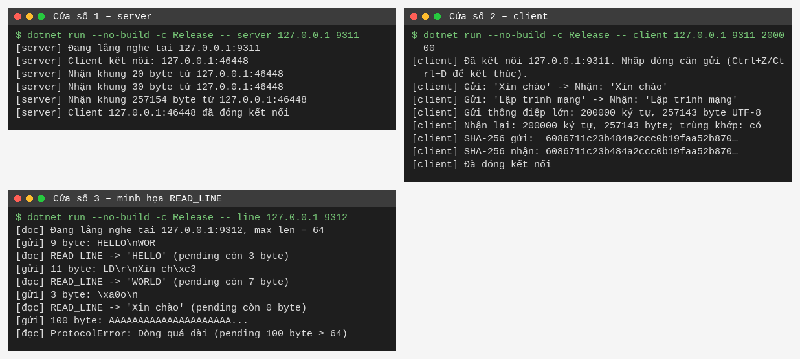

# Bài 3.2 – Thư viện định khung thông điệp (C#)

| Thông tin | Nội dung |
|---|---|
| Mã giả tương ứng | Mã giả 3.3 (SEND_ALL), Mã giả 3.4 (RECV_EXACT), Mã giả 3.5 (READ_LINE), Mã giả 3.6 (SEND_FRAME, RECV_FRAME, SEND_JSON, RECV_JSON) |
| Mục giáo trình | 3.2.4 Gửi và nhận dữ liệu, 3.4.1–3.4.4 Thiết kế giao thức trao đổi |
| Kế thừa | Mã giả 2.1, 2.2 (`NetUtil.cs`); khung sườn Mã giả 3.1 (server) và 3.2 (client) |
| Thư viện | .NET 10 BCL: `System.Net.Sockets`, `System.Buffers.Binary.BinaryPrimitives`, `System.Text.Json.Nodes`, `System.Security.Cryptography` |

## Mục tiêu
Xây dựng thư viện định khung dùng lại ở các bài sau: gửi hết dãy byte, nhận đúng n byte, đọc một dòng kết thúc bằng LF/CRLF, gửi và nhận khung `[4 byte độ dài big-endian][nội dung]` chứa JSON mã hóa UTF-8. Chương trình minh họa cho thấy một thông điệp 200 000 ký tự (257 143 byte UTF-8) được nhận đủ và trùng khớp, trường hợp mà client của Bài 3.1 (một lần `Receive` 4 096 byte) không xử lý được.

## Tệp
- `Bai3.2_DinhKhung.csproj` – dự án console `net10.0`.
- `Program.cs` – chọn vai trò theo tham số đầu tiên: `server`, `client`, `line`.
- `Framing.cs` – thư viện: `SendAll`, `RecvExact`, `Reader`/`ReadLine`, `SendFrame`, `RecvFrame`, `SendJson`, `RecvJson`; các lỗi `ConnectionClosed`, `ProtocolError`, `JsonError`; hằng `MaxFrame` = 1 MiB.
- `NetUtil.cs` – `ParseEndpoint` (Mã giả 2.1), `SafeConnect` (Mã giả 2.2) và lỗi đã phân loại `NetError`.
- `FrameServer.cs` – echo server dùng khung JSON: `{"text": …}` → `{"status": 200, "text": …}`; JSON sai hoặc thiếu trường `text` → `status` 400.
- `FrameClient.cs` – gửi từng dòng nhập từ bàn phím; tham số thứ ba (tùy chọn) là số ký tự của một thông điệp lớn gửi sau cùng, so sánh nội dung và mã băm SHA-256 hai chiều.
- `LineDemo.cs` – minh họa `READ_LINE`: tự mở một kết nối loopback, gửi các mảnh cắt ngang dòng (kể cả cắt giữa hai byte UTF-8 của chữ "à") và một dòng 100 byte vượt `max_len` = 64.
- `demo.json`, `ket_qua.txt`, `ket_qua.png` – kịch bản và kết quả thực thi thật.

## Cách chạy
Mở các cửa sổ dòng lệnh trong thư mục bài (lệnh giống nhau trên Windows và Linux):
```bash
# Cửa sổ 1 – server
dotnet run -- server 0.0.0.0 9000
# Cửa sổ 2 – client: gửi các dòng nhập, sau đó một thông điệp 200 000 ký tự
dotnet run -- client 127.0.0.1 9000 200000
# Cửa sổ 3 – minh họa READ_LINE (một chương trình, tự kết nối tới chính nó)
dotnet run -- line 127.0.0.1 9001
```
Kết thúc nhập ở client bằng Ctrl+D (Linux/macOS) hoặc Ctrl+Z rồi Enter (Windows); dừng server bằng Ctrl+C.

## Kết quả thực thi


Server nhận khung 257 154 byte; client nhận lại đủ 200 000 ký tự và mã băm hai chiều trùng nhau. Ở cửa sổ 3, `ReadLine` lần lượt trả về "HELLO", "WORLD" (đã bỏ CR), "Xin chào" (ghép đúng hai nửa của chữ "à") và giữ phần dư trong `Pending`; dòng 100 byte không có LF gây lỗi `ProtocolError: Dòng quá dài`. Kết quả trùng với bản Python và Java.

## Ghi chú
- Mặc định `System.Text.Json` thoát mọi ký tự ngoài ASCII thành `\uXXXX`; bài dùng `JavaScriptEncoder.UnsafeRelaxedJsonEscaping` để giữ nguyên chữ tiếng Việt, nhờ đó độ dài khung giống nhau giữa ba ngôn ngữ.
- Giải mã UTF-8 dùng `new UTF8Encoding(false, true)` để báo lỗi khi gặp byte sai (mặc định `Encoding.UTF8` thay byte sai bằng ký tự U+FFFD và không báo lỗi); lỗi này và `JsonException` được gộp thành `JsonError`.
- `RecvExact` tự viết vòng lặp trên `Socket.Receive`; `NetworkStream.ReadExactly` có tác dụng tương tự nhưng không cho biết số byte đã nhận khi kết nối đóng giữa chừng, thông tin cần cho `ConnectionClosed(received)`.
- `UINT32_BE`/`FROM_UINT32_BE` tương ứng `BinaryPrimitives.WriteUInt32BigEndian`/`ReadUInt32BigEndian` (số không dấu, nên độ dài 0xFFFFFFFF được so sánh đúng với `MaxFrame`).
- `FrameServer` gọi `RecvFrame` rồi `JsonDecode` (tách hai bước của `RECV_JSON`) chỉ để ghi kích thước khung vào nhật ký.
- Theo đúng mã giả, `ReadLine` bỏ qua phần dư không có LF khi đối tác đóng kết nối. Giới hạn `maxLen` được kiểm tra cả khi đã tìm thấy LF (dòng 5 của Mã giả 3.5), nên một dòng dài hơn `maxLen` luôn bị từ chối.
- Server phân tích địa chỉ bằng `IPAddress.Parse`, nên tham số host của server phải là địa chỉ IP. Nhật ký server không có dòng "Dừng server" vì chương trình không bắt Ctrl+C.
- Kiểm thử: Linux, .NET SDK 10.0.114.
