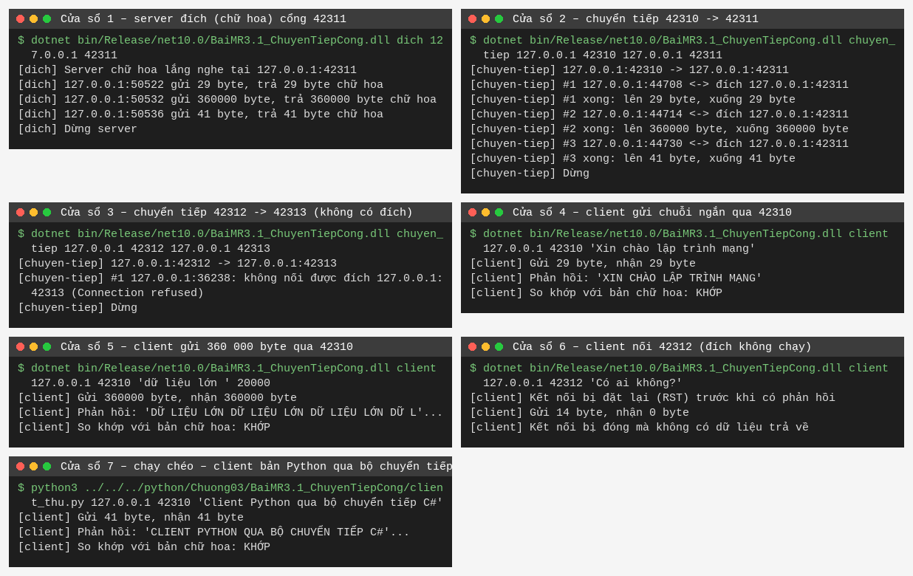

# Bài mở rộng MR3.1 – Bộ chuyển tiếp cổng TCP (TCP port forwarder) (C#)

| Thông tin | Nội dung |
|---|---|
| Loại | **Bài mở rộng** – không có trong giáo trình, không có mã giả tương ứng |
| Liên hệ với giáo trình | Chương 3: Bài 3.1 (vòng đời socket, `SHUTDOWN` một chiều), Bài 3.2 (`SEND_ALL`); Chương 6: Bài 6.1 (mỗi kết nối một luồng) |
| Thư viện | .NET 10 BCL: `System.Net.Sockets` (`TcpListener`, `Socket`), `System.Threading.Thread` |
| Bản ngôn ngữ khác | [Python](../../../python/Chuong03/BaiMR3.1_ChuyenTiepCong/), [Go](../../../go/Chuong03/BaiMR3.1_ChuyenTiepCong/), [Java](../../../java/Chuong03/BaiMR3.1_ChuyenTiepCong/), [Rust](../../../rust/Chuong03/BaiMR3.1_ChuyenTiepCong/) |

## Mục tiêu
Viết một bộ chuyển tiếp: mỗi client nối vào cổng nghe được ghép với một kết nối mới tới máy đích, hai luồng (goroutine) bơm dữ liệu theo hai chiều. Điểm mấu chốt là **đóng một chiều (half-close)**: khi một chiều gặp EOF, bộ chuyển tiếp gọi `SHUTDOWN(WRITE)` trên socket bên kia để chuyển tiếp gói FIN, chứ không đóng hẳn, vì chiều ngược lại có thể vẫn đang truyền. Server đích trong bài chỉ trả lời **sau khi** thấy EOF, nên nếu bộ chuyển tiếp làm sai, client và server sẽ chờ nhau mãi. Đây là nguyên lý của `ssh -L`, `socat`, proxy TCP và cân bằng tải lớp 4.

## Tệp
- `BaiMR3.1_ChuyenTiepCong.csproj` – dự án console `net10.0`; vai trò chọn bằng tham số đầu tiên.
- `Program.cs` – chọn vai trò `dich`, `chuyen_tiep`, `client`.
- `ChuyenTiep.cs` – bộ chuyển tiếp: `Serve` (một kết nối), `Pump` (một chiều, kết thúc bằng `Shutdown(SocketShutdown.Send)`).
- `ServerDich.cs` – server đích “chữ hoa”: đọc tới EOF rồi trả bản viết hoa.
- `ClientThu.cs` – client thử: gửi, `Shutdown(Send)`, đọc tới EOF, so khớp.
- `demo.json` – kịch bản chạy minh họa (dùng với `tools/demo.py`); bước cuối chạy chéo client bản Python qua bộ chuyển tiếp C#.
- `ket_qua.txt`, `ket_qua.png` – kết quả thực thi thật.

## Cách chạy
Trong thư mục bài (lệnh giống nhau trên Windows và Linux):
```bash
dotnet build -c Release
# Cửa sổ 1 – server đích
dotnet bin/Release/net10.0/BaiMR3.1_ChuyenTiepCong.dll dich 127.0.0.1 9001
# Cửa sổ 2 – bộ chuyển tiếp 9000 -> 9001
dotnet bin/Release/net10.0/BaiMR3.1_ChuyenTiepCong.dll chuyen_tiep 127.0.0.1 9000 127.0.0.1 9001
# Cửa sổ 3 – client nối vào cổng chuyển tiếp
dotnet bin/Release/net10.0/BaiMR3.1_ChuyenTiepCong.dll client 127.0.0.1 9000 "Xin chào"
dotnet bin/Release/net10.0/BaiMR3.1_ChuyenTiepCong.dll client 127.0.0.1 9000 "dữ liệu lớn " 20000
```
Có thể thay `dotnet bin/Release/net10.0/BaiMR3.1_ChuyenTiepCong.dll` bằng `dotnet run --`. Dừng server đích và bộ chuyển tiếp bằng Ctrl+C. Kịch bản `demo.json` dùng cổng 42310–42313 và chạy thêm một bộ chuyển tiếp trỏ tới cổng không có server.

Tái lập kết quả từ thư mục gốc của kho: `python3 tools/demo.py csharp/Chuong03/BaiMR3.1_ChuyenTiepCong`.

## Kết quả thực thi


Hai client C# đi qua bộ chuyển tiếp nhận đúng bản chữ hoa, kể cả 360 000 byte (20 000 lần chuỗi 18 byte UTF-8); số byte lên bằng số byte xuống. Server đích chỉ thấy địa chỉ của bộ chuyển tiếp (127.0.0.1 với một cổng tạm), không thấy client gốc – vì vậy proxy thật thường thêm thông tin nguồn (ví dụ giao thức PROXY, tiêu đề `X-Forwarded-For`). Với bộ chuyển tiếp trỏ tới cổng không có server, kết nối tới đích bị từ chối nên bộ chuyển tiếp đóng kết nối của client; client nhận 0 byte. Cửa sổ 7 chạy chéo: client bản Python đi qua bộ chuyển tiếp C# tới server đích C# và nhận đúng bản chữ hoa (giao thức chỉ là luồng byte nên mọi bản ngôn ngữ dùng lẫn được).

## Ghi chú
- Khi một bên đóng socket trong lúc bộ đệm nhận vẫn còn dữ liệu chưa đọc, TCP gửi RST thay vì FIN. Ở tình huống đích không chạy, kết quả phụ thuộc thời điểm: nếu dữ liệu của client tới trước lúc đóng, client thấy *Connection reset* (RST); nếu không, client thấy EOF bình thường.
- Bộ chuyển tiếp không có xác thực hay giới hạn: chỉ nghe trên `127.0.0.1` và chỉ dùng trong máy, mạng phòng thí nghiệm.
- Mỗi kết nối dùng hai luồng `Pump`; luồng phục vụ `Join` cả hai rồi mới đóng hai socket. Luồng chấp nhận kết nối chạy luồng phục vụ dạng `IsBackground = true` để không giữ tiến trình khi dừng.
- Ctrl+C (SIGINT) được bắt bằng `Console.CancelKeyPress`: đặt `e.Cancel = true` rồi `TcpListener.Stop()` để `AcceptSocket` ném ngoại lệ, vòng chấp nhận thoát và in `Dừng` như bản Python.
- Thông điệp lỗi kết nối in dạng ngắn (`Connection refused`) theo `SocketErrorCode` để giống `strerror` của bản Python; `e.Message` của .NET khác nhau theo hệ điều hành.
- Client in `...` khi phản hồi dài hơn 40 **byte** (giống bản Python), nên chuỗi 35 ký tự nhưng 41 byte UTF-8 vẫn có `...` dù đã in đủ.
- Kiểm thử: Linux, .NET SDK 10.0.114.

## Đọc thêm
- M. O. Faruque Sarker, *Python Network Programming Cookbook*, Packt, 2014, Chương 3 (công thức *Forwarding a local port to a remote host*; sách dùng mô-đun `asyncore` đã bị loại khỏi Python 3.12, bài này viết lại bằng socket và luồng).

Mã nguồn của bài được viết mới cho kho này; sách trên chỉ là tài liệu tham khảo ý tưởng.
