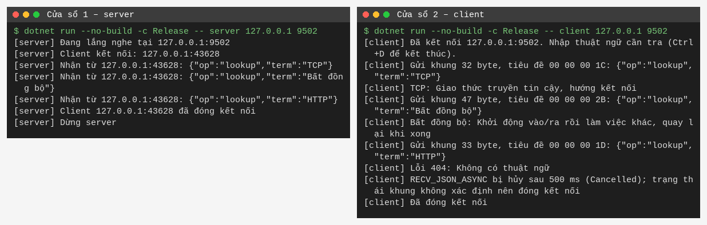

# Bài 5.1 – Các hàm gửi, nhận khung JSON bất đồng bộ (C#)

| Thông tin | Nội dung |
|---|---|
| Mã giả tương ứng | Mã giả 5.1 (Các hàm gửi, nhận khung JSON bất đồng bộ) |
| Mục giáo trình | 5.2.4 Các hàm socket bất đồng bộ; 5.4.1 Hủy tác vụ hợp tác |
| Kế thừa | Mã giả 3.3 (SEND_ALL), 3.4 (RECV_EXACT), 3.6 (khung JSON), 3.7 (PROCESS_REQUEST), 3.8 (LOOKUP_CLIENT), 2.1 (PARSE_ENDPOINT), 2.2 (SAFE_CONNECT) |
| Thư viện | BCL: `System.Net.Sockets` (`Socket`, `NetworkStream`), `System.Text.Json.Nodes`, `System.Buffers.Binary` |

## Mục tiêu
Chuyển các hàm định khung của Mục 3.4 sang bất đồng bộ theo đúng quy tắc của Mục 5.2.4: mỗi lời gọi vào/ra được thay bằng phiên bản bất đồng bộ, logic giữ nguyên. Server tra cứu dùng các hàm này phục vụ mỗi kết nối bằng một tác vụ riêng; client in 4 byte tiêu đề của từng khung để đối chiếu với giải thích bước (6) và minh họa việc hủy một lời gọi nhận đang chờ bằng tín hiệu hủy (Mục 5.4.1).

## Tệp
- `KhungJson.cs` – `Khung.RecvExactAsync`, `RecvJsonAsync`, `SendJsonAsync`, `Net.ParseEndpoint`, `Net.SafeConnectAsync`, các lớp lỗi.
- `FrameServer.cs` – server tra cứu bất đồng bộ (mỗi kết nối một `Task`).
- `FrameClient.cs` – client tra cứu, in tiêu đề khung và minh họa hủy.
- `Program.cs`, `Bai5.1_KhungBatDongBo.csproj` – điểm vào, phân nhánh `server`/`client`.
- `demo.json` – kịch bản chạy minh họa (dùng với `tools/demo.py`).
- `ket_qua.txt`, `ket_qua.png` – kết quả thực thi thật.

## Cách chạy
Trong thư mục bài:
```bash
dotnet build -c Release
```
```bash
# Cửa sổ 1 – server
dotnet run -- server 0.0.0.0 9100
# Cửa sổ 2 – client
dotnet run -- client 127.0.0.1 9100
```
Nhập từng thuật ngữ, kết thúc bằng Ctrl+Z rồi Enter (Windows) hoặc Ctrl+D (Linux/macOS). Dừng server bằng Ctrl+C.

## Kết quả thực thi


Ba khung có độ dài nội dung 28, 43 và 29 byte (tiêu đề `00 00 00 1C`, `00 00 00 2B`, `00 00 00 1D`): chuỗi "Bất đồng bộ" có 11 ký tự nhưng chiếm nhiều byte hơn trong UTF-8, nên độ dài khung luôn tính bằng byte. Thuật ngữ không có trong từ điển nhận mã 404. Lời gọi nhận cuối bị hủy sau 500 ms; client đóng kết nối thay vì dùng tiếp, và server nhận biết client đóng đúng ranh giới khung (`received = 0`) nên kết thúc phiên bình thường.

## Ghi chú
- `NetworkStream.ReadExactlyAsync` làm sẵn việc của `RECV_EXACT_ASYNC`; bài viết vòng `ReadAsync` tường minh để đối chiếu với mã giả. `WriteAsync` của `NetworkStream` gửi hết dữ liệu nên đóng vai `SEND_ALL_ASYNC`.
- Tín hiệu hủy `ct` là `CancellationToken`; `new CancellationTokenSource(500)` tự hủy sau 500 ms (`CANCEL_AFTER`). Hủy làm lời gọi kết thúc bằng `OperationCanceledException` (tương ứng `Cancelled`).
- JSON được ghi bằng `JavaScriptEncoder.UnsafeRelaxedJsonEscaping` để giữ nguyên chữ có dấu trong UTF-8, nên độ dài khung giống bản Python, Java.
- Server không có trong mã giả 5.1; server dùng lại nghiệp vụ của Mã giả 3.7 với từ điển nhỏ viết sẵn trong mã. `_ = HandleLookupAsync(conn)` là `RUN_BACKGROUND`. Thông báo "Dừng server" được in trong sự kiện `Console.CancelKeyPress`.
- Kiểm thử: Linux, .NET SDK 10.0.114.
