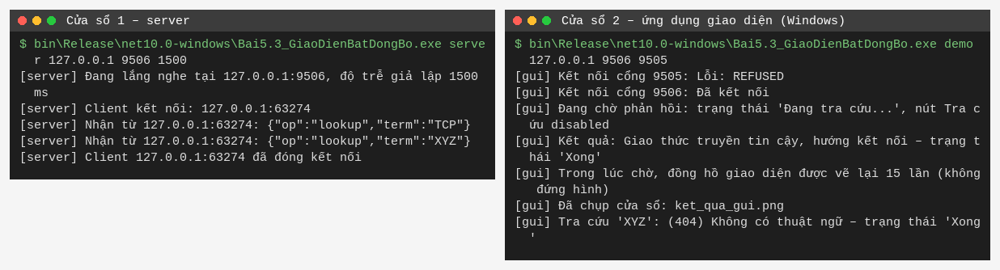
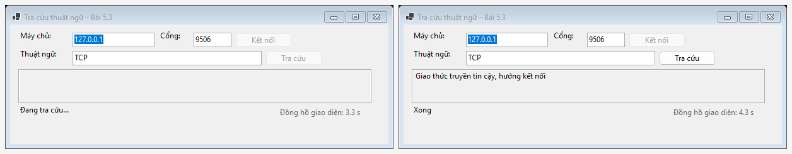

# Bài 5.3 – Ứng dụng tra cứu có giao diện bất đồng bộ (C#)

| Thông tin | Nội dung |
|---|---|
| Mã giả tương ứng | Mã giả 5.3 (Cách (1): luồng nền và UI_INVOKE), Mã giả 5.4 (Cách (2): trình xử lý sự kiện bất đồng bộ) |
| Mục giáo trình | 5.3.1 Mô hình luồng giao diện đơn, 5.3.2 Ba cách tiếp cận, 5.3.5 Tranh chấp và quản lý trạng thái |
| Kế thừa | Mã giả 2.2 (SAFE_CONNECT), 3.7 (server tra cứu), 3.8 (một lượt tra cứu), 5.1 (khung JSON bất đồng bộ) |
| Thư viện | BCL và Windows Forms (`net10.0-windows`, `UseWindowsForms`): `System.Windows.Forms`, `System.Net.Sockets`, `System.Text.Json.Nodes` |

## Mục tiêu
Kết hợp socket với giao diện đồ họa theo hai cách tiếp cận của Mục 5.3.2. Nút Kết nối dùng cách (1): luồng nền gọi `SAFE_CONNECT` chặn rồi chuyển kết quả về luồng giao diện bằng `UI_INVOKE` (Mã giả 5.3). Nút Tra cứu dùng cách (2): trình xử lý sự kiện bất đồng bộ gửi yêu cầu và chờ phản hồi mà không chặn luồng giao diện (Mã giả 5.4). Một đồng hồ trên cửa sổ cập nhật mỗi 100 ms để kiểm chứng giao diện không đứng hình khi server trả lời chậm.

## Tệp
- `LookupForm.cs` – cửa sổ WinForms: `OnConnectClick`, `ConnectWorker` (cách 1, `Control.BeginInvoke`), `OnLookupClick` (cách 2, `async void`), `SafeConnect` bản chặn.
- `KhungJson.cs` – khung JSON bất đồng bộ (Mã giả 5.1), `ParseEndpoint`, `SafeConnectAsync`.
- `LookupServer.cs` – server tra cứu tối giản có độ trễ giả lập.
- `Program.cs`, `Bai5.3_GiaoDienBatDongBo.csproj` – điểm vào `[STAThread]`, phân nhánh `server`/`gui`/`demo`.
- `DemoGui.cs` – kịch bản minh họa tự động (vai trò `demo`): thao tác trên cửa sổ thật như người dùng, chụp cửa sổ bằng `Control.DrawToBitmap`, ghi `ket_qua_gui.png`; cùng kịch bản với `DemoGui.java`, `demo_gui.py`.

## Cách chạy
Trên Windows (cần .NET 10 SDK), trong thư mục bài:
```powershell
dotnet build -c Release
# Cửa sổ 1 – server, trả lời chậm 1500 ms
dotnet run -- server 0.0.0.0 9100 1500
# Cửa sổ 2 – ứng dụng giao diện
dotnet run -- gui 127.0.0.1 9100
```
Bấm Kết nối, nhập thuật ngữ (ví dụ `TCP`) rồi bấm Tra cứu; trong lúc chờ, kéo cửa sổ hoặc quan sát đồng hồ để kiểm chứng giao diện không đứng hình.

Chạy kịch bản tự động và chụp ảnh (từ thư mục gốc kho mã):
```powershell
powershell -NoProfile -ExecutionPolicy Bypass -File tools\demo_windows.ps1
```
Script biên dịch bài, chạy server ở cổng 9506 với độ trễ 1500 ms, chạy `demo 127.0.0.1 9506 9505` (cổng 9505 không có server để minh họa lỗi REFUSED), ghi nhật ký `.log_*.txt` và ảnh `ket_qua_gui.png`.

## Kết quả thực thi
Đã chạy trên Windows 11 x64 với .NET SDK 10.0.403 (tháng 11/2026) bằng `tools/demo_windows.ps1`. Nhật ký hai cửa sổ:



Ảnh cửa sổ giao diện chụp trong lúc chờ server trả lời chậm (trái: trạng thái "Đang tra cứu...", nút Tra cứu bị khóa, đồng hồ vẫn chạy) và sau khi có kết quả (phải):



Trong 1,5 giây chờ phản hồi, đồng hồ giao diện được vẽ lại 15 lần: luồng giao diện không bị chặn.

## Ghi chú
- Cách (2) là cách được khuyến nghị trên .NET: sau `await`, `SynchronizationContext` của WinForms đưa phần tiếp theo về luồng giao diện, nên mã gán trực tiếp `txtResult.Text` mà không cần `UI_INVOKE` (Mục 5.3.2). Trình xử lý dùng `async void` vì đây là chữ ký của sự kiện; mọi ngoại lệ được bắt bên trong (Mục 5.4.5).
- `UI_INVOKE` dùng dạng không đồng bộ `BeginInvoke`; dạng đồng bộ `Invoke` bắt luồng nền chờ luồng giao diện xử lý xong.
- Trong mã giả 5.4, `conn` được mở khi nạp cửa sổ; bài mở kết nối bằng nút Kết nối (cách 1): `CONNECT_WORKER` kết nối trên luồng nền rồi dùng `UI_INVOKE(SET_FIELD, conn, c)` để lưu socket vào trường của cửa sổ trên luồng giao diện trước khi báo "Đã kết nối" (dòng 7–9 của Mã giả 5.3). Theo dòng 8–12 của Mã giả 5.4, phản hồi khác 200 (ví dụ 404 khi thuật ngữ không có trong từ điển) được hiển thị dạng "(mã) lý do", ví dụ `(404) Không có thuật ngữ`.
- Đóng cửa sổ (`FormClosing`) hủy `CancellationTokenSource` của cửa sổ và đóng kết nối (Mục 5.3.5).
- Kiểm thử: đã chạy trên Windows 11 (.NET SDK 10.0.403). Server không in "Dừng server" vì script dừng tiến trình bằng `Stop-Process` thay cho Ctrl+C.
