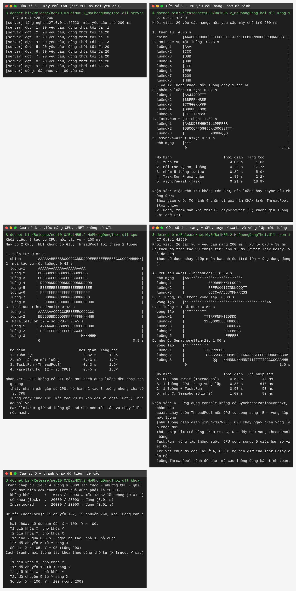

# Bài mở rộng MR5.2 – So sánh các mô hình đồng thời: tuần tự, Thread, nhóm luồng, ThreadPool/Task, Parallel, async/await (C#)

| Thông tin | Nội dung |
|---|---|
| Loại | **Bài mở rộng** – không có trong giáo trình, không có mã giả tương ứng |
| Liên hệ với giáo trình | Chương 5: Bài 5.1 (khung bất đồng bộ), Bài 5.2 (kiểm tra nhiều cổng đồng thời có giới hạn); Chương 6: Bài 6.1 (server đa luồng, nhóm luồng), Bài 6.2 (server bất đồng bộ) |
| Thư viện | .NET 10 BCL: `System.Threading.Thread`, `ThreadPool`, `Task.Run`, `Parallel.For`, `async`/`await`, `SynchronizationContext`, `SemaphoreSlim`, `Interlocked`, `Monitor` |
| Bản ngôn ngữ khác | [Python](../../../python/Chuong05/BaiMR5.2_MoPhongDongThoi/), [Go](../../../go/Chuong05/BaiMR5.2_MoPhongDongThoi/), [Java](../../../java/Chuong05/BaiMR5.2_MoPhongDongThoi/), [Rust](../../../rust/Chuong05/BaiMR5.2_MoPhongDongThoi/) |

## Mục tiêu
Cùng một khối việc, chạy bằng nhiều mô hình đồng thời của .NET, đo thời gian thật và **vẽ biểu đồ Gantt bằng văn bản** cho thấy tác vụ nào chạy trên luồng nào, vào lúc nào. Khối việc giống hệt bản Python, Go:

| Lệnh | Khối việc | Mô hình so sánh |
|---|---|---|
| `mang` | 20 yêu cầu TCP tới máy chủ thử, mỗi yêu cầu trễ 200 ms (chờ I/O) | 1. tuần tự; 2. mỗi tác vụ một `Thread`; 3. nhóm 5 luồng tự tạo; 4. `Task.Run` + gọi **chặn** trên ThreadPool; 5. `async`/`await` |
| `cpu` | 8 tác vụ tính toán, mỗi tác vụ ≈ 100 ms | 1. tuần tự; 2. mỗi tác vụ một `Thread`; 3. `Task.Run` (ThreadPool); 4. `Parallel.For` (số CPU) |
| `tron` | 20 tác vụ = yêu cầu mạng 200 ms + xử lý CPU ≈ 30 ms | A. CPU ngay sau `await` (không có `SynchronizationContext`); B. vòng lặp một luồng, CPU chạy trên vòng lặp; C. vòng lặp một luồng + `Task.Run`; D. như C, giới hạn 2 bằng `SemaphoreSlim` – đo thêm **độ trễ nhịp tim** |
| `khoa` | biến đếm chung, chuyển tiền giữa hai tài khoản | tranh chấp dữ liệu và sửa bằng `lock`, `Interlocked`; bế tắc và cách tránh bằng thứ tự lấy khóa |

## Kiến thức chính
- **Việc chờ I/O và việc nặng CPU khác nhau:** khi chờ mạng, CPU rảnh nên luồng hay `async` đều chồng được thời gian chờ (20 × 200 ms ≈ 4 s → ≈ 0,2 s). Nhóm 5 luồng chạy thành 4 đợt (≈ 0,8 s) – giới hạn đồng thời có chủ ý, như Bài 5.2.
- **Không có GIL:** khác CPython, mọi luồng .NET (`Thread`, ThreadPool, `Task`, `Parallel`) chạy song song thật trên mọi CPU; việc CPU nhanh gần gấp số CPU mà không cần nhóm tiến trình. Kết quả gần với bản Go hơn bản Python.
- **ThreadPool không dành cho việc chặn:** ThreadPool chỉ có sẵn số luồng tối thiểu (bằng số CPU) và *thêm dần* luồng khi thiếu (thuật toán leo đồi + phát hiện “đói luồng”). 20 việc gọi `Socket.Receive` chặn qua `Task.Run` vì vậy phải xếp hàng: mô hình 4 mất ≈ 1,8 s và cửa sổ máy chủ chỉ thấy 3–4 kết nối đồng thời. Việc chờ mạng nên viết bằng `async`/`await` (mô hình 5): lúc chờ không giữ luồng nào, hàng “chờ mạng” có ký hiệu `*`.
- **`SynchronizationContext` quyết định phần sau `await` chạy ở đâu:** ứng dụng console không có ngữ cảnh nên phần sau `await` chạy trên một luồng ThreadPool bất kỳ (A – CPU tự song song). Ứng dụng giao diện (WinForms, WPF) có ngữ cảnh **một luồng**, giống vòng lặp sự kiện của `asyncio`: bài tự cài lớp `VongLap` để mô phỏng. Làm việc CPU ngay trên luồng đó (B) làm vòng lặp “đứng” – nhịp tim trễ hàng trăm ms, giống mô hình A của bản Python và lỗi “giao diện treo” ở MR5.3. Đẩy việc CPU sang `Task.Run` (C, D) giữ vòng lặp thông suốt.
- **Tranh chấp dữ liệu:** “đọc – nhường CPU – ghi” lên biến chung không được bảo vệ làm mất cập nhật; sửa bằng `lock` (đoạn găng) hoặc `Interlocked.Increment` (một lệnh nguyên tử của CPU).
- **Bế tắc:** hai luồng giữ khóa theo thứ tự ngược nhau thì chờ nhau mãi; cách tránh đơn giản nhất là mọi luồng lấy khóa theo **cùng một thứ tự**; chờ có hạn (`Monitor.TryEnter(khóa, 500)`) giúp phát hiện thay vì treo.

## Cấu trúc tệp
- `BaiMR5.2_MoPhongDongThoi.csproj` – dự án console `net10.0`; vai trò `server`, `mang`, `cpu`, `tron`, `khoa`.
- `Program.cs` – chọn vai trò.
- `DongThoi.cs` – ba khối việc `mang`, `cpu`, `tron` và các mô hình; việc mạng chặn/bất đồng bộ, việc CPU (bộ sinh đồng dư tuyến tính, hiệu chỉnh số vòng lặp theo máy).
- `DongHo.cs` – ghi khoảng thời gian (`Stopwatch`), đặt tên luồng (`Names`), vẽ biểu đồ Gantt, bảng so sánh.
- `VongLap.cs` – `SynchronizationContext` một luồng (vòng lặp sự kiện) dùng cho mô hình B, C, D.
- `Khoa.cs` – tranh chấp dữ liệu, `lock`, `Interlocked`; bế tắc và thứ tự lấy khóa.
- `MayChuTre.cs` – máy chủ thử `async`/`await` trả lời sau một độ trễ giả lập; báo số yêu cầu và số kết nối đồng thời lớn nhất của mỗi “đợt”.
- `demo.json` – kịch bản chạy minh họa (dùng với `tools/demo.py`).
- `ket_qua.txt`, `ket_qua.png` – kết quả thực thi thật.

## Cách chạy
Trong thư mục bài (lệnh giống nhau trên Windows và Linux):
```bash
dotnet build -c Release
dotnet bin/Release/net10.0/BaiMR5.2_MoPhongDongThoi.dll server 127.0.0.1 9000 200   # cửa sổ 1: máy chủ thử
dotnet bin/Release/net10.0/BaiMR5.2_MoPhongDongThoi.dll mang 127.0.0.1 9000         # cửa sổ 2
dotnet bin/Release/net10.0/BaiMR5.2_MoPhongDongThoi.dll cpu
dotnet bin/Release/net10.0/BaiMR5.2_MoPhongDongThoi.dll tron 127.0.0.1 9000
dotnet bin/Release/net10.0/BaiMR5.2_MoPhongDongThoi.dll khoa
```
Máy chủ thử giữ nguyên giao thức `GET k` / `OK k` nên dùng lẫn được với bản Python, Go. Tái lập kết quả từ thư mục gốc của kho: `python3 tools/demo.py csharp/Chuong05/BaiMR5.2_MoPhongDongThoi` (cổng 42520).

## Kết quả thực thi


Cách đọc biểu đồ: mỗi hàng là một worker; mỗi cột là 1/48 trục thời gian chung của cả khối việc (ghi ở cuối, ví dụ `4.1 s`); chữ cái là tác vụ đang chạy (A = tác vụ 1), `*` là nhiều tác vụ cùng lúc trên một worker. Lần chạy trong ảnh (Linux, 2 CPU, ThreadPool tối thiểu 2 luồng):
- **mang:** tuần tự 4,06 s; mỗi tác vụ một luồng 0,23 s; nhóm 5 luồng 0,82 s (4 đợt: hàng `luồng-1` lần lượt chạy A, J, O, T); `Task.Run` + gọi chặn 1,82 s – biểu đồ chỉ có 3 luồng, luồng thứ ba được ThreadPool thêm vào sau ≈ 1 s; `async`/`await` 0,21 s. Cửa sổ máy chủ xác nhận số kết nối đồng thời lớn nhất của mỗi đợt: 1, 20, 5, 3, 20.
- **cpu:** tuần tự 0,82 s; 8 `Thread` 0,43 s (mỗi tác vụ bị kéo dài vì 8 luồng chia lượt trên 2 CPU); `Task.Run` 0,43 s và `Parallel.For` 0,45 s – chỉ 2 luồng, mỗi tác vụ chạy liền một mạch. Cả ba nhanh ≈ 1,9 lần (bản Python: nhóm luồng *chậm hơn* tuần tự vì GIL).
- **tron:** A 0,59 s, nhịp tim trễ 44 ms; B 0,83 s, trễ **613 ms** (vòng lặp bị chặn); C 0,53 s, trễ 50 ms; D 1,00 s, trễ 90 ms (lần chạy khác D ≈ 0,66 s; số đo dao động khi máy đang bận). Phần trễ vài chục ms ở A, C, D là vì bộ hẹn giờ của `Task.Delay` cần một luồng ThreadPool rảnh để báo, mà các luồng đang bận tính toán.
- **khoa:** không khóa còn 6718/20000 (mất 2/3 số lần cộng – trên 2 CPU các luồng chạy song song thật nên lỗi lộ ra ngay); `lock` và `Interlocked` đều đúng 20000. Phần bế tắc in giống hệt bản Python và Go.

Thời gian đo thay đổi giữa các lần chạy và giữa các máy; quan hệ giữa các mô hình thì ổn định.

## Ghi chú
- Việc CPU là vòng lặp LCG trên `long`; kết quả được ghi vào biến `volatile` để trình biên dịch JIT không bỏ vòng lặp. Số vòng lặp được hiệu chỉnh lúc chạy (lấy lần đo nhanh nhất trong 5 lần, vì các lần đầu JIT còn ở mức tối ưu thấp – *tiered compilation*).
- Mô hình 4 của khối `mang` cố ý minh họa lỗi “đói ThreadPool” (thread-pool starvation) hay gặp ở ứng dụng ASP.NET khi gọi `.Result`/`.Wait()` hoặc hàm chặn trong `Task.Run`. Có thể nâng ngưỡng bằng `ThreadPool.SetMinThreads`, nhưng cách đúng là viết bất đồng bộ.
- Lớp `VongLap` là `SynchronizationContext` tối giản: `Post` đẩy continuation vào `BlockingCollection`, luồng gọi `Run` lấy ra chạy lần lượt tới khi tác vụ chính xong (cùng ý tưởng với `Application.Run` của WinForms hay `asyncio.run`).
- Ở mô hình tranh chấp, `Thread.Yield()` giữa lúc đọc và lúc ghi tượng trưng cho một thao tác chậm; không có nó lỗi vẫn tồn tại (vì không có GIL, còn dễ lộ hơn Python) nhưng số lần mất ít và thất thường – loại lỗi nguy hiểm nhất.
- Bản Python dùng nhóm tiến trình cho việc CPU; .NET không cần (và không có `ProcessPoolExecutor`), nên bản C# thay bằng `Task.Run` và `Parallel.For`.
- Kiểm thử: Linux, .NET SDK 10.0.114, máy 2 CPU.

## Bài tập gợi ý
1. Đổi kích thước nhóm luồng ở khối `mang` thành 2, 10, 20; dự đoán trước thời gian (≈ ⌈20 / n⌉ × 0,2 s) rồi đo lại. Ở cửa sổ máy chủ, số đồng thời tối đa thay đổi thế nào?
2. Thêm `ThreadPool.SetMinThreads(32, 32)` ở đầu chương trình rồi chạy lại khối `mang`: mô hình 4 còn chậm không? Vì sao đây chỉ là cách chữa triệu chứng?
3. Tăng số yêu cầu lên 2000: mô hình “mỗi tác vụ một luồng” và `async`/`await` chạy thế nào? So sánh bộ nhớ (`Process.GetCurrentProcess().WorkingSet64`). Gợi ý: dùng `SemaphoreSlim` để không mở quá nhiều socket một lúc.
4. Viết lại tranh chấp bằng `System.Threading.Channels.Channel<int>`: các luồng chỉ gửi “+1” vào kênh, một luồng duy nhất cộng vào biến – không cần khóa (mô hình truyền thông điệp, giống kênh của Go).
5. (Nâng cao) Ở mô hình B, thay `CpuWork` trên vòng lặp bằng `await Task.Yield()` chen giữa từng đoạn nhỏ của phép tính; nhịp tim thay đổi thế nào? So sánh với cách bộ lập lịch Go tự ngắt goroutine.

## Đọc thêm
- Tài liệu .NET: *Managed threading best practices*, *The managed thread pool*, *Task-based asynchronous pattern (TAP)*, *SynchronizationContext* (learn.microsoft.com).
- Stephen Toub, *ConfigureAwait FAQ* và *How async/await really works in C#*, .NET Blog, 2019, 2023.
- Claus Töpke, *Network Programming and Automation Essentials*, Packt, 2023, Chương 8 *Scaling Your Code* (đa tiến trình, đa luồng, coroutine – ý tưởng so sánh mô hình).

Mã nguồn của bài được viết mới cho kho này; các tài liệu trên chỉ là nguồn tham khảo kiến thức.
