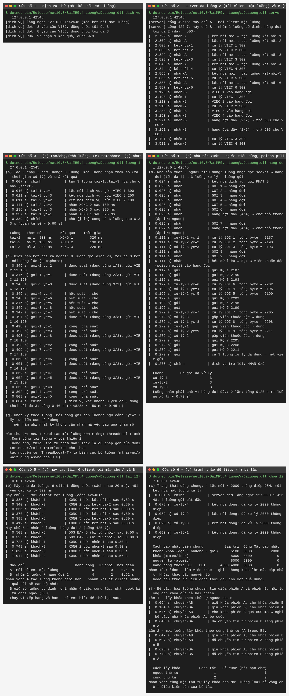

# Bài mở rộng MR5.4 – Luồng (thread) và đa luồng trong chương trình mạng (C#)

| Thông tin | Nội dung |
|---|---|
| Loại | **Bài mở rộng** – không có trong giáo trình, không có mã giả tương ứng |
| Liên hệ với giáo trình | Chương 5 (Bài 5.1–5.6); Chương 6 (Bài 6.1 server đa luồng, nhóm luồng; Bài 6.2) |
| Thư viện | .NET 10, chỉ BCL: `System.Threading` (`Thread`, `ThreadPool`, `Monitor`/`lock`, `SemaphoreSlim`, `Interlocked`, `ThreadLocal<T>`), `System.Collections.Concurrent` (`BlockingCollection<T>`, `ConcurrentDictionary`), `System.Net.Sockets` |
| Bản ngôn ngữ khác | [Python](../../../python/Chuong05/BaiMR5.4_LuongVaDaLuong/) (bản tham chiếu), [Java](../../../java/Chuong05/BaiMR5.4_LuongVaDaLuong/), [Rust](../../../rust/Chuong05/BaiMR5.4_LuongVaDaLuong/), [Go](../../../go/Chuong05/BaiMR5.4_LuongVaDaLuong/) |

## Mục tiêu
Cùng kịch bản, cùng giao thức và cùng thông điệp với bản Python: đi từng bước vào **luồng** trong một chương trình mạng .NET:

| Vai trò | Phần | Nội dung |
|---|---|---|
| `luong` | (a) | `new Thread(...) { Name = "tải-1" }`, `Start()`, `Join()`; tham số qua biểu thức lambda, kết quả vào ô riêng của mảng |
| `server` + `tai` | (b) | Server A: **mỗi client một `Thread`**; server B: **2 luồng cố định đọc `BlockingCollection` có `boundedCapacity = 2`**, `TryAdd()` thất bại → `503 BAN` |
| `khoa` | (c) | 4 kết nối × 2000 `DEM`: không khóa (mất cập nhật), `lock`, `Interlocked.Increment`, `ConcurrentDictionary.AddOrUpdate` |
| `hang-doi` | (d) | Nhà sản xuất – người tiêu dùng với `BlockingCollection` (sức chứa 4), viên thuốc độc `null` |
| `luong` | (e) | `SemaphoreSlim(3)` giới hạn kết nối ra ngoài; `Wait(0)` để biết có phải chờ không |
| `khoa` | (f) | Bế tắc hai khóa ngược thứ tự; `Monitor.TryEnter(khóa, 500)` phát hiện, thứ tự lấy khóa sửa |
| mọi vai trò | (g) | Nhật ký có `Thread.CurrentThread.Name` và ngữ cảnh `yc=` trong `ThreadLocal<string>` |

Bài khác [MR5.2](../../../python/Chuong05/BaiMR5.2_MoPhongDongThoi/) (so sánh mô hình trên một khối việc): MR5.4 dạy các mẫu dùng luồng trong server/client mạng.

## Liên hệ giáo trình
- **Chương 5 (Bài 5.1–5.6):** bản C# của Chương 5 dùng `async/await`; bài này cho thấy lớp bên dưới – luồng HĐH và `ThreadPool` mà `Task` chạy trên đó. Giới hạn đồng thời (Bài 5.2) xuất hiện lại ở (e).
- **Chương 6 (Bài 6.1, 6.2):** phần (b) đặt server mỗi client một luồng cạnh nhóm luồng có hàng đợi giới hạn; [MR5.5](../BaiMR5.5_PhoiHopDaLuongBatDongBo/) phối hợp `async` với luồng.

## Kiến thức chính
- `new Thread(lambda)` tạo **một luồng HĐH riêng**; `IsBackground = true` để luồng không giữ tiến trình sống; `Join()` chờ. `Thread` không trả giá trị – mỗi luồng ghi vào ô riêng của mảng (không cần khóa). Với giá trị trả về, dùng `Task.Run(() => ...)` và `await`/`.Result` (chạy trên **ThreadPool** – dùng lại luồng, tối thiểu bằng số CPU, thiếu thì tự thêm dần).
- **Server B:** `BlockingCollection<T>(boundedCapacity)` gói sẵn khóa và điều kiện chờ; `TryAdd` không chờ (đầy → từ chối), `Add` chặn khi đầy, `GetConsumingEnumerable()`/`Take()` chặn khi rỗng. `CompleteAdding()` là cách dừng dựng sẵn (thay cho viên thuốc độc).
- **Tranh chấp:** `long` thường “đọc – `Thread.Yield()` – ghi” mất cập nhật. `lock (obj) { … }` là cú pháp gọn của `Monitor.Enter/Exit` trong `try/finally`; `Interlocked.Increment(ref x)` là thao tác nguyên tử; `ConcurrentDictionary` cho phép nhiều luồng cập nhật cùng lúc. **Không** cho nhiều luồng cùng ghi `Dictionary<K,V>` thường – cấu trúc có thể hỏng và ném ngoại lệ.
- `SemaphoreSlim` có cả `Wait()` (chặn luồng) và `WaitAsync()` (chờ bất đồng bộ – dùng ở MR5.5); luôn `Release()` trong `finally`.
- `Monitor.TryEnter(obj, ms)` chờ khóa có hạn – phát hiện bế tắc; sửa bằng thứ tự lấy khóa cố định.
- `ThreadLocal<T>` là biến cục bộ luồng; với mã `async/await` (một tác vụ có thể đổi luồng sau mỗi `await`), ngữ cảnh đi theo tác vụ phải dùng `AsyncLocal<T>`.

**Khác biệt so với bản Python:** không có GIL – các luồng chạy song song thật trên nhiều CPU, nên ở (c) số cập nhật bị mất nhiều hơn hẳn; “nguyên tử” là `Interlocked` thật (Python mượn `itertools.count`); bảng đồng thời là `ConcurrentDictionary` (Python dùng `dict` + khóa). Dòng “Đặc thù C#” in số luồng tối thiểu của ThreadPool. Cổng demo 42545–42548 (dải của C# cho k = 4 là 42540–42549; bốn cổng đầu bị một chương trình thử khác chiếm tạm lúc chạy).

## Tệp
- `BaiMR5.4_LuongVaDaLuong.csproj` – dự án .NET 10 (Exe, ImplicitUsings, Nullable).
- `Program.cs` – phân nhánh vai trò; lớp `Luong`: (a), (e), (g).
- `NhatKy.cs` – nhật ký theo luồng, `ThreadLocal<string>`.
- `DichVu.cs` – dịch vụ thử `VIEC`, `PHAT`, `THONGKE`.
- `MayChu.cs` – (b) server A, B và máy tạo tải.
- `Khoa.cs` – (c) tranh chấp dữ liệu, (f) bế tắc.
- `HangDoi.cs` – (d) nhà sản xuất – người tiêu dùng.
- `demo.json`; `ket_qua.txt`, `ket_qua.png` – kết quả thực thi thật.

## Cách chạy
Trong thư mục bài:
```bash
dotnet run -- dich-vu  127.0.0.1 9000      # cửa sổ 1
dotnet run -- server   127.0.0.1 9001      # cửa sổ 2: A ở 9001, B ở 9002
dotnet run -- luong    127.0.0.1 9000
dotnet run -- hang-doi 127.0.0.1 9000
dotnet run -- tai      127.0.0.1 9001
dotnet run -- khoa     127.0.0.1 9003
```
Tái lập: `python3 tools/demo.py csharp/Chuong05/BaiMR5.4_LuongVaDaLuong` (biên dịch `dotnet build -c Release`, chạy `bin/Release/net10.0/BaiMR5.4_LuongVaDaLuong.dll`).

## Kết quả


Lần chạy trong ảnh (Linux, 2 CPU, .NET 10.0):
- **(a)** ba luồng xong sau 0,33 s (tuần tự ≈ 0,60 s).
- **(b)** A: 6/6 trong 0,41 s; B: 4 thành công, VIEC 5, 6 nhận `503` sau 0,00 s, tổng 0,62 s.
- **(c)** không khóa còn 5100/8000 (mất 2900 – nhiều hơn bản Python vì luồng chạy song song thật); `lock`, `Interlocked`, `ConcurrentDictionary` đúng 8000.
- **(d)** 9 gói, mỗi luồng 3 gói, 0,25 s; luồng nhận chờ 2 lần; `NHAN 9/9`.
- **(e)** đồng thời tối đa 3, tổng 0,46 s.
- **(f)** ngược thứ tự: 1 hoàn tất, 1 bỏ cuộc; cùng thứ tự: 2 hoàn tất.

## Bài tập gợi ý
1. Viết lại (a) bằng `Task.Run` + `await Task.WhenAll(...)`; in `Environment.CurrentManagedThreadId` để thấy ThreadPool dùng lại luồng.
2. Thay server B bằng `Channel.CreateBounded<T>(new BoundedChannelOptions(2) { FullMode = BoundedChannelFullMode.DropWrite })`; so sánh với `BlockingCollection`.
3. Ở (d), dùng `CompleteAdding()` thay cho viên thuốc độc; luồng gửi biết khi nào dừng?
4. Ở (c), thử `Dictionary<string,long>` thường thay cho `ConcurrentDictionary` (không khóa): quan sát ngoại lệ hoặc số đếm sai, giải thích.
5. Dùng `ReaderWriterLockSlim` cho một bảng tra cứu nhiều đọc ít ghi; đo thời gian so với `lock`.

## Đọc thêm
- Microsoft Learn: [Managed threading](https://learn.microsoft.com/dotnet/standard/threading/), [The managed thread pool](https://learn.microsoft.com/dotnet/standard/threading/the-managed-thread-pool), [`BlockingCollection` overview](https://learn.microsoft.com/dotnet/standard/collections/thread-safe/blockingcollection-overview), [`lock` statement](https://learn.microsoft.com/dotnet/csharp/language-reference/statements/lock).
- API: [`SemaphoreSlim`](https://learn.microsoft.com/dotnet/api/system.threading.semaphoreslim), [`Interlocked`](https://learn.microsoft.com/dotnet/api/system.threading.interlocked), [`ConcurrentDictionary<TKey,TValue>`](https://learn.microsoft.com/dotnet/api/system.collections.concurrent.concurrentdictionary-2), [`Monitor.TryEnter`](https://learn.microsoft.com/dotnet/api/system.threading.monitor.tryenter), [`ThreadLocal<T>`](https://learn.microsoft.com/dotnet/api/system.threading.threadlocal-1).

Mã nguồn của bài được viết mới cho kho này; các tài liệu trên chỉ là nguồn tham khảo kiến thức.
