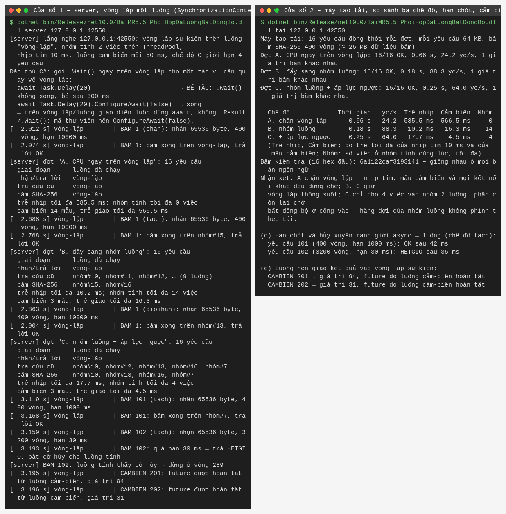

# Bài mở rộng MR5.5 – Phối hợp đa luồng và bất đồng bộ trong server mạng (C#)

| Thông tin | Nội dung |
|---|---|
| Loại | **Bài mở rộng** – không có trong giáo trình, không có mã giả tương ứng |
| Liên hệ với giáo trình | Chương 5 (Bài 5.1–5.6); Chương 6 (Bài 6.1, 6.2); MR5.4 |
| Thư viện | .NET 10, chỉ BCL: `SynchronizationContext`, `Task.Run`, `TaskScheduler`/`ConcurrentExclusiveSchedulerPair`, `Task.WaitAsync`, `CancellationTokenSource`, `SemaphoreSlim.WaitAsync`, `System.Threading.Channels`, `TaskCompletionSource<T>`, `IncrementalHash` (SHA-256), `TcpListener` async |
| Bản ngôn ngữ khác | [Python](../../../python/Chuong05/BaiMR5.5_PhoiHopDaLuongBatDongBo/) (bản tham chiếu), [Java](../../../java/Chuong05/BaiMR5.5_PhoiHopDaLuongBatDongBo/), [Rust](../../../rust/Chuong05/BaiMR5.5_PhoiHopDaLuongBatDongBo/), [Go](../../../go/Chuong05/BaiMR5.5_PhoiHopDaLuongBatDongBo/) |

## Mục tiêu
Cùng kịch bản, giao thức và thông điệp với bản Python: server async nhận `BAM` (64 KB), gọi **hàm thư viện cũ kiểu chặn** (20 ms) rồi **băm SHA-256** 400 vòng; so sánh ba chế độ A (làm ngay trên vòng lặp – SAI), B (đẩy sang ThreadPool), C (B + áp lực ngược) bằng **nhịp tim 10 ms**; thêm hạn chót/hủy, luồng nền giao kết quả vào vòng lặp, và minh họa **bế tắc `.Wait()`/`.Result`**.

Ứng dụng console .NET mặc định **không có vòng lặp sự kiện** – phần sau mỗi `await` chạy trên một luồng bất kỳ của ThreadPool. Để so sánh đúng với asyncio, bài tự dựng `VongLap` – một `SynchronizationContext` **một luồng** (giống luồng UI của WinForms/WPF): `Post()` từ bất kỳ luồng nào chỉ xếp việc vào hàng đợi, `Run()` lấy ra chạy lần lượt trên luồng `vòng-lặp` và chạy nhịp tim mỗi 10 ms. Mọi `await` trong mã chạy trên vòng lặp bắt context này nên quay về vòng lặp.

| Phần | Cách làm trong C# |
|---|---|
| (a) việc CPU | `Task.Factory.StartNew(việc, …, nhómTính)` – chạy trên ThreadPool qua `ConcurrentExclusiveSchedulerPair(…, 2).ConcurrentScheduler` (tối đa 2 việc cùng lúc) |
| (b) hàm chặn | `await Task.Run(TraCuuCu)` (ThreadPool; `ThreadPool.SetMinThreads(8, 8)` để không “đói” luồng) |
| (c) luồng nền → async | `Thread` `cảm-biến` ghi mẫu vào `Channel<T>` (`TryWrite`), vòng lặp đọc bằng `await foreach … ReadAllAsync()`; `CAMBIEN` dùng `TaskCompletionSource.SetResult` từ luồng cảm biến |
| (d) hủy, hạn chót | `await task.WaitAsync(hạn)` → `TimeoutException` → `CancellationTokenSource.Cancel()`; luồng băm kiểm tra `token.IsCancellationRequested` mỗi vòng |
| (e) áp lực ngược | `await SemaphoreSlim(4).WaitAsync()` – chờ không chặn vòng lặp |
| (f) cách làm SAI | chế độ `chan`: gọi `TraCuuCu()` và `Bam()` ngay trên vòng lặp |
| thêm | `.Wait()` trên vòng lặp cho tác vụ cần quay về vòng lặp → bế tắc (phát hiện sau 300 ms); `ConfigureAwait(false)` → không bế tắc |

## Liên hệ giáo trình
- **Chương 5 (Bài 5.1–5.6):** `async/await`, hủy bằng `CancellationToken`, hạn chót (Bài 5.6); Bài 5.3 (WinForms) có cùng mô hình một luồng UI + `SynchronizationContext` như `VongLap`.
- **Chương 6 (Bài 6.1, 6.2):** kết hợp phần mạng bất đồng bộ với nhóm luồng; nối tiếp [MR5.4](../BaiMR5.4_LuongVaDaLuong/).

## Kiến thức chính
- **`await` và `SynchronizationContext`:** `await t` mặc định *bắt* context hiện tại và đưa phần tiếp theo về đó (luồng UI, hoặc `VongLap` ở đây). `ConfigureAwait(false)` bảo “phần sau chạy ở đâu cũng được” – nên dùng trong mã thư viện.
- **Bế tắc `.Result`/`.Wait()`:** trên luồng có context một luồng, `.Wait()` chặn chính luồng đó, trong khi phần tiếp theo của tác vụ lại phải chạy trên luồng đó → chờ nhau mãi. Quy tắc: trên vòng lặp/luồng UI luôn `await`, không `.Result`/`.Wait()` (“async all the way”).
- **`Task.Run` vs async I/O:** đọc/ghi socket bằng `ReadAsync/WriteAsync` không chiếm luồng nào khi chờ; `Task.Run` dành cho việc CPU hoặc hàm chặn không có bản async. Hàm chặn chiếm luồng ThreadPool → nhiều lời gọi chặn có thể làm **đói ThreadPool** (ThreadPool chỉ thêm luồng từ từ), nên bài nâng số luồng tối thiểu.
- **Giới hạn mức song song của việc CPU:** `Task.Run` không giới hạn – 16 việc băm có thể cùng chạy trên 8+ luồng tranh 2 CPU với luồng vòng lặp. `ConcurrentExclusiveSchedulerPair` cho một `TaskScheduler` chỉ chạy tối đa N việc cùng lúc trên ThreadPool.
- **Hoàn tất đồng bộ:** thao tác async có dữ liệu sẵn (accept, đọc) hoàn tất *ngay*, phần sau `await` chạy luôn không qua vòng lặp. Bài gọi `await Task.Yield()` đầu mỗi kết nối để mỗi kết nối là một việc riêng trên vòng lặp (như asyncio luôn lên lịch callback qua vòng lặp); thiếu dòng này, các yêu cầu và cả lệnh `THONGKE` có thể chạy liền một mạch và số đo nhịp tim bị tính nhầm sang đợt sau.
- **luồng → async:** `Channel<T>` (luồng ghi, async đọc), `TaskCompletionSource<T>` (`RunContinuationsAsynchronously` để phần tiếp theo không chạy trên luồng gọi `SetResult`), hoặc `SynchronizationContext.Post`.

**Khác biệt so với bản Python:** vòng lặp tự dựng (`VongLap.cs`) thay cho asyncio; luồng ThreadPool không có tên riêng nên hiển thị `nhóm#<mã luồng>`; tra cứu cũ và băm cùng chạy trên ThreadPool (bản Python tách hai nhóm luồng), mức song song của băm giới hạn bằng `TaskScheduler`; thêm phần bế tắc `.Wait()`. Server in dòng “nhóm tính 2 việc trên ThreadPool”.

## Tệp
- `BaiMR5.5_PhoiHopDaLuongBatDongBo.csproj` – dự án .NET 10.
- `Program.cs` – phân nhánh vai trò; máy tạo tải (`Task.WhenAll` 16 yêu cầu mỗi đợt).
- `VongLap.cs` – vòng lặp sự kiện một luồng (`SynchronizationContext`) có nhịp tim.
- `MayChu.cs` – server: ba chế độ, luồng cảm biến, `Channel<T>`, `TaskCompletionSource`, hạn chót, thống kê, minh họa bế tắc `.Wait()`.
- `Chung.cs` – hằng số, `Bam()` (SHA-256 có token hủy), `TraCuuCu()`, nhật ký, hàm gửi của client.
- `demo.json`; `ket_qua.txt`, `ket_qua.png` – kết quả thực thi thật.

## Cách chạy
```bash
dotnet run -- server 127.0.0.1 9000     # cửa sổ 1
dotnet run -- tai    127.0.0.1 9000     # cửa sổ 2
```
Tái lập: `python3 tools/demo.py csharp/Chuong05/BaiMR5.5_PhoiHopDaLuongBatDongBo` (cổng 42550). Client C# chạy được với server Go/Python (đã thử: cùng giá trị băm `6a1122caf3193141`).

## Kết quả


Lần chạy trong ảnh (Linux, 2 CPU, .NET 10.0):

| Chế độ | Thời gian 16 yêu cầu | Trễ nhịp tối đa | Trễ giao mẫu cảm biến | Việc ở nhóm tính tối đa |
|---|---|---|---|---|
| A. chặn vòng lặp | 0,66 s | 586 ms | 567 ms | 0 |
| B. đẩy sang ThreadPool | 0,18 s | 10,2 ms | 16,3 ms | 14 |
| C. + áp lực ngược | 0,25 s | 17,7 ms | 4,5 ms | 4 |

- Bảng giai đoạn: ở A mọi giai đoạn trên `vòng-lặp`; ở B tra cứu cũ chạy trên 9 luồng ThreadPool khác nhau (`nhóm#7`, …), vòng lặp chỉ nhận/trả lời.
- **(d)** yêu cầu 102 (hạn 30 ms) nhận `HETGIO` sau 35 ms; luồng băm dừng ở vòng 289.
- **Bế tắc `.Wait()`:** `await Task.Delay(20)` rồi `.Wait(300)` trên vòng lặp → không xong sau 300 ms; cùng mã với `ConfigureAwait(false)` → xong.

## Bài tập gợi ý
1. Bỏ `await Task.Yield()` trong `PhucVuAsync` rồi chạy lại vài lần: số đo của chế độ A có bị “chuyển” sang đợt B không? Giải thích bằng việc hoàn tất đồng bộ.
2. Thay `Task.Factory.StartNew(…, NhomTinhLich)` bằng `Task.Run`: số luồng băm và trễ nhịp ở B, C thay đổi ra sao trên máy 2 CPU?
3. Bỏ `ThreadPool.SetMinThreads(8, 8)` và tăng số yêu cầu lên 64: quan sát “đói ThreadPool” (thời gian tăng, số luồng `nhóm#` tăng dần).
4. Viết lại máy tạo tải với `Parallel.ForEachAsync(…, new ParallelOptions { MaxDegreeOfParallelism = 8 })`.
5. Chạy server dưới một ứng dụng WinForms (Bài 5.3): luồng UI chính là vòng lặp – thử lại bế tắc `.Result` trong một nút bấm.

## Đọc thêm
- Microsoft Learn: [Task-based asynchronous pattern](https://learn.microsoft.com/dotnet/standard/asynchronous-programming-patterns/task-based-asynchronous-pattern-tap), [Cancellation in managed threads](https://learn.microsoft.com/dotnet/standard/threading/cancellation-in-managed-threads), [System.Threading.Channels](https://learn.microsoft.com/dotnet/core/extensions/channels), [The managed thread pool](https://learn.microsoft.com/dotnet/standard/threading/the-managed-thread-pool).
- API: [`SynchronizationContext`](https://learn.microsoft.com/dotnet/api/system.threading.synchronizationcontext), [`TaskCompletionSource<TResult>`](https://learn.microsoft.com/dotnet/api/system.threading.tasks.taskcompletionsource-1), [`Task.WaitAsync`](https://learn.microsoft.com/dotnet/api/system.threading.tasks.task.waitasync), [`ConcurrentExclusiveSchedulerPair`](https://learn.microsoft.com/dotnet/api/system.threading.tasks.concurrentexclusiveschedulerpair), [`SemaphoreSlim.WaitAsync`](https://learn.microsoft.com/dotnet/api/system.threading.semaphoreslim.waitasync).
- .NET Blog: [*ConfigureAwait FAQ*](https://devblogs.microsoft.com/dotnet/configureawait-faq/) (Stephen Toub).

Mã nguồn của bài được viết mới cho kho này; các tài liệu trên chỉ là nguồn tham khảo kiến thức.
