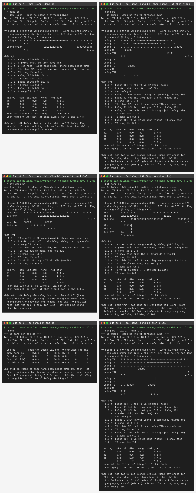

# Bài mở rộng MR5.6 – Mô phỏng thực thi tác vụ: đơn luồng/đa luồng × đồng bộ/bất đồng bộ, chen ngang, phụ thuộc, một việc trên hai luồng (C#)

| Thông tin | Nội dung |
|---|---|
| Loại | **Bài mở rộng** – không có trong giáo trình, không có mã giả tương ứng |
| Liên hệ với giáo trình | Chương 5: Bài 5.1–5.3 (bất đồng bộ, giao diện không treo), Bài 5.2 (giới hạn đồng thời); Chương 6: Bài 6.1, 6.2 (server đa luồng, nhóm luồng, server bất đồng bộ); MR1.2 (mô phỏng bên trong máy chủ), MR5.2, MR5.4, MR5.5 (đo thật cùng các mô hình) |
| Thư viện | Chỉ BCL của .NET 10: bản dòng lệnh `net10.0` (chạy trên Windows, Linux, macOS); ứng dụng giao diện Windows Forms `net10.0-windows` (`System.Windows.Forms`, GDI+ `System.Drawing`). Không tạo luồng thật – luồng, lõi CPU, lát thời gian, vòng lặp sự kiện đều được mô phỏng trong `LapLich.cs`. Ảnh ứng dụng chụp bằng `Control.DrawToBitmap` |
| Bản ngôn ngữ khác | [Python](../../../python/Chuong05/BaiMR5.6_MoPhongThucThiTacVu/), [Java](../../../java/Chuong05/BaiMR5.6_MoPhongThucThiTacVu/), [Rust](../../../rust/Chuong05/BaiMR5.6_MoPhongThucThiTacVu/), [Go](../../../go/Chuong05/BaiMR5.6_MoPhongThucThiTacVu/) |

## Mục tiêu
Một ứng dụng giao diện để **nhìn thấy** cùng một khối việc chạy khác nhau thế nào khi tổ chức chương trình theo bốn cách – *đơn luồng/đa luồng × đồng bộ/bất đồng bộ* – theo thời gian, với đủ các hiện tượng mà sinh viên thường chỉ đọc trong sách: chờ I/O chặn luồng, chồng thời gian chờ, tranh lõi CPU, **chia lát thời gian**, **chen ngang** của việc ưu tiên cao, **phụ thuộc** (`Join`/`await`), **một công việc chạy trên hai luồng** (chia đôi chạy song song; chạy tiếp trên luồng khác sau khi chờ I/O).

Ba tác vụ T1, T2, T3 (thời lượng nhập được, mặc định 4, 3, 2 s), mỗi tác vụ: **CPU 1/4 → chờ I/O 1/2 → CPU phần còn lại**. Tùy chọn: T3 chờ T1 và T2; chia bước CPU cuối của T1 làm hai nửa chạy cùng lúc; **việc khẩn U** (0,5 s CPU, ưu tiên cao) đến lúc 0,3 s hoặc lúc bấm nút *Chen ngang U ngay*; số lõi CPU (1–4); lát thời gian (mặc định 0,5 s). Bộ lập lịch, bản dòng lệnh và giao diện giống bản Python; đầu ra bản dòng lệnh **trùng từng ký tự** với `mo_phong.py`.

| Chế độ | Cách chạy | Điều cần quan sát |
|---|---|---|
| Đơn luồng – đồng bộ | một luồng, lời gọi chặn, làm lần lượt theo thứ tự đến | luồng đứng yên khi chờ I/O; U phải chờ tất cả (8,7 s) |
| Đa luồng – đồng bộ | mỗi tác vụ một luồng hệ điều hành; bộ lập lịch cấp lõi theo ưu tiên rồi thứ tự đến, chia lát thời gian, cho ưu tiên cao chen ngang | U chen ngang Luồng T1 ngay khi đến (chờ 0 s); luồng hết lát thì nhường lõi; T3 chờ join; nửa sau của T1 chạy trên Luồng T1b song song; 5 luồng |
| Đơn luồng – bất đồng bộ | một luồng chạy vòng lặp sự kiện; bước CPU chạy trên vòng lặp tới khi xong; chờ I/O không giữ luồng; hàng việc FIFO | hàng *I/O chờ* có 2 lệnh chờ cùng lúc (T1, T2) mà chỉ một luồng; U xếp hàng sau T2 (chờ 1,4 s); hai nửa của T1 chạy lần lượt – bất đồng bộ không phải là song song |
| Đa luồng – bất đồng bộ | nhóm thợ (số thợ = số lõi), mỗi bước CPU giao cho thợ rảnh đầu tiên | T2 bắt đầu trên Thợ 2, sau I/O **chạy tiếp trên Thợ 1**; hai nửa của T1 chạy song song trên 2 thợ; hoàn tất sớm nhất (5,5 s) với 2 luồng |

## Kiến thức chính
- **Đồng bộ và bất đồng bộ.** Lời gọi đồng bộ (chặn, ví dụ `Stream.Read`, `Socket.Receive`) giữ luồng suốt thời gian chờ I/O; lời gọi bất đồng bộ (`await stream.ReadAsync(...)`) gửi yêu cầu rồi trả luồng lại, phần tiếp theo chạy khi có kết quả. Vì vậy *đơn luồng – bất đồng bộ* chồng được các lần chờ I/O mà không cần thêm luồng – như một hàm `async` chạy trên luồng giao diện WinForms, nơi `SynchronizationContext` đưa mọi phần tiếp theo về một luồng duy nhất.
- **Đơn luồng và đa luồng.** `new Thread(...)` tạo một luồng hệ điều hành riêng (chế độ *đa luồng – đồng bộ*: mỗi tác vụ một `Thread`); nhiều luồng thì nhiều việc tiến triển cùng lúc, nhưng *song song thật* chỉ có khi có nhiều lõi (`Environment.ProcessorCount`; ở chế độ 1 lõi, các luồng chỉ xen kẽ nhau).
- **Bộ lập lịch hệ điều hành** (mô phỏng): mỗi nhịp 0,1 s, lõi trống được cấp cho luồng sẵn sàng có ưu tiên cao nhất, cùng ưu tiên thì luồng chờ lâu nhất; luồng chạy hết **lát thời gian** mà có luồng cùng hoặc cao hơn ưu tiên đang chờ thì phải nhường (round-robin); luồng **ưu tiên cao** (`Thread.Priority = ThreadPriority.Highest`) sẵn sàng mà không còn lõi thì **chen ngang** (preemption) luồng ưu tiên thấp đang chạy. Luồng bị chen ngang chuyển sang *sẵn sàng* (ô viền đứt), không mất công đã làm.
- **Nhóm luồng + bất đồng bộ:** `ThreadPool`/`Task.Run(...)` giao việc cho các luồng thợ dùng chung; bước CPU giao cho thợ rảnh, I/O `await` không giữ thợ nào. Đây là cách ASP.NET Core và ứng dụng console `async Main` chạy (không có `SynchronizationContext`).
- **Đa nhiệm hợp tác** (cooperative): vòng lặp sự kiện và nhóm thợ chỉ đổi việc ở điểm `await`/kết thúc bước; một bước CPU dài làm mọi việc khác chờ – nên việc khẩn U không chen ngang được (muốn nhường giữa chừng phải tự `await Task.Yield()`).
- **Phụ thuộc:** T3 chờ T1, T2 bằng `t1.Join(); t2.Join();` (đồng bộ – luồng T3 bị chặn, ô chấm) hoặc `await Task.WhenAll(t1, t2)` (bất đồng bộ – không giữ luồng nào, T3 chỉ xuất hiện khi bắt đầu chạy).
- **Một việc trên hai luồng:** (1) chia đôi phần CPU và chạy hai nửa song song (luồng phụ T1b, hoặc `await Task.WhenAll(Task.Run(nửa1), Task.Run(nửa2))`, `Parallel.Invoke`) rồi hợp kết quả – chỉ nhanh hơn khi có ≥ 2 lõi; (2) ở nhóm thợ + bất đồng bộ, phần tiếp theo sau `await` chạy trên thợ rảnh bất kỳ của `ThreadPool`, không nhất thiết luồng cũ – mặc định khi không có `SynchronizationContext`, hoặc khi viết `await ...ConfigureAwait(false)` trong thư viện (in `Environment.CurrentManagedThreadId` trước và sau `await` để thấy).
- **Tất định:** mô phỏng không dùng luồng thật và không ngẫu nhiên nên cùng tham số cho cùng biểu đồ ở cả năm ngôn ngữ; bấm *Chen ngang U ngay* lúc t chỉ là mô phỏng lại với U đến lúc t – phần trước t không đổi. Để trùng bản Python từng ký tự: `round()` của Python làm tròn về số chẵn gần nhất khi đúng nửa (0,25 s → 2 nhịp) – C# dùng `Math.Round(x, MidpointRounding.ToEven)`; phép `//` và `%` của Python làm tròn xuống – C# viết hàm `Div`/`Mod` riêng.

## Cấu trúc tệp
- `BaiMR5.6_MoPhongThucThiTacVu.csproj` – dự án dòng lệnh `net10.0` (bỏ thư mục `GiaoDien/` khỏi biên dịch).
- `LapLich.cs` – bộ lập lịch mô phỏng (dùng chung cho hai dự án): `ThamSo`, `Viec`, chế độ đồng bộ (`DongBo`: luồng, hàng sẵn sàng, cấp lõi, lát thời gian, chen ngang, join, luồng phụ) và bất đồng bộ (`BatDongBo`: vòng lặp/nhóm thợ, hàng việc FIFO, I/O không giữ luồng, WhenAll), chỉ số, biểu đồ Gantt văn bản.
- `MoPhong.cs` – bản dòng lệnh: in tham số, Gantt, nhật ký, bảng tác vụ, chỉ số, nhận xét; lệnh `so_sanh`, `tat_ca`.
- `GiaoDien/BaiMR5.6_GiaoDien.csproj` – dự án WinForms `net10.0-windows`, lấy `..\LapLich.cs` bằng `<Compile Include>`.
- `GiaoDien/Program.cs` – điểm vào `[STAThread]`, vai trò `demo`.
- `GiaoDien/UngDung.cs` – cửa sổ WinForms: nút bốn chế độ, *So sánh 4 chế độ*, *Xóa*, *Chen ngang U ngay*, *Dừng/Chạy*, thanh kéo thời gian (`TrackBar`), tốc độ; ô nhập thời lượng T1–T3, số lõi, lát thời gian, ba tùy chọn; Gantt hoạt hình vẽ bằng GDI+ trên `Panel` bộ đệm đôi, bảng chỉ số (`ListView`), nhật ký sự kiện.
- `GiaoDien/DemoGui.cs` – kịch bản minh họa tự động: cùng các bước với `--demo` của bản Python, chụp cửa sổ bằng `DrawToBitmap`, ghép thành `ket_qua_gui.png`.
- `demo.json` – kịch bản chạy bản dòng lệnh (dùng với `tools/demo.py`); `GiaoDien/demo.json` – kịch bản giao diện dạng Windows (dùng với `tools/demo_windows.ps1`); `ket_qua.txt`, `ket_qua.png` – kết quả thực thi thật.

## Cách chạy
Bản dòng lệnh, trong thư mục bài (cần .NET 10 SDK; Windows cài bằng `winget install Microsoft.DotNet.SDK.10`):
```bash
dotnet run -- da_dong_bo                          # một chế độ
dotnet run -- so_sanh --loi 1                     # so sánh bốn chế độ trên 1 lõi
dotnet run -- da_bat_dong_bo --t1 6 --khong-chia --khan 2
```
Tham số dòng lệnh: `--t1 --t2 --t3` (giây), `--loi` (số lõi), `--lat` (lát thời gian, giây), `--khan` (lúc U đến), `--khong-khan`, `--khong-phu-thuoc`, `--khong-chia`; chế độ `tat_ca` chạy cả bốn rồi so sánh. Tái lập kết quả từ thư mục gốc của kho: `python3 tools/demo.py csharp/Chuong05/BaiMR5.6_MoPhongThucThiTacVu`.

Ứng dụng giao diện (chỉ Windows), trong thư mục `GiaoDien`:
```powershell
dotnet run                                        # ứng dụng giao diện
dotnet run -- demo                                # kịch bản tự thao tác, ghi ..\ket_qua_gui.png
```
Chạy kịch bản giao diện và ghi nhật ký (từ thư mục gốc kho mã):
```powershell
powershell -NoProfile -ExecutionPolicy Bypass -File tools\demo_windows.ps1 csharp\Chuong05\BaiMR5.6_MoPhongThucThiTacVu\GiaoDien
```
Script biên dịch dự án WinForms, chạy `demo ..\ket_qua_gui.png`, ghi nhật ký `GiaoDien\.log_gui.txt`; ảnh nhật ký dựng bằng `tools/render_output.py`.

## Kết quả thực thi


Bản dòng lệnh đã chạy trên Linux (.NET SDK 10.0.114). Đầu ra được so bằng `cmp` với bản Python (Python 3.13.18) và **trùng từng ký tự** ở cả sáu tiến trình của `demo.json` (`don_dong_bo`, `da_dong_bo`, `don_bat_dong_bo`, `da_bat_dong_bo`, `so_sanh`, `da_dong_bo --loi 1 --khan 1.2`) và các tổ hợp khác như `tat_ca`, `tat_ca --loi 1`, `tat_ca --khong-chia --khong-phu-thuoc`, `so_sanh --loi 4 --lat 0.2 --khan 2`, `tat_ca --khong-khan --t1 5 --t2 1.5 --t3 3`, `tat_ca --lat 0.25 --khan 0.25 --t1 0.35 --t2 0.45 --khong-chia` (kiểm tra làm tròn về số chẵn), `tat_ca --loi 0 --lat 0 --khan 0.05`.

| Chế độ (mặc định, 2 lõi) | Hoàn tất | Luồng | Lõi bận | U chờ | Chen ngang | Hết lát |
|---|---|---|---|---|---|---|
| đơn luồng, đồng bộ | 9,5 s | 1 | 26 % | 8,7 s | 0 | 0 |
| đa luồng, đồng bộ | 5,8 s | 5 | 43 % | 0,0 s | 1 | 2 |
| đơn luồng, bất đồng bộ | 6,8 s | 1 | 36 % | 1,4 s | 0 | 0 |
| đa luồng, bất đồng bộ | 5,5 s | 2 | 45 % | 0,4 s | 0 | 0 |

Cửa sổ 6 chạy *đa luồng – đồng bộ* trên 1 lõi, U đến lúc 1,2 s: T1 và T2 xen kẽ từng lát 0,5 s, U chen ngang T1; hai nửa của T1 không còn song song (Luồng T1b chờ lõi) nên hoàn tất 7,2 s.

**Ứng dụng giao diện: chưa chạy – cần Windows.** Môi trường biên soạn (Linux) không có gói tham chiếu Windows Desktop nên không biên dịch được dự án `net10.0-windows`; vì vậy thư mục chưa có `ket_qua_gui.png` (không dựng ảnh giả). Mã WinForms đã được kiểm tra biên dịch (0 lỗi, 0 cảnh báo) với các tham chiếu `System.Windows.Forms`/`System.Drawing` thay thế; các số liệu kịch bản `demo` lấy từ cùng `LapLich.cs` nên khi chạy trên Windows sẽ in như bản Python: so sánh bốn chế độ như bảng trên; bỏ việc khẩn, dừng ở 3,3 s rồi bấm *Chen ngang U ngay* → U chờ 0,0 s, chen ngang 1 lần, hoàn tất 5,7 s (đã kiểm bằng `dotnet run -- da_dong_bo --khan 3.3`). Riêng dòng “Hoạt hình chạy xong sau … s thật, vẽ lại … lần” tùy máy (bản C# đếm số lần vẽ lại thật của vùng Gantt).

## Ghi chú
- Mô hình đã đơn giản hóa: chuyển ngữ cảnh tốn 0; luồng phụ T1b và luồng U được tạo tức thời; I/O không giới hạn số lệnh cùng lúc; vòng lặp/nhóm thợ dùng hàng FIFO (không ưu tiên) như hàng công việc toàn cục của `ThreadPool`; số thợ bằng số lõi nên thợ không phải tranh lõi.
- Thứ tự trong một nhịp: tác vụ đến → các luồng sang thao tác kế tiếp (hai lượt, để join thấy ngay luồng vừa kết thúc) → lập lịch (hết lát → cấp lõi trống → chen ngang) → chạy một nhịp. Các bản ngôn ngữ khác theo đúng thứ tự này nên in trùng từng ký tự.
- Khác bản Python ở một chỗ có chủ đích: khi phần CPU cuối của T1 chỉ dài 1 nhịp (T1 = 0,1; 0,2 hay 0,4 s, có chia CPU), nửa sau dài 0 nhịp và bản Python lặp mãi ở hai chế độ bất đồng bộ (thợ chỉ xong khi số nhịp còn lại đúng bằng 0). Bản C# coi thợ xong khi số nhịp còn lại ≤ 0; với mọi tham số khác số nhịp không bao giờ âm nên kết quả vẫn trùng.
- Căn lề `{x:<11}` của Python đếm theo ký tự; chuỗi tiếng Việt trong mã nguồn ở dạng dựng sẵn (NFC) nên `string.Length` của C# cho cùng độ rộng (hàm `Trai`/`Phai`). Bản dòng lệnh luôn xuống dòng bằng `\n` và ghi UTF-8 không BOM.
- Ứng dụng giao diện chỉ dùng luồng giao diện: mô phỏng chạy trong vài mili giây, hoạt hình bằng `System.Windows.Forms.Timer` 30 ms; không có luồng nền nên không cần `Invoke`/`BeginInvoke` hay khóa. Vùng Gantt bật `DoubleBuffered` để không nhấp nháy; nhật ký chỉ cập nhật khi có dòng mới.
- Kiểm thử: bản dòng lệnh – Linux, .NET SDK 10.0.114; ứng dụng giao diện – chưa chạy (cần Windows).

## Bài tập gợi ý
1. Đặt số lõi 1, 2, 4 và so sánh bốn chế độ: chế độ nào nhanh lên khi thêm lõi, chế độ nào không? Vì sao *đơn luồng – bất đồng bộ* không đổi?
2. Đổi lát thời gian 0,1 s và 2 s ở *đa luồng – đồng bộ* trên 1 lõi: số lần hết lát, thời gian chờ của từng tác vụ thay đổi thế nào? Lát quá nhỏ trong thực tế tốn gì (chuyển ngữ cảnh)?
3. Thêm ưu tiên cho hàng việc của nhóm thợ (U đứng đầu hàng): U chờ còn bao lâu? Vì sao vẫn không bằng 0?
4. Thêm “chia nhỏ việc CPU” cho chế độ bất đồng bộ: mỗi bước CPU dài hơn 0,2 s tự nhường (`await Task.Yield()`) sau mỗi 0,2 s. U chờ bao lâu? So sánh với chen ngang của hệ điều hành.
5. (Nâng cao) Đổi tỉ lệ CPU/I/O của tác vụ thành 80/20 (việc nặng CPU) rồi 10/80 (việc nặng I/O) và kết luận mô hình nào hợp với máy chủ mạng thông thường.

## Đọc thêm
- Tài liệu .NET (learn.microsoft.com): *Managed threading* (`Thread`, `Thread.Join`, `ThreadPriority`), *The managed thread pool* (`ThreadPool`), *Task-based asynchronous programming* (`Task.Run`, `Task.WhenAll`, `Parallel.Invoke`), *Asynchronous programming with async and await*, *ConfigureAwait FAQ* (devblogs.microsoft.com/dotnet).
- A. Silberschatz, P. B. Galvin, G. Gagne, *Operating System Concepts*, Wiley – chương *CPU Scheduling* (round-robin, ưu tiên, preemption) và *Threads & Concurrency*.
- Dan Kegel, *The C10K problem* (kegel.com/c10k.html) – các mô hình máy chủ: mỗi kết nối một luồng, nhóm luồng, vòng lặp sự kiện.

Mã nguồn của bài được viết mới cho kho này; các tài liệu trên chỉ là nguồn tham khảo kiến thức.
