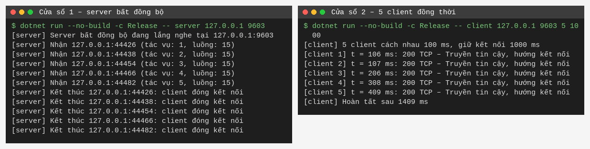

# Bài 6.2 – Server tra cứu bất đồng bộ (C#)

| Thông tin | Nội dung |
|---|---|
| Mã giả tương ứng | Mã giả 6.3 (Server bất đồng bộ: mỗi kết nối một tác vụ) |
| Mục giáo trình | 6.2.3 Server bất đồng bộ |
| Kế thừa | Mã giả 6.1 (SOCKET, SETOPT, BIND, LISTEN), 5.1 (RECV_JSON_ASYNC, SEND_JSON_ASYNC), 3.7 (PROCESS_REQUEST), 2.1; client: 2.2, 3.6, 3.8 (rút gọn) |
| Thư viện | BCL: `Socket.AcceptAsync`, `NetworkStream.ReadAsync/WriteAsync`, `CancellationTokenSource`, `System.Text.Json` |

## Mục tiêu
Phục vụ mỗi kết nối bằng một tác vụ bất đồng bộ thay cho một luồng: khi tác vụ chờ ở `AWAIT RECV_JSON_ASYNC`, nó không chiếm luồng nào. Mã nguồn gần như giống phiên bản đa luồng, chỉ khác ở các lời gọi bất đồng bộ.

## Tệp
- `Program.cs` – phân nhánh theo tham số `server` / `client`.
- `AsyncServer.cs` – Mã giả 6.3: `RunAsync` (ASYNC_SERVER), `ServeAsync` (SERVE_ASYNC).
- `AsyncFrame.cs` – Mã giả 5.1: `RecvJsonAsync`, `SendJsonAsync`.
- `LookupService.cs` – Mã giả 3.7: `ProcessRequest`.
- `NetUtil.cs` – Mã giả 2.1, 2.2, 3.4, 3.6 (dùng cho client đồng bộ).
- `MultiClient.cs` – chương trình mở n client tra cứu đồng thời.
- `glossary.json` – từ điển thuật ngữ.
- `Bai6.2_ServerBatDongBo.csproj` – dự án console .NET 10.
- `demo.json` – kịch bản chạy minh họa (dùng với `tools/demo.py`).
- `ket_qua.txt`, `ket_qua.png` – kết quả thực thi thật.

## Cách chạy
Mở các cửa sổ dòng lệnh trong thư mục bài:
```bash
dotnet build
# Cửa sổ 1 – server (mặc định 0.0.0.0 9000)
dotnet run -- server 0.0.0.0 9000
# Cửa sổ 2 – 5 client đồng thời, mỗi client giữ kết nối 1000 ms
dotnet run -- client 127.0.0.1 9000 5 1000
```
Dừng server bằng Ctrl+C.

## Kết quả thực thi


Năm client khởi động cách nhau 100 ms đều được phục vụ ngay (t ≈ 0, 100, …, 400 ms) dù các client trước vẫn giữ kết nối. Số tác vụ tăng theo số client trong khi số luồng của tiến trình không đổi, minh họa việc tác vụ đang chờ không chiếm luồng.

## Ghi chú
- `SERVE_ASYNC` không có thao tác `bye` (khác `HANDLE_LOOKUP` của Mã giả 3.7), nên client chỉ đóng kết nối; server nhận `ConnectionClosed` với 0 byte và ghi "client đóng kết nối".
- Mã giả không liệt kê `JsonError` trong khối `CATCH`; bản cài đặt coi JSON sai như `ProtocolError` và kết thúc phiên (Mã giả 3.7 thì trả 400 và tiếp tục).
- Con số "luồng" in ra có ý nghĩa khác nhau giữa ba nền tảng (xem mục riêng của ngôn ngữ); điểm cần quan sát là con số này không tăng theo số client.
- `RUN_BACKGROUND` là `_ = ServeAsync(...)` (không `await`). `WITH_TIMEOUT(300000, …)` dùng `CancellationTokenSource(300000)` cho mỗi lần nhận. "luồng" là `Process.Threads.Count`, gồm cả các luồng của môi trường chạy .NET.
- Kiểm thử: Linux, .NET SDK 10.0.114.
