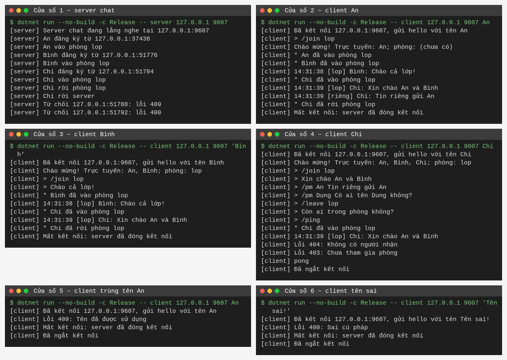

# Bài 6.4 – Server chat nhiều phòng (C#)

| Thông tin | Nội dung |
|---|---|
| Mã giả tương ứng | Mã giả 6.5 (Server chat: cấu trúc dữ liệu và tác vụ phiên), Mã giả 6.6 (Server chat: phát tới phòng, gửi riêng và tác vụ ghi) |
| Mục giáo trình | 6.3.1 Đặc tả giao thức chat, 6.3.2 Kiến trúc server, 6.3.3 Mã giả server chat, 6.3.4 Các vấn đề bảo mật |
| Kế thừa | Mã giả 6.3 (server bất đồng bộ), 5.1 (khung JSON bất đồng bộ), 5.5 (lớp ChatClient), 2.1, 2.2 |
| Thư viện | BCL: `Socket.AcceptAsync`, `NetworkStream`, `System.Threading.Channels` (hàng đợi có giới hạn), `SemaphoreSlim`, `System.Text.Json`, `Regex` |

## Mục tiêu
Xây dựng server chat theo đặc tả Mục 6.3.1: đăng ký tên bằng `hello` trong 10 giây (`welcome` hoặc lỗi 409), tham gia và rời phòng, tin nhóm (`msg`), tin riêng (`pm`), nhịp tim `ping`/`pong`, mã lỗi 400, 403, 404, 409, 429. Mỗi client có một tác vụ phiên đọc socket, một hộp thư đi 256 thông điệp và đúng một tác vụ ghi; bảng `users`, `rooms` được bảo vệ bằng khóa và không thực hiện vào/ra khi giữ khóa.

## Tệp
- `Program.cs` – phân nhánh theo tham số `server` / `client`.
- `ChatServer.cs` – Mã giả 6.5: vòng chấp nhận kết nối, `ChatSession` (CHAT_SESSION).
- `ChatBroadcast.cs` – Mã giả 6.6: `Broadcast`, `SendTo`, `Enqueue`, `Writer`; `ChatUser` (STRUCT Client); `Register`, `Unregister`, `JoinRoom`, `LeaveRoom`.
- `ChatClient.cs` – Mã giả 5.5: lớp `ChatClient`; `ChatClientApp` – client dòng lệnh.
- `AsyncFrame.cs` – Mã giả 5.1, 2.1.
- `Bai6.4_ServerChat.csproj` – dự án console .NET 10.
- `demo.json` – kịch bản chạy minh họa (dùng với `tools/demo.py`).
- `ket_qua.txt`, `ket_qua.png` – kết quả thực thi thật.

## Cách chạy
Mở các cửa sổ dòng lệnh trong thư mục bài:
```bash
dotnet build
# Cửa sổ 1 – server (mặc định 0.0.0.0 9200)
dotnet run -- server 0.0.0.0 9200
# Cửa sổ 2, 3, … – mỗi cửa sổ một client
dotnet run -- client 127.0.0.1 9200 An
dotnet run -- client 127.0.0.1 9200 Bình
```
Lệnh của client: `/join phòng`, `/leave phòng`, `/pm tên nội dung`, `/ping`, `/quit`; dòng khác được gửi thành tin `msg` tới phòng của lệnh `/join` gần nhất. Dừng server bằng Ctrl+C.

## Kết quả thực thi


Ba client An, Bình, Chi cùng vào phòng `lop`: tin nhóm đến mọi thành viên (kể cả người gửi), tin riêng của Chi chỉ đến An, tin riêng tới người không tồn tại trả lỗi 404, tin gửi vào phòng sau khi đã rời trả lỗi 403, `ping` nhận `pong`. Client đăng ký trùng tên An nhận lỗi 409, client có tên chứa ký tự không cho phép nhận lỗi 400; cả hai bị đóng kết nối ngay. Hai dòng "Mất kết nối" ở cuối cửa sổ An, Bình xuất hiện vì kịch bản dừng server trước khi dừng hai client chạy nền.

## Ghi chú
- `REGISTER`, `JOIN_ROOM`, `LEAVE_ROOM`, `UNREGISTER` cài đặt theo đoạn văn sau Mã giả 6.5: chỉ thao tác trên `users`, `rooms` trong khóa `lock`, và mọi lời gọi `BROADCAST` đặt sau khi nhả khóa. `REGISTER` trả `NULL` khi trùng tên (409); tên không hợp lệ bị từ chối ngay trước khi gọi `REGISTER` (400). `JOIN_ROOM` tạo phòng nếu chưa có, thêm tên rồi phát tin hệ thống `sys` (`sender` = `NULL`) cho cả phòng. `LEAVE_ROOM` xóa tên khỏi phòng và xóa phòng khi không còn thành viên; `UNREGISTER` xóa client khỏi `users` và khỏi mọi phòng. Bổ sung so với giáo trình: `LEAVE_ROOM` và `UNREGISTER` còn phát tin `sys` "đã rời phòng" cho các thành viên còn lại, và `LEAVE_ROOM` trả 403 nếu người gửi không ở trong phòng.
- Thông điệp `welcome` gửi cả `users` và `rooms` theo bảng đặc tả (Mã giả 6.5 dòng 10 chỉ có `users`); thông điệp `error` có thêm trường `text` theo bảng đặc tả.
- Bổ sung theo Mục 6.3.4 (không có trong mã giả): tên người dùng và tên phòng phải khớp `^[\w-]{1,32}$` (sai → 400), thông điệp thiếu trường bắt buộc → 400, mỗi client tối đa 10 tin `msg`/`pm` mỗi giây (vượt → 429). Vì giới hạn tốc độ, bài tập "client chậm" cần nhiều client gửi hoặc tin dài để làm đầy hàng đợi 256 thông điệp.
- Client: thủ tục `SEND_MESSAGE(c, room, text)` của Mã giả 5.5 được tổng quát thành `send(obj)` vì cần gửi nhiều loại thông điệp (`join`, `leave`, `msg` có trường `room`, `pm`). Sự kiện trạng thái "connected" được báo trước khi khởi động vòng nhận (đảo dòng 12–13 của Mã giả 5.5) để dòng "Đã kết nối" luôn in trước thông điệp đầu tiên; ở C# và Java vòng nhận chạy song song trên luồng khác.
- Khi hết dữ liệu nhập (Ctrl+D/Ctrl+Z), client chờ 1 giây để nhận nốt các thông điệp rồi mới ngắt kết nối. Trường `ts` do server gán theo giờ UTC; client hiển thị phần HH:MM:SS.
- Hộp thư đi là `Channel.CreateBounded<JsonObject>(256)`: `TryWrite` = `try_put`, `TryComplete` = `outbox.close()`, `ReadAllAsync` kết thúc khi kênh đóng. Mỗi hàng đợi nhận một bản sao `JsonObject` vì kiểu này không an toàn khi nhiều tác vụ ghi cùng đọc. Khóa là `lock` trên một đối tượng dùng chung; các phiên chạy song song trên nhóm luồng.
- Kiểm thử: Linux, .NET SDK 10.0.114.
