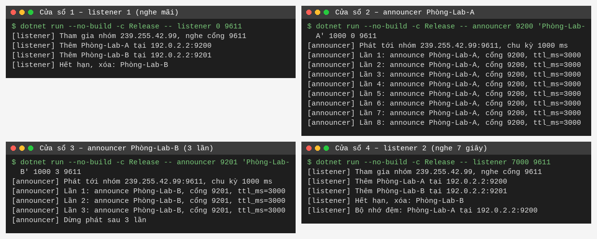

# Bài 6.6 – Phát và nhận thông báo dịch vụ qua multicast (C#)

| Thông tin | Nội dung |
|---|---|
| Mã giả tương ứng | Mã giả 6.8 (Phát và nhận thông báo dịch vụ qua multicast: ANNOUNCER, LISTENER) |
| Mục giáo trình | 6.4.3 Multicast, 6.4.4 Thiết lập TTL và tránh ngập lụt gói tin, 6.4.5 Khám phá dịch vụ trong LAN |
| Kế thừa | Mã giả 6.7: thay địa chỉ broadcast bằng địa chỉ nhóm |
| Thư viện | BCL: `Socket` (UDP), `SocketOptionName.MulticastTimeToLive`, `MulticastLoopback`, `AddMembership` với `MulticastOption` |

## Mục tiêu
Dịch vụ định kỳ phát thông báo `announce` tới nhóm `239.255.42.99` (dải quản trị cục bộ) với `MULTICAST_TTL = 1` và chu kỳ có nhiễu ngẫu nhiên; bên nghe bật `REUSEADDR`, tham gia nhóm (`ADD_MEMBERSHIP`, hệ điều hành gửi IGMP) và giữ bộ nhớ đệm dịch vụ, tự xóa dịch vụ quá hạn `ttl_ms = 3 × chu kỳ` mà không cần thông báo hủy.

## Tệp
- `Program.cs` – phân nhánh theo tham số `announcer` / `listener`.
- `Multicast.cs` – Mã giả 6.8: `Announcer`, `Listener`, `RemoveExpired`.
- `Bai6.6_Multicast.csproj` – dự án console .NET 10.
- `demo.json` – kịch bản chạy minh họa (dùng với `tools/demo.py`).
- `ket_qua.txt`, `ket_qua.png` – kết quả thực thi thật.

## Cách chạy
Mở các cửa sổ dòng lệnh trong thư mục bài:
```bash
dotnet build
# Bên nghe: listener [run_ms] [MPORT]   (mặc định 0 = nghe mãi, 9998)
dotnet run -- listener 0 9998
# Dịch vụ: announcer [cổng dịch vụ] [tên] [period_ms] [count] [MPORT]   (mặc định 9200 server-chat 5000 0 9998)
dotnet run -- announcer 9200 Phòng-Lab-A 5000 0 9998
```
Có thể chạy nhiều bên nghe trên cùng máy nhờ `REUSEADDR`. Dừng bằng Ctrl+C.

## Kết quả thực thi


Hai bên nghe cùng cổng trên một máy đều nhận bản sao của mọi thông báo. Phòng-Lab-A phát liên tục mỗi giây; Phòng-Lab-B chỉ phát 3 lần rồi dừng, nên sau khoảng 3 giây (ttl_ms = 3000) kể từ lần phát cuối, cả hai bên nghe xóa Phòng-Lab-B khỏi bộ nhớ đệm khi nhận thông báo kế tiếp của Phòng-Lab-A. Bên nghe thứ hai chạy 7 giây rồi in bộ nhớ đệm cuối chỉ còn Phòng-Lab-A.

## Ghi chú
- Tham số `count` của ANNOUNCER và `run_ms` của LISTENER được bổ sung để minh họa (giá trị 0 giữ đúng hành vi lặp vô hạn của mã giả). Với `run_ms > 0`, bên nghe đặt thời gian chờ nhận bằng phần thời gian còn lại.
- Giáo trình không nêu chu kỳ mặc định; bài chọn 5000 ms (Mục 6.4.4: vài giây đến vài chục giây). Kịch bản minh họa dùng 1000 ms để thấy kết quả nhanh.
- Theo đúng mã giả, `REMOVE_EXPIRED` chỉ chạy sau mỗi datagram nhận được: nếu không còn dịch vụ nào phát, mục đã hết hạn chỉ bị xóa khi có datagram kế tiếp. Cài đặt thực tế nên đặt thời gian chờ nhận để dọn bộ nhớ đệm định kỳ.
- Gói IGMP Membership Report (bài tập Chương 6) không được quan sát trong môi trường biên soạn; cần Wireshark với bộ lọc `igmp` trên máy thật.
- `ADD_MEMBERSHIP(GROUP, ANY_INTERFACE)` là `SetSocketOption(IP, AddMembership, new MulticastOption(group, IPAddress.Any))`.
- Kiểm thử: Linux, .NET SDK 10.0.114.
