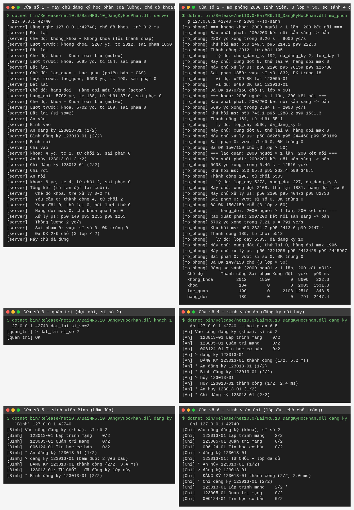

# Bài mở rộng MR6.10 – Đăng ký học phần: 2000 sinh viên tranh 150 chỗ (C#)

| Thông tin | Nội dung |
|---|---|
| Loại | **Bài mở rộng**, không có trong giáo trình và không có mã giả tương ứng. Thuộc nhóm "tranh chấp tài nguyên" MR6.6–MR6.14, dùng chung khung của [MR6.6](../BaiMR6.6_DauGia/) |
| Liên hệ với giáo trình | Chương 6: Bài 6.1 (server đa luồng, một luồng mỗi kết nối), Bài 6.7 (kiểm thử tải); Chương 3: Bài 3.2 (định khung thông điệp theo dòng); bài mở rộng MR5.4/MR5.5 (luồng, đồng bộ) |
| Thư viện | .NET 10 BCL: `System.Net.Sockets`, `System.Threading` (`Thread`, `lock`/`Monitor`, `Interlocked`, `Volatile`, `Barrier`), `System.Collections.Concurrent` (`BlockingCollection`, `ConcurrentDictionary`), `System.Collections.Immutable`, `System.Text.Json.Nodes`; bản giao diện: Windows Forms (`net10.0-windows`, bảng lớp và thanh sĩ số vẽ bằng GDI+). Không dùng gói NuGet |
| Bản ngôn ngữ khác | [Python](../../../python/Chuong06/BaiMR6.10_DangKyHocPhan/), [Java](../../../java/Chuong06/BaiMR6.10_DangKyHocPhan/), [Rust](../../../rust/Chuong06/BaiMR6.10_DangKyHocPhan/), [Go](../../../go/Chuong06/BaiMR6.10_DangKyHocPhan/) |

## Mục tiêu
Bài mô phỏng giờ mở cổng đăng ký học phần. Có vài lớp học phần (mặc định **3 lớp, sĩ số 50**) và hàng nghìn sinh viên cùng bấm "Đăng ký". Lớp chỉ nhận khi **số đã đăng ký < sĩ số**. Sinh viên đã có tên trong lớp thì không đăng ký lại được (`da_dang_ky`), và chỉ hủy được lớp mình đã đăng ký (`chua_dang_ky`). Mỗi lớp là một ô tài nguyên, giữ tập tên sinh viên. Máy chủ TCP đa luồng xử lý `dang_ky` và `huy` bằng thao tác "đọc → kiểm tra (giả lập độ trễ cơ sở dữ liệu 0–2 ms) → ghi" theo **bốn cách** đổi được khi đang chạy. **Sổ kiểm toán** đếm hai sai phạm: **vượt sĩ số** (một lượt đăng ký được chấp nhận khi lớp, theo sổ, đã đủ) và **ĐK trùng** (một sinh viên được nhận vào một lớp mà sổ ghi là đã có tên).

Phần khung (`Chung.cs`, `Khach.cs`, phần KHUNG của `MoPhong.cs`, `GiaoDien/GiaoDienChung.cs`) chép từ MR6.6–MR6.8 (khác dòng `namespace`; riêng `KhoTranhChap` dùng `ConcurrentDictionary` cho bảng ô để thêm ô khi đang chạy, và `SoKiemToan` có thêm `CongSaiPham` – xem Ghi chú). Giao thức, mã lỗi, câu chữ và định dạng dòng in giống hệt bản Python – chạy chéo được.

## Kiến thức chính
Số liệu dưới đây lấy từ `ket_qua.txt`, là một lần chạy thật trên máy cục bộ (127.0.0.1, .NET 10 trên Linux, độ trễ xử lý ngẫu nhiên 0–2 ms). Mỗi lần chạy, số liệu lệch đi đôi chút; .NET chạy đa lõi thật (không có GIL như Python) nên tranh chấp ở `khong_khoa` và thông lượng khác bản Python.

```
2000 sinh viên, 3 lớp × 50, mỗi người muốn 1 lớp, 200 kết nối:
  Chế độ       Thành công Sai phạm Xung đột  yc/s  p99 ms
  khong_khoa         2012     1850        0  8606   222.3
  khoa                184        0        0  2003  1531.3
  lac_quan            190        0     2108 12510   348.5
  hang_doi            189        0        0   791  2447.4
```
("Thành công" gồm cả lượt đăng ký lẫn lượt hủy được chấp nhận – 10 % sinh viên "đổi ý" hủy ngay lớp vừa được nên số chỗ cuối có thể dưới 150. "Sai phạm" do sổ kiểm toán đếm, "Xung đột" là số lần so sánh-và-đổi thất bại, "yc/s" và "p99" (khứ hồi) đo ở bộ mô phỏng.)

- **Vượt sĩ số (race condition).** Ở `khong_khoa`, hàng trăm luồng cùng đọc "lớp còn chỗ" rồi cùng ghi tập mới: sổ kiểm toán đếm **1832 lần vượt sĩ số** và **18 lần ĐK trùng** (ví dụ `u299 ĐK lại 123005-01` – hai thiết bị của cùng một sinh viên cùng thấy "chưa có tên"); tóm tắt "Đã ĐK 1970/150 chỗ". Mất cập nhật còn làm danh sách lớp thật ít hơn số lượt "thành công": nhiều sinh viên được báo thành công nhưng tên không có trong lớp (giao diện báo "Đăng ký … đã bị MẤT"). Chế độ này chỉ dùng để minh họa lỗi trong phòng lab (loopback).
- **Khóa theo từng lớp.** Mỗi lớp là một ô (`LopHp` giữ `ImmutableHashSet` tên sinh viên – ghi là tạo tập mới, hàm xử lý thuần). `khoa` khóa đúng một lớp; ba lớp là ba điểm nóng nên thông lượng chỉ 2003 yc/s, p99 1,5 s.
- **Lạc quan khi tranh nhiều.** `lac_quan` nhanh nhất (12 510 yc/s) nhưng **2108 xung đột** và 227 yêu cầu hết 5 lần thử bị từ chối "xung đột, thử lại sau" (`xung_dot`) – điểm yếu của điều khiển lạc quan khi nhiều người cùng ghi một ô.
- **Hàng đợi một luồng.** `hang_doi` đúng, công bằng (FIFO), hàng đợi dài 1996, nhưng chỉ 791 yc/s.
- **Idempotency theo tên.** Bấm đúp (cửa sổ 5) gửi hai `ma_yc` khác nhau: lượt sau bị từ chối `da_dang_ky`. Sinh viên thứ 100, 200, … của bộ mô phỏng dùng tên người liền trước (thiết bị thứ hai). Thứ tự ưu tiên lớp của mỗi sinh viên ảo xáo bằng `Random` gieo theo tên (FNV-1a) – cùng tên, cùng thứ tự.
- **Dòng lệnh** (sĩ số 2): An đăng ký 123013-01 (1/2), Bình bấm đúp → một thành công (2/2), một "đã đăng ký lớp này"; Chi bị "lớp đã đủ", An hủy, Chi đăng ký lại được (2/2).

### Giao thức (giống hệt ở 5 ngôn ngữ)
Phần chung (chào, quản trị, `thong_ke`, `lap_lai`) như [MR6.6](../BaiMR6.6_DauGia/). Phần riêng của bài:

| Chiều | Thông điệp |
|---|---|
| người dùng → server | `{"loai":"dang_ky","ma_yc":k,"ma_lop":"123013-01"}`, `{"loai":"huy","ma_yc":k,"ma_lop":"123013-01"}` (kết nối gộp thêm `"nguoi":"u17"`) |
| server → client | `{"loai":"kq","ma_yc":k,"ok":true,"thao_tac":"dang_ky","ma_lop":…,"nguoi":…,"da_dk":37}` hoặc `{"loai":"kq","ma_yc":k,"ok":false,"ma_loi":"lop_day"\|"da_dang_ky"\|"chua_dang_ky"\|"sai_du_lieu"\|"xung_dot"\|…,"ly_do":…,"ma_lop":…,"da_dk":50}` |
| server → tất cả | `{"loai":"cap_nhat","che_do":…,"si_so":50,"lop":[{"ma","ten","gv","lich","tc","si_so","da_dk","theo_so","sv":[tên…]}…]}` (≤ 10 lần/s); `{"loai":"su_kien","noi_dung":"An đăng ký 123013-01 (1/50)"}` (chỉ người dùng thật) |
| quản trị → server | `{"loai":"dat_lai","ma_yc":k,"so_lop":3,"si_so":50}` (1–6 lớp, sĩ số 1–500) |

## Cấu trúc tệp
- `Chung.cs`, `Khach.cs`: khung chung (giao thức, `ThongKe`, `KhoTranhChap` 4 chế độ, `SoKiemToan`, `MayChuCoSo`; `KetNoiKhach`, `QuanTri` và dòng lệnh quản trị).
- `MayChu.cs`: `DanhMuc` (6 lớp học phần), record `LopHp`, `SoKiemToanDangKy`, `MayChuDangKy` (đăng ký / hủy, khóa theo lớp); `Server.cs`: máy chủ dòng lệnh.
- `MoPhong.cs`: bộ mô phỏng tải; phần NGHIỆP VỤ là `NguoiAo` (thứ tự ưu tiên theo tên, lớp đủ thì thử lớp sau, 10 % hủy ngay, sinh viên thứ 100, 200, … là thiết bị thứ hai).
- `DangKy.cs`: sinh viên dòng lệnh (`dk <mã> [x2]`, `huy <mã>`, `xem`). `Program.cs`: chọn vai trò `server | mo_phong | khach | dang_ky`.
- `GiaoDien/`: dự án WinForms `BaiMR6.10_GiaoDien.csproj` (dùng chung lõi ở thư mục cha bằng `<Compile Include="..\*.cs">`): `GiaoDienChung.cs`, `FormServer.cs`, `FormDangKy.cs` (cổng đăng ký học phần), `DemoGui.cs`, `Program.cs`, `demo.json`.
- `demo.json`, `ket_qua.txt`, `ket_qua.png`: kịch bản và kết quả thực thi thật.

## Cách chạy
Cần .NET 10 SDK. Chạy trong thư mục bài:
```bash
dotnet build -c Release
dotnet run -c Release -- server 127.0.0.1 9000                                # 3 lớp × 50
dotnet run -c Release -- mo_phong 127.0.0.1 9000 --n 2000 --so-sanh
dotnet run -c Release -- khach 127.0.0.1 9000 dat_lai so_lop=6 si_so=25
dotnet run -c Release -- dang_ky An 127.0.0.1 9000                            # gõ dk 123013-01 / huy … / xem
```
- Lệnh của máy chủ: `che_do …`, `tre <ms>`, `dat_lai [so_lop=… si_so=…]`, `thong_ke`, `thoat`; tùy chọn khi chạy: `--che-do`, `--tre-ms`, `--so-lop`, `--si-so`.
- `dang_ky`: `dk <mã lớp>`, `dk <mã lớp> x2` (bấm đúp), `huy <mã lớp>`, `xem` (bảng lớp, `*` là lớp của mình), `thoat`.
- Tái lập kết quả, từ thư mục gốc của kho: `python3 tools/demo.py csharp/Chuong06/BaiMR6.10_DangKyHocPhan`.

## Ứng dụng giao diện


*(Ảnh `ket_qua_gui.png` và `ket_qua_gui_tranh_chap.png` do vai trò `demo` tự chụp khi chạy trên Windows – WinForms không chạy trên Linux nên bản trong kho chưa có ảnh.)*

- **Máy chủ** (`server_gui`): các phần chung như MR6.6; khung **tài nguyên**: tóm tắt số chỗ đã đăng ký, mỗi lớp một thanh sĩ số (đỏ khi đủ; "(sổ N)" đỏ khi sổ kiểm toán đếm vượt sĩ số), ô **Số lớp**, **Sĩ số** và nút **Đặt lại**.
- **Cổng đăng ký** (`dang_ky_gui`): thanh tiêu đề "CỔNG ĐĂNG KÝ HỌC PHẦN" (học kỳ, năm học), sinh viên và số tín chỉ đã đăng ký, bảng lớp (mã lớp, tên học phần, TC, giảng viên, lịch học, thanh "Đã ĐK / Sĩ số" xanh / cam / đỏ, nút **Đăng ký / Hủy / Đã đủ** trên từng hàng, hàng của mình tô xanh), kết quả đăng ký của bạn; cập nhật trực tiếp từ `cap_nhat`. Đối chiếu danh sách lớp thật: máy chủ báo thành công mà danh sách thiếu tên mình liên tục 0,5 s → "Đăng ký … đã bị MẤT (lỗi máy chủ)!".

Kịch bản `demo` (cùng các bước và dòng `[demo] …` như `demo_gui.py` của bản Python): `khoa`, 3 lớp sĩ số 1: An, Bình, Chi cùng bấm Đăng ký 123013-01 → đúng một người được; `khong_khoa`, trễ 0–20 ms: cùng thao tác → máy chủ báo thành công cho nhiều người, 1 giây sau người mất chỗ thấy "đã bị MẤT", SAI PHẠM, chụp `ket_qua_gui_tranh_chap.png`; `khoa`, 3 lớp × 50: So sánh 4 chế độ; An đăng ký 2 lớp, Bình 1 lớp, bắn đồng loạt 500 sinh viên, Chi bị "Đã đủ", An hủy, Chi đăng ký được; chụp 4 cửa sổ thành `ket_qua_gui.png`; STOP SERVER.

### Cách chạy
**Windows** (cần .NET 10 SDK: `winget install Microsoft.DotNet.SDK.10`):
```powershell
cd csharp\Chuong06\BaiMR6.10_DangKyHocPhan\GiaoDien
dotnet build -c Release
dotnet run -c Release -- server_gui 127.0.0.1 42742        # bấm START SERVER
dotnet run -c Release -- dang_ky_gui An 127.0.0.1 42742
dotnet run -c Release -- dang_ky_gui Bình 127.0.0.1 42742
```
- Kịch bản tự động (từ thư mục gốc kho): `powershell -NoProfile -ExecutionPolicy Bypass -File tools\demo_windows.ps1 csharp\Chuong06\BaiMR6.10_DangKyHocPhan\GiaoDien`.
- Chạy riêng từng cửa sổ: nhật ký và cứ 5 giây một dòng số liệu cũng in ra dòng lệnh (chuyển hướng vào tệp được).
- Thử trên nhiều máy: máy chủ nghe IP card mạng (hoặc `0.0.0.0`), mở tường lửa cho cổng; cả lớp cùng mở `dang_ky_gui` (hoặc bản Python) tới máy thầy; chỉ dùng `khoa`, `lac_quan`, `hang_doi` khi thử thật.

## Kết quả thực thi


## Ghi chú
- **Chạy chéo đã kiểm tra:** bộ mô phỏng C# → máy chủ Python (1000 sinh viên: khong_khoa 850 sai phạm; khoa, lac_quan (1185 xung đột), hang_doi 0) và bộ mô phỏng Python → máy chủ C# (850; 0; 0 (1628 xung đột); 0); `dang_ky` C# với máy chủ Python và ngược lại (bấm đúp → một thành công, một `da_dang_ky`; hủy; bảng `xem` giống hệt).
- **Khác với khung MR6.6–MR6.8 (C#):** bảng ô của `KhoTranhChap` là `ConcurrentDictionary` (trước đây: `Dictionary` chép cả bảng mỗi lần thêm ô) – khung chung của MR6.9–MR6.13 (MR6.9, MR6.13 tạo ô khi đang chạy); `SoKiemToan.CongSaiPham(ma, n)` cộng thẳng vào bộ đếm (như `self.dem[...] += n` của Python). Hành vi 4 chế độ, cổng tạm dừng khi đổi chế độ/đặt lại và định dạng in không đổi.
- Kiểm thử: bản dòng lệnh chạy trên Linux (.NET 10.0.114, `tools/demo.py`). Ứng dụng WinForms đã kiểm tra biên dịch với assembly tham chiếu WinForms, **chưa chạy – cần Windows**.

## Bài tập gợi ý
1. Chạy `mo_phong --so-sanh` với `--tre-ms 0`, `2`, `10`. Sai phạm của `khong_khoa` và số xung đột của `lac_quan` thay đổi thế nào?
2. `dat_lai so_lop=6 si_so=25` (vẫn 150 chỗ) rồi so sánh lại. Vì sao `khoa` nhanh hơn còn `hang_doi` thì không?
3. Thêm luật "không đăng ký hai lớp cùng học phần" (ví dụ 123013-01 và 123013-02). Thao tác `dang_ky` giờ phải đọc những ô nào? Thứ tự khóa và sổ kiểm toán cần gì thêm?
4. Thêm luật "tối đa 6 tín chỉ mỗi sinh viên". Nên giữ tổng tín chỉ ở ô lớp, ở ô sinh viên, hay ở cả hai? Hãy chỉ ra một tình huống tranh chấp mới.
5. Thêm "danh sách chờ": lớp đủ thì sinh viên xếp hàng, có người hủy thì người đầu hàng được nhận tự động. Ở chế độ `hang_doi` điều này dễ hơn vì sao?
6. Giao diện: thêm ô lọc theo tên học phần và nút "Đăng ký nhanh" đăng ký mọi lớp đã chọn trong một lần bấm (gửi nhiều yêu cầu pipelining).

## Đọc thêm
- H. T. Kung, J. T. Robinson (1981). *On Optimistic Methods for Concurrency Control*. ACM Transactions on Database Systems 6(2).
- E. G. Coffman, M. J. Elphick, A. Shoshani (1971). *System Deadlocks*. ACM Computing Surveys 3(2).
- Tài liệu .NET: [câu lệnh `lock`](https://learn.microsoft.com/dotnet/csharp/language-reference/statements/lock), [`Monitor`](https://learn.microsoft.com/dotnet/api/system.threading.monitor) (`TryEnter` có thời gian chờ), [`Interlocked`](https://learn.microsoft.com/dotnet/api/system.threading.interlocked) (`Increment`, `CompareExchange`), [`Barrier`](https://learn.microsoft.com/dotnet/api/system.threading.barrier), [`ConcurrentDictionary<TKey,TValue>`](https://learn.microsoft.com/dotnet/api/system.collections.concurrent.concurrentdictionary-2), [`BlockingCollection<T>`](https://learn.microsoft.com/dotnet/api/system.collections.concurrent.blockingcollection-1), [`System.Threading.Channels`](https://learn.microsoft.com/dotnet/core/extensions/channels), [`ImmutableHashSet<T>`](https://learn.microsoft.com/dotnet/api/system.collections.immutable.immutablehashset-1).

Mã nguồn của bài được viết mới cho kho này.
