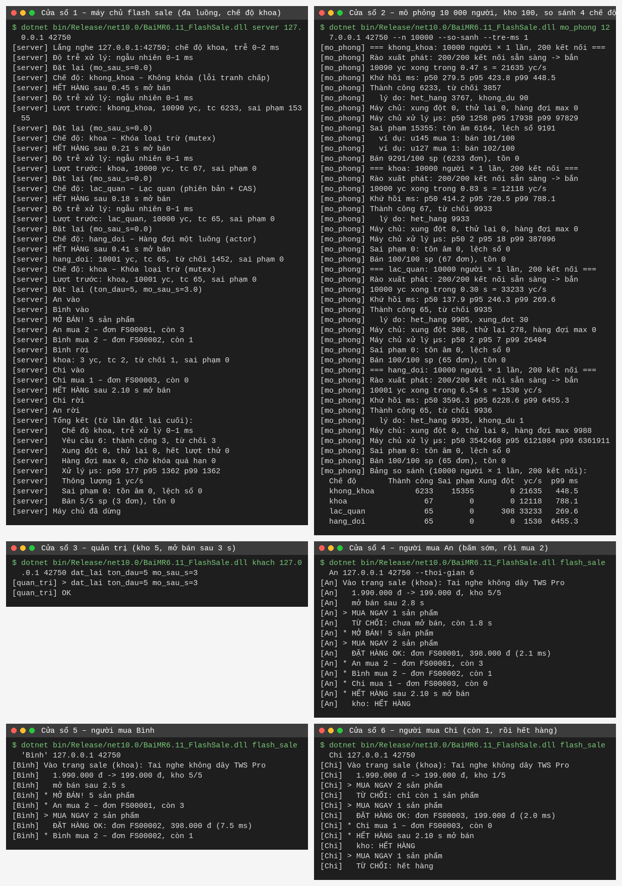

# Bài mở rộng MR6.11 – Flash sale: 10 000 người cùng bấm "MUA NGAY" cho 100 sản phẩm (C#)

| Thông tin | Nội dung |
|---|---|
| Loại | **Bài mở rộng**, không có trong giáo trình và không có mã giả tương ứng. Thuộc nhóm "tranh chấp tài nguyên" MR6.6–MR6.13, dùng chung khung của [MR6.6](../BaiMR6.6_DauGia/) |
| Liên hệ với giáo trình | Chương 6: Bài 6.1 (server đa luồng, một luồng mỗi kết nối), Bài 6.7 (kiểm thử tải); Chương 3: Bài 3.2 (định khung thông điệp theo dòng); bài mở rộng MR5.4/MR5.5 (luồng, đồng bộ) |
| Thư viện | .NET 10 BCL: `System.Net.Sockets`, `System.Threading` (`Thread`, `lock`/`Monitor`, `Interlocked`, `Volatile`, `Barrier`), `System.Collections.Concurrent` (`BlockingCollection`, `ConcurrentDictionary`), `System.Text.Json.Nodes`; bản giao diện: Windows Forms (`net10.0-windows`, ảnh sản phẩm và thanh tồn kho vẽ bằng GDI+). Không dùng gói NuGet |
| Bản ngôn ngữ khác | [Python](../../../python/Chuong06/BaiMR6.11_FlashSale/), [Java](../../../java/Chuong06/BaiMR6.11_FlashSale/), [Rust](../../../rust/Chuong06/BaiMR6.11_FlashSale/), [Go](../../../go/Chuong06/BaiMR6.11_FlashSale/) |

## Mục tiêu
Bài mô phỏng một "giờ vàng" flash sale. Kho có **100 sản phẩm** (tai nghe 1.990.000 đ, giá sale 199.000 đ), **mở bán lúc T** sau một đồng hồ đếm ngược, và **10 000 người** cùng bấm "MUA NGAY" đúng lúc mở, mỗi người đặt một đơn 1–2 sản phẩm. Luật bán: chưa tới giờ thì từ chối `chua_mo`; còn 1 mà mua 2 thì `khong_du`; hết thì `het_hang`. Tồn kho là **một ô duy nhất**, điểm nóng mà mọi đơn hàng cùng tranh. Máy chủ TCP đa luồng xử lý `mua` bằng thao tác "đọc tồn → kiểm tra (giả lập độ trễ cơ sở dữ liệu) → ghi" theo **bốn cách** đổi được khi đang chạy. **Sổ kiểm toán** đếm hai sai phạm: **tồn âm** (một đơn được chấp nhận làm tổng đã bán vượt tồn đầu kỳ, tức bán vượt kho) và **lệch sổ** (cuối buổi, tổng đã bán theo sổ khác tồn đầu kỳ − tồn hiện tại, tính theo số sản phẩm lệch).

Phần khung (`Chung.cs`, `Khach.cs`, phần KHUNG của `MoPhong.cs`, `GiaoDien/GiaoDienChung.cs`) chép từ MR6.6–MR6.8 (khác dòng `namespace`; riêng `KhoTranhChap` dùng `ConcurrentDictionary` cho bảng ô để thêm ô khi đang chạy, và `SoKiemToan` có thêm `CongSaiPham` – xem Ghi chú). Giao thức, mã lỗi, câu chữ và định dạng dòng in giống hệt bản Python – chạy chéo được.

## Kiến thức chính
Số liệu dưới đây lấy từ `ket_qua.txt`, là một lần chạy thật trên máy cục bộ (127.0.0.1, .NET 10 trên Linux, độ trễ xử lý ngẫu nhiên 0–1 ms (`--tre-ms 1`)). Mỗi lần chạy, số liệu lệch đi đôi chút; .NET chạy đa lõi thật (không có GIL như Python) nên tranh chấp ở `khong_khoa` và thông lượng khác bản Python.

```
10 000 người, kho 100, mỗi đơn 1–2 sản phẩm, mở bán ngay lúc rào xuất phát, 200 kết nối:
  Chế độ       Thành công Sai phạm Xung đột  yc/s  p99 ms
  khong_khoa         6233    15355        0 21635   448.5
  khoa                 67        0        0 12118   788.1
  lac_quan             65        0      308 33233   269.6
  hang_doi             65        0        0  1530  6455.3
```
("Thành công" là số đơn được chấp nhận – 100 sản phẩm thành 65–67 đơn 1–2 sản phẩm. "Sai phạm" do sổ kiểm toán đếm, "Xung đột" là số lần so sánh-và-đổi thất bại, "yc/s" và "p99" (khứ hồi) đo ở bộ mô phỏng.)

- **Bán vượt kho (race condition).** Ở `khong_khoa`, hàng nghìn đơn cùng đọc "còn hàng" trước khi đơn đầu tiên kịp ghi: **6233 đơn được chấp nhận** cho kho 100, sổ đếm **6164 lần tồn âm** (ví dụ `u145 mua 1: bán 101/100`) và **9191 sản phẩm lệch sổ** (tồn kho bị ghi đè: "Bán 9291/100 sp … tồn 0"). Chế độ này chỉ dùng để minh họa lỗi trong phòng lab (loopback).
- **Một điểm nóng.** Tồn kho là một ô (`KhoHang(Ton, DaBan, SoDon)`) mà mọi đơn cùng tranh. Ba chế độ an toàn đều bán đúng 100/100.
- **Không đưa vào vùng găng những gì không cần.** Kiểm tra giờ mở bán chỉ đọc đồng hồ đơn điệu; **"hết hàng nhanh"** đọc tồn kho không khóa (tồn chỉ giảm, đã thấy 0 thì chắc chắn là 0) – 9933 yêu cầu đến sau khi cháy hàng được trả lời `het_hang` ngay mà không chờ khóa, nên `khoa` vẫn đạt 12 118 yc/s và `lac_quan` 33 233 yc/s (308 xung đột). `hang_doi` không được lợi vì mọi yêu cầu đã vào hàng (9988) trước khi kịp biết hết hàng: 1530 yc/s, p99 6,5 s.
- **Đồng hồ ở máy chủ.** Thời điểm mở bán chỉ nằm ở máy chủ (`Stopwatch`); client nhận `mo_con_ms` và tự đếm ngược. Bấm sớm vẫn bị máy chủ từ chối `chua_mo` (cửa sổ 4: "chưa mở bán, còn 1.8 s").
- **Dòng lệnh** (kho 5, mở sau 3 s): An bấm sớm bị từ chối; mở bán: An mua 2 (FS00001), Bình 2 (FS00002), Chi mua 2 bị "chỉ còn 1 sản phẩm", mua 1 (FS00003) → "HẾT HÀNG sau 2.10 s mở bán"; lần mua sau bị "hết hàng".

### Giao thức (giống hệt ở 5 ngôn ngữ)
Phần chung (chào, quản trị, `thong_ke`, `lap_lai`) như [MR6.6](../BaiMR6.6_DauGia/). Phần riêng của bài:

| Chiều | Thông điệp |
|---|---|
| người dùng → server | `{"loai":"mua","ma_yc":k,"so_luong":2}` (kết nối gộp thêm `"nguoi":"u17"`) |
| server → client | `{"loai":"kq","ma_yc":k,"ok":true,"ma_don":"FS00012","so_luong":2,"ton":61,"nguoi":"An","thanh_tien":398000}` hoặc `{"loai":"kq","ma_yc":k,"ok":false,"ma_loi":"chua_mo"\|"khong_du"\|"het_hang"\|"sai_du_lieu"\|"xung_dot"\|…,"ly_do":…,"con_ms"/"ton":…}` |
| server → tất cả | `{"loai":"cap_nhat","che_do":…,"sp":{"ten","gia_goc","gia_sale","toi_da"},"ton_dau":100,"ton":61,"da_ban":39,"so_don":25,"ban_theo_so":39,"mo_ban":true,"mo_con_ms":0,"don_gan":[{"nguoi","so_luong","gio"}…]}` (≤ 10 lần/s); `{"loai":"su_kien","noi_dung":"MỞ BÁN! 100 sản phẩm"}`, `"HẾT HÀNG sau 0.17 s mở bán"`, `"An mua 2 – đơn FS00001, còn 98"` (chỉ người dùng thật) |
| quản trị → server | `{"loai":"dat_lai","ma_yc":k,"ton_dau":100,"mo_sau_s":30,"toi_da":2,"gia_goc":…,"gia_sale":…,"ten_sp":…}` |

## Cấu trúc tệp
- `Chung.cs`, `Khach.cs`: khung chung (giao thức, `ThongKe`, `KhoTranhChap` 4 chế độ, `SoKiemToan`, `MayChuCoSo`; `KetNoiKhach`, `QuanTri` và dòng lệnh quản trị).
- `MayChu.cs`: record `KhoHang`, `SoKiemToanFlashSale` (tồn âm, lệch sổ), `MayChuFlashSale` (giờ mở bán, hết hàng nhanh, đơn `FS00001`…, đồng hồ mở bán ở luồng nền); `Server.cs`: máy chủ dòng lệnh.
- `MoPhong.cs`: bộ mô phỏng tải; phần NGHIỆP VỤ là `NguoiAo` (1–2 sản phẩm; "chỉ còn k" thì mua đúng k; hết hàng thì thôi), `ThamSoDatLai = {mo_sau_s: 0}` (rào xuất phát là "giờ G").
- `FlashSale.cs`: người mua dòng lệnh (`mua [n]`). `Program.cs`: chọn vai trò `server | mo_phong | khach | flash_sale`.
- `GiaoDien/`: dự án WinForms `BaiMR6.11_GiaoDien.csproj` (dùng chung lõi ở thư mục cha bằng `<Compile Include="..\*.cs">`): `GiaoDienChung.cs`, `FormServer.cs`, `FormFlashSale.cs` (trang flash sale, ảnh tai nghe `VeTaiNghe`), `DemoGui.cs`, `Program.cs`, `demo.json`.
- `demo.json`, `ket_qua.txt`, `ket_qua.png`: kịch bản và kết quả thực thi thật.

## Cách chạy
Cần .NET 10 SDK. Chạy trong thư mục bài:
```bash
dotnet build -c Release
dotnet run -c Release -- server 127.0.0.1 9000                                # kho 100, mở sau 30 s
dotnet run -c Release -- mo_phong 127.0.0.1 9000 --n 10000 --so-sanh --tre-ms 1
dotnet run -c Release -- khach 127.0.0.1 9000 dat_lai ton_dau=5 mo_sau_s=10
dotnet run -c Release -- flash_sale An 127.0.0.1 9000                         # gõ mua 1 / mua 2
```
- Lệnh của máy chủ: `che_do …`, `tre <ms>`, `dat_lai [ton_dau=… mo_sau_s=… toi_da=… gia_goc=… gia_sale=… ten_sp=…]`, `thong_ke`, `thoat`; tùy chọn khi chạy: `--che-do`, `--tre-ms`, `--ton`, `--mo-sau`.
- `flash_sale`: `mua [n]`, `thoat`; dòng `@t lệnh` chờ tới giây thứ t.
- Tái lập kết quả, từ thư mục gốc của kho: `python3 tools/demo.py csharp/Chuong06/BaiMR6.11_FlashSale`.

## Ứng dụng giao diện


*(Ảnh `ket_qua_gui.png` và `ket_qua_gui_tranh_chap.png` do vai trò `demo` tự chụp khi chạy trên Windows – WinForms không chạy trên Linux nên bản trong kho chưa có ảnh.)*

- **Máy chủ** (`server_gui`): các phần chung như MR6.6; khung **tài nguyên**: ảnh sản phẩm, **tồn kho** cỡ lớn, thanh đã bán, số đã bán theo kho và theo sổ (đỏ khi lệch / bán vượt), đồng hồ mở bán ("Mở bán sau 00:00:27" / "ĐANG MỞ BÁN" / "HẾT HÀNG"), 3 đơn gần nhất, ô **Tồn đầu kỳ**, **Mở bán sau (s)** và nút **Đặt lại**.
- **Trang flash sale** (`flash_sale_gui`): dải "FLASH SALE – GIỜ VÀNG GIÁ SỐC" với đồng hồ đếm ngược (chạy cục bộ theo `mo_con_ms`), thẻ sản phẩm (ảnh vẽ bằng GDI+, nhãn giảm giá "-90%", giá sale cỡ lớn, giá gốc gạch ngang), thanh tồn kho "ĐÃ BÁN x%" / "SẮP CHÁY HÀNG – còn k" / "HẾT HÀNG", chọn số lượng 1–2, nút **MUA NGAY** khóa tới giờ mở bán ("CHỜ MỞ BÁN"), đơn hàng của bạn và "vừa mua" trực tiếp (đơn của mình tô xanh).

Kịch bản `demo` (cùng các bước và dòng `[demo] …` như `demo_gui.py` của bản Python): `khoa`, kho 3, mở sau 3 s: nút khóa khi đếm ngược, mở bán thì An (2), Bình (1), Chi (2) cùng bấm → bán đúng 3; `khong_khoa`, trễ 0–20 ms: cả ba "đặt hàng thành công" → bán vượt, SAI PHẠM, chụp `ket_qua_gui_tranh_chap.png`; `khoa`, trễ 0–1 ms, kho 100: So sánh 4 chế độ; kho 100, mở sau 4 s: chụp Chi lúc đếm ngược, mở bán: An mua 2, 50 người ảo, Bình mua 2; chụp 4 cửa sổ thành `ket_qua_gui.png`; STOP SERVER.

### Cách chạy
**Windows** (cần .NET 10 SDK: `winget install Microsoft.DotNet.SDK.10`):
```powershell
cd csharp\Chuong06\BaiMR6.11_FlashSale\GiaoDien
dotnet build -c Release
dotnet run -c Release -- server_gui 127.0.0.1 42752        # bấm START SERVER
dotnet run -c Release -- flash_sale_gui An 127.0.0.1 42752
dotnet run -c Release -- flash_sale_gui Bình 127.0.0.1 42752
```
- Kịch bản tự động (từ thư mục gốc kho): `powershell -NoProfile -ExecutionPolicy Bypass -File tools\demo_windows.ps1 csharp\Chuong06\BaiMR6.11_FlashSale\GiaoDien`.
- Chạy riêng từng cửa sổ: nhật ký và cứ 5 giây một dòng số liệu cũng in ra dòng lệnh (chuyển hướng vào tệp được).
- Thử trên nhiều máy: máy chủ nghe IP card mạng (hoặc `0.0.0.0`), mở tường lửa cho cổng; cả lớp cùng mở `flash_sale_gui` (hoặc bản Python) tới máy thầy; chỉ dùng `khoa`, `lac_quan`, `hang_doi` khi thử thật.

## Kết quả thực thi


## Ghi chú
- **Chạy chéo đã kiểm tra:** bộ mô phỏng C# → máy chủ Python (5000 người, trễ 0–1 ms: khong_khoa 12 259 sai phạm; khoa, lac_quan (766 xung đột), hang_doi 0) và bộ mô phỏng Python → máy chủ C# (7614; 0; 0 (1034 xung đột); 0); `flash_sale` C# với máy chủ Python và ngược lại (kho 3: mua 2 → FS00001, mua 2 → "chỉ còn 1 sản phẩm", mua 1 → FS00002, hết hàng).
- **Khác với khung MR6.6–MR6.8 (C#):** bảng ô của `KhoTranhChap` là `ConcurrentDictionary` (trước đây: `Dictionary` chép cả bảng mỗi lần thêm ô) – khung chung của MR6.9–MR6.13 (MR6.9, MR6.13 tạo ô khi đang chạy); `SoKiemToan.CongSaiPham(ma, n)` cộng thẳng vào bộ đếm (như `self.dem[...] += n` của Python). Hành vi 4 chế độ, cổng tạm dừng khi đổi chế độ/đặt lại và định dạng in không đổi.
- Kiểm thử: bản dòng lệnh chạy trên Linux (.NET 10.0.114, `tools/demo.py`). Ứng dụng WinForms đã kiểm tra biên dịch với assembly tham chiếu WinForms, **chưa chạy – cần Windows**.

## Bài tập gợi ý
1. Bỏ bước "hết hàng nhanh" trong `MayChu.cs` rồi chạy lại so sánh. Thông lượng của `khoa` và p50 xử lý ở máy chủ thay đổi thế nào? Giải thích.
2. Thêm cờ "hết hàng" kiểm tra ngay trong luồng kết nối *trước khi* xếp vào hàng đợi của `hang_doi`, và kiểm tra lại cờ đó lúc luồng xử lý lấy việc ra. Thông lượng `hang_doi` tăng bao nhiêu? Vì sao vẫn đúng?
3. Thêm luật "mỗi khách tối đa 2 sản phẩm cho cả đợt" (không chỉ mỗi đơn). Cần thêm ô nào, và thao tác `mua` phải khóa những ô nào?
4. Chia kho 100 thành 10 "lô" (ô `kho_0` … `kho_9`, mỗi ô 10 sản phẩm), mỗi người mua ở lô theo băm tên, lô hết thì thử lô khác. Đây là cách giảm điểm nóng (sharding). Đo lại `khoa` và `lac_quan`.
5. Giả sử đồng hồ máy client chạy nhanh 2 s. Vì sao máy chủ gửi `mo_con_ms` thay vì giờ mở bán tuyệt đối, và vì sao vẫn phải kiểm tra giờ ở máy chủ?
6. Giao diện: thêm hiệu ứng "nháy" cho thanh tồn kho khi còn dưới 10 sản phẩm, và âm báo khi đặt hàng thành công.

## Đọc thêm
- H. T. Kung, J. T. Robinson (1981). *On Optimistic Methods for Concurrency Control*. ACM Transactions on Database Systems 6(2).
- E. G. Coffman, M. J. Elphick, A. Shoshani (1971). *System Deadlocks*. ACM Computing Surveys 3(2).
- Tài liệu .NET: [câu lệnh `lock`](https://learn.microsoft.com/dotnet/csharp/language-reference/statements/lock), [`Monitor`](https://learn.microsoft.com/dotnet/api/system.threading.monitor) (`TryEnter` có thời gian chờ), [`Interlocked`](https://learn.microsoft.com/dotnet/api/system.threading.interlocked) (`Increment`, `CompareExchange`), [`Barrier`](https://learn.microsoft.com/dotnet/api/system.threading.barrier), [`ConcurrentDictionary<TKey,TValue>`](https://learn.microsoft.com/dotnet/api/system.collections.concurrent.concurrentdictionary-2), [`BlockingCollection<T>`](https://learn.microsoft.com/dotnet/api/system.collections.concurrent.blockingcollection-1), [`System.Threading.Channels`](https://learn.microsoft.com/dotnet/core/extensions/channels), [`Stopwatch`](https://learn.microsoft.com/dotnet/api/system.diagnostics.stopwatch).

Mã nguồn của bài được viết mới cho kho này.
