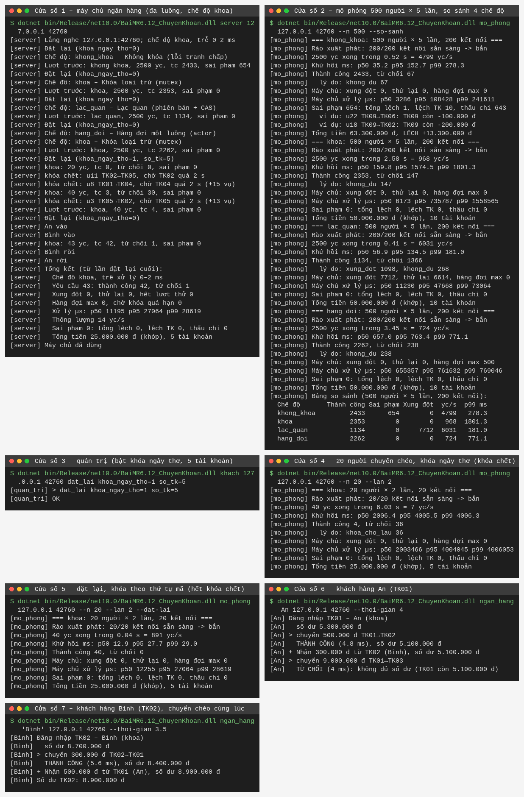

# Bài mở rộng MR6.12 – Chuyển khoản: n người chuyển tiền chéo nhau cùng lúc (C#)

| Thông tin | Nội dung |
|---|---|
| Loại | **Bài mở rộng**, không có trong giáo trình và không có mã giả tương ứng. Thuộc nhóm "tranh chấp tài nguyên" MR6.6–MR6.14, dùng chung khung của [MR6.6](../BaiMR6.6_DauGia/) |
| Liên hệ với giáo trình | Chương 6: Bài 6.1 (server đa luồng, một luồng mỗi kết nối), Bài 6.7 (kiểm thử tải); Chương 3: Bài 3.2 (định khung thông điệp theo dòng); bài mở rộng MR5.4/MR5.5 (luồng, đồng bộ) |
| Thư viện | .NET 10 BCL: `System.Net.Sockets`, `System.Threading` (`Thread`, `lock`/`Monitor`, `Interlocked`, `Volatile`, `Barrier`), `System.Collections.Concurrent` (`BlockingCollection`, `ConcurrentDictionary`), `System.Text.Json.Nodes`; bản giao diện: Windows Forms (`net10.0-windows`, thẻ tài khoản và thanh số dư vẽ bằng GDI+). Không dùng gói NuGet |
| Bản ngôn ngữ khác | [Python](../../../python/Chuong06/BaiMR6.12_ChuyenKhoan/), [Java](../../../java/Chuong06/BaiMR6.12_ChuyenKhoan/), [Rust](../../../rust/Chuong06/BaiMR6.12_ChuyenKhoan/), [Go](../../../go/Chuong06/BaiMR6.12_ChuyenKhoan/) |

## Mục tiêu
Bài mô phỏng một ngân hàng nhỏ có 5–20 tài khoản (mặc định 10 tài khoản, mỗi tài khoản 5.000.000 đ). Một lệnh **chuyển khoản** (`chuyen`: từ, đến, số tiền) phải trừ tài khoản nguồn và cộng tài khoản đích **trong cùng một thao tác**, và bị từ chối nếu số dư nguồn không đủ. Khác với MR6.6 (một tài nguyên), mỗi thao tác ở đây chạm **hai tài nguyên**. Rất nhiều người chuyển chéo nhau cùng lúc (A→B và B→A), nên ngoài tranh chấp (mất cập nhật) còn xuất hiện **khóa chết** (deadlock) nếu khóa sai thứ tự.

Máy chủ TCP đa luồng giữ số dư. Mỗi lần chuyển là "đọc hai số dư → kiểm tra (giả lập độ trễ cơ sở dữ liệu 0–2 ms) → ghi hai số dư", xử lý theo bốn cách chọn được lúc đang chạy: không khóa, khóa loại trừ (hai tài khoản), lạc quan (phiên bản + so sánh-và-đổi cả hai tài khoản), hàng đợi một luồng. Chế độ `khoa` có thêm tùy chọn **khóa ngây thơ** (khóa nguồn rồi mới khóa đích) để thấy khóa chết. **Sổ kiểm toán** tự cộng trừ từng giao dịch được chấp nhận và đối chiếu: tổng tiền toàn hệ thống có giữ nguyên không, số dư từng tài khoản có khớp sổ không, có giao dịch nào làm tài khoản âm (thấu chi) không.

Phần khung (`Chung.cs`, `Khach.cs`, phần KHUNG của `MoPhong.cs`, `GiaoDien/GiaoDienChung.cs`) chép từ MR6.6–MR6.8 (khác dòng `namespace`; riêng `KhoTranhChap` dùng `ConcurrentDictionary` cho bảng ô để thêm ô khi đang chạy, và `SoKiemToan` có thêm `CongSaiPham` – xem Ghi chú). Giao thức, mã lỗi, câu chữ và định dạng dòng in giống hệt bản Python – chạy chéo được.

## Kiến thức chính
Số liệu dưới đây lấy từ `ket_qua.txt`, là một lần chạy thật trên máy cục bộ (127.0.0.1, .NET 10 trên Linux, độ trễ xử lý ngẫu nhiên 0–2 ms). Mỗi lần chạy, số liệu lệch đi đôi chút; .NET chạy đa lõi thật (không có GIL như Python) nên tranh chấp ở `khong_khoa` và thông lượng khác bản Python.

```
500 người × 5 lần chuyển qua lại một cặp tài khoản, 10 tài khoản × 5 triệu, 200 kết nối:
  Chế độ       Thành công Sai phạm Xung đột  yc/s  p99 ms
  khong_khoa         2433      654        0  4799   278.3
  khoa               2353        0        0   968  1801.3
  lac_quan           1134        0     7712  6031   181.0
  hang_doi           2262        0        0   724   771.1
Khóa ngây thơ (nguồn rồi đích), 20 người × 2 lần, 5 tài khoản:
  40 yc trong 6,03 s: thành công 4, khoa_cho_lau 36 (khóa chết)
Đặt lại (khóa theo thứ tự mã): 40 yc trong 0,04 s, thành công 40
```
("Thành công" là số lệnh chuyển được chấp nhận; từ chối `khong_du` là nghiệp vụ bình thường. "Sai phạm" do sổ kiểm toán đếm, "Xung đột" là số lần so sánh-và-đổi thất bại, "yc/s" và "p99" (khứ hồi) đo ở bộ mô phỏng.)

- **Mất cập nhật trên hai tài nguyên.** Ở `khong_khoa`, hai lệnh cùng đọc số dư cũ rồi cùng ghi: tổng tiền hệ thống từ 50.000.000 đ thành **63.300.000 đ (LỆCH +13.300.000 đ)**, sổ đếm 1 tổng lệch, 10 tài khoản lệch sổ và **643 lần thấu chi** (ví dụ `u22 TK09→TK06: TK09 còn -100.000 đ`). Chế độ này chỉ dùng để minh họa lỗi trong phòng lab (loopback).
- **Khóa chết và thứ tự khóa (Coffman và cộng sự 1971).** Khóa ngây thơ (`dat_lai khoa_ngay_tho=1`): A→B giữ A chờ B, B→A giữ B chờ A – vòng chờ. Khung phát hiện bằng `Monitor.TryEnter(…, 2 s)`: giao dịch "nạn nhân" bị hủy (`khoa_cho_lau`), nhả khóa, giao dịch kia đi tiếp; máy chủ báo tối đa 1 dòng/giây `khóa chết: u11 TK02→TK05, chờ TK02 quá 2 s (+15 vụ)`. 40 lệnh mất 6 s, chỉ 4 thành công. Khóa **theo thứ tự mã tài khoản** (mặc định) phá điều kiện vòng chờ: 40/40 trong 0,04 s.
- **Lạc quan trên hai ô.** `lac_quan` so sánh-và-đổi phiên bản **cả hai** tài khoản một cách nguyên tử; nhiều người cùng chạm 10 tài khoản nên **7712 xung đột**, 1098 lệnh hết 5 lần thử (`xung_dot`) – nhanh (6031 yc/s) nhưng nhiều từ chối.
- **`khoa` chậm vì giữ hai khóa.** Mỗi lệnh giữ khóa hai tài khoản suốt đọc – xử lý – ghi; 500 người trên 10 tài khoản xếp hàng chờ nhau: 968 yc/s, p99 1,8 s; `hang_doi` 724 yc/s, p99 0,77 s.
- **Sổ kiểm toán tự tính số dư** theo từng giao dịch được chấp nhận (ghi trong vùng găng, ngay sau khi ghi hai số dư) rồi đối chiếu với số dư thật.
- **Dòng lệnh:** An chuyển 500.000 đ cho Bình đúng lúc Bình chuyển 300.000 đ cho An – cả hai thành công, mỗi bên thấy "+ Nhận …"; An chuyển 9.000.000 đ bị "không đủ số dư".

### Giao thức (giống hệt ở 5 ngôn ngữ)
Phần chung (chào, quản trị, `thong_ke`, `lap_lai`) như [MR6.6](../BaiMR6.6_DauGia/). Phần riêng của bài:

| Chiều | Thông điệp |
|---|---|
| client → server | `{"loai":"chao","ten":"An","vai_tro":"nguoi_dung"\|"quan_tri"}` (đầu tiên, tên 1–16 ký tự); kết nối gộp của bộ mô phỏng thêm `"so_nguoi":m` |
| người dùng → server | `{"loai":"chuyen","ma_yc":k,"tu":"TK01","den":"TK02","so_tien":500000,"noi_dung":"…"}` (nội dung tùy chọn, ≤ 40 ký tự; kết nối gộp thêm `"nguoi":"u17"`) |
| quản trị → server | `{"loai":"che_do","ma_yc":k,"gia_tri":"khoa"}`, `{"loai":"tre","ma_yc":k,"ms":2}`, `{"loai":"dat_lai","ma_yc":k,"so_tk":10,"so_du_dau":5000000,"khoa_ngay_tho":0\|1}`, `{"loai":"thong_ke","ma_yc":k}` |
| server → client | `{"loai":"chao","ma":id,"che_do":"khoa","may_chu":"Ngân hàng MR6.12"}`, ngay sau đó là một `cap_nhat`; `{"loai":"loi","ly_do":…}` khi sai giao thức |
| server → client | `{"loai":"kq","ma_yc":k,"ok":true,"tu","den","so_tien","so_du"(số dư mới của nguồn),"ma_gd",…}` hoặc `{"loai":"kq","ma_yc":k,"ok":false,"ma_loi":"khong_du"\|"khoa_cho_lau"\|"xung_dot"\|"khong_co"\|"sai_du_lieu"\|…,"ly_do":…}` |
| server → tất cả | `{"loai":"cap_nhat","che_do":…,"tai_khoan":[{"ma","chu","so_du"}…],"tong","tong_dau","khoa_ngay_tho","khoa_chet","so_gd","lich_su":[{"ma","gio","nguoi","tu","den","so_tien","noi_dung"}…]}` (≤ 10 lần/s); `{"loai":"su_kien","noi_dung":"khóa chết: …"}` |
| server → quản trị | `{"loai":"thong_ke","ma_yc":k,"so_yc","thanh_cong","tu_choi","xung_dot","thu_lai","het_lan_thu","khoa_cho_lau","hang_doi_max","yc_s","thong_luong","p50_us","p95_us","p99_us","sai_pham":[{"ma","ten","so"}],"sai_pham_tong","tom_tat",…}` |

## Cấu trúc tệp
- `Chung.cs`, `Khach.cs`: khung chung (giao thức, `ThongKe`, `KhoTranhChap` 4 chế độ, `SoKiemToan`, `MayChuCoSo`; `KetNoiKhach`, `QuanTri` và dòng lệnh quản trị).
- `MayChu.cs`: `NganHang` (chủ tài khoản, `MaTk`, `TienDau`), `SoKiemToanNganHang`, `MayChuNganHang` (chuyển khoản hai ô, báo khóa chết, lịch sử giao dịch); `Server.cs`: máy chủ dòng lệnh (`--khoa-ngay-tho`).
- `MoPhong.cs`: bộ mô phỏng tải; phần NGHIỆP VỤ là `NguoiAo` (một cặp tài khoản ngẫu nhiên, chuyển qua lại `lan` lần), `ThamSoDatLai = {khoa_ngay_tho: 0}`.
- `NganHang.cs`: khách hàng dòng lệnh (`chuyen <TK> <số tiền> [nội dung]`, `so_du`). `Program.cs`: chọn vai trò `server | mo_phong | khach | ngan_hang`.
- `GiaoDien/`: dự án WinForms `BaiMR6.12_GiaoDien.csproj` (dùng chung lõi ở thư mục cha bằng `<Compile Include="..\*.cs">`): `GiaoDienChung.cs`, `FormServer.cs`, `FormNganHang.cs` (ngân hàng số, thẻ tài khoản `VeThe`), `DemoGui.cs`, `Program.cs`, `demo.json`.
- `demo.json`, `ket_qua.txt`, `ket_qua.png`: kịch bản và kết quả thực thi thật.

## Cách chạy
Cần .NET 10 SDK. Chạy trong thư mục bài:
```bash
dotnet build -c Release
dotnet run -c Release -- server 127.0.0.1 9000                                # 10 tài khoản × 5 triệu
dotnet run -c Release -- mo_phong 127.0.0.1 9000 --n 500 --so-sanh
dotnet run -c Release -- khach 127.0.0.1 9000 dat_lai khoa_ngay_tho=1 so_tk=5
dotnet run -c Release -- mo_phong 127.0.0.1 9000 --n 20 --lan 2              # khóa chết
dotnet run -c Release -- ngan_hang An 127.0.0.1 9000                          # gõ chuyen TK02 500000 / so_du
```
- Lệnh của máy chủ: `che_do …`, `tre <ms>`, `dat_lai [so_tk=… so_du_dau=… khoa_ngay_tho=0|1]`, `thong_ke`, `thoat`; tùy chọn khi chạy: `--che-do`, `--tre-ms`, `--so-tk`, `--so-du`, `--khoa-ngay-tho`.
- `ngan_hang`: `chuyen <TK> <số tiền> [nội dung]`, `so_du`, `thoat`; `--tk TK03` chọn tài khoản (mặc định tài khoản mang tên mình, không có thì TK01).
- Tái lập kết quả, từ thư mục gốc của kho: `python3 tools/demo.py csharp/Chuong06/BaiMR6.12_ChuyenKhoan`.

## Ứng dụng giao diện


*(Ảnh `ket_qua_gui.png`, `ket_qua_gui_khoa_chet.png` và `ket_qua_gui_tranh_chap.png` do vai trò `demo` tự chụp khi chạy trên Windows – WinForms không chạy trên Linux nên bản trong kho chưa có ảnh.)*

- **Máy chủ** (`server_gui`): các phần chung như MR6.6; khung **tài nguyên**: **TỔNG TIỀN HỆ THỐNG** (xanh khi khớp, đỏ "LỆCH …"), mỗi tài khoản một thanh số dư (vạch xám = số dư ban đầu), số giao dịch và số vụ **khóa chết** phát hiện, 3 giao dịch gần nhất, ô **Số tài khoản**, **Số dư ban đầu**, ô chọn **Khóa ngây thơ** và nút **Đặt lại**.
- **Ngân hàng số** (`ngan_hang_gui`): thẻ tài khoản (GDI+: nền chuyển màu, góc bo, chip, số tài khoản, chủ tài khoản, số dư cỡ lớn), chọn tài khoản của tôi, lịch sử giao dịch (tiền ra đỏ "−", tiền vào xanh "+"), khung chuyển tiền (người nhận, số tiền, nút nhanh 100K / 500K / 1 triệu / 2 triệu, nội dung), thông báo kết quả (kể cả "Khóa chết: chờ … quá 2 s, đã hủy giao dịch"), dòng "+ Nhận … từ …" khi có tiền đến, cảnh báo khi tổng tiền hệ thống lệch.

Kịch bản `demo` (cùng các bước và dòng `[demo] …` như `demo_gui.py` của bản Python): `khoa`: An→Bình và Bình→An cùng lúc → cả hai thành công; bật khóa ngây thơ, trễ 0–50 ms: lặp lại → khóa chết, chụp `ket_qua_gui_khoa_chet.png`; tắt khóa ngây thơ → hết khóa chết; `khong_khoa`, trễ 0–20 ms: An→Bình, Bình→Chi, Chi→An 1.000.000 đ cùng lúc → tổng tiền lệch, chụp `ket_qua_gui_tranh_chap.png`; `khoa`: So sánh 4 chế độ; An chuyển 200.000 đ cho Chi; chụp 4 cửa sổ thành `ket_qua_gui.png`; STOP SERVER.

### Cách chạy
**Windows** (cần .NET 10 SDK: `winget install Microsoft.DotNet.SDK.10`):
```powershell
cd csharp\Chuong06\BaiMR6.12_ChuyenKhoan\GiaoDien
dotnet build -c Release
dotnet run -c Release -- server_gui 127.0.0.1 42762        # bấm START SERVER
dotnet run -c Release -- ngan_hang_gui An 127.0.0.1 42762
dotnet run -c Release -- ngan_hang_gui Bình 127.0.0.1 42762
```
- Kịch bản tự động (từ thư mục gốc kho): `powershell -NoProfile -ExecutionPolicy Bypass -File tools\demo_windows.ps1 csharp\Chuong06\BaiMR6.12_ChuyenKhoan\GiaoDien`.
- Chạy riêng từng cửa sổ: nhật ký và cứ 5 giây một dòng số liệu cũng in ra dòng lệnh (chuyển hướng vào tệp được).
- Thử trên nhiều máy: máy chủ nghe IP card mạng (hoặc `0.0.0.0`), mở tường lửa cho cổng; cả lớp cùng mở `ngan_hang_gui` (hoặc bản Python) tới máy thầy; chỉ dùng `khoa`, `lac_quan`, `hang_doi` khi thử thật.

## Kết quả thực thi


## Ghi chú
- **Chạy chéo đã kiểm tra:** bộ mô phỏng C# → máy chủ Python (300 người × 5 lần: khong_khoa 464 sai phạm; khoa, lac_quan (4621 xung đột), hang_doi 0; khóa ngây thơ 20 người × 2: 30 `khoa_cho_lau`) và bộ mô phỏng Python → máy chủ C# (393; 0; 0 (4241 xung đột); 0; khóa ngây thơ: 37 `khoa_cho_lau`, máy chủ C# báo `khóa chết: …`); `ngan_hang` C# với máy chủ Python và ngược lại (chuyển 500.000 đ thành công, 90.000.000 đ "không đủ số dư").
- **Khác với khung MR6.6–MR6.8 (C#):** bảng ô của `KhoTranhChap` là `ConcurrentDictionary` (trước đây: `Dictionary` chép cả bảng mỗi lần thêm ô) – khung chung của MR6.9–MR6.13 (MR6.9, MR6.13 tạo ô khi đang chạy); `SoKiemToan.CongSaiPham(ma, n)` cộng thẳng vào bộ đếm (như `self.dem[...] += n` của Python). Hành vi 4 chế độ, cổng tạm dừng khi đổi chế độ/đặt lại và định dạng in không đổi.
- Kiểm thử: bản dòng lệnh chạy trên Linux (.NET 10.0.114, `tools/demo.py`). Ứng dụng WinForms đã kiểm tra biên dịch với assembly tham chiếu WinForms, **chưa chạy – cần Windows**.

## Bài tập gợi ý
1. Chạy lượt khóa chết với `--n 2 --lan 1` và một người chuyển A→B, người kia B→A (sửa `NguoiAo`). Đo chính xác thời gian và số giao dịch bị hủy. Vì sao chỉ một trong hai bị hủy?
2. Thay `Monitor.TryEnter(…, 2 s)` bằng `Monitor.Enter` (chờ mãi) ở chế độ khóa ngây thơ. Chuyện gì xảy ra với máy chủ và với bộ mô phỏng? Đây là lý do phải có thời gian chờ hoặc dò vòng chờ.
3. Cài đặt một cách phòng khóa chết khác: "thử khóa" (`Monitor.TryEnter(o)` không chờ) khóa thứ hai, không được thì nhả khóa thứ nhất, nghỉ ngẫu nhiên rồi thử lại. So sánh với khóa có thứ tự. Có nguy cơ *livelock* không?
4. Tăng `so_tk` lên 20 và giảm xuống 5. Thông lượng của `khoa` và số xung đột của `lac_quan` thay đổi thế nào? Giải thích bằng xác suất hai lệnh chuyển chung một tài khoản.
5. Thêm thao tác `chuyen_nhieu` (một nguồn, nhiều đích: trả lương). Cần khóa bao nhiêu ô, theo thứ tự nào? Sổ kiểm toán có cần luật mới không?
6. Giao diện: vẽ bằng GDI+ (`OVe`) trên bảng điều khiển máy chủ đồ thị chờ (tài khoản là đỉnh, "giữ khóa X chờ khóa Y" là cạnh) khi bật khóa ngây thơ, và tô đỏ chu trình.

## Đọc thêm
- E. G. Coffman, M. J. Elphick, A. Shoshani (1971). *System Deadlocks*. ACM Computing Surveys 3(2): bốn điều kiện cần của khóa chết và các cách phòng, tránh, phát hiện.
- H. T. Kung, J. T. Robinson (1981). *On Optimistic Methods for Concurrency Control*. ACM Transactions on Database Systems 6(2).
- Tài liệu .NET: [câu lệnh `lock`](https://learn.microsoft.com/dotnet/csharp/language-reference/statements/lock), [`Monitor`](https://learn.microsoft.com/dotnet/api/system.threading.monitor) (`TryEnter` có thời gian chờ), [`Interlocked`](https://learn.microsoft.com/dotnet/api/system.threading.interlocked) (`Increment`, `CompareExchange`), [`Barrier`](https://learn.microsoft.com/dotnet/api/system.threading.barrier), [`ConcurrentDictionary<TKey,TValue>`](https://learn.microsoft.com/dotnet/api/system.collections.concurrent.concurrentdictionary-2), [`BlockingCollection<T>`](https://learn.microsoft.com/dotnet/api/system.collections.concurrent.blockingcollection-1), [`System.Threading.Channels`](https://learn.microsoft.com/dotnet/core/extensions/channels).

Mã nguồn của bài được viết mới cho kho này.
