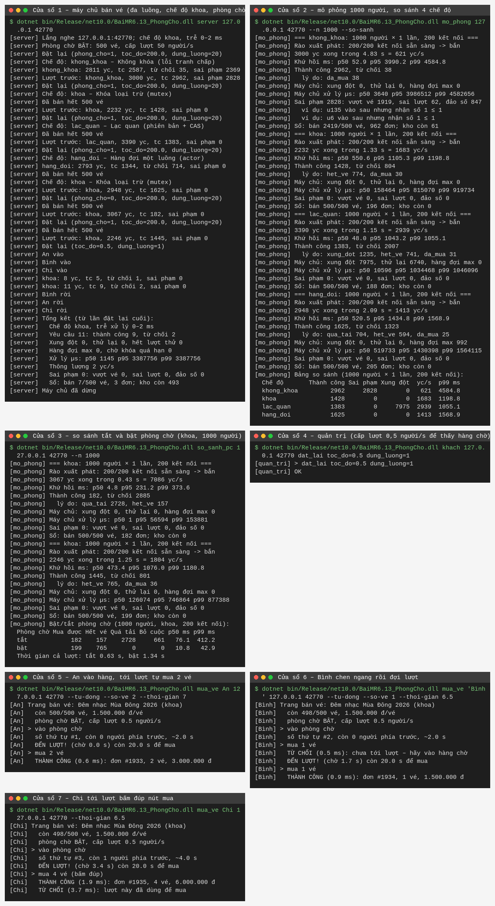

# Bài mở rộng MR6.13 – Phòng chờ ảo bán vé concert: hàng nghìn người tranh 500 vé (C#)

| Thông tin | Nội dung |
|---|---|
| Loại | **Bài mở rộng**, không có trong giáo trình và không có mã giả tương ứng. Thuộc nhóm "tranh chấp tài nguyên" MR6.6–MR6.13, dùng chung khung của [MR6.6](../BaiMR6.6_DauGia/) |
| Liên hệ với giáo trình | Chương 6: Bài 6.1 (server đa luồng, một luồng mỗi kết nối), Bài 6.7 (kiểm thử tải); Chương 3: Bài 3.2 (định khung thông điệp theo dòng); bài mở rộng MR5.4/MR5.5 (luồng, đồng bộ) |
| Thư viện | .NET 10 BCL: `System.Net.Sockets`, `System.Threading` (`Thread`, `lock`/`Monitor`, `Interlocked`, `Volatile`, `Barrier`), `System.Collections.Concurrent` (`BlockingCollection`, `ConcurrentDictionary`), `System.Text.Json.Nodes`; bản giao diện: Windows Forms (`net10.0-windows`, áp phích concert vẽ bằng GDI+). Không dùng gói NuGet |
| Bản ngôn ngữ khác | [Python](../../../python/Chuong06/BaiMR6.13_PhongCho/), [Java](../../../java/Chuong06/BaiMR6.13_PhongCho/), [Rust](../../../rust/Chuong06/BaiMR6.13_PhongCho/), [Go](../../../go/Chuong06/BaiMR6.13_PhongCho/) |

## Mục tiêu
Bài mô phỏng trang bán 500 vé concert vào lúc mở bán, khi hàng nghìn người cùng bấm "Mua". Máy chủ có **phòng chờ ảo** (virtual waiting room). Người dùng gửi `xep_hang` để nhận **số thứ tự**, số người phía trước và thời gian chờ ước tính. Máy chủ **cấp lượt** cho người đầu hàng theo **thùng token** (token bucket, mặc định 50 người/giây, chỉnh được ngay lúc chạy). Mỗi lượt có hạn **20 s** để `mua` 1–4 vé. Một **công tắc** bật/tắt phòng chờ cho phép so sánh: khi tắt, mọi người dồn thẳng vào `mua`, máy chủ chỉ nhận tối đa 64 yêu cầu mua đang xử lý cùng lúc, phần vượt bị từ chối ngay "hệ thống quá tải".

Ba chỗ tranh chấp đi qua bốn cách xử lý của khung (không khóa, khóa loại trừ, lạc quan, hàng đợi một luồng): **phát số thứ tự** (đọc – cộng 1 – ghi), **trừ kho vé** và **tiêu lượt** (một lượt chỉ được mua một lần, kể cả khi người dùng mở hai tab). **Sổ kiểm toán** đếm ba sai phạm: *vượt vé* (bán quá 500 vé), *sai lượt* (một đơn được nhận khi lượt đã dùng) và *đảo số* (người vào hàng sau nhận số thứ tự không lớn hơn người vào trước, tức FIFO bị phá).

Phần khung (`Chung.cs`, `Khach.cs`, phần KHUNG của `MoPhong.cs`, `GiaoDien/GiaoDienChung.cs`) chép từ MR6.6–MR6.8 (khác dòng `namespace`; riêng `KhoTranhChap` dùng `ConcurrentDictionary` cho bảng ô để thêm ô khi đang chạy, và `SoKiemToan` có thêm `CongSaiPham` – xem Ghi chú). Giao thức, mã lỗi, câu chữ và định dạng dòng in giống hệt bản Python – chạy chéo được.

## Kiến thức chính
Số liệu dưới đây lấy từ `ket_qua.txt`, là một lần chạy thật trên máy cục bộ (127.0.0.1, .NET 10 trên Linux, độ trễ xử lý ngẫu nhiên 0–2 ms; `--so-sanh` đặt lại phòng chờ bật, cấp lượt 200 người/s, thùng 20 token). Mỗi lần chạy, số liệu lệch đi đôi chút; .NET chạy đa lõi thật (không có GIL như Python) nên tranh chấp ở `khong_khoa` và thông lượng khác bản Python.

```
1000 người, mỗi người mua 1–4 vé, 1/10 là tab thứ hai của người liền trước, 200 kết nối:
  Chế độ       Thành công Sai phạm Xung đột  yc/s  p99 ms
  khong_khoa         2962     2828        0   621  4584.8
  khoa               1428        0        0  1683  1198.8
  lac_quan           1383        0     7975  2939  1055.1
  hang_doi           1625        0        0  1413  1568.9
Bật/tắt phòng chờ (khoa, 1000 người):
  Phòng chờ Mua được Hết vé Quá tải Bỏ cuộc p50 ms p99 ms
  tắt            182    157    2728     661   76.1  412.2
  bật            199    765       0       0   10.8   42.9
  Thời gian cả lượt: tắt 0.63 s, bật 1.34 s
```
("Thành công" đếm mọi yêu cầu được chấp nhận – xếp hàng, chờ lượt, mua. Bảng bật/tắt: "Mua được", "Hết vé", "Bỏ cuộc" là số NGƯỜI (kết quả cuối, bỏ cuộc = quá tải 3 lần bấm lại), "Quá tải" là số LẦN bị từ chối `qua_tai`, p50/p99 là thời gian mua của từng người – từ lần bấm "mua" đầu tiên tới kết quả cuối.)

- **Ba chỗ tranh chấp.** Ở `khong_khoa`: phát số thứ tự (đọc – cộng 1 – ghi) mất cập nhật nên nhiều người cùng nhận một số (**847 lần đảo số**, ví dụ `u135 vào sau nhưng nhận số 1 ≤ 1`); trừ kho vé ghi đè nhau nên sổ bán **2419/500 vé (1919 vé vượt)**; hai tab của cùng một người cùng tiêu một lượt (**62 lần sai lượt**). Chế độ này chỉ dùng để minh họa lỗi trong phòng lab (loopback).
- **Tiêu lượt nguyên tử với trừ kho.** Thao tác `mua` đọc và ghi CÙNG LÚC hai ô – `kho` và `luot:<tên>` (`Luot(Con: false)`) – nên ở `khoa` (khóa hai ô theo thứ tự tên), `lac_quan` (CAS cả hai phiên bản) và `hang_doi`, tab thứ hai nhận "lượt này đã dùng để mua" (`da_mua` 25–36 lần).
- **Thùng token (token bucket).** Luồng nền 100 ms rót `toc_do` token/giây vào thùng tối đa `dung_luong` token, mỗi người đầu hàng (`PriorityQueue` theo số thứ tự) tốn một token để được **lượt có hạn 20 s**. Yêu cầu `cho_luot` là **chờ dài (long polling)**: máy chủ giữ `traLoi` tới khi cấp lượt / hết vé. Phía mua chỉ nhận đều đặn, nên khi **bật** phòng chờ: 0 lần quá tải, thời gian mua p99 42,9 ms; khi **tắt**: mọi người dồn vào `mua`, máy chủ chỉ cho 64 yêu cầu đang xử lý, phần vượt bị từ chối ngay `qua_tai` (2728 lần, 661 người bỏ cuộc sau 3 lần bấm lại), p99 412 ms. Phòng chờ bật làm cả lượt dài hơn (1,34 s so với 0,63 s) nhưng công bằng: người đến trước mua trước (FIFO).
- **`hang_doi` cũng quá tải.** Ở `hang_doi`, yêu cầu mua nằm trong hàng đợi vẫn tính là "đang xử lý", nên giới hạn 64 làm 704 lần `qua_tai` dù phòng chờ bật – hàng đợi một luồng là nút cổ chai.
- **Ô lượt tạo khi đang chạy.** Ô `luot:<tên>` được luồng nền tạo khi cấp lượt (`Kho.DatO` – bảng ô `ConcurrentDictionary`); chưa có ô → `mua` nhận `khong_luot` ("chưa tới lượt – hãy vào hàng chờ").
- **Dòng lệnh** (cấp lượt 0,5 người/s, thùng 1): An #1 tới lượt ngay, tự mua 2 vé; Bình #2 chen ngang mua trước khi tới lượt bị từ chối, 1,7 s sau tới lượt, mua 1 vé; Chi #3 chờ 3,4 s, bấm đúp mua 4 vé – đúng một đơn, lần kia "lượt này đã dùng để mua".

### Giao thức (giống hệt ở 5 ngôn ngữ)
Phần chung (chào, quản trị, `thong_ke`, `lap_lai`) như [MR6.6](../BaiMR6.6_DauGia/). Phần riêng của bài:

| Chiều | Thông điệp |
|---|---|
| client → server | `{"loai":"chao","ten":"An","vai_tro":"nguoi_dung"\|"quan_tri"}` (đầu tiên, tên 1–16 ký tự); kết nối gộp của bộ mô phỏng thêm `"so_nguoi":m` |
| người dùng → server | `{"loai":"xep_hang","ma_yc":k}`, `{"loai":"cho_luot","ma_yc":k}` (chờ dài), `{"loai":"mua","ma_yc":k,"so_ve":2}` (kết nối gộp thêm `"nguoi":"u17"`) |
| quản trị → server | `{"loai":"che_do","ma_yc":k,"gia_tri":"khoa"}`, `{"loai":"tre","ma_yc":k,"ms":2}`, `{"loai":"dat_lai","ma_yc":k,"phong_cho":0\|1,"tong_ve":500,"toc_do":50,"dung_luong":50,"luot_s":20,"gioi_han_xu_ly":64,"ve_toi_da":4,"gia_ve":…,"ten_su_kien":…}`, `{"loai":"thong_ke","ma_yc":k}` |
| server → client | `{"loai":"chao","ma":id,"che_do":"khoa","may_chu":"Bán vé MR6.13"}`, ngay sau đó là một `cap_nhat`; `{"loai":"loi","ly_do":…}` khi sai giao thức |
| server → client | `xep_hang`: `{"loai":"kq","ma_yc":k,"ok":true,"so":291,"truoc":134,"cho_s":2.7,"trang_thai":"cho"[,"da_co":true]}`; `cho_luot` (khi tới lượt): `{"ok":true,"luot":true,"so":291,"han_ms":20000}`; `mua`: `{"ok":true,"ma_don":272,"so_ve":3,"thanh_tien":4500000,"con":…}`; từ chối: `"ma_loi":"het_ve"\|"qua_tai"\|"khong_luot"\|"da_mua"\|"het_luot"\|"pc_tat"\|"chua_xep_hang"\|"dat_lai"\|"xung_dot"\|"sai_du_lieu"` |
| server → tất cả | `{"loai":"cap_nhat","che_do":…,"su_kien":{"ten","gia_ve","tong_ve","ve_toi_da","luot_s"},"phong_cho","con_lai","da_ban","toc_do","dung_luong","token","dang_phuc_vu","so_cap","dang_cho","da_cap_luot","het_han","het_ve","dang_xu_ly","xu_ly_max","gioi_han","qua_tai","so_don","ban_so","lich_su":[…]}` (≤ 10 lần/s); `{"loai":"su_kien","noi_dung":"Đã bán hết 500 vé"}` |
| server → quản trị | `{"loai":"thong_ke","ma_yc":k,"so_yc","thanh_cong","tu_choi","xung_dot","thu_lai","het_lan_thu","khoa_cho_lau","hang_doi_max","yc_s","thong_luong","p50_us","p95_us","p99_us","sai_pham":[{"ma","ten","so"}],"sai_pham_tong","tom_tat",…}` |

## Cấu trúc tệp
- `Chung.cs`, `Khach.cs`: khung chung (giao thức, `ThongKe`, `KhoTranhChap` 4 chế độ, `SoKiemToan`, `MayChuCoSo`; `KetNoiKhach`, `QuanTri` và dòng lệnh quản trị).
- `MayChu.cs`: record `KhoVe`, `HangCho`, `Luot`, `SoKiemToanPhongCho` (vượt vé đếm theo số vé, sai lượt, đảo số), `MayChuPhongCho` (xếp hàng, chờ dài, mua có giới hạn xử lý, thùng token ở luồng nền, `DatTocDo`); `Server.cs`: máy chủ dòng lệnh (lệnh `toc_do`, `--tat-phong-cho`).
- `MoPhong.cs`: bộ mô phỏng tải; phần NGHIỆP VỤ là `DoMua`, `NguoiAo` (xếp hàng → chờ lượt → mua; phòng chờ tắt thì mua ngay, quá tải thì bấm lại tối đa 3 lần; 1/10 là tab thứ hai), `SoSanhPhongCho` + `BangPhongCho` (vai trò `so_sanh_pc`).
- `MuaVe.cs`: người mua dòng lệnh (`xep_hang`, `mua <n>`, `mua2 <n>`, `--tu-dong`). `Program.cs`: chọn vai trò `server | mo_phong | so_sanh_pc | khach | mua_ve`.
- `GiaoDien/`: dự án WinForms `BaiMR6.13_GiaoDien.csproj` (dùng chung lõi ở thư mục cha bằng `<Compile Include="..\*.cs">`): `GiaoDienChung.cs`, `FormServer.cs`, `FormPhongCho.cs` (áp phích, ba trang sự kiện / phòng chờ / mua), `DemoGui.cs`, `Program.cs`, `demo.json`.
- `demo.json`, `ket_qua.txt`, `ket_qua.png`: kịch bản và kết quả thực thi thật.

## Cách chạy
Cần .NET 10 SDK. Chạy trong thư mục bài:
```bash
dotnet build -c Release
dotnet run -c Release -- server 127.0.0.1 9000                                # 500 vé, 50 người/s
dotnet run -c Release -- mo_phong 127.0.0.1 9000 --n 1000 --so-sanh
dotnet run -c Release -- so_sanh_pc 127.0.0.1 9000 --n 1000                  # tắt rồi bật phòng chờ
dotnet run -c Release -- khach 127.0.0.1 9000 dat_lai toc_do=0.5 dung_luong=1
dotnet run -c Release -- mua_ve An 127.0.0.1 9000 --tu-dong --so-ve 2
```
- Lệnh của máy chủ: `che_do …`, `tre <ms>`, `toc_do <người/s>` (đổi ngay), `dat_lai [tong_ve=… phong_cho=0|1 toc_do=… dung_luong=… luot_s=… gioi_han_xu_ly=… ve_toi_da=… gia_ve=… ten_su_kien=…]`, `thong_ke`, `thoat`; tùy chọn khi chạy: `--che-do`, `--tre-ms`, `--tong-ve`, `--toc-do`, `--dung-luong`, `--luot-s`, `--gioi-han`, `--tat-phong-cho`.
- `mua_ve`: `xep_hang`, `mua <n>`, `mua2 <n>` (bấm đúp), `thoat`; `--tu-dong` vào hàng ngay và tới lượt thì tự mua `--so-ve` vé.
- Tái lập kết quả, từ thư mục gốc của kho: `python3 tools/demo.py csharp/Chuong06/BaiMR6.13_PhongCho`.

## Ứng dụng giao diện


*(Ảnh `ket_qua_gui.png`, `ket_qua_gui_phong_cho.png` và `ket_qua_gui_tranh_chap.png` do vai trò `demo` tự chụp khi chạy trên Windows – WinForms không chạy trên Linux nên bản trong kho chưa có ảnh.)*

- **Máy chủ** (`server_gui`): các phần chung như MR6.6; khung **tài nguyên**: vé còn lại (thanh tiến trình), số người trong hàng đợi, sổ đã bán (đỏ "VƯỢT …"), đang phục vụ tới số mấy / đã phát số mấy, lượt đã cấp / hết hạn, số mua đang xử lý / giới hạn và số lần từ chối quá tải, **tốc độ cấp lượt** (nút "Áp dụng ngay", không đặt lại), thùng token, ô **Tổng vé**, **Thùng token**, **Hạn lượt**, **Giới hạn xử lý**, ô chọn **Bật phòng chờ ảo**, nút **Đặt lại**, nút **So sánh bật/tắt phòng chờ** kèm bảng (dòng có quá tải tô đỏ).
- **Trang bán vé** (`phong_cho_gui`): áp phích concert (GDI+: nền chuyển màu, sao, đèn sân khấu, đám đông) và ba trang: **sự kiện** (giá vé, vé còn lại, giới thiệu phòng chờ, nút "VÀO HÀNG CHỜ MUA VÉ" / "MUA VÉ NGAY"), **phòng chờ** (số thứ tự, thanh vị trí, "Còn khoảng N người phía trước – chờ ~T s", đang phục vụ tới số mấy, cập nhật trực tiếp), **mua** ("ĐẾN LƯỢT BẠN!", đồng hồ đếm ngược thời hạn lượt đỏ khi < 5 s, chọn số vé, tạm tính, THANH TOÁN, kết quả, "Về trang sự kiện").

Kịch bản `demo` (cùng các bước và dòng `[demo] …` như `demo_gui.py` của bản Python): `khoa`, phòng chờ bật (2000 vé, 50 người/s): Chi vào hàng đầu tiên, tới lượt ngay; 300 người ảo ùa vào; An, Bình vào hàng sau họ → thấy vị trí, chụp `ket_qua_gui_phong_cho.png`; An tới lượt mua 3 vé; `khong_khoa`, trễ 0–20 ms: Chi đăng nhập lại tên "An" (tab thứ hai), hai tab cùng tới lượt, cùng thanh toán → cả hai đơn được nhận, chụp `ket_qua_gui_tranh_chap.png`; `khoa`: So sánh 4 chế độ và So sánh bật/tắt phòng chờ; 20 người/s, thùng 2: Bình, Chi vào hàng, 400 người ùa vào, An vào sau họ; chụp 4 cửa sổ thành `ket_qua_gui.png`; STOP SERVER.

### Cách chạy
**Windows** (cần .NET 10 SDK: `winget install Microsoft.DotNet.SDK.10`):
```powershell
cd csharp\Chuong06\BaiMR6.13_PhongCho\GiaoDien
dotnet build -c Release
dotnet run -c Release -- server_gui 127.0.0.1 42772        # bấm START SERVER
dotnet run -c Release -- phong_cho_gui An 127.0.0.1 42772
dotnet run -c Release -- phong_cho_gui Bình 127.0.0.1 42772
```
- Kịch bản tự động (từ thư mục gốc kho): `powershell -NoProfile -ExecutionPolicy Bypass -File tools\demo_windows.ps1 csharp\Chuong06\BaiMR6.13_PhongCho\GiaoDien`.
- Chạy riêng từng cửa sổ: nhật ký và cứ 5 giây một dòng số liệu cũng in ra dòng lệnh (chuyển hướng vào tệp được).
- Thử trên nhiều máy: máy chủ nghe IP card mạng (hoặc `0.0.0.0`), mở tường lửa cho cổng; cả lớp cùng mở `phong_cho_gui` (hoặc bản Python) tới máy thầy; chỉ dùng `khoa`, `lac_quan`, `hang_doi` khi thử thật.

## Kết quả thực thi


## Ghi chú
- **Chạy chéo đã kiểm tra:** bộ mô phỏng C# → máy chủ Python (600 người: khong_khoa 1511 sai phạm; khoa, lac_quan (7389 xung đột), hang_doi 0; bật/tắt phòng chờ: tắt 1638 lần quá tải, p99 302 ms – bật 0, p99 33 ms) và bộ mô phỏng Python → máy chủ C# (1452; 0; 0 (2901 xung đột); 0; tắt 1548 quá tải, p99 292 ms – bật 0, p99 25 ms); `mua_ve` C# với máy chủ Python và ngược lại (mua trước lượt → `khong_luot`, xếp hàng #1, tới lượt, bấm đúp → một đơn, một `da_mua`).
- **Khác với khung MR6.6–MR6.8 (C#):** bảng ô của `KhoTranhChap` là `ConcurrentDictionary` (trước đây: `Dictionary` chép cả bảng mỗi lần thêm ô) vì luồng nền tạo ô `luot:<tên>` khi cấp lượt; `SoKiemToan.CongSaiPham(ma, n)` cộng thẳng vào bộ đếm (như `self.dem[...] += n` của Python). Hành vi 4 chế độ, cổng tạm dừng khi đổi chế độ/đặt lại và định dạng in không đổi.
- Kiểm thử: bản dòng lệnh chạy trên Linux (.NET 10.0.114, `tools/demo.py`). Ứng dụng WinForms đã kiểm tra biên dịch với assembly tham chiếu WinForms, **chưa chạy – cần Windows**.

## Bài tập gợi ý
1. Chạy `so_sanh_pc` với `--n 3000`, rồi đổi `gioi_han_xu_ly` (16, 64, 256). Khi tắt phòng chờ, giới hạn lớn hơn thì có đỡ hơn không, hay chỉ chuyển "quá tải" thành "chờ lâu"?
2. Đặt `toc_do` lớn hơn năng lực thật của phía mua (ví dụ 2000 người/s, thùng 200) và xem cột quá tải khi phòng chờ bật. Làm sao chọn tốc độ cấp lượt? Gợi ý: đo thông lượng `mua` ở chế độ `khoa`.
3. Sửa `NguoiAo` để 30% người được cấp lượt nhưng không mua (bỏ đi). Lượt của họ hết hạn sau 20 s. Cấp lại token cho người khác khi lượt hết hạn sẽ cải thiện tốc độ bán ra sao?
4. Phát số thứ tự là điểm nóng của `lac_quan` và `hang_doi`. Hãy thay ô `hang` bằng một bộ đếm nguyên tử riêng (`Interlocked.Increment`) tách khỏi kho vé. Bảng so sánh thay đổi thế nào?
5. Thêm "chống bot": mỗi người chỉ được giữ một chỗ trong hàng (hai tab dùng chung chỗ, đã có), và giới hạn số lần `xep_hang` mỗi giây theo tên. Cần thêm gì vào sổ kiểm toán?
6. Giao diện: vẽ bằng GDI+ (`OVe`) trên bảng điều khiển máy chủ biểu đồ độ dài hàng đợi và số mua đang xử lý theo thời gian, để thấy thùng token "làm phẳng" luồng vào.

## Đọc thêm
- H. T. Kung, J. T. Robinson (1981). *On Optimistic Methods for Concurrency Control*. ACM Transactions on Database Systems 6(2).
- E. G. Coffman, M. J. Elphick, A. Shoshani (1971). *System Deadlocks*. ACM Computing Surveys 3(2).
- J. S. Turner (1986). *New Directions in Communications (or Which Way to the Information Age?)*. IEEE Communications Magazine 24(10): một trong những bài đầu mô tả cơ chế "leaky bucket" điều tiết lưu lượng, họ hàng của thùng token.
- J. Heinanen, R. Guerin (1999). *A Single Rate Three Color Marker*. RFC 2697, IETF: định nghĩa đo lưu lượng bằng thùng token (tốc độ rót và kích thước thùng).
- Tài liệu .NET: [câu lệnh `lock`](https://learn.microsoft.com/dotnet/csharp/language-reference/statements/lock), [`Monitor`](https://learn.microsoft.com/dotnet/api/system.threading.monitor) (`TryEnter` có thời gian chờ), [`Interlocked`](https://learn.microsoft.com/dotnet/api/system.threading.interlocked) (`Increment`, `CompareExchange`), [`Barrier`](https://learn.microsoft.com/dotnet/api/system.threading.barrier), [`ConcurrentDictionary<TKey,TValue>`](https://learn.microsoft.com/dotnet/api/system.collections.concurrent.concurrentdictionary-2), [`BlockingCollection<T>`](https://learn.microsoft.com/dotnet/api/system.collections.concurrent.blockingcollection-1), [`System.Threading.Channels`](https://learn.microsoft.com/dotnet/core/extensions/channels), [`PriorityQueue<TElement,TPriority>`](https://learn.microsoft.com/dotnet/api/system.collections.generic.priorityqueue-2).

Mã nguồn của bài được viết mới cho kho này.
