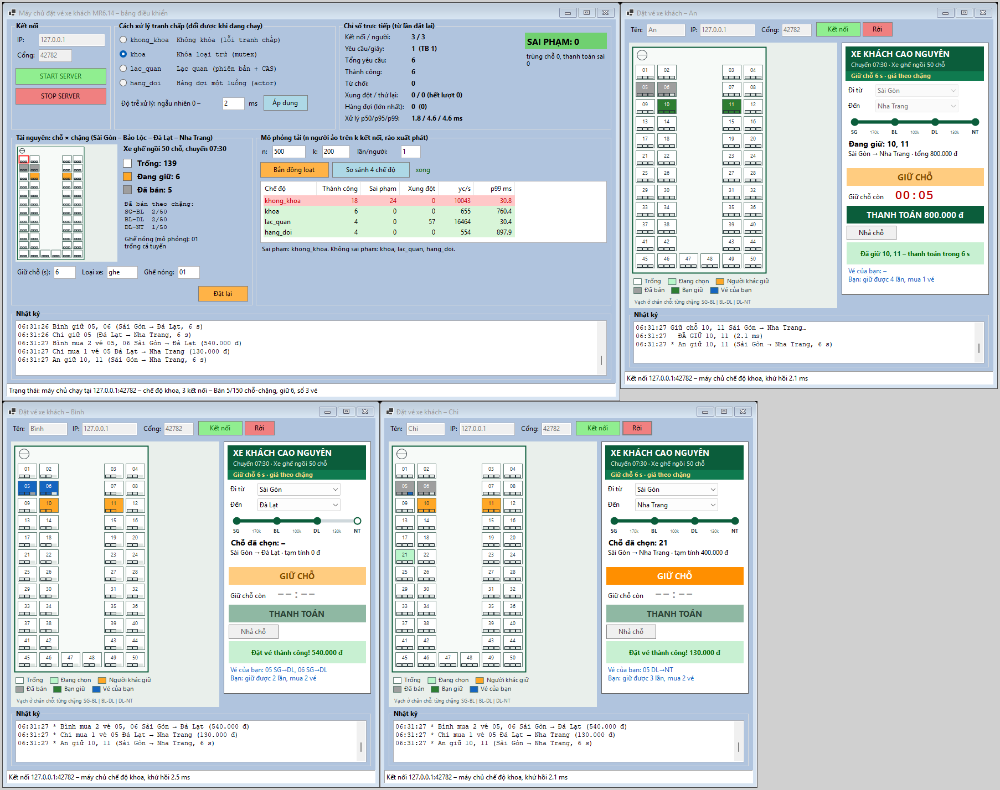
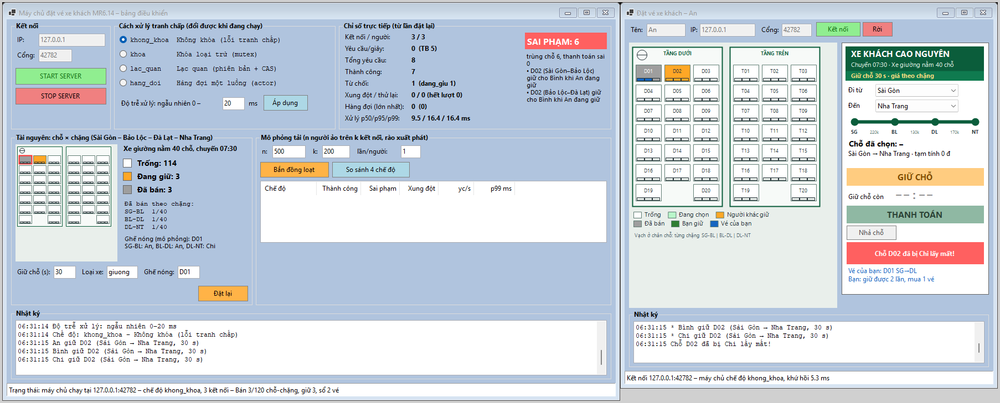
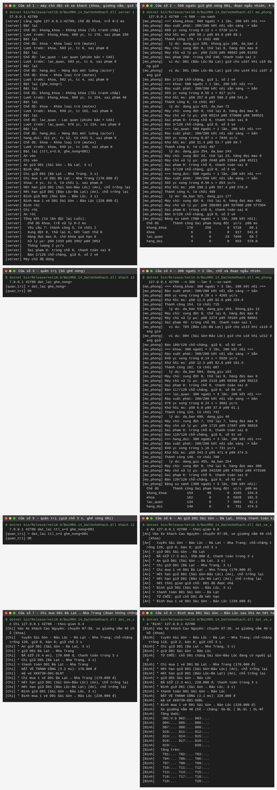

# Bài mở rộng MR6.14 – Đặt vé xe khách theo chặng: xe giường nằm 40 chỗ, xe ghế 50 chỗ (C#)

| Thông tin | Nội dung |
|---|---|
| Loại | **Bài mở rộng**, không có trong giáo trình và không có mã giả tương ứng. Bài thứ chín của nhóm "tranh chấp tài nguyên" MR6.6–MR6.14, dùng chung khung của [MR6.6](../BaiMR6.6_DauGia/) và mở rộng [MR6.8](../BaiMR6.8_DatVePhim/) (giữ chỗ có thời hạn) |
| Liên hệ với giáo trình | Chương 6: Bài 6.1 (server đa luồng, một luồng mỗi kết nối), Bài 6.7 (kiểm thử tải); Chương 3: Bài 3.2 (định khung thông điệp theo dòng); bài mở rộng MR5.4/MR5.5 (luồng, đồng bộ) |
| Thư viện | .NET 10 BCL: `System.Net.Sockets`, `System.Threading` (`Thread`, `lock`/`Monitor`, `Interlocked`, `Volatile`, `Barrier`), `System.Collections.Concurrent` (`BlockingCollection`, `ConcurrentDictionary`), `System.Text.Json.Nodes`; bản giao diện: Windows Forms (`net10.0-windows`, sơ đồ xe vẽ bằng GDI+). Không dùng gói NuGet |
| Bản ngôn ngữ khác | [Python](../../../python/Chuong06/BaiMR6.14_DatVeXeKhach/), [Java](../../../java/Chuong06/BaiMR6.14_DatVeXeKhach/), [Rust](../../../rust/Chuong06/BaiMR6.14_DatVeXeKhach/), [Go](../../../go/Chuong06/BaiMR6.14_DatVeXeKhach/) |

## Mục tiêu
Bài mô phỏng một ứng dụng đặt vé xe khách đường dài. Chuyến xe chạy qua **4 trạm**: Sài Gòn – Bảo Lộc – Đà Lạt – Nha Trang, tức **3 chặng**. Có hai loại xe, đổi được khi đặt lại:
- **xe giường nằm 40 chỗ** (`giuong`): hai tầng, tầng dưới D01–D20, tầng trên T01–T20, mỗi tầng 3 dãy × 7 hàng (hàng cuối 2 giường);
- **xe ghế ngồi 50 chỗ** (`ghe`): ghế 01–50, 11 hàng × 4 ghế có lối đi ở giữa, hàng cuối 6 ghế liền.

Khách chọn **một đoạn đường** (đi từ trạm `tu` đến trạm `den`), chọn chỗ rồi **giữ chỗ** có thời hạn, sau đó **thanh toán** hoặc **nhả**. Khác với rạp chiếu phim ở MR6.8, **một chỗ bán được cho nhiều người** nếu các đoạn đường không chồng nhau: An mua giường D01 Sài Gòn → Đà Lạt, Chi mua đúng giường đó Đà Lạt → Nha Trang. Vì vậy tài nguyên không phải là "ghế" mà là **cặp (chỗ, chặng)**, tên ô `D01#1` (chặng 1 = Bảo Lộc → Đà Lạt). Giữ 2 giường cho cả tuyến là khóa 6 ô. Mọi thao tác là "đọc → kiểm tra (giả lập độ trễ cơ sở dữ liệu 0–2 ms) → ghi", xử lý theo **bốn cách**: không khóa, khóa loại trừ theo từng ô, lạc quan, hàng đợi một luồng. **Sổ kiểm toán** đếm (chỗ, chặng) bị giữ/bán cho hai người và thanh toán sai. **Bộ mô phỏng tải** chạy hai tình huống: 500 người cùng giữ giường "nóng" D01 với đoạn ngẫu nhiên, và 300 người × 3 lần thử chọn 1–2 chỗ ngẫu nhiên cho đoạn ngẫu nhiên.

Phần khung (`Chung.cs`, `Khach.cs`, phần KHUNG của `MoPhong.cs`, `GiaoDien/GiaoDienChung.cs`) chép nguyên từ MR6.6. Bài này chỉ viết nghiệp vụ, người đặt vé dòng lệnh, ứng dụng giao diện, bảng tài nguyên của máy chủ và kịch bản demo.

## Kiến thức chính
Số liệu dưới đây lấy từ `ket_qua.txt`, là một lần chạy thật trên máy cục bộ (127.0.0.1, .NET 10, độ trễ xử lý ngẫu nhiên 0–2 ms). Mỗi lần chạy, số liệu lệch đi đôi chút.

```
500 người cùng giữ giường nóng D01, đoạn ngẫu nhiên (giữ được thì thanh toán ngay):
  Chế độ       Thành công Sai phạm Xung đột  yc/s  p99 ms
  khong_khoa          170      250        0  5728    89.1
  khoa                  6        0        0   917   541.0
  lac_quan              6        0       23  7046    69.7
  hang_doi              4        0        0   853   578.0
300 người × 3 lần thử, 1–2 chỗ và đoạn ngẫu nhiên (40 giường × 3 chặng = 120 ô):
  Chế độ       Thành công Sai phạm Xung đột  yc/s  p99 ms
  khong_khoa          154       40        0  4265   154.6
  khoa                162        0        0  5928   101.5
  lac_quan            134        0        7  3601    61.1
  hang_doi            140        0        0   731   474.5
```
("Thành công" đếm cả trả lời giữ chỗ lẫn thanh toán được chấp nhận; "Sai phạm" do sổ kiểm toán đếm; "Xung đột" là số lần so sánh-và-đổi thất bại; "yc/s" và "p99" (khứ hồi) đo ở bộ mô phỏng.)

- **Tài nguyên là (chỗ, chặng), không phải chỗ.** Với giường nóng D01 và đoạn ngẫu nhiên, ở ba chế độ đúng D01 bán được 3, 3 và 2 vé (`khoa`, `lac_quan`, `hang_doi`; mỗi vé là 2 trả lời thành công: giữ rồi thanh toán). Số vé tùy đoạn của những người đến trước: một vé Sài Gòn → Bảo Lộc và một vé Bảo Lộc → Nha Trang không chạm chung chặng nào. Ở rạp chiếu phim MR6.8, ghế nóng E7 chỉ bán được 1 vé. Nếu máy chủ coi cả giường là một ô, nhà xe sẽ bỏ phí các chặng còn trống.
- **Tranh chấp (race condition) trên từng chặng.** Ở `khong_khoa`, thao tác giữ chỗ "đọc các ô → chờ → ghi" không đồng bộ, nên nhiều người cùng được báo "đã giữ" cho cùng một (chỗ, chặng) và lượt ghi sau đè lượt ghi trước: 250 sai phạm với giường nóng, 40 sai phạm với nhiều chỗ. Sổ kiểm toán ghi từng ô, ví dụ `D02 (Sài Gòn–Bảo Lộc) giữ cho Bình khi An đang giữ`. Một lượt giữ cả tuyến bị đè ở 3 chặng thì sổ đếm 3 sai phạm.
- **Khóa theo từng ô cho song song thật.** Ở `khoa`, mỗi lần giữ khóa đúng các ô `chỗ#chặng` mình chạm vào, theo thứ tự tên ô (không khóa chết). Hai đoạn không chồng nhau của cùng một giường chạm các ô khác nhau, nên chạy song song. Ở tình huống nhiều chỗ, `khoa` đạt **5928 yc/s** so với **731 yc/s** của `hang_doi`: hàng đợi một luồng xử lý lần lượt dù các yêu cầu không đụng nhau. Ngược lại, với giường nóng D01, mọi yêu cầu chạm chung ô D01#… nên `khoa` cũng chỉ còn 917 yc/s.
- **Lạc quan với nhiều ô.** `lac_quan` đọc (giá trị, phiên bản) của mọi ô trong yêu cầu, quyết định ngoài khóa, rồi chỉ ghi nếu không ô nào đổi phiên bản. Đoạn càng dài thì càng nhiều ô có thể bị người khác đổi, nên xung đột tăng theo độ dài đoạn (lần chạy này: 23 xung đột với giường nóng, 7 với nhiều chỗ). Mỗi người ảo chỉ thử `--lan` lần, nên mỗi lần xung đột cũng tiêu một lượt thử của khách.
- **Giữ chỗ có thời hạn (TTL) theo từng ô.** Như MR6.8: hạn tính theo đồng hồ đơn điệu, luồng nền dọn ô quá hạn mỗi 100 ms, và lượt giữ quá hạn coi như trống ngay cả khi chưa dọn. Lượt chạy dòng lệnh (giữ chỗ 3 s) cho thấy:
  - An giữ D01 Sài Gòn → Đà Lạt, Chi giữ và mua được D01 Đà Lạt → Nha Trang ngay lúc đó (mã vé `XK0730-D01-DLNT`).
  - Bình giữ D01 Sài Gòn → Bảo Lộc khi An còn hạn thì bị từ chối "chỗ D01 chặng Sài Gòn–Bảo Lộc đang có người giữ". Hết hạn, Bình giữ và mua được (`XK0730-D01-SGBL`). Lệnh `xem` của Bình in `D01:V.b`: chặng 1 là vé của Bình, chặng 2 trống, chặng 3 đã bán cho người khác.
  - An thanh toán muộn thì nhận "TỪ CHỐI: giữ chỗ D01 đã hết hạn". Máy chủ ưu tiên báo "hết hạn" khi còn dấu vết lượt giữ của An ở một chặng nào đó, dù chặng đầu đã là của Bình.
- **Ảnh chụp trạng thái có số thứ tự.** Như các bài trước, mỗi lần ghi được đánh số (`kq["phien"]`), và client chỉ kết luận "chỗ đã bị lấy" hoặc "đã hết hạn" từ bản `cap_nhat` có `phien` ≥ số của lần giữ của mình.

### Giao thức (giống hệt ở 5 ngôn ngữ)
Khung chung (chào, quản trị, `kq`, `cap_nhat`, `su_kien`, `thong_ke`) xem [README MR6.6](../BaiMR6.6_DauGia/README.md#giao-thức-giống-hệt-ở-5-ngôn-ngữ). Phần riêng của bài:

| Chiều | Thông điệp |
|---|---|
| người dùng → server | `{"loai":"giu_cho","ma_yc":k,"ghe":["D01","D02"],"tu":0,"den":2}`, `{"loai":"thanh_toan",…}`, `{"loai":"nha",…}` cùng trường (1–6 mã chỗ của loại xe hiện tại, không trùng; `0 ≤ tu < den ≤ 3` là chỉ số trạm). Kết nối gộp thêm `"nguoi":"u17"` |
| quản trị → server | `{"loai":"dat_lai","ma_yc":k,"ttl_s":30,"loai_xe":"giuong"\|"ghe","ghe_nong":"D01"\|"","chuyen":"07:30","nha_xe":…}` (đổi loại xe mà ghế nóng không thuộc xe mới thì ghế nóng về chỗ đầu: D01 hoặc 01) |
| server → client | giữ: `{"loai":"kq","ok":true,"ghe","tu","den","het_han_ms":30000,"tien","nguoi","phien"}`; thanh toán: `{"ok":true,"ghe","tu","den","ma_ve":["XK0730-D01-SGDL"],"tien","nguoi","phien"}`; nhả: `{"ok":true,"ghe","tu","den","nguoi","phien"}`; từ chối: `"ma_loi":"dang_giu"\|"da_ban"\|"khong_giu"\|"het_han"\|"xung_dot"\|"sai_du_lieu"\|…` (giữ thất bại kèm `"ghe_ban":[…]`, `"tu"`, `"den"`) |
| server → tất cả | `{"loai":"cap_nhat","che_do","phien","nha_xe","chuyen","loai_xe","ten_xe","tram":[…],"gia_chang":[220000,130000,170000],"ttl_s","ghe_nong","ghe":["D01",…],"bo_tri":[[tầng,hàng,cột],…],"so_do":["b.g",…] (mỗi chỗ một chuỗi 3 ký tự, một ký tự mỗi chặng: . trống, g đang giữ, b đã bán),"chu":{"D01#0":"An",…},"con_lai_ms":{"D01#0":27000,…},"dem":{"trong","giu","ban"}}` (đếm theo ô chỗ-chặng); `su_kien` cho người dùng thật: "An giữ D01 (Sài Gòn → Đà Lạt, 30 s)", "Chi mua 1 vé D01 Đà Lạt → Nha Trang (170.000 đ)", "Hết hạn giữ D01 (Bảo Lộc–Đà Lạt) (An), chỗ trống lại" |

Giá mỗi chặng là **giá minh họa** (giường 220.000 / 130.000 / 170.000 đ, ghế 170.000 / 100.000 / 130.000 đ); giá một vé là tổng giá các chặng của đoạn. Sai phạm trong `thong_ke`: `trùng chỗ`, `thanh toán sai`; `tom_tat`: `Bán 118/120 chỗ-chặng, giữ 0, sổ 101 vé`.

## Cấu trúc tệp
- `Chung.cs`, `Khach.cs`: khung chung (chép từ MR6.6).
- `MayChu.cs`: `XeKhach` (trạm, giá chặng, `BoTri(loaiXe)` – sơ đồ hai loại xe, dùng chung cho máy chủ và giao diện), record `ChoXe`, record `ChoChang` (giá trị một ô), `SoKiemToanDatVeXe`, `MayChuDatVeXe` (giữ chỗ, thanh toán, nhả theo đoạn, dọn ô quá hạn trong `DinhKy`, đánh số lần ghi); `Server.cs`: máy chủ dòng lệnh (tùy chọn `--ttl`, `--loai-xe`, `--ghe-nong`).
- `MoPhong.cs`: bộ mô phỏng tải; phần NGHIỆP VỤ là `NguCanh` (ô bận theo những gì kết nối biết, chọn đoạn và chỗ trống ngẫu nhiên), `NguoiAo` (lần đầu giữ ghế nóng cho một đoạn ngẫu nhiên, giữ được thì thanh toán, bị từ chối thì đổi đoạn và chỗ).
- `DatVeXe.cs`: người đặt vé dòng lệnh (`giu SG DL D01`, `tt`, `nha`, `xem`, `thoat`). `Program.cs`: chọn vai trò `server | mo_phong | khach | dat_ve_xe`.
- `GiaoDien/`: dự án WinForms `BaiMR6.14_GiaoDien.csproj` (dùng chung lõi ở thư mục cha): `GiaoDienChung.cs`, `FormServer.cs` (sơ đồ xe thu nhỏ, ghế nóng viền đỏ, số chỗ bán theo chặng), `FormDatVeXe.cs` (lớp `SoDoXe` vẽ xe bằng GDI+, dùng ở cả hai cửa sổ; băng rôn nhà xe, chọn đoạn, thanh tuyến, đồng hồ giữ chỗ), `DemoGui.cs`, `Program.cs`, `demo.json`.
- `demo.json`, `ket_qua.txt`, `ket_qua.png`: kịch bản và kết quả thực thi thật; `*_windows.*`: kết quả chạy trên Windows.

## Cách chạy
Cần .NET 10 SDK. Chạy trong thư mục bài:
```bash
dotnet build -c Release
dotnet run -c Release -- server 127.0.0.1 9000                          # giữ chỗ 30 s, xe giường nằm, ghế nóng D01
dotnet run -c Release -- mo_phong 127.0.0.1 9000 --n 500 --so-sanh      # 500 người tranh D01, đoạn ngẫu nhiên
dotnet run -c Release -- khach 127.0.0.1 9000 dat_lai ghe_nong=         # bỏ ghế nóng: chọn ngẫu nhiên
dotnet run -c Release -- mo_phong 127.0.0.1 9000 --n 300 --lan 3 --so-sanh
dotnet run -c Release -- khach 127.0.0.1 9000 dat_lai loai_xe=ghe ttl_s=10
dotnet run -c Release -- dat_ve_xe An 127.0.0.1 9000                    # gõ giu SG DL D01 / tt / nha / xem
```
- Lệnh của máy chủ: `che_do …`, `tre <ms>`, `dat_lai [ttl_s=… loai_xe=… ghe_nong=… chuyen=… nha_xe=…]`, `thong_ke`, `thoat`; tùy chọn khi chạy: `--che-do`, `--tre-ms`, `--ttl`, `--loai-xe`, `--ghe-nong`.
- Lệnh của `dat_ve_xe`: `giu SG DL D01 [D02 …]` (hai mã trạm `SG`, `BL`, `DL`, `NT` rồi các chỗ), `tt` và `nha` (các chỗ vừa giữ, kể cả khi đã hết hạn, để thấy máy chủ từ chối), `xem` (mỗi chỗ 3 ký tự, một ký tự mỗi chặng: `.` trống, `g` người khác giữ, `b` đã bán, `G` mình giữ, `V` vé của mình), `thoat`. Dòng `@t lệnh` chờ tới giây thứ t.
- Tái lập kết quả, từ thư mục gốc của kho: `python3 tools/demo.py csharp/Chuong06/BaiMR6.14_DatVeXeKhach` (cổng 42780).

## Ứng dụng giao diện


Ảnh trên là lần chạy thật của vai trò `demo` trên Windows (WinForms): bảng điều khiển máy chủ (trên trái), An (trên phải), Bình và Chi (dưới), cùng các bước với `demo_gui.py` của bản Python: xe giường nằm, `khoa`: An và Bình cùng giữ D01 Sài Gòn → Đà Lạt, Chi giữ D01 Đà Lạt → Nha Trang – một trong hai người đầu và Chi giữ được, hai người thanh toán; `khong_khoa`, trễ 0–20 ms: cả ba cùng giữ D02 Sài Gòn → Nha Trang → SAI PHẠM; So sánh 4 chế độ; đặt lại thành xe ghế 50 chỗ, giữ chỗ 6 s: An giữ 05, 06 Sài Gòn → Bảo Lộc rồi hết hạn, Bình mua 05, 06 Sài Gòn → Đà Lạt, Chi mua 05 Đà Lạt → Nha Trang, An giữ 10, 11, Chi chọn 21.



Ở bước `khong_khoa`, cả ba cùng nhận "ĐÃ GIỮ D02"; bản cập nhật kế tiếp cho thấy D02 thuộc một người ở cả 3 chặng, hai người kia thấy "Chỗ D02 đã bị … lấy mất!", ô **SAI PHẠM** chuyển đỏ (trùng chỗ 6 = 2 người bị đè × 3 chặng).

- **Máy chủ** (`server_gui`): phần chung giống MR6.6; **tài nguyên**: sơ đồ xe thu nhỏ (mỗi chỗ có dải 3 vạch theo chặng, ghế nóng viền đỏ), số ô trống – đang giữ – đã bán, số chỗ đã bán theo từng chặng, ghế nóng đang thuộc ai ở chặng nào, ô **Giữ chỗ (s)**, **Loại xe** (`giuong`/`ghe`), **Ghế nóng** và nút **Đặt lại**.
- **Đặt vé** (`dat_ve_xe_gui`): băng rôn nhà xe (tên, chuyến, loại xe, thời hạn giữ chỗ); chọn **Đi từ** và **Đến**, thanh tuyến 4 trạm tô đoạn đã chọn kèm giá từng chặng; **sơ đồ xe** có vô lăng ở đầu xe (xe giường: tầng dưới, tầng trên đặt cạnh nhau; xe ghế: lối đi giữa, hàng cuối 6 ghế); màu theo đoạn đang chọn: **trống**, **đang chọn**, **người khác giữ**, **đã bán**, **bạn giữ**, **vé của bạn**, kèm chú giải và **dải vạch theo chặng** ở chân mỗi chỗ; bấm chỗ để chọn/bỏ chọn (tối đa 6); "Chỗ đã chọn", tạm tính theo đoạn; nút **GIỮ CHỖ**; **đồng hồ giữ chỗ** đếm ngược (đỏ khi còn dưới 10 s); nút **THANH TOÁN** ghi tổng tiền; nút **Nhả chỗ**; khi đang giữ chỗ thì khóa ô chọn đoạn; dòng thông báo; "Vé của bạn" (chỗ và đoạn, ví dụ `05 SG→DL`). Sơ đồ đổi ngay khi người khác giữ hoặc mua (≤ 10 cập nhật/giây).


### Cách chạy
**Windows** (cần .NET 10 SDK: `winget install Microsoft.DotNet.SDK.10`):
```powershell
cd csharp\Chuong06\BaiMR6.14_DatVeXeKhach\GiaoDien
dotnet build -c Release
dotnet run -c Release -- server_gui 127.0.0.1 42782        # bấm START SERVER (giữ chỗ 30 s, xe giường nằm)
dotnet run -c Release -- dat_ve_xe_gui An 127.0.0.1 42782
dotnet run -c Release -- dat_ve_xe_gui Bình 127.0.0.1 42782
```
- Kịch bản tự động (từ thư mục gốc kho): `python tools\demo_windows.py csharp\Chuong06\BaiMR6.14_DatVeXeKhach\GiaoDien`.
- Chạy riêng từng cửa sổ: nhật ký và cứ 5 giây một dòng số liệu cũng in ra dòng lệnh.
- Thử trên nhiều máy: máy chủ nghe IP card mạng (hoặc `0.0.0.0`), mở tường lửa cho cổng; cả lớp cùng mở `dat_ve_xe_gui` (hoặc bản của ngôn ngữ khác) tới máy thầy và tranh giường D01 với các đoạn khác nhau; **chỉ dùng `khoa`, `lac_quan`, `hang_doi`** khi thử thật.

## Kết quả thực thi


## Ghi chú
- **Chạy chéo đã thử** (500 người cùng giữ giường nóng D01, so sánh 4 chế độ; thứ tự `khong_khoa` / `khoa` / `lac_quan` / `hang_doi`, mỗi cặp là thành công / sai phạm): bộ mô phỏng Python → máy chủ C#: 93 / 134, 6 / 0, 6 / 0 (10 xung đột), 4 / 0; C# → Python: 9 / 5, 4 / 0, 4 / 0, 6 / 0; Java → Rust: 7 / 1, 4 / 0, 4 / 0, 6 / 0; Rust → Go: 27 / 36, 6 / 0, 4 / 0, 4 / 0; Go → Java: 20 / 23, 6 / 0, 4 / 0, 6 / 0. Bốn người dùng dòng lệnh Python (An), Java (Chi), Rust (Bình) và Go (Dũng, giữ và mua T05, T06 Bảo Lộc → Nha Trang, 600.000 đ) cùng chạy kịch bản giữ chỗ 3 s trên máy chủ C#: diễn biến giống hệt lượt chạy một ngôn ngữ, sổ kiểm toán 0 sai phạm, `Bán 6/120 chỗ-chặng, giữ 0, sổ 4 vé`.
- Giá trị mỗi ô là record bất biến `ChoChang`, mỗi lần ghi thay nguyên đối tượng, nên luồng đọc để hiển thị (`TrangThaiNghiepVu`) không bao giờ thấy một ô "nửa giữ nửa bán". Khi đặt lại sang loại xe khác, bảng ô cũ còn được đọc tới lúc bảng mới xong; ô chưa có được coi là trống.
- Ở tình huống nhiều chỗ, `khong_khoa` kết thúc với "Bán 109/120 chỗ-chặng, giữ 9, sổ 92 vé": 9 ô bị "giữ mồ côi" bởi những người đã bị đè (họ thanh toán thì bị từ chối), và các ô này chỉ trống lại sau 30 s. Ba chế độ đúng bán được 117–120/120 chỗ-chặng (91–96 vé).
- Tham số đặt lại của bộ mô phỏng rỗng: `--so-sanh` đặt lại sơ đồ xe mà vẫn giữ loại xe, thời hạn và ghế nóng hiện tại của máy chủ.
- Kiểm thử: bản dòng lệnh chạy trên Linux (.NET 10.0.114) và Windows; ứng dụng WinForms biên dịch được với assembly tham chiếu WinForms trên Linux và chạy thật trên Windows (ảnh `*_windows.png`).

## Bài tập gợi ý
1. Đo số vé bán được cho giường nóng D01 khi máy chủ coi **cả giường là một ô** (sửa `KhoiTao` để mỗi chỗ chỉ có ô `D01#0`, và `oYC` luôn là ô đó). So với cách chia theo chặng, nhà xe mất bao nhiêu doanh thu trong tình huống 300 người × 3 lần?
2. Chạy tình huống nhiều chỗ với đoạn luôn là cả tuyến (`NguCanh.Doan()` trả về `(0, 3)`). Thông lượng của `khoa` và số xung đột của `lac_quan` thay đổi thế nào? Giải thích bằng số ô mỗi yêu cầu chạm vào.
3. Thêm thao tác `doi_cho` (đổi từ chỗ đang giữ sang chỗ khác, nguyên tử: chỉ nhả chỗ cũ khi giữ được chỗ mới). Những ô nào phải khóa cùng lúc? Sắp thứ tự thế nào để không khóa chết?
4. Thêm luật "giường tầng dưới ưu tiên người cao tuổi": người dùng mang cờ `uu_tien` mới giữ được D01–D20 trong 10 phút đầu mở bán. Luật này đặt ở `XuLyYeuCau` hay trong hàm thuần `XuLy`? Vì sao?

## Đọc thêm
- H. T. Kung, J. T. Robinson (1981). *On Optimistic Methods for Concurrency Control*. ACM Transactions on Database Systems 6(2).
- E. G. Coffman, M. J. Elphick, A. Shoshani (1971). *System Deadlocks*. ACM Computing Surveys 3(2): điều kiện khóa chết và cách phòng bằng thứ tự khóa (giữ nhiều chỗ cho nhiều chặng = khóa nhiều ô theo thứ tự tên ô).
- Tài liệu .NET: [câu lệnh `lock`](https://learn.microsoft.com/dotnet/csharp/language-reference/statements/lock), [`Interlocked`](https://learn.microsoft.com/dotnet/api/system.threading.interlocked), [`ConcurrentDictionary<TKey,TValue>`](https://learn.microsoft.com/dotnet/api/system.collections.concurrent.concurrentdictionary-2), [`Stopwatch`](https://learn.microsoft.com/dotnet/api/system.diagnostics.stopwatch), [`System.Drawing.Graphics`](https://learn.microsoft.com/dotnet/api/system.drawing.graphics), [`ComboBox`](https://learn.microsoft.com/dotnet/api/system.windows.forms.combobox).

Mã nguồn của bài được viết mới cho kho này.
