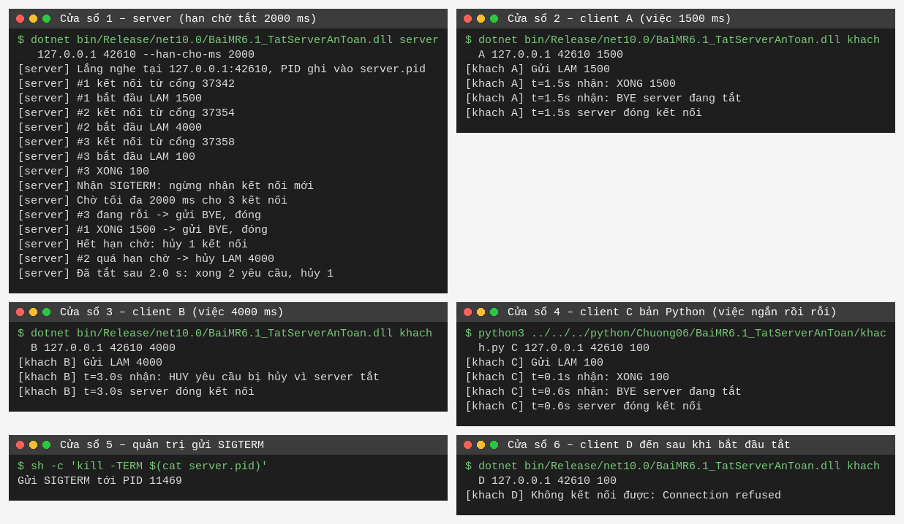

# Bài mở rộng MR6.1 – Tắt server an toàn (graceful shutdown) (C#)

| Thông tin | Nội dung |
|---|---|
| Loại | **Bài mở rộng** – không có trong giáo trình, không có mã giả tương ứng |
| Liên hệ với giáo trình | Chương 6: Bài 6.2 (server bất đồng bộ), Bài 6.1 (server đa luồng); Chương 5: Bài 5.6 (hạn chót, hủy) |
| Thư viện | .NET 10 BCL: `TcpListener`, `async`/`await`, `CancellationTokenSource`, `System.Runtime.InteropServices.PosixSignalRegistration` |
| Bản ngôn ngữ khác | [Python](../../../python/Chuong06/BaiMR6.1_TatServerAnToan/), [Go](../../../go/Chuong06/BaiMR6.1_TatServerAnToan/), [Java](../../../java/Chuong06/BaiMR6.1_TatServerAnToan/), [Rust](../../../rust/Chuong06/BaiMR6.1_TatServerAnToan/) |

## Mục tiêu
Server thật không bị “rút điện”: hệ điều hành, systemd, Docker hay Kubernetes gửi tín hiệu SIGTERM và cho một khoảng thời gian trước khi buộc dừng (SIGKILL). Bài cài đặt quy trình tắt bốn bước: (1) đóng socket nghe – client mới bị từ chối; (2) kết nối đang rỗi nhận `BYE` rồi đóng ngay; (3) kết nối đang làm dở được làm xong yêu cầu hiện tại, nhận kết quả, rồi `BYE`; (4) quá hạn chờ thì hủy phần còn lại và báo `HUY`. Giao thức dòng văn bản: client gửi `LAM <ms>`, server mô phỏng công việc dài `<ms>` mili giây rồi trả `XONG <ms>`.

## Tệp
- `BaiMR6.1_TatServerAnToan.csproj` – dự án console `net10.0`; vai trò `server` hoặc `khach`.
- `Program.cs` – chọn vai trò.
- `ServerTatAnToan.cs` – server async: `Handle` (chờ dòng lệnh bằng `ReadLineAsync(stopping.Token)` – tức chờ dòng lệnh **hoặc** tín hiệu dừng), quy trình tắt trong `Run`; hai nguồn hủy `stopping` (bắt đầu tắt) và `hard` (hết hạn chờ).
- `Khach.cs` – client: gửi các yêu cầu, rồi giữ kết nối và in mọi thông báo của server.
- `demo.json` – kịch bản chạy minh họa (dùng với `tools/demo.py`); client C là bản Python (chạy chéo).
- `ket_qua.txt`, `ket_qua.png` – kết quả thực thi thật.

## Cách chạy
Trong thư mục bài:
```bash
dotnet build -c Release
dotnet bin/Release/net10.0/BaiMR6.1_TatServerAnToan.dll server 127.0.0.1 9000 --han-cho-ms 2000   # cửa sổ 1
dotnet bin/Release/net10.0/BaiMR6.1_TatServerAnToan.dll khach A 127.0.0.1 9000 1500                # cửa sổ 2
dotnet bin/Release/net10.0/BaiMR6.1_TatServerAnToan.dll khach B 127.0.0.1 9000 4000                # cửa sổ 3
kill -TERM $(cat server.pid)                   # cửa sổ 4 (hoặc Ctrl+C ở cửa sổ 1)
```
Có thể thay `dotnet bin/Release/net10.0/BaiMR6.1_TatServerAnToan.dll` bằng `dotnet run --` (khi đó `kill` phải gửi tới PID của tiến trình con mà `dotnet run` khởi chạy – chính là số trong `server.pid`). Server ghi PID vào `server.pid` khi khởi động và xóa tệp này khi tắt xong.

Tái lập kết quả từ thư mục gốc của kho: `python3 tools/demo.py csharp/Chuong06/BaiMR6.1_TatServerAnToan` (cổng 42610).

## Kết quả thực thi


Ba client A, B, C kết nối; C làm xong việc ngắn và đang rỗi. Khi quản trị gửi SIGTERM (t ≈ 0,6 s sau khi C kết nối), server ngừng nhận kết nối mới – client D đến sau bị từ chối ngay (*Connection refused*). C nhận `BYE` tức thì; A làm nốt việc 1500 ms, nhận `XONG 1500` rồi `BYE`; việc 4000 ms của B vượt hạn chờ 2000 ms nên bị hủy đúng hạn (B nhận `HUY` lúc t ≈ 3,0 s tính từ khi B gửi yêu cầu). Server tắt sau 2,0 s với 2 yêu cầu xong (C và A), 1 yêu cầu bị hủy. Bản C# cho cùng trình tự sự kiện, từng dòng nhật ký server giống bản Python; client C là bản Python nối vào server C# (chạy chéo).

## Ghi chú
- Hạn chờ của server phải nhỏ hơn thời gian mà trình quản lý tiến trình chờ trước khi gửi SIGKILL (ví dụ `docker stop` mặc định 10 s).
- Với server HTTP, ASP.NET Core (Generic Host) tự làm các bước 1–3 khi nhận SIGTERM, có `HostOptions.ShutdownTimeout`; Go có `http.Server.Shutdown(ctx)`. Bài tự cài để thấy rõ cơ chế.
- Trên Windows không có lệnh `kill -TERM`; dùng Ctrl+C (SIGINT) – server xử lý SIGINT giống SIGTERM.
- `PosixSignalRegistration` (.NET 6+) chạy trên mọi hệ điều hành: trên Windows, `SIGINT` ứng với Ctrl+C, `SIGTERM` ứng với đóng cửa sổ/tắt máy. Đặt `ctx.Cancel = true` để .NET không kết thúc tiến trình ngay mà để chương trình tự tắt có trật tự.
- Thứ tự nhật ký được giữ giống bản Python: tín hiệu chỉ hoàn thành một `TaskCompletionSource`; vòng chính dừng socket nghe, in hai dòng thông báo rồi mới `stopping.Cancel()` để đánh thức các kết nối.
- Mỗi kết nối là một `Task` lưu trong `ConcurrentDictionary`; chờ có hạn bằng `Task.WhenAny(Task.WhenAll(...), Task.Delay(hạn))`.
- Kiểm thử: Linux, .NET SDK 10.0.114.

## Đọc thêm
- Matt Butcher, Matt Farina, *Go in Practice*, Manning, 2016, Chương 2 (Technique 5 *Graceful shutdowns using manners*) và Chương 3 (Techniques 10–15: goroutine, `WaitGroup`, kênh).
- Claus Töpke, *Network Programming and Automation Essentials*, Packt, 2023, Chương 8 *Scaling Your Code* (đa luồng, coroutine).

Mã nguồn của bài được viết mới cho kho này; sách trên chỉ là tài liệu tham khảo ý tưởng.
