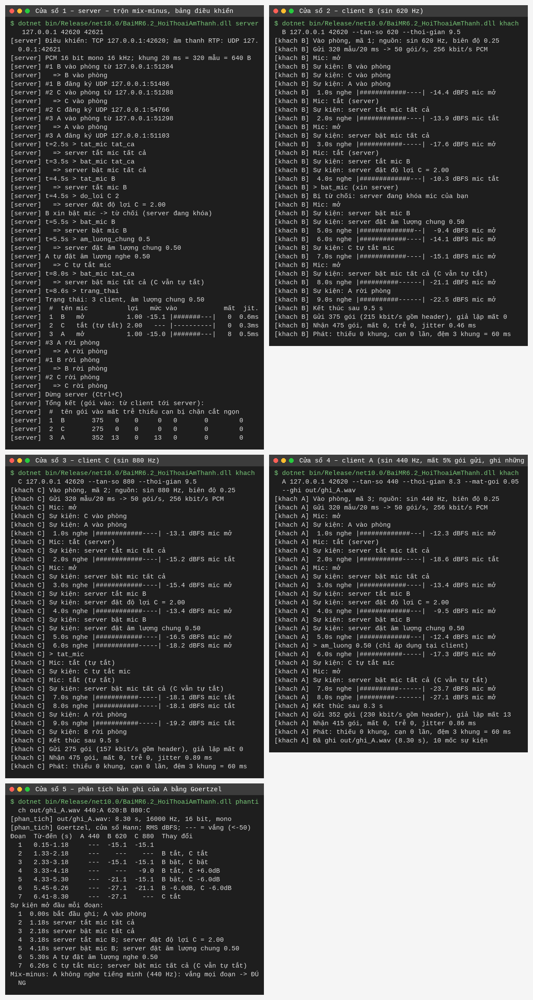

# Bài mở rộng MR6.2 – Phòng hội thoại âm thanh nhiều client (C#)

| Thông tin | Nội dung |
|---|---|
| Loại | **Bài mở rộng** – không có trong giáo trình, không có mã giả tương ứng |
| Liên hệ với giáo trình | Chương 6: Bài 6.1 (server đa luồng), Bài 6.4 (server chat nhiều client); Chương 4: Bài 4.1 (UDP); Chương 3: Bài 3.2 (định khung thông điệp) |
| Thư viện | .NET 10 BCL: `System.Net.Sockets` (TCP, UDP), `System.Threading.Thread`, `BinaryPrimitives`, `System.Text.Json.Nodes`; WAV, Goertzel tự viết. Bản giao diện: Windows Forms (`net10.0-windows`), micro/loa qua `winmm.dll` (P/Invoke) – không dùng gói NuGet |
| Bản ngôn ngữ khác | [Python](../../../python/Chuong06/BaiMR6.2_HoiThoaiAmThanh/), [Go](../../../go/Chuong06/BaiMR6.2_HoiThoaiAmThanh/), [Java](../../../java/Chuong06/BaiMR6.2_HoiThoaiAmThanh/), [Rust](../../../rust/Chuong06/BaiMR6.2_HoiThoaiAmThanh/) |

## Mục tiêu
Xây dựng một "phòng họp thoại" thu nhỏ: n client nối tới một server; mỗi client gửi âm thanh micro dạng PCM qua UDP, server **trộn tiếng** và gửi cho mỗi người tiếng của *những người khác* ("mix-minus"). Kênh điều khiển TCP cho phép server tắt/bật mic của tất cả hoặc từng người, đặt độ lợi đầu vào từng người, âm lượng chung; mỗi client tự tắt mic và tự chỉnh âm lượng nghe. Client ghi lại những gì nghe được thành tệp WAV; chương trình phân tích tần số (thuật toán Goertzel) **chứng minh bằng số liệu** rằng mỗi lệnh điều khiển đã có hiệu lực.

## Kiến thức chính
- **Âm thanh số.** Lấy mẫu 16 000 lần/giây, mỗi mẫu 16 bit có dấu, một kênh (mono) → 16 000 × 16 = 256 kbit/s. Khung 20 ms = 320 mẫu = 640 byte → 50 gói/giây. Phụ phí header mỗi gói 12 (RTP) + 8 (UDP) + 20 (IPv4) = 40 byte → 16 kbit/s; tổng ≈ 272 kbit/s mỗi chiều cho mỗi client (đúng với số `272 kbit/s gồm header` client in ra khi mic mở suốt).
- **Hai kênh, hai giao thức.** Điều khiển cần tin cậy, đúng thứ tự → TCP, mỗi dòng một JSON (định khung theo dòng như Bài 3.2). Âm thanh cần đến đúng lúc → UDP: mất một gói chỉ mất 20 ms, còn truyền lại kiểu TCP sẽ đến quá muộn để phát.
- **Gói RTP (RFC 3550).** Header 12 byte: `V=2`, payload type (96 = âm thanh L16, 127 = gói giữ kết nối rỗng), **số thứ tự** 16 bit (phát hiện mất, đảo thứ tự), **nhãn thời gian** 32 bit tính bằng mẫu (tăng 320 mỗi khung, *kể cả khi tắt mic*), **SSRC** = mã client. Mẫu L16 theo thứ tự byte mạng (big-endian, RFC 3551), trong khi WAV lưu little-endian.
- **Bộ đệm jitter.** Gói đến không đều (jitter). Bên nhận giữ vài khung rồi mới phát mỗi 20 ms một khung theo số thứ tự: thiếu khung → phát khoảng lặng (che lỗi), rỗng → *cạn bộ đệm*, chờ nạp lại; đến sau lượt phát → *trễ*, bỏ. Đệm sâu hơn chịu jitter tốt hơn nhưng tăng độ trễ (3 khung = 60 ms). Jitter được ước lượng theo RFC 3550 mục 6.4.1: `J += (|D| − J)/16`.
- **Trộn tiếng, mix-minus, cắt ngọn.** Mỗi nhịp 20 ms: tổng `T = Σ gᵢ·xᵢ` của các client đang mở mic (gᵢ là độ lợi đầu vào); người nghe k nhận `(T − gₖ·xₖ) × âm_lượng_chung` – không nghe tiếng vọng của mình. Tổng có thể vượt phạm vi 16 bit → **cắt ngọn** (clipping) về −32768…32767, gây méo (sinh hài). Server đếm số mẫu bị cắt ngọn cho từng người nghe.
- **dBFS.** Mức RMS so với toàn thang: sin biên độ 0,25 → −15,1 dBFS; nhân 2 → +6,0 dB; nhân 0,5 → −6,0 dB; hai âm cùng mức cộng lại → +3 dB.
- **Goertzel.** Tính một điểm của DFT bằng bộ lọc bậc hai `s[n] = x[n] + 2cos(ω)s[n−1] − s[n−2]`, rẻ hơn FFT khi chỉ cần vài tần số (cách điện thoại giải mã phím DTMF). Mỗi client phát một tần số riêng (A 440 Hz, B 620 Hz, C 880 Hz), nên đo mức ở từng tần số là biết ai đang nói, to bao nhiêu.
- **Không tin client.** Server tự bỏ gói từ client đang bị tắt mic (kể cả client cố tình gửi), chỉ nhận UDP từ địa chỉ đã đăng ký và cùng IP với kết nối TCP; client `connect()` socket UDP để chỉ nhận gói từ server.

### Quy tắc quyền điều khiển

| # | Quy tắc |
|---|---|
| 1 | Mic của X mở **khi và chỉ khi** X không tự tắt **và** server không khóa mic của X |
| 2 | Server tắt (khóa) thắng client: đang bị khóa, client xin bật bị **từ chối** |
| 3 | Server bật = gỡ khóa, **không bật hộ** mic mà người dùng đã tự tắt (quyền riêng tư: server làm người dùng im lặng được, nhưng không tự ý mở micro của họ) |
| 4 | Độ lợi đầu vào từng người và âm lượng chung do server đặt, áp dụng khi trộn |
| 5 | Âm lượng nghe do từng client tự đặt, áp dụng tại client; server không có lệnh đổi giá trị này |
| 6 | Tự tắt mic có hiệu lực ngay tại client; tự bật phải chờ server xác nhận |

Âm lượng người A thực sự nghe thấy tiếng B: `độ_lợi_B × âm_lượng_chung × âm_lượng_nghe_A`.

## Cấu trúc tệp
- `BaiMR6.2_HoiThoaiAmThanh.csproj` – dự án console `net10.0`; vai trò `server`, `khach`, `phantich`.
- `Program.cs` – chọn vai trò.
- `Chung.cs` – hằng số âm thanh, đóng/tách gói RTP (`DongGoiRtp`, `TachRtp`), PCM ↔ byte big-endian, dBFS, thanh đo mức, Goertzel, đọc/ghi WAV (RIFF tự viết), gửi dòng JSON; lớp `BoDemJitter`.
- `ServerAmThanh.cs` – server: lớp `Khach` (trạng thái mic, độ lợi, bộ đệm); lớp `PhongAmThanh` (kênh TCP – mỗi client một luồng, luồng nhận UDP, luồng trộn 20 ms, các lệnh `DatKhoaMic`, `DatDoLoi`, `DatAmLuongChung` dùng chung cho bảng điều khiển stdin và nút bấm giao diện; nguồn tiếng server `LayKhungServer`, đầu ra nghe `NgheServer` – bản dòng lệnh để trống); lớp `ServerAmThanh` – bảng điều khiển đọc stdin.
- `KhachAmThanh.cs` – client: nguồn âm (`NguonSin`, `NguonWav`), vòng 20 ms thu–gửi–nhận–phát, ghi WAV và tệp mốc sự kiện `*_moc.json`.
- `PhanTichWav.cs` – chia bản ghi theo mốc sự kiện, đo mức từng âm bằng Goertzel, kiểm tra mix-minus.
- `demo.json`, `ket_qua.txt`, `ket_qua.png` – kịch bản minh họa và kết quả thực thi thật (bản dòng lệnh).
- `GiaoDien/` – ứng dụng giao diện WinForms (dự án riêng `BaiMR6.2_GiaoDien.csproj`, `net10.0-windows`; dự án dòng lệnh loại thư mục này ra bằng `<Compile Remove="GiaoDien/**" />`). Biên dịch kèm `../Chung.cs`, `../ServerAmThanh.cs`, `../KhachAmThanh.cs`:
  - `Program.cs` – vai trò `server_gui`, `client_gui`, `demo`;
  - `FormServer.cs` – cửa sổ “Bảng điều khiển âm thanh” và lớp `HangKhach` (một hàng client);
  - `FormKhach.cs` – cửa sổ client;
  - `KetNoiAmThanh.cs` – phần mạng/âm thanh của client (không phụ thuộc WinForms);
  - `WinMM.cs` – P/Invoke `waveIn*`/`waveOut*`: `ThuAmWinMM` (thu micro), `PhatAmWinMM` (phát loa), liệt kê micro, `timeBeginPeriod(1)`;
  - `NguonAm.cs` – `INguonMic`, `MicGiaLap` (sin), `MicThat` (winmm), `DoMuc` (đo dBFS theo cửa sổ 100 ms);
  - `DieuKhien.cs` – thanh đo mức tự vẽ `ThanhMucAm`, hàm tạo điều khiển, bộ hẹn giờ gom lệnh thanh trượt;
  - `DemoGui.cs` – kịch bản tự thao tác và chụp `ket_qua_gui.png`;
  - `demo.json` – kịch bản dạng Windows cho `tools/demo_windows.ps1`.

## Cách chạy
Trong thư mục bài (lệnh giống nhau trên Windows và Linux):
```bash
dotnet build -c Release
dotnet bin/Release/net10.0/BaiMR6.2_HoiThoaiAmThanh.dll server 127.0.0.1 9000 9001                       # cửa sổ 1 (gõ lệnh điều khiển ở đây)
dotnet bin/Release/net10.0/BaiMR6.2_HoiThoaiAmThanh.dll khach B 127.0.0.1 9000 --tan-so 620               # cửa sổ 2
dotnet bin/Release/net10.0/BaiMR6.2_HoiThoaiAmThanh.dll khach C 127.0.0.1 9000 --tan-so 880               # cửa sổ 3
dotnet bin/Release/net10.0/BaiMR6.2_HoiThoaiAmThanh.dll khach A 127.0.0.1 9000 --tan-so 440 --ghi out/ghi_A.wav --thoi-gian 20
dotnet bin/Release/net10.0/BaiMR6.2_HoiThoaiAmThanh.dll phantich out/ghi_A.wav 440:A 620:B 880:C          # sau khi A kết thúc
```
Có thể thay `dotnet bin/Release/net10.0/BaiMR6.2_HoiThoaiAmThanh.dll` bằng `dotnet run --`. Lệnh server: `tat_mic tat_ca`, `tat_mic B`, `bat_mic tat_ca`, `do_loi C 2`, `am_luong_chung 0.5`, `trang_thai`, `thoat`. Lệnh client: `tat_mic`, `bat_mic`, `am_luong 0.5`, `thoat`. Dòng `@t lệnh` chờ tới giây thứ t rồi mới chạy lệnh (dùng cho kịch bản tự động).

Tùy chọn client: `--wav tệp.wav` (nguồn là tệp WAV 16 bit mono 16 kHz, phát lặp), `--mat-goi 0.05` (giả lập mất 5 % gói gửi), `--dem 3` (độ sâu bộ đệm jitter), `--bien-do`, `--thoi-gian`. Bản dòng lệnh không dùng micro/loa thật (BCL không có API âm thanh đa nền tảng), chỉ dùng âm tổng hợp hoặc tệp WAV; micro/loa thật có trong ứng dụng giao diện (mục dưới, chỉ Windows).

Tái lập kết quả từ thư mục gốc của kho: `python3 tools/demo.py csharp/Chuong06/BaiMR6.2_HoiThoaiAmThanh` (cổng TCP 42620, UDP 42621).

## Ứng dụng giao diện


*(Ảnh `ket_qua_gui.png` do vai trò `demo` tự chụp khi chạy trên Windows – xem “Kết quả thực thi”.)*

Hai cửa sổ WinForms, cùng giao thức với bản dòng lệnh nên chạy chéo được với server/client dòng lệnh của mọi ngôn ngữ:
- **Server – “Bảng điều khiển âm thanh”**: nhóm *Kết nối* (IP, cổng TCP/UDP, Start/Stop Server); *Điều khiển chung* (Mở mic tất cả = gỡ khóa, Tắt mic tất cả = khóa, Âm lượng chung 0–200 %); *Micro của server* (chọn “Giả lập (sin 330 Hz)” hoặc micro thật, Start/Stop Mic, Mic Volume, thanh đo mức) – tiếng server là một nguồn trong bộ trộn (SSRC 0), mọi client đều nghe; *Nghe* (phát tổng tiếng các client ra loa máy server, không gồm tiếng server). Dòng trạng thái “Server đang chạy tại …”, “Số client: n”; mỗi client một hàng: mã/tên, trạng thái mic (mở / tự tắt / bị khóa), thanh đo mức dBFS (10 lần/s), nút Khóa/Gỡ khóa, thanh trượt độ lợi 0–200 %, âm lượng nghe client báo lên, số gói nhận/mất; nhật ký sự kiện cuộn.
- **Client**: *Kết nối* (IP, cổng, tên, Connect/Disconnect); *Nhận âm thanh* (âm lượng nghe 0–200 %, Start/Stop Audio = phát/không phát ra loa, “Server Vol: xx %”, thanh đo mức tiếng nhận); *Micro* (chọn “Giả lập (sin 440 Hz)” hoặc micro thật, Start/Stop Mic, Mic Volume, thanh đo mức, trạng thái mic do server báo); dòng trạng thái (Đã kết nối / Bị từ chối / Mất kết nối) và số gói gửi/nhận/mất, jitter.

Thông điệp mới (thêm, tương thích ngược – client cũ bỏ qua): server → client `{"loai":"do_loi","gia_tri":g}` một lần sau `chao` và mỗi khi server đổi độ lợi của client đó. Bản dòng lệnh C# cũng gửi thông điệp này (đầu ra không đổi).

**Thiết bị thật hay giả lập.** Ô chọn thiết bị liệt kê các micro do `waveInGetNumDevs`/`waveInGetDevCapsW` trả về, cộng mục “Giả lập”. Chương trình **không** mở micro/loa khi khởi động: micro chỉ mở khi bấm Start Mic, loa khi bấm Start Audio (client) hoặc đánh dấu *Nghe* (server); nhãn cạnh nút cho biết đang dùng “THẬT” hay “giả lập”. Mở micro thật lỗi (bị chặn quyền, thiết bị bận) → tự chuyển sang giả lập và ghi nhật ký; không có loa → vẫn nhận và đo mức. Windows 11: *Settings → Privacy & security → Microphone* phải cho phép ứng dụng desktop dùng micro. Mặc định server nghe `127.0.0.1`; muốn máy khác vào phòng thì nhập IP của card mạng (và mở tường lửa cho hai cổng).

**Luồng xử lý và quy tắc luồng giao diện**
```
 luồng giao diện (Application.Run)          luồng mạng                       luồng âm thanh
 ─────────────────────────────────          ──────────                       ──────────────
 nút bấm ──► PhongAmThanh.DatKhoaMic ──TCP──► client          micro winmm ──► ThuAmWinMM (sự kiện, 8 bộ đệm 20 ms)
 kéo thanh trượt ─(gom 300 ms)─► DatDoLoi                                        │ hàng đợi
 Timer 100 ms ◄── chụp trạng thái (lock)    PhucVu (mỗi client 1 luồng)      VongTron 20 ms: server + client
     │            ◄── ConcurrentQueue nhật ký NhanUdp ──► bộ đệm jitter ───►   trộn mix-minus ──UDP──► client
     ▼                                                                        └─► NgheServer ──► PhatAmWinMM ──► loa
 vẽ hàng client, thanh đo mức
 Client: Connect = await Task.Run(KetNoi); luồng đọc TCP, luồng nhận UDP, luồng âm thanh 20 ms (thu–gửi, nhận–phát)
```
Chỉ luồng giao diện chạm vào điều khiển. Các luồng nền không gọi điều khiển: chúng ghi trạng thái vào đối tượng dùng chung (có khóa) và đẩy nhật ký vào `ConcurrentQueue`; bộ hẹn giờ `System.Windows.Forms.Timer` 100 ms (chạy trên luồng giao diện) đọc ra và vẽ. Thao tác có thể chờ mạng (Connect) chạy bằng `await Task.Run(...)`. Cách khác tương đương là `Control.BeginInvoke` (Bài 5.3). Luồng âm thanh dùng hẹn giờ tuyệt đối 20 ms và `timeBeginPeriod(1)` vì `Thread.Sleep` mặc định trên Windows chỉ chính xác ≈ 15,6 ms.

**Chạy trên Windows** (cần .NET 10 SDK: `winget install Microsoft.DotNet.SDK.10`; không cần thư viện nào khác, không cần ffmpeg cho bài âm thanh):
```powershell
cd csharp\Chuong06\BaiMR6.2_HoiThoaiAmThanh\GiaoDien
dotnet build -c Release
dotnet run -c Release -- server_gui 127.0.0.1 9000 9001       # cửa sổ server
dotnet run -c Release -- client_gui 127.0.0.1 9000 A          # mỗi client một cửa sổ (đổi tên B, C…)
```
Kịch bản tự động (từ thư mục gốc kho): `powershell -NoProfile -ExecutionPolicy Bypass -File tools\demo_windows.ps1 csharp\Chuong06\BaiMR6.2_HoiThoaiAmThanh\GiaoDien` – chạy `demo 127.0.0.1 42625 42626 ..\ket_qua_gui.png`: một server và ba client (A 440 Hz, B 620 Hz, C 880 Hz, đều giả lập, không mở loa) trong cùng tiến trình; Start Server, server Start Mic (giả lập 330 Hz), Connect, Start Mic; chờ 2 s; server khóa B, kéo độ lợi C lên 150 %, A kéo âm lượng nghe xuống 50 %; B Stop Mic rồi Start Mic → bị từ chối; chờ 2,5 s, in mức dBFS, số gói và chụp 4 cửa sổ (`Control.DrawToBitmap`) thành `ket_qua_gui.png`. Có thể chạy server giao diện với client dòng lệnh (hoặc ngược lại) của bất kỳ ngôn ngữ nào.

**Linux/macOS**: WinForms chỉ chạy trên Windows. Phần không phụ thuộc WinForms (`PhongAmThanh`, `KetNoiAmThanh`, `NguonAm.cs`) là .NET thuần; trên Linux `winmm.dll` không có nên `WinMM.DanhSachMicro()` trả danh sách rỗng và mọi nguồn là giả lập.

## Kết quả thực thi


Kịch bản: B (620 Hz), C (880 Hz), A (440 Hz, giả lập mất 5 % gói gửi) vào phòng; A ghi những gì nghe được. Server lần lượt: tắt mic tất cả (2,5 s) → bật lại (3,5 s) → tắt mic B và đặt độ lợi C = 2 (4,5 s) → B xin bật mic, **bị từ chối** → bật mic B và đặt âm lượng chung 0,5 (5,5 s); A tự đặt âm lượng nghe 0,5 (≈ 6,5 s); C tự tắt mic (≈ 7,5 s); server "bật mic tất cả" (8,0 s) nhưng C **vẫn tắt** (quy tắc 3). Kết quả phân tích bản ghi của A (bản C#) khớp đúng giá trị lý thuyết và trùng bản Python tới 0,1 dB:

| Đoạn | Trạng thái | B 620 Hz | C 880 Hz | Lý thuyết |
|---|---|---|---|---|
| 1, 3 | mọi mic mở | −15,1 | −15,1 | sin 0,25 → −15,1 dBFS |
| 2 | server tắt tất cả | vắng | vắng | |
| 4 | B bị khóa, độ lợi C = 2 | vắng | −9,0 | +6,0 dB |
| 5 | âm lượng chung 0,5 | −21,1 | −15,1 | −6,0 dB (C: 2 × 0,5 = 1) |
| 6 | A tự đặt âm lượng nghe 0,5 | −27,1 | −21,1 | thêm −6,0 dB |
| 7 (bản Python: 7, 8) | C tự tắt; server bật tất cả | −27,1 | vắng | C vẫn tắt |

Âm 440 Hz của chính A vắng ở mọi đoạn – mix-minus đúng. Ở lần chạy C#, hai mốc “C tự tắt mic” (6,26 s) và “server bật mic tất cả” cách nhau dưới 0,45 s nên được gộp thành một đoạn (bản Python có hai đoạn 7, 8 với cùng mức đo). Server đếm được số gói mất trong luồng của A đúng bằng số gói A giả lập làm rơi, các khung thiếu được thay bằng khoảng lặng. Jitter trên máy cục bộ chỉ khoảng 0,1–0,5 ms; các client không cạn bộ đệm (3 khung) lần nào trong lần chạy này. Nếu một nhịp bị hệ điều hành lập lịch trễ làm bộ đệm cạn, đoạn chứa lần cạn đó có thêm vài chục ms im lặng và đo thấp hơn vài phần mười dB (một lần chạy thử đo được −21,5 thay vì −21,1 dBFS). Mức nghe in mỗi giây là trung bình của cả giây nên thay đổi dần qua các mốc; bảng phân tích bỏ 0,15 s đầu mỗi đoạn để loại độ trễ (≈ 80 ms: bộ đệm jitter + một nhịp trộn).

**Ứng dụng giao diện – chưa chạy GUI, cần Windows.** Môi trường biên soạn là Linux không có gói tham chiếu Windows Desktop, nên chưa có `ket_qua_gui.png` (không dựng ảnh giả); ảnh sinh ra khi tác giả chạy `tools/demo_windows.ps1` như trên. Đã kiểm tra trên Linux (.NET SDK 10.0.114):
- toàn bộ mã WinForms biên dịch sạch (không lỗi, không cảnh báo) với các assembly tham chiếu `System.Windows.Forms`/`System.Drawing` của .NET Framework 4.8 (gói mono/reference-assemblies) trong một dự án tạm – kiểm tra kiểu và API, không chạy được cửa sổ;
- phần không phụ thuộc WinForms chạy thật trong một dự án console tạm: server `PhongAmThanh` có tiếng server giả lập 330 Hz + ba client `KetNoiAmThanh` (440/620/880 Hz, giả lập). Đo bằng Goertzel: mỗi client nghe hai client kia và server ở −15,1 dBFS, không nghe chính mình; server *nghe* ba client −15,1 dBFS, không có 330 Hz; sau khi khóa B, độ lợi C = 2 và A nghe 50 %: A nghe 330 Hz −21,1, 880 Hz −15,1 (= −9,0 + −6,0), 620 Hz vắng; client C nhận `do_loi` = 2 (Server Vol 200 %); B bấm Stop/Start Mic bị từ chối; Stop Server → client báo “Mất kết nối với server”. `winmm.dll` không có trên Linux → 0 micro, `MicThat` ném `DllNotFoundException`, giao diện chuyển sang giả lập.

Bản dòng lệnh sau khi tách lớp `PhongAmThanh` được chạy lại bằng `tools/demo.py`: `ket_qua.txt` chỉ khác bản trước ở số đo thời gian, cổng ngẫu nhiên và mức trung bình mỗi giây; bảng phân tích Goertzel giữ nguyên các mức.

## Ghi chú
- Thời gian và số gói có thể chênh vài đơn vị giữa các lần chạy (lịch luồng của hệ điều hành); mức dBFS trong bảng phân tích ổn định tới 0,1 dB.
- Luồng trộn chạy theo đồng hồ của server, luồng gửi theo đồng hồ của từng client; trên máy thật hai đồng hồ trôi lệch nhau (clock drift) nên bộ đệm sẽ dần đầy hoặc cạn – hệ thống thực tế co giãn nhẹ âm thanh để bù.
- Hệ thống thực tế nén âm thanh (Opus, RFC 6716 – khoảng 16–32 kbit/s cho thoại), mã hóa và xác thực gói (SRTP, RFC 3711), khử vọng, tự động cân bằng mức; bài giữ PCM không nén để dễ quan sát. Không có SRTP, bất kỳ ai trên đường truyền đều nghe được và có thể giả gói với SSRC của người khác – kiểm tra địa chỉ nguồn chỉ là lớp phòng vệ tối thiểu.
- Phép trộn làm tròn bằng `Math.Round` (mặc định làm tròn về số chẵn – giống `round()` của Python) nên luồng trộn trùng từng mẫu với bản Python khi cùng đầu vào. Giả lập mất gói dùng `new Random(mã_client)` – tất định nhưng khác dãy của Python, nên số gói A làm rơi khác bản Python (13 so với 20).
- Giao thức giống hệt bản Python, Go: đã thử client bản Python (A) cùng client C# (B) với server C# – bản ghi của A (tệp WAV do Python ghi) được `phantich` của C# đọc và cho B −15,1 dBFS, A vắng.
- Kiểm thử: Linux, .NET SDK 10.0.114 (không có thiết bị âm thanh); ứng dụng giao diện chưa chạy (cần Windows).
- winmm đổi dữ liệu giữa bộ nhớ quản lý và không quản lý bằng `Marshal`; `WAVEHDR` nằm ở `Marshal.AllocHGlobal` vì trình điều khiển giữ con trỏ tới nó suốt lúc thu/phát. Đồng hồ card âm thanh và đồng hồ máy lệch nhau: `ThuAmWinMM` bỏ khung khi hàng đợi > 4 khung, `PhatAmWinMM` bỏ khung khi đã chờ ≥ 8 khung và chèn 2 khung lặng khi cạn.

## Bài tập gợi ý
1. Đổi `--dem` của client thành 1 và chạy kèm `--mat-goi 0.1`; đếm số lần cạn bộ đệm và nghe thử bản ghi. Giải thích sự đánh đổi giữa độ trễ và độ ổn định.
2. Đặt `do_loi C 5`: quan sát số mẫu cắt ngọn trong `trang_thai`/tổng kết và đo hài bậc 3 (2640 Hz) bằng `phantich ... 2640:H3`. Cài đặt giới hạn mềm (soft limiter) thay cho cắt cứng.
3. Thay phát khoảng lặng khi mất gói bằng lặp lại khung trước (packet loss concealment) và so sánh mức đo được của âm bị mất gói.
4. Thêm lệnh server `chi_nghe <tên>` (chế độ người nghe) và lệnh client `xin_phat_bieu` (giơ tay) – server duyệt rồi mới gỡ khóa.
5. Nâng cao: thêm gói báo cáo kiểu RTCP (RFC 3550 mục 6.4) để mỗi client định kỳ báo cho server tỉ lệ mất và jitter của luồng mình nhận; server hiển thị trong `trang_thai`.
6. (Giao diện) Thêm nút “Giơ tay” ở client: gửi thông điệp mới, server tô sáng hàng của client đó và có nút “Cho nói” (gỡ khóa). Chỉ được sửa điều khiển trong luồng giao diện.
7. (Giao diện) Vẽ dạng sóng 200 ms gần nhất của tiếng nhận trong cửa sổ client (lấy mẫu từ luồng âm thanh qua hàng đợi, vẽ trong `OnPaint`) và so sánh khi bật/tắt mất gói.

## Đọc thêm
- RFC 3550 – *RTP: A Transport Protocol for Real-Time Applications* (header RTP mục 5.1; ước lượng jitter mục 6.4.1; tính số gói mất phụ lục A.3).
- RFC 3551 – *RTP Profile for Audio and Video Conferences with Minimal Control* (payload type động, định dạng L16 mục 4.5.11).
- RFC 7667 – *RTP Topologies* (Topo-Mixer – server trộn như bài này; Topo-SFU).
- RFC 768 – *User Datagram Protocol*.
- G. Goertzel, “An Algorithm for the Evaluation of Finite Trigonometric Series”, *The American Mathematical Monthly*, 65(1), 1958, tr. 34–37.
- Microsoft, *WAVEFORMATEX structure* (định dạng khối `fmt ` của tệp WAV PCM); tài liệu .NET `System.Buffers.Binary.BinaryPrimitives`.
- Microsoft Learn, *Waveform Audio* (`waveInOpen`, `waveInAddBuffer`, `waveOutWrite`, cấu trúc `WAVEHDR`), *timeBeginPeriod*; *Control.DrawToBitmap*, *Threading in Windows Forms*.

Mã nguồn của bài được viết mới cho kho này.
