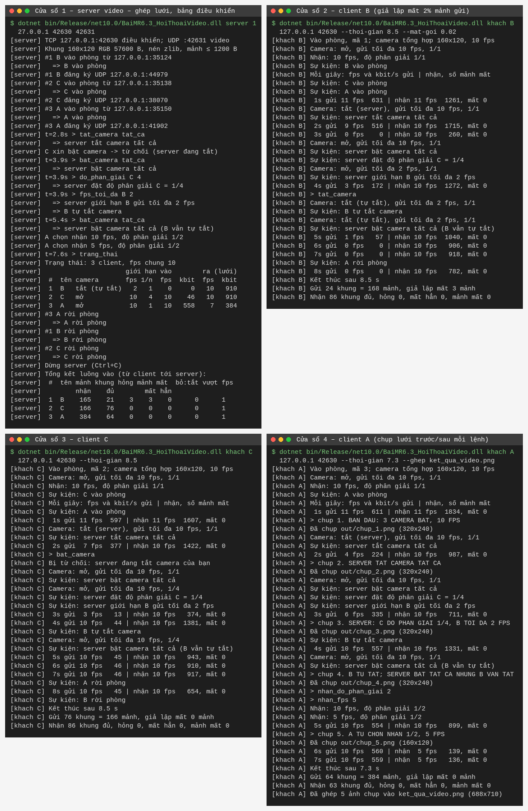
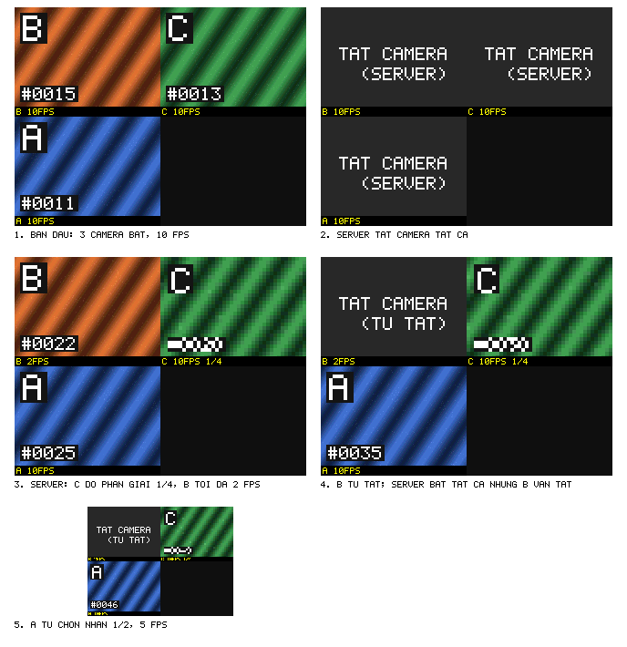

# Bài mở rộng MR6.3 – Phòng hội thoại video nhiều client (C#)

| Thông tin | Nội dung |
|---|---|
| Loại | **Bài mở rộng** – không có trong giáo trình, không có mã giả tương ứng |
| Liên hệ với giáo trình | Bài mở rộng MR6.2 (hội thoại âm thanh); Chương 6: Bài 6.1 (server đa luồng), Bài 6.4 (server chat); Chương 4: Bài 4.1 (UDP); Chương 3: Bài 3.2 (định khung thông điệp) |
| Thư viện | .NET 10 BCL: `System.Net.Sockets`, `System.Threading.Thread`, `System.IO.Compression.ZLibStream`, `BinaryPrimitives`, `System.Text.Json.Nodes`; PNG, CRC-32, phông chữ tự viết. Bản giao diện: Windows Forms (`net10.0-windows`), camera thật qua tiến trình `ffmpeg` – không dùng gói NuGet |
| Bản ngôn ngữ khác | [Python](../../../python/Chuong06/BaiMR6.3_HoiThoaiVideo/), [Go](../../../go/Chuong06/BaiMR6.3_HoiThoaiVideo/), [Java](../../../java/Chuong06/BaiMR6.3_HoiThoaiVideo/), [Rust](../../../rust/Chuong06/BaiMR6.3_HoiThoaiVideo/) |

## Mục tiêu
Cùng ý tưởng với MR6.2 nhưng cho hình ảnh: n client gửi khung hình camera qua UDP; server ghép khung của mọi người thành một **lưới** và gửi cho từng người theo tốc độ khung (fps) và độ phân giải mà người đó chọn. Server điều khiển được: tắt/bật camera của tất cả hoặc từng người, giới hạn fps gửi và độ phân giải gửi của từng người (tương tự độ lợi đầu vào ở MR6.2), giới hạn fps chung (tương tự âm lượng chung). Client tự tắt/bật camera, tự chọn fps và độ phân giải nhận. Client chụp lưới đang xem thành PNG trước/sau mỗi lệnh và ghép thành `ket_qua_video.png` – bằng chứng trực quan rằng lệnh có hiệu lực.

## Kiến thức chính
- **Kích thước khung và tốc độ bit.** Khung 160×120 điểm RGB = 160 × 120 × 3 = 57 600 byte; 10 fps không nén cần 57 600 × 8 × 10 ≈ 4,6 Mbit/s. Nén zlib (không mất dữ liệu) còn khoảng 7 KB/khung → ≈ 560–640 kbit/s. Giảm độ phân giải 1/4 mỗi chiều → 40×30 điểm = 1/16 số điểm ảnh, client C trong kết quả chỉ còn ≈ 47 kbit/s. Khung tổng hợp có "hạt nhiễu" thưa như cảm biến thật; không có nhiễu, ảnh nhân tạo nén quá tốt (≈ 1 KB) và không phản ánh được thực tế.
- **Chia mảnh và ghép khung.** Một khung nén (vài KB) lớn hơn một datagram an toàn. Mỗi datagram ≤ 1200 byte – mức QUIC (RFC 9000 mục 14) yêu cầu mọi đường truyền phải chở được, nhỏ hơn MTU 1500 của Ethernet sau khi trừ header IP/UDP và phần bọc của VPN, nên không bị phân mảnh IP. Header 20 byte: phiên bản, loại, mã nguồn, **số khung**, **chỉ số mảnh**, **tổng số mảnh**, rộng, cao, nhãn thời gian. Bên nhận gom đủ mảnh mới giải nén; **mất một mảnh là hỏng cả khung** – lý do codec thực tế có cơ chế chống lỗi (FEC, khung tham chiếu, yêu cầu khung khóa).
- **Video trực tiếp chỉ cần khung mới nhất.** Khi một khung đủ mảnh, mọi khung cũ hơn còn dở bị bỏ; không chờ, không truyền lại. Số khung tăng dần cho phép đếm khung hỏng (thiếu mảnh) và khung mất hẳn.
- **MCU và SFU (RFC 7667).** Bài dùng kiến trúc *ghép* (MCU/Topo-Mixer): server giải nén, ghép lưới, nén lại riêng cho từng người nhận – nên điều chỉnh được fps/độ phân giải *nhận* của từng người, nhưng tốn CPU server. Kiến trúc *chuyển tiếp chọn lọc* (SFU) chỉ chuyển tiếp luồng của từng người, client tự ghép; server nhẹ hơn nhiều nhưng muốn đổi độ phân giải cho từng người nhận thì người gửi phải gửi nhiều lớp (simulcast). Khác với âm thanh (mix-minus), lưới video có cả hình của chính mình (self-view) – không gây vọng, chỉ tốn băng thông.
- **Giới hạn hai phía.** Phía gửi: server báo `fps` tối đa và `chia` (1, 2, 4) qua TCP; client tuân thủ, và server **tự thực thi** – bỏ khung đến nhanh hơn 0,8/fps giây (cột "vượt fps": vài khung bị bỏ khi đồng hồ của client nhích sớm) và bỏ khung của camera đang tắt. Phía nhận: `fps nhận = min(fps client chọn, fps chung)`.
- **Phóng to và thu nhỏ ảnh.** Thu nhỏ: lấy 1 điểm trong mỗi khối d×d (dùng phép cắt lát `hang[c::3*d]` của Python). Phóng to: lặp điểm gần nhất (nearest neighbour), nên ô của C ở độ phân giải 1/4 hiện thành các ô vuông 4×4.
- **PNG viết tay.** Chữ ký 8 byte + các khối `IHDR`, `IDAT` (zlib của các hàng ảnh, mỗi hàng mở đầu bằng 1 byte bộ lọc), `IEND`; mỗi khối có CRC-32 (`zlib.crc32`).
- **Phòng vệ.** Giới hạn 256 mảnh/khung, giải nén có giới hạn kích thước (`decompressobj().decompress(dữ_liệu, 4 MB)`) chống "bom nén", kiểm tra rộng × cao × 3 khớp dữ liệu, chỉ nhận UDP từ địa chỉ đã đăng ký.

### Quy tắc quyền điều khiển (giống mic ở MR6.2)

| # | Quy tắc |
|---|---|
| 1 | Camera của X mở **khi và chỉ khi** X không tự tắt **và** server không tắt camera của X |
| 2 | Server tắt thắng client: đang bị server tắt, client xin bật bị **từ chối** |
| 3 | Server bật = gỡ lệnh tắt của server, **không bật hộ** camera mà người dùng tự tắt |
| 4 | Giới hạn gửi (fps tối đa, độ phân giải 1/1, 1/2, 1/4) của từng người và fps chung do server đặt |
| 5 | Tham số nhận (fps, độ phân giải lưới 1/1 hoặc 1/2) do từng client tự chọn; fps nhận không vượt fps chung |
| 6 | Tự tắt camera có hiệu lực ngay tại client; tự bật phải chờ server xác nhận |

## Cấu trúc tệp
- `BaiMR6.3_HoiThoaiVideo.csproj` – dự án console `net10.0`; vai trò `server` hoặc `khach`.
- `Program.cs` – chọn vai trò.
- `Chung.cs` – header datagram (`ChiaManh`, `TachHeader`, `GoiGiu`), phông chữ bitmap 5×7, tô/vẽ chữ, thu nhỏ/phóng to, nén/giải nén zlib có giới hạn, `GhiPng` (PNG viết tay, CRC-32 tự tính); lớp `GhepKhung`, `CameraTongHop`.
- `ServerVideo.cs` – server: lớp `Khach`; lớp `PhongVideo` (kênh TCP, luồng nhận UDP – ghép mảnh, kiểm tra quyền, vẽ ô; luồng ghép lưới và gửi theo hạn của từng người nhận; các lệnh `DatCamera`, `DatFpsToiDa`, `DatDoPhanGiai`, `DatFpsChung` dùng chung cho bảng điều khiển stdin và nút bấm giao diện); lớp `ServerVideo` – bảng điều khiển đọc stdin.
- `KhachVideo.cs` – client: vòng gửi theo fps cho phép, luồng nhận lưới, lệnh `chup`, ghép ảnh chụp (`--ghep`).
- `demo.json`, `ket_qua.txt`, `ket_qua.png` – kịch bản và kết quả thực thi thật (bản dòng lệnh); `ket_qua_video.png` – 5 ảnh lưới do client A chụp trong lần chạy đó.
- `GiaoDien/` – ứng dụng giao diện WinForms (dự án riêng `BaiMR6.3_GiaoDien.csproj`, `net10.0-windows`; dự án dòng lệnh loại thư mục này ra bằng `<Compile Remove="GiaoDien/**" />`). Biên dịch kèm `../Chung.cs`, `../ServerVideo.cs`:
  - `Program.cs` – vai trò `server_gui`, `client_gui`, `demo`;
  - `FormServer.cs` – cửa sổ “Camera Server” (lưới 4×4, danh sách client, điều khiển, nhật ký);
  - `FormKhach.cs` – cửa sổ “Camera Client” (kết nối, chọn camera, xem trước, lưới nhận);
  - `KetNoiVideo.cs` – phần mạng của client (không phụ thuộc WinForms): gửi theo fps cho phép, nhận và ghép lưới, số liệu mỗi giây;
  - `CameraFfmpeg.cs` – `INguonHinh`, `CameraGiaLap` (khung tổng hợp), `CameraFfmpeg` (đọc khung RGB thô từ ffmpeg, liệt kê camera DirectShow / `/dev/video*`);
  - `DieuKhien.cs` – ô hình tự vẽ `OHinh`, đổi RGB → `Bitmap` bằng `LockBits`, hàm tạo điều khiển;
  - `DemoGui.cs` – kịch bản tự thao tác và chụp `ket_qua_gui.png`;
  - `demo.json` – kịch bản dạng Windows cho `tools/demo_windows.ps1`.

## Cách chạy
Trong thư mục bài (lệnh giống nhau trên Windows và Linux):
```bash
dotnet build -c Release
dotnet bin/Release/net10.0/BaiMR6.3_HoiThoaiVideo.dll server 127.0.0.1 9000 9001                    # cửa sổ 1 (gõ lệnh điều khiển ở đây)
dotnet bin/Release/net10.0/BaiMR6.3_HoiThoaiVideo.dll khach B 127.0.0.1 9000                         # cửa sổ 2
dotnet bin/Release/net10.0/BaiMR6.3_HoiThoaiVideo.dll khach C 127.0.0.1 9000                         # cửa sổ 3
dotnet bin/Release/net10.0/BaiMR6.3_HoiThoaiVideo.dll khach A 127.0.0.1 9000 --thoi-gian 60 --ghep ket_qua_video.png   # cửa sổ 4
```
Có thể thay `dotnet bin/Release/net10.0/BaiMR6.3_HoiThoaiVideo.dll` bằng `dotnet run --`. Lệnh server: `tat_camera tat_ca`, `tat_camera B`, `bat_camera tat_ca`, `fps_toi_da B 2`, `do_phan_giai C 4`, `fps_chung 5`, `trang_thai`, `thoat`. Lệnh client: `tat_camera`, `bat_camera`, `nhan_fps 5`, `nhan_do_phan_giai 2`, `chup <nhãn>` (lưu `out/chup_N.png`), `thoat`. Dòng `@t lệnh` chờ tới giây thứ t. Nhãn ảnh chụp chỉ vẽ được chữ in hoa không dấu, số và vài ký hiệu (phông 5×7 tự định nghĩa).

Tùy chọn client: `--fps 10` (tốc độ khung camera), `--mat-goi 0.02` (giả lập mất 2 % mảnh gửi), `--thoi-gian`. Bản dòng lệnh không dùng camera thật (BCL không có API camera), chỉ dùng camera tổng hợp; camera thật có trong ứng dụng giao diện (mục dưới) qua tiến trình ffmpeg.

Tái lập kết quả từ thư mục gốc của kho: `python3 tools/demo.py csharp/Chuong06/BaiMR6.3_HoiThoaiVideo` (cổng TCP 42630, UDP 42631).

## Ứng dụng giao diện


*(Ảnh `ket_qua_gui.png` do vai trò `demo` tự chụp khi chạy trên Windows – xem “Kết quả thực thi”.)*

Không thêm thông điệp mới; hai cửa sổ dùng đúng giao thức của bản dòng lệnh nên chạy chéo được với mọi ngôn ngữ.
- **Server – “Camera Server”**: lưới 4×4 ô, mỗi client một ô (ảnh 160×120 của client, tên, fps nhận được, kbit/s, giới hạn gửi; chấm đỏ khi camera tắt; viền vàng = client đang chọn – bấm vào ô để chọn). Khung phải: danh sách client, nút *Tắt camera*/*Bật camera* (khóa của server) cho client đang chọn, *fps gửi tối đa* 1–15, *độ phân giải gửi* 1/1, 1/2, 1/4, *fps chung* 1–15, nhật ký, IP/cổng, START SERVER/STOP SERVER; thanh trạng thái dưới cùng.
- **Client – “Camera Client”**: *Kết nối server* (IP, cổng, tên, Kết nối/Ngắt kết nối); *Camera* (chọn camera thật hoặc “Camera giả lập”, START/CANCEL = tự bật/tắt camera); khung xem trước camera của mình; khung *lưới nhận từ server* với *fps nhận* và *độ phân giải nhận* 1/1, 1/2; thanh trạng thái “Đang truyền dữ liệu camera… | gửi x fps, y kbit/s | nhận …”.

**Camera thật qua ffmpeg.** Lúc mở cửa sổ, client chạy `ffmpeg -hide_banner -list_devices true -f dshow -i dummy` (trên luồng nền) và đọc các dòng `"Tên" (video)` ở stderr để điền danh sách – lệnh này **không** bật camera. Chỉ khi bấm START với một camera thật, chương trình mới chạy
`ffmpeg -f dshow -i video="Tên" -vf scale=160:120,fps=15 -pix_fmt rgb24 -f rawvideo pipe:1`
và đọc từng khung đúng 57 600 byte từ stdout (`Stream.ReadExactly`), đưa vào đúng đường gửi sẵn có (thu nhỏ theo server, nén zlib, chia mảnh). Trên Linux dùng `-f v4l2 -i /dev/videoN`. Không có ffmpeg, không có camera hoặc ffmpeg dừng giữa chừng (rút camera) → thông báo trên thanh trạng thái và dùng “Camera giả lập”; nhãn trong nhóm *Camera* luôn ghi rõ “THẬT” hay “giả lập”. Windows 11: *Settings → Privacy & security → Camera* phải cho phép ứng dụng desktop.

**Luồng xử lý và quy tắc luồng giao diện**
```
 luồng giao diện                         luồng mạng                              luồng camera
 ───────────────                         ──────────                              ────────────
 nút/thanh trượt ─► PhongVideo.Dat* ─TCP─► client      ffmpeg (tiến trình) ──stdout──► CameraFfmpeg.DocKhung (khung mới nhất)
 Timer 100 ms ◄── chụp ô hình (lock, sao chép)          NhanUdp: ghép mảnh ─► Khach.O        │
     │        ◄── ConcurrentQueue nhật ký               VongGui: ghép lưới, nén ─UDP─► client  ▼
     ▼                                                                    Client VongGui: theo fps ─► thu nhỏ, nén, chia mảnh ─UDP─► server
 RGB ─LockBits─► Bitmap ─► OHinh.OnPaint
 Client: Kết nối = await Task.Run(KetNoi); liệt kê camera = await Task.Run(DanhSach)
```
Chỉ luồng giao diện chạm vào điều khiển: các luồng nền chỉ ghi trạng thái (có khóa) và đẩy nhật ký vào `ConcurrentQueue`; bộ hẹn giờ `System.Windows.Forms.Timer` 100 ms trên luồng giao diện sao chép ô hình trong khóa rồi mới đổi sang `Bitmap` và vẽ (ngoài khóa). Việc có thể chờ lâu (kết nối, chạy ffmpeg để liệt kê) dùng `await Task.Run(...)`.

**Chạy trên Windows** (cần .NET 10 SDK `winget install Microsoft.DotNet.SDK.10`; muốn dùng camera thật thì cài ffmpeg: `winget install -e --id Gyan.FFmpeg`, mở lại cửa sổ dòng lệnh để PATH có `ffmpeg`):
```powershell
cd csharp\Chuong06\BaiMR6.3_HoiThoaiVideo\GiaoDien
dotnet build -c Release
dotnet run -c Release -- server_gui 127.0.0.1 9000 9001       # Camera Server
dotnet run -c Release -- client_gui 127.0.0.1 9000 A          # mỗi client một cửa sổ (đổi tên B, C…)
```
Kịch bản tự động (từ thư mục gốc kho): `powershell -NoProfile -ExecutionPolicy Bypass -File tools\demo_windows.ps1 csharp\Chuong06\BaiMR6.3_HoiThoaiVideo\GiaoDien` – chạy `demo 127.0.0.1 42635 42636 ..\ket_qua_gui.png`: Camera Server và ba Camera Client (A, B, C – camera giả lập, không mở camera thật) trong cùng tiến trình; START SERVER, Kết nối, START; chờ 2 s; server chọn B → Tắt camera, chọn C → fps gửi 5, độ phân giải 1/2; A chọn nhận 1/2; B CANCEL rồi START → bị từ chối; chờ 2,5 s, in fps/kbit/s và chụp 4 cửa sổ (`Control.DrawToBitmap`) thành `ket_qua_gui.png`.

**Linux/macOS**: WinForms chỉ chạy trên Windows; phần `PhongVideo`, `KetNoiVideo`, `CameraFfmpeg` là .NET thuần và chạy được trên Linux (đã kiểm thử, xem dưới).

## Kết quả thực thi


Ảnh lưới do client A chụp trong lần chạy trên (ô theo thứ tự vào phòng: B, C, A; dải vàng dưới mỗi ô là giới hạn gửi server đặt cho người đó):



1. Ba camera bật, 10 fps; số khung (`#0014`…) do camera của từng client vẽ.
2. Server `tat_camera tat_ca`: cả ba ô "TAT CAMERA (SERVER)"; C xin bật camera và **bị từ chối**.
3. Server bật lại, `do_phan_giai C 4`, `fps_toi_da B 2`: ô C thành các ô vuông 4×4 (40×30 điểm được phóng to), luồng của C giảm từ ≈ 630 xuống ≈ 46 kbit/s; B chỉ còn gửi 2 fps.
4. B tự tắt camera; server `bat_camera tat_ca` nhưng ô B vẫn "TAT CAMERA (TU TAT)" (quy tắc 3).
5. A tự chọn nhận độ phân giải 1/2 và 5 fps: lưới A nhận còn 160×120, luồng nhận giảm từ ≈ 900 xuống ≈ 130 kbit/s (1/4 số điểm ảnh × 1/2 số khung).

Luồng của B giả lập mất 2 % mảnh: server đếm được khung hỏng và mảnh mất (bảng tổng kết), các khung đó bị bỏ, lưới vẫn hiện khung đủ gần nhất của B. Mọi dòng nhật ký của bản C# giống bản Python (chỉ khác số đo kbit/s vài phần trăm và số mảnh); ảnh lưới giống bản Python trừ vị trí hạt nhiễu (bộ sinh ngẫu nhiên `System.Random` khác của Python).

**Ứng dụng giao diện – chưa chạy GUI, cần Windows.** Môi trường biên soạn là Linux không có gói tham chiếu Windows Desktop, nên chưa có `ket_qua_gui.png` (không dựng ảnh giả). Đã kiểm tra trên Linux (.NET SDK 10.0.114, ffmpeg có sẵn, không có camera):
- toàn bộ mã WinForms biên dịch sạch (không lỗi, không cảnh báo) với các assembly tham chiếu `System.Windows.Forms`/`System.Drawing` của .NET Framework 4.8 (gói mono/reference-assemblies) trong một dự án tạm – kiểm tra kiểu và API, không chạy được cửa sổ;
- phần không phụ thuộc WinForms chạy thật trong một dự án console tạm: `PhongVideo` + ba `KetNoiVideo`, A và B dùng `CameraGiaLap`, C dùng `CameraFfmpeg` với nguồn thử `-f lavfi -i testsrc` của ffmpeg (cùng đường đọc khung RGB thô như camera thật). Ba camera gửi 10 fps (A 575, B 547, C 360 kbit/s), mỗi client nhận lưới 320×240 ở 10 fps ≈ 1555 kbit/s, 0 mảnh mất. Sau khi server tắt camera B, giới hạn C 5 fps, A gửi 1/2 và A chọn nhận 1/2: C gửi 5 fps 185 kbit/s, A gửi 156 kbit/s và nhận lưới 160×120 ≈ 342 kbit/s; B CANCEL/START bị từ chối; STOP server → client báo “Mất kết nối với server”. Mở `/dev/video9` không tồn tại → `CameraFfmpeg.Loi` = “ffmpeg dừng: Error opening input files: No such file or directory”.

Bản dòng lệnh sau khi tách lớp `PhongVideo` được chạy lại bằng `tools/demo.py`: `ket_qua.txt` chỉ khác bản trước ở số đo fps/kbit/s, số mảnh và cổng.

## Ghi chú
- Số fps/kbit/s đo theo cửa sổ 1 giây không thẳng hàng với thời điểm lệnh, nên giây chuyển tiếp có giá trị trung gian; ở 5 fps một cửa sổ có thể đếm được 5 hoặc 6 khung.
- Nén zlib không mất dữ liệu kém xa codec video thật: H.264/VP8/AV1 nén có mất dữ liệu và chỉ gửi phần thay đổi giữa các khung (nén liên khung), đạt chất lượng tương đương ở vài chục kbit/s cho khung nhỏ như thế này. Video thật còn cần SRTP để mã hóa, điều khiển tắc nghẽn để tự giảm tốc khi mạng nghẽn, và đồng bộ hình–tiếng theo nhãn thời gian.
- Server ghép lưới và nén lại cho từng người nhận mỗi khung; với nhiều client hơn, CPU server sẽ là nút thắt – đó chính là lý do hệ thống lớn dùng SFU.
- Giao thức (header, JSON, zlib) giống hệt bản Python, Go: đã thử client bản Python nối vào server C# và chụp được lưới 320×120 của hai client. `ZLibStream` của .NET (RFC 1950) tương thích với `zlib` của Python; mức `CompressionLevel.Fastest` cho dung lượng gần với `zlib.compress(…, 1)` (nên số mảnh của A ít hơn bản Python: 384 so với 445).
- PNG cần CRC-32 cho mỗi khối; BCL không có sẵn (gói `System.IO.Hashing` phải tải từ NuGet) nên bài tự tính bằng bảng 256 phần tử, cùng đa thức `0xEDB88320` với `zlib.crc32`.
- Giải nén có giới hạn 4 MiB: đọc `ZLibStream` từng khối và ném lỗi khi vượt – chống “bom nén” (vài KB giải ra hàng GB).
- Kiểm thử: Linux, .NET SDK 10.0.114; ứng dụng giao diện chưa chạy (cần Windows).
- ffmpeg ghi thông báo ra stderr: `CameraFfmpeg` phải đọc stderr (`BeginErrorReadLine`), nếu không ống stderr đầy sẽ làm ffmpeg dừng chờ và không ra khung nào. Đối số truyền qua `ProcessStartInfo.ArgumentList` nên tên camera có khoảng trắng không cần tự đặt dấu nháy.

## Bài tập gợi ý
1. Thêm `fps_chung 3` vào kịch bản server và quan sát fps nhận của mọi client; giải thích vì sao `nhan_fps 30` của client vẫn không vượt được giới hạn này.
2. Chạy client với `--mat-goi 0.1`: tính xác suất một khung 6 mảnh đến đủ (0,9⁶ ≈ 53 %) và so sánh với số khung hỏng server đếm được. Vì sao khung lớn chịu mất gói kém hơn?
3. Bỏ ô của chính người nhận khỏi lưới (giống mix-minus) và đo băng thông tiết kiệm được.
4. (Giao diện) Ứng dụng giao diện đang đổi RGB → `Bitmap` cho cả 16 ô mỗi 100 ms trên luồng giao diện. Chuyển việc đổi sang luồng nhận (chỉ khi có khung mới) và đo thời gian xử lý một nhịp `CapNhat` trước/sau bằng `Stopwatch`.
5. Nâng cao: chuyển server sang kiến trúc SFU – chuyển tiếp nguyên mảnh của từng người, client tự ghép lưới; giới hạn fps nhận bằng cách server bỏ cả khung (mọi mảnh có cùng số khung). So sánh CPU server và độ trễ với bản MCU.
6. (Giao diện) Thêm nút “Chụp lưới” ở client lưu khung lưới đang xem thành PNG bằng `GhiPng` sẵn có, và ô số fps camera để chạy ffmpeg với `fps=<n>` khác (phải khởi động lại tiến trình ffmpeg).

## Đọc thêm
- RFC 9000 – *QUIC: A UDP-Based Multiplexed and Secure Transport*, mục 14 (kích thước datagram 1200 byte).
- RFC 7667 – *RTP Topologies* (Topo-Mixer/MCU, Topo-SFU).
- RFC 8085 – *UDP Usage Guidelines* (mục 3.2: tránh phân mảnh IP, kích thước thông điệp).
- RFC 1950, RFC 1951 – định dạng zlib và DEFLATE.
- W3C, *Portable Network Graphics (PNG) Specification* (Second Edition), 2003 (cấu trúc khối, CRC, bộ lọc hàng).
- Tài liệu .NET: `System.IO.Compression.ZLibStream`; W3C, *Portable Network Graphics (PNG) Specification* (khối IHDR, IDAT, IEND, CRC-32).
- FFmpeg Documentation, *ffmpeg-devices* (`dshow`, `v4l2`, `-list_devices`), *ffmpeg-formats* (`rawvideo`); Microsoft Learn, *Bitmap.LockBits*, *Control.DrawToBitmap*.

Mã nguồn của bài được viết mới cho kho này.
