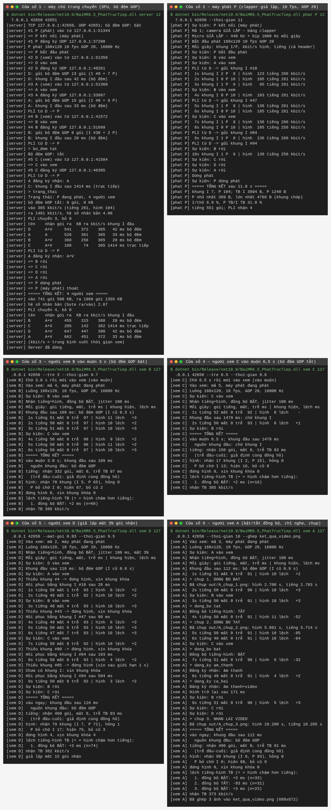
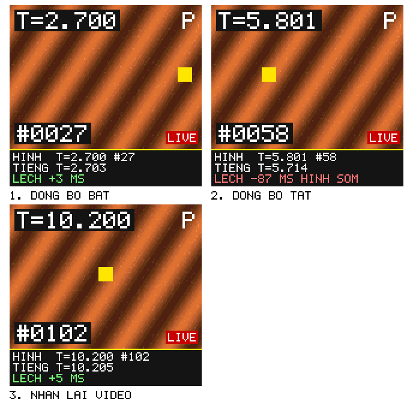

# Bài mở rộng MR6.5 – Phát trực tiếp âm thanh + video 1→n (C#)

| Thông tin | Nội dung |
|---|---|
| Loại | **Bài mở rộng** – không có trong giáo trình, không có mã giả tương ứng |
| Liên hệ với giáo trình | Bài mở rộng MR6.2 (âm thanh RTP, bộ đệm jitter), MR6.3 (video chia mảnh); Chương 6: Bài 6.1 (server đa luồng), Bài 6.6 (một nguồn – nhiều người nhận); Chương 4: Bài 4.1 (UDP); Chương 3: Bài 3.2 (định khung thông điệp) |
| Thư viện | .NET 10 BCL: `System.Net.Sockets` (TCP, UDP), `System.Threading.Thread`, `System.IO.Compression.ZLibStream` (`ZLibCompressionOptions`, mức 6), `BinaryPrimitives`, `System.Text.Json.Nodes`, `System.Diagnostics.Process`; PNG, CRC-32, phông chữ tự viết. Bản giao diện: Windows Forms (`net10.0-windows`). Thiết bị thật (tùy chọn): công cụ `ffmpeg` (camera, tệp video), micro/loa qua `winmm.dll` (P/Invoke, chỉ Windows) – không dùng gói NuGet |
| Bản ngôn ngữ khác | [Python](../../../python/Chuong06/BaiMR6.5_PhatTrucTiep/), [Java](../../../java/Chuong06/BaiMR6.5_PhatTrucTiep/), [Rust](../../../rust/Chuong06/BaiMR6.5_PhatTrucTiep/), [Go](../../../go/Chuong06/BaiMR6.5_PhatTrucTiep/) |

## Mục tiêu
Mô hình của livestream thật (YouTube Live, Facebook Live, Twitch; máy chủ RTMP/SRS, WebRTC SFU): **một máy phát** (camera + micro) gửi lên **máy chủ trung chuyển**; máy chủ **không giải nén, không trộn** mà chỉ **nhân bản gói** (fan-out) tới **n người xem**. Khác MR6.2/MR6.3 (hội thoại n↔n, server MCU trộn/ghép lưới). Bài cho thấy bằng số liệu thật: băng thông ra = n × vào; khung khóa I và khung sai khác P; mất một khung P thì **đứng hình** cho tới khi **xin khung khóa** (PLI); **bộ đệm GOP** giúp người vào muộn thấy hình gần như tức thì; **đồng bộ tiếng-hình** (lip-sync) với âm thanh làm đồng hồ chủ; đăng ký theo lớp (chỉ nghe). Nguồn phát: **camera thật**, **tệp video** (mp4, mkv… – phát lại như OBS "Media Source"), mẫu thử ffmpeg hoặc nguồn giả lập; micro thật, tiếng của tệp hoặc giả lập.

## Kiến thức chính
Số liệu dưới đây lấy từ `ket_qua.txt` (một lần chạy thật trên máy cục bộ; mỗi lần chạy lệch vài phần trăm).

- **Fan-out 1→n và SFU (RFC 7667 mục 3.7).** Máy chủ chỉ đọc header (byte đầu, loại khung, số khung) rồi `Socket.SendTo()` nguyên byte cho từng người xem. Lúc `trang_thai` (4 người xem, A đang "chỉ nghe"): vào 365 kbit/s, ra 1461 kbit/s, hệ số nhân bản 4,00. Cả buổi: vào 508 KB, ra 1355 KB, hệ số 2,67 (người xem vào/ra ở các thời điểm khác nhau). CPU máy chủ gần như chỉ dành cho gửi gói – khác MCU ở MR6.3 phải giải nén, ghép và nén lại cho từng người.
- **Khung I, khung P, nhóm GOP.** I = `zlib(rgb thô 160×120×3)`; P = `zlib(XOR(khung này, khung trước))`, nén bằng `ZLibStream` mức 6 (như `zlib.compress(…, 6)` của Python). Cảnh gần như tĩnh (nền tĩnh, một ô vuông chạy, đồng hồ đổi số) nên P nhỏ nhất chỉ 389 B so với I trung bình 3994 B (6,9 % ảnh thô 57 600 B). Khung chớp trắng mỗi giây tròn đổi gần như toàn ảnh nên P lúc đó lên tới 4768 B – "đổi cảnh" thì P lớn như I. Video tốn 95–138 kbit/s, tiếng L16 256–266 kbit/s (đều tính cả header RTP/bài).
- **Mất tham chiếu và xin khung khóa (PLI – RFC 4585 mục 6.3.1).** P số k chỉ giải được khi đã có khung k−1. D giả lập mất 3 % gói nhận (15 gói): 4 lần "Thiếu khung #… → đứng hình", gửi `xin_khung_khoa`; máy chủ lọc 500 ms rồi chuyển cho máy phát; máy phát gửi I ngay ở khung kế tiếp. Có PLI thì hình về sau 28–103 ms ("Hồi phục bằng khung I #47 sau 98 ms") – cộng 200 ms chờ khung thiếu trước khi kết luận mất tham chiếu ⇒ đứng ≈ 0,3 s. Một lần mất ngay sau lần hồi phục ("xin sau giới hạn 1 s"): người xem chờ hết giới hạn 1 s rồi xin lại, hình về sau 594 ms.
- **Bộ đệm GOP ở máy chủ (GOP cache của SRS, nginx-rtmp).** Máy chủ giữ khung I mới nhất và mọi P sau nó (≤ 4 MB). B vào muộn 3 s khi bộ đệm bật: máy chủ gửi ngay 8 gói (I #30 + 2 P), khung I tới sau 20 ms; B hiện khung đầu sau **109 ms** (chờ bộ đệm jitter nạp tiếng để khung đầu cũng đúng tiếng). C vào lúc bộ đệm đã tắt: phải chờ khung I kế tiếp, khung đầu sau **1479 ms** (tối đa một GOP = 2 s ở 10 fps, GOP 20; thời gian chờ tùy C vào ở pha nào của GOP – các lần chạy thử khác cho 0,5–0,8 s vì PLI của D làm dời vị trí các khung I). Người vào **trước** khi máy phát bấm Phát thì thời gian tới khung đầu tính từ lúc bắt đầu phát (dòng in có "(từ lúc phát)"), không tính thời gian chờ người phát.
- **Đồng bộ tiếng-hình, âm thanh là đồng hồ chủ.** Nhãn thời gian tiếng (RTP ts, 16 kHz) và hình (ms) cùng một gốc: t = 0 lúc bấm Phát (đồng hồ đơn điệu `Stopwatch`). Máy phát gửi `dong_ho` mỗi giây (như RTCP Sender Report – RFC 3550 mục 6.4.1). Người xem chỉ hiện khung có nhãn ≤ đồng hồ phát tiếng: A **+3 ms** khi BẬT (sai số do nhịp hiển thị 5 ms), **−83 ms** khi TẮT (hình đi trước tiếng đúng bằng thời gian tiếng nằm trong bộ đệm jitter, ≈ 4 khung × 20 ms + nửa nhịp phát). Ảnh chụp `ket_qua_video.png` ghi nhãn hình và đồng hồ tiếng ngay lúc khung được hiện.
- **Độ trễ đầu-cuối (tiếng).** `giờ thực khi phát − (gio + (ts_ms − ts))` theo báo cáo đồng hồ mới nhất: 90–98 ms (bộ đệm jitter 5 khung). Chỉ đúng khi máy phát và người xem **cùng đồng hồ** (cùng máy hoặc đồng bộ NTP) – điều RTCP SR thật cũng phải giả định.
- **Đăng ký theo lớp.** `dang_ky am_thanh` – A "chỉ nghe": máy chủ ngừng gửi hình cho A (cột "nhận" = `A`). Bật lại video khi bộ đệm đã tắt: A chờ khung I kế tiếp (ở lần chạy này I #94 do PLI của D tới ngay) – hình trở lại sau 171 ms; nếu chưa có I, khung tham chiếu cũ đã lỗi thời → mất tham chiếu → PLI (như bản Python).
- **Phát từ tệp video (đồng bộ ở phía phát).** Hai tiến trình ffmpeg cùng đọc tệp với `-re` (theo tốc độ thật) và `-stream_loop -1` (lặp lại): một ra khung rgb24 160×120 (`scale…,pad…,fps=10` – khung thứ i ứng với giây i/10 của tệp), một ra tiếng s16le 16 kHz mono. Hai tiến trình khởi động lệch nhau, nên nếu cứ gửi "khung mới nhất" thì hình và tiếng của tệp đã lệch ngay từ máy phát. `TepVideo.cs` làm như bộ ghép kênh (muxer) của bộ mã hóa thật: tiếng là đồng hồ chủ – thiếu mẫu thì chèn 20 ms im lặng, dồn quá 300 ms thì bỏ 20 ms, và ghi lại `LechMs` = thời điểm phương tiện − thời điểm trong tệp của tiếng đang gửi; khi chụp khung ở thời điểm T, máy phát chọn khung hình của tệp có thời điểm ≤ T − `LechMs`. Thử tại nguồn với tệp mẫu (chớp trắng và bíp 1000 Hz cùng lúc ở đầu mỗi giây, 8 s): bíp bắt đầu ở 880, 1880, … 7880 ms phương tiện, khung chớp ở 900, 1904, … 7900 ms – lệch ≤ 20 ms (độ phân giải: khung hình 100 ms, khung tiếng 20 ms), `LechMs` = −120. Phát tệp mẫu qua máy chủ C# tới người xem Python và C#: I TB 11 948 B, P TB 7757 B (ảnh động nhiều – testsrc2 có vạch màu, đường chéo chạy – nên P chỉ nhỏ hơn I chút ít; codec thật dùng bù chuyển động để P vẫn nhỏ khi cảnh chuyển động), lệch tiếng-hình ở người xem +2 / +3 ms.
- **Đa luồng.** Máy chủ: luồng nhận kết nối, mỗi client một luồng TCP, **một** luồng UDP nhận và chuyển tiếp ngay (mọi gói phương tiện đi ra từ luồng này nên thứ tự được giữ – bộ đệm GOP luôn đi trước gói trực tiếp). Người xem: luồng TCP, luồng nhận UDP, luồng phát 20 ms (đồng hồ chủ) và luồng hiển thị 5 ms; trạng thái chung dưới một khóa (`lock`).

### Giao thức (giống hệt ở 5 ngôn ngữ)
Máy chủ: TCP cổng P (điều khiển, mỗi dòng một JSON UTF-8 kết thúc `\n`, ≤ 64 KB), UDP cổng P+1 (phương tiện). Mỗi client mở **một** socket UDP cho cả tiếng và hình.

| Chiều | Thông điệp TCP |
|---|---|
| client → server | `{"loai":"chao","vai_tro":"phat"\|"xem","ten":"A"}` (đầu tiên, tên 1–16 ký tự) |
| xem → server | `{"loai":"dang_ky","am_thanh":true,"video":true}`, `{"loai":"xin_khung_khoa"}` |
| phát → server | `{"loai":"thong_tin","rong":160,"cao":120,"fps":10,"gop":20,"tan_so_mau":16000}`, `{"loai":"dong_ho","ts":<ms phương tiện>,"gio":<ms Unix>}` mỗi 1 s, `{"loai":"dung_phat"}` |
| server → client | `{"loai":"chao","ma":k,"cong_udp":P+1,"phat":bool}`; `{"loai":"loi","ly_do":"đã có máy phát"\|"tên không hợp lệ"}` rồi đóng |
| server → xem | `thong_tin`, `dong_ho` (chuyển tiếp; bản đã lưu cho người vào sau); `{"loai":"bi_ngat","ly_do":"server ngắt"}` rồi đóng |
| server → phát | `{"loai":"xin_khung_khoa","tu":"A"}` (lọc 500 ms), `{"loai":"nguoi_xem","so":n,"ds":[…]}` |
| server → tất cả | `{"loai":"su_kien","noi_dung":"B vào xem"}`, `{"loai":"ket_thuc"}` |

| Datagram UDP | Byte đầu | Cấu trúc |
|---|---|---|
| Tiếng | `0x80` | RTP v2, 12 byte big-endian (0x80, PT 96, seq, ts 16 kHz từ 0, SSRC = mã máy phát) + 320 mẫu L16 big-endian (640 B) |
| Hình | `0x01` | 20 byte big-endian (phiên bản 1, loại, mã nguồn, số khung, chỉ số mảnh, tổng mảnh, rộng, cao, nhãn ms – viết bằng `BinaryPrimitives`) + ≤ 1180 B dữ liệu; loại 2 = giữ kết nối (`GoiGiu`), **3 = mảnh I**, **4 = mảnh P**; ≤ 256 mảnh/khung |

Client gửi `GoiGiu(mã)` ngay sau chào và mỗi 1 s; máy chủ ghi nhận địa chỉ UDP khi IP trùng IP TCP của mã đó và chỉ nhận phương tiện từ địa chỉ đã đăng ký của máy phát. Khung 0 luôn là I; I lặp lại mỗi `gop` khung hoặc ngay sau khi có `xin_khung_khoa` (đếm GOP lại từ đó).

**Chạy chéo với bản Python** (cùng máy, Linux):
- (a) máy phát **Python** + máy chủ **C#** + hai người xem **C#** (X bật/tắt đồng bộ, Z giả lập mất 3 %) + người xem **Python** Y vào muộn 2,5 s: X giải mã đủ I/P, lệch **+3 ms** (BẬT) / −98 ms (TẮT) / +3 ms; Z đứng hình 5 lần, mỗi lần hồi phục bằng I sau PLI (≈ 100 ms; 400–600 ms khi bị giới hạn 1 s); Y nhận bộ đệm GOP từ máy chủ C# (15 gói, I #20 + 9 P), khung đầu sau 109 ms, lệch +3 ms; máy chủ C# chuyển 5 PLI cho máy phát Python.
- (b) máy phát **C#** + máy chủ **Python** + ba người xem **Python**: Y lệch +3 / −87 / +2 ms, W vào muộn 2,5 s khung đầu 116 ms từ bộ đệm GOP, V (mất 3 %) đứng hình 5 lần và hồi phục bằng I sau 94–98 ms; máy phát C# nhận 5 PLI; hệ số nhân bản 3,00.
- Phát tệp video bằng máy phát C# (`--tep … --tao-tep-mau`) tới máy chủ C#, người xem Python và C#: khung đầu 93/110 ms, lệch +2 / +3 ms.
- Người xem C# và Python vào trước khi máy phát Python bấm Phát: "Khung đầu sau 110 ms (từ lúc phát)".

## Cấu trúc tệp
- `BaiMR6.5_PhatTrucTiep.csproj` – dự án console `net10.0` (loại thư mục `GiaoDien` ra bằng `<Compile Remove="GiaoDien/**" />`); `Program.cs` – chọn vai trò `server`, `phat`, `xem`.
- `Chung.cs` – hằng số; RTP (`DongGoiRtp`, `TachRtp`, L16 big-endian); header video, `ChiaManh`, `GoiGiu`, `TachHeader`; `GhepKhung` (không bỏ khung cũ còn dở, chờ 0,5 s); `BoDemJitter` (trả về nhãn thời gian, đổi độ sâu khi chạy); `XorKhung`, `MaHoaI/P`, `Nen`/`GiaiNen` (giới hạn 4 MB), `GiaiMaVideo` (chờ khung thiếu 200 ms, mất tham chiếu); phông 5×7, `GhiPng`, `GhepAnh`; nguồn giả lập `NguonClapper` (hình) và `NguonAmClapper` (tiếng); `GuiJson`, `DocDong` (đọc dòng JSON giới hạn 64 KB), `TenHopLe`, `DocLenhStdin` (lệnh `@t`), `KetNoiTcp`.
- `Camera.cs` – `INguonHinh`, `CameraGiaLap` (clapper), `CameraFfmpeg` (camera thật / testsrc qua ffmpeg, liệt kê camera dshow / `/dev/video*` / avfoundation) – chép từ MR6.3 (GiaoDien/CameraFfmpeg.cs) và sửa.
- `ThietBiAmThanh.cs` – `WinMM` (P/Invoke `waveIn*`/`waveOut*`), `ThuAmWinMM`, `PhatAmWinMM` – chép từ MR6.2; `INguonMic`, `ILoa`, `MicGiaLap` (440 Hz + bíp), `MicThat`, `LoaThat`, `MoMic`, `MoLoa`.
- `TepVideo.cs` – nguồn "tệp video": `TepVideo` (hai tiến trình ffmpeg `-re -stream_loop -1`, bộ đệm tiếng, vòng khung hình 3 s có thời điểm trong tệp, `LechMs`), `CameraTep`, `MicTep`, `MoTep`, `TaoTepMau` (mp4 có chớp + bíp mỗi giây).
- `MayChu.cs` – lõi máy chủ `MayChuPhat` (BatDau/Dung nhiều lần, bộ đệm GOP, lọc PLI, thống kê, `BangTrangThai`, `BangTongKet`) và lớp `ServerPhat` (bản dòng lệnh).
- `MayPhat.cs` – lõi máy phát `MayPhat` và lớp `Phat` (bản dòng lệnh).
- `NguoiXem.cs` – lõi người xem `NguoiXem` (đồng hồ chủ, lip-sync, PLI, thống kê), `AnhChup`, và lớp `Xem` (bản dòng lệnh).
- `GiaoDien/` – ứng dụng WinForms (dự án riêng `BaiMR6.5_GiaoDien.csproj`, `net10.0-windows`, biên dịch kèm mọi tệp `../*.cs` trừ `../Program.cs` bằng `<Compile Include="..\*.cs" Exclude="..\Program.cs" LinkBase="DungChung" />`):
  - `Program.cs` – vai trò `server_gui`, `phat_gui`, `xem_gui`, `demo`;
  - `FormServer.cs`, `FormPhat.cs`, `FormXem.cs` – ba cửa sổ;
  - `DieuKhien.cs` – `GD` (đổi RGB → `Bitmap` bằng `LockBits`, tạo điều khiển, chụp cửa sổ), `HangDoiGiaoDien`, `OAnh` (ô hình phóng điểm gần nhất), `ThanhMuc` (dBFS), `NhatKy`, `ThongKeDinhKy`;
  - `DemoGui.cs` – kịch bản tự thao tác, chụp `ket_qua_gui.png` và `ket_qua_gui_tep.png`;
  - `demo.json` – kịch bản dạng Windows cho `tools/demo_windows.ps1`.
- `demo.json`, `ket_qua.txt`, `ket_qua.png`, `ket_qua_video.png` – kịch bản và kết quả thực thi thật (bản dòng lệnh).

## Cách chạy
Trong thư mục bài (lệnh giống nhau trên Windows và Linux):
```bash
dotnet build -c Release
dotnet bin/Release/net10.0/BaiMR6.5_PhatTrucTiep.dll server 127.0.0.1 9000 9001                      # cửa sổ 1 (gõ lệnh ở đây)
dotnet bin/Release/net10.0/BaiMR6.5_PhatTrucTiep.dll phat P 127.0.0.1 9000 --thoi-gian 120            # cửa sổ 2: máy phát
dotnet bin/Release/net10.0/BaiMR6.5_PhatTrucTiep.dll xem A 127.0.0.1 9000 --thoi-gian 60              # cửa sổ 3, 4…: người xem
dotnet bin/Release/net10.0/BaiMR6.5_PhatTrucTiep.dll xem B 127.0.0.1 9000 --tre 5 --khong-dong-bo     # vào muộn 5 s, không đồng bộ
dotnet bin/Release/net10.0/BaiMR6.5_PhatTrucTiep.dll xem D 127.0.0.1 9000 --mat-goi 0.03              # giả lập mất 3 % gói nhận
dotnet bin/Release/net10.0/BaiMR6.5_PhatTrucTiep.dll phat P 127.0.0.1 9000 --tep phim.mp4             # phát tệp video (hình + tiếng của tệp)
dotnet bin/Release/net10.0/BaiMR6.5_PhatTrucTiep.dll phat P 127.0.0.1 9000 --tep out/mau.mp4 --tao-tep-mau   # tạo tệp mẫu 10 s rồi phát
```
Có thể thay `dotnet bin/Release/net10.0/BaiMR6.5_PhatTrucTiep.dll` bằng `dotnet run --`.
- Lệnh máy chủ: `trang_thai`, `bo_dem bat|tat`, `ngat <tên>`, `thoat`. Lệnh máy phát: `khung_khoa`, `dung`. Lệnh người xem: `chup <nhãn>` (lưu `out/<tên>_chup_N.png`), `dong_bo bat|tat`, `dang_ky am_thanh|video|ca_hai`, `thoat`. Dòng `@t lệnh` chờ tới giây thứ t kể từ khi chương trình chạy.
- Tùy chọn máy phát: `--camera gia_lap|testsrc|<thiết bị>`, `--mic gia_lap|<chỉ số>`, `--tep <tệp>`, `--tao-tep-mau`, `--fps 10`, `--gop 20`, `--thoi-gian`, `--mat-goi`. Người xem: `--thoi-gian` (tính cả `--tre`), `--tre`, `--dem 5` (độ sâu bộ đệm jitter, 1–25 khung), `--khong-dong-bo`, `--chi-am-thanh`, `--chi-video`, `--mat-goi`, `--ghep tệp.png`.
- **Thiết bị thật:** camera `--camera /dev/video0` (Linux), `--camera "Tên camera"` (Windows, dshow), `--camera 0` (macOS) – cần `ffmpeg` trong PATH; micro `--mic <chỉ số>` – thiết bị `waveIn` của Windows (chỉ số theo thứ tự `waveInGetDevCapsW`). Không có ffmpeg/winmm, hoặc ffmpeg không mở được camera, chương trình báo và **tự lùi về nguồn giả lập** (đã thử trên Linux: `--mic 0` → "Không mở được micro thật: dùng giả lập"; camera `/dev/video9` không tồn tại → "Camera lỗi, dùng giả lập: …").
- **Tệp video:** `--tep <tệp>` (cần ffmpeg) lấy cả hình lẫn tiếng của tệp, hết tệp thì phát lại từ đầu; thêm `--mic gia_lap` hoặc `--mic <chỉ số>` để thay tiếng của tệp bằng micro. Tệp không có tiếng: hình vẫn phát, tiếng im lặng.
- Bản dòng lệnh không phát ra loa (đồng hồ phát vẫn chạy đúng nhịp 20 ms); loa thật có trong ứng dụng giao diện.

Tái lập kết quả từ thư mục gốc của kho: `python3 tools/demo.py csharp/Chuong06/BaiMR6.5_PhatTrucTiep` (cổng TCP 42650, UDP 42651).

## Ứng dụng giao diện


*(Ảnh `ket_qua_gui.png` và `ket_qua_gui_tep.png` do vai trò `demo` tự chụp khi chạy trên Windows – xem “Kết quả thực thi”.)*

Ba cửa sổ có cùng điều khiển và bố cục như bản Python, dùng đúng giao thức của bản dòng lệnh nên chạy chéo được với mọi ngôn ngữ:
- **Máy chủ** (`server_gui`): IP, cổng TCP/UDP, START/STOP SERVER; công tắc **Bộ đệm GOP** và số gói/KB đang giữ; chỉ số mỗi giây: vào kbit/s (tiếng, hình), ra kbit/s, **hệ số nhân bản**, PLI chuyển/bỏ; **xem trước luồng** (máy chủ tự giải mã một bản chỉ để hiện ảnh, kèm đồng hồ phương tiện); bảng người xem (`ListView`: tên, IP:cổng UDP, nhận A/V, gói gửi, kbit/s, khung I đầu sau … ms và nguồn); nút **Ngắt người chọn**; nhật ký.
- **Máy phát** (`phat_gui`): kết nối; chọn camera (thật qua ffmpeg / "Tệp video (chọn tệp bên dưới)" / "Mẫu thử ffmpeg (testsrc)" / "Camera giả lập (bảng clapper)"), micro (thật qua winmm / "Tiếng của tệp video" / giả lập); ô **Tệp video** với nút **Chọn tệp…** (`OpenFileDialog`) và **Tạo tệp mẫu** (tạo `out/tep_mau.mp4` 10 s cạnh chương trình, ở nền); chọn tệp thì camera và micro tự chuyển sang tệp, bỏ "Tệp video" thì micro về mục đầu danh sách; FPS, GOP; PHÁT, DỪNG PHÁT, **Khung khóa ngay**; xem trước khung vừa gửi; thanh mức micro (dBFS); thống kê khung I/P, kích thước TB I/P, P nhỏ nhất/lớn nhất, kbit/s tiếng/hình, PLI nhận; danh sách người xem; nhật ký (bấm PHÁT ghi "Camera: …", "Micro: …").
- **Người xem** (`xem_gui`): kết nối; ô hình phóng ×2 kèm nhãn hình và đồng hồ tiếng lúc hiện; thanh mức tiếng, ô **Loa** (thật qua `waveOut` nếu có thiết bị phát, không thì "chỉ đo mức"); công tắc **Đồng bộ tiếng-hình**; chọn nhận **Âm thanh / Video / Cả hai**; độ sâu bộ đệm jitter (đổi khi đang xem); **Chụp**; thống kê trễ đầu-cuối, lệch hiện tại và TB của giai đoạn, tiếng nhận/mất, khung I/P, đứng hình/PLI gửi, khung đầu sau … ms; nhật ký.

Kịch bản `demo` (cùng các bước và dòng `[demo] …` như `demo_gui.py`): START SERVER; P kết nối, PHÁT (giả lập); A vào ngay (đồng bộ BẬT); B bỏ chọn "Đồng bộ" rồi vào muộn 3,5 s; in số liệu; P bấm "Khung khóa ngay", A bấm "Chụp"; chụp 4 cửa sổ (`Control.DrawToBitmap`) thành `ket_qua_gui.png`; máy chủ ngắt B; có ffmpeg thì thêm lượt "Mẫu thử ffmpeg (testsrc)" và lượt **tệp video** (tạo tệp mẫu mp4, chọn tệp, PHÁT cả hình và tiếng của tệp, chụp máy phát + người xem A thành `ket_qua_gui_tep.png`); STOP SERVER.


### Cách chạy
**Windows** (cần .NET 10 SDK: `winget install Microsoft.DotNet.SDK.10`; muốn dùng camera thật hoặc tệp video thì cài ffmpeg: `winget install -e --id Gyan.FFmpeg`, mở lại cửa sổ dòng lệnh để PATH có `ffmpeg`; micro/loa dùng winmm có sẵn của Windows, không cần cài thêm):
```powershell
cd csharp\Chuong06\BaiMR6.5_PhatTrucTiep\GiaoDien
dotnet build -c Release
dotnet run -c Release -- server_gui 127.0.0.1 42652 42653
dotnet run -c Release -- phat_gui P 127.0.0.1 42652
dotnet run -c Release -- xem_gui A 127.0.0.1 42652
dotnet run -c Release -- xem_gui B 127.0.0.1 42652
```
- Cho phép ứng dụng desktop dùng camera/micro trong *Settings → Privacy & security*. Thiết bị thật chỉ được mở khi bấm PHÁT. Muốn máy khác nối vào: máy chủ nghe IP card mạng (hoặc `0.0.0.0`) và mở tường lửa cho hai cổng.
- Ô Micro của máy phát mặc định chọn **micro thật đầu tiên** tìm thấy (máy không có micro thì là micro giả lập); kịch bản `demo` tự chọn micro giả lập.
- Chạy riêng từng cửa sổ (không qua `demo`): mọi dòng nhật ký (tiền tố `[server]`, `[phat P]`, `[xem A]`) và cứ 5 giây một dòng số liệu (tiếng nhận/mất, mức dBFS, loa; khung I/P, đứng hình, lệch, trễ; kbit/s vào/ra) cũng in ra dòng lệnh, chuyển hướng được vào tệp (`dotnet run -c Release -- xem_gui A … > xem_A.txt`) để kiểm tra khi thử thiết bị thật.
- Kịch bản tự động (từ thư mục gốc kho): `powershell -NoProfile -ExecutionPolicy Bypass -File tools\demo_windows.ps1 csharp\Chuong06\BaiMR6.5_PhatTrucTiep\GiaoDien` – chạy `demo 127.0.0.1 42652 42653 ..\ket_qua_gui.png`.
- **Linux/macOS:** WinForms chỉ chạy trên Windows; phần lõi (`MayChuPhat`, `MayPhat`, `NguoiXem`, `Camera.cs`, `TepVideo.cs`) là .NET thuần và chạy được trên Linux (bản dòng lệnh dùng đúng các lớp này); trên Linux `winmm.dll` không có nên mọi micro là giả lập.

### Sơ đồ luồng
```
 máy phát                         máy chủ (SFU)                              người xem (mỗi người)
 ────────                         ─────────────                              ─────────────────────
 luồng 20 ms: mic -> RTP ──UDP──▶ luồng UDP: kiểm tra nguồn ─nhân bản──▶ luồng UDP: RTP -> bộ đệm jitter
 luồng fps: camera -> I/P ─UDP──▶   + bộ đệm GOP (I + các P)  ─n gói──▶   mảnh -> ghép -> giải mã I/P -> hàng
 TCP: thong_tin, dong_ho ──────▶  luồng TCP mỗi client ─chuyển tiếp──▶ luồng 20 ms: phát tiếng = ĐỒNG HỒ CHỦ
 TCP ◀── xin_khung_khoa (lọc 500 ms) ◀──────────────── xin_khung_khoa ◀─ luồng 5 ms: mất tham chiếu? chọn khung
                                                                        (nhãn ≤ đồng hồ tiếng) -> hiện
```
Giao diện: chỉ luồng giao diện chạm điều khiển; lõi báo nhật ký qua `HangDoiGiaoDien` (`ConcurrentQueue` + `System.Windows.Forms.Timer` 50 ms), giao diện đọc trạng thái mỗi 50–200 ms; việc có thể chờ lâu (kết nối, liệt kê camera, tạo tệp mẫu, dừng máy chủ) chạy bằng `Task.Run`.

## Kết quả thực thi


Ảnh do người xem A chụp trong lần chạy trên (nhãn hình, đồng hồ tiếng lúc khung được hiện, lệch):



1. Đồng bộ BẬT: hình 2,700 s – tiếng 2,703 s, lệch +3 ms.
2. Đồng bộ TẮT: hình 5,801 s nhưng tiếng mới ở 5,714 s – hình sớm 87 ms.
3. Chỉ nghe 1 s rồi nhận lại video: hình trở lại, lệch +5 ms.

Mọi dòng nhật ký của bản C# giống bản Python (chỉ khác số đo ms, kbit/s, byte và vị trí các khung I do PLI). Vài dòng in khác thứ tự vì luồng chạy khác nhịp (ví dụ "Luồng 160x120…" của người xem in trước hoặc sau dòng "Nhận tiếng+hình…"); máy phát C# còn kịp nhận sự kiện "P dừng phát" trước khi đóng kết nối.

**Ứng dụng giao diện – chưa chạy GUI, cần Windows.** Môi trường biên soạn là Linux không tải được gói tham chiếu Windows Desktop, nên chưa có `ket_qua_gui.png`, `ket_qua_gui_tep.png` (không dựng ảnh giả); ảnh sinh ra khi tác giả chạy `tools/demo_windows.ps1` như trên. Đã kiểm tra trên Linux (.NET SDK 10.0.114, ffmpeg 6.1.1, không có camera, không có thiết bị âm thanh):
- toàn bộ mã WinForms (`GiaoDien/*.cs` + lõi ở thư mục cha) biên dịch sạch (0 lỗi, 0 cảnh báo) với các assembly tham chiếu `System.Windows.Forms`/`System.Drawing` của .NET Framework 4.8 trong một dự án tạm – kiểm tra kiểu và API, không chạy được cửa sổ; danh sách tệp biên dịch của `BaiMR6.5_GiaoDien.csproj` (đánh giá bằng `dotnet msbuild -getItem:Compile`) gồm đúng 6 tệp của `GiaoDien/` và 7 tệp lõi (không có `../Program.cs`);
- lõi mà giao diện dùng chạy thật qua bản dòng lệnh (kể cả `TepVideo`, `CameraFfmpeg` testsrc) và chạy chéo với Python (mục Giao thức).

## Ghi chú
- Lệch tiếng-hình đo ở đây là lệch giữa thời điểm **hiện khung** và thời điểm **đưa khung tiếng ra loa** trong chương trình; loa thật còn bộ đệm riêng của hệ điều hành (vài chục ms, với `PhatAmWinMM` thêm 2 khung lặng đệm trước) mà chương trình không thấy. Tai người khó nhận ra lệch dưới khoảng ±40 ms (ngưỡng tô màu xanh/đỏ trong bài).
- Giá trị "trung bình" theo giai đoạn gồm cả các khung chuyển tiếp ngay sau khi bật/tắt, nên giai đoạn TẮT ra −83 ms dù ở trạng thái ổn định là −84 … −87 ms.
- `Thread.Sleep` trên Windows mặc định chỉ chính xác ≈ 15,6 ms – quá thô cho nhịp 20 ms; cả hai dự án gọi `timeBeginPeriod(1)` (`WinMM.TangDoChinhXacHenGio`). Linux không cần. Vòng 20 ms bám đồng hồ tuyệt đối nên không trôi.
- UDP trên Windows: sau một lần `SendTo` bị ICMP "port unreachable" (người xem vừa thoát), lần `ReceiveFrom` kế tiếp ném `WSAECONNRESET`; bài tắt hành vi này bằng `IOControl(SIO_UDP_CONNRESET, false)` (`Chung.TatLoiUdpReset`) – thiếu nó, luồng UDP của máy chủ có thể dừng khi một người xem rời.
- `ZLibStream` của .NET và `zlib` của Python cho dữ liệu nén không giống từng byte (thư viện nén khác), nhưng đều là định dạng zlib RFC 1950 nên giải nén chéo được; số mảnh của một khung có thể khác vài mảnh giữa hai bản. `System.Random` khác bộ sinh của Python nên vị trí hạt nhiễu trên nền và các gói bị "mất" giả lập khác nhau.
- Nhãn thời gian 32 bit (ms và mẫu) quay vòng sau ≈ 49,7 ngày và ≈ 3 ngày; bài không xử lý quay vòng của nhãn hình.
- zlib + XOR kém xa codec thật (H.264/VP8/AV1 có bù chuyển động, nén có mất dữ liệu); khung IDR của H.264 (RFC 6184 mục 8) chính là khung I mà người xem xin bằng PLI. Livestream thật còn cần mã hóa (SRTP/TLS), điều khiển tắc nghẽn và simulcast/SVC để mỗi người xem nhận chất lượng hợp với đường truyền.
- Kiểm thử: Linux, .NET SDK 10.0.114, ffmpeg 6.1.1; ứng dụng giao diện chưa chạy (cần Windows).

## Bài tập gợi ý
1. Chạy `xem … --dem 15` với đồng bộ tắt rồi bật: lệch TB thay đổi thế nào? Giải thích bằng công thức lệch ≈ −(độ sâu − 1) × 20 ms.
2. Chạy máy phát `--gop 5` và `--gop 100`, cho một người vào muộn khi bộ đệm GOP tắt: so sánh thời gian tới khung hình đầu tiên và kbit/s hình. Vì sao dịch vụ livestream thường chọn GOP 1–2 s?
3. Người xem mới vào (chưa có tham chiếu) hiện chỉ chờ I. Sửa để gửi `xin_khung_khoa` ngay khi vào nếu không nhận được khung I trong 300 ms; đo lại C. Điều gì xảy ra với máy phát khi 1000 người cùng vào?
4. Tăng `--mat-goi` của D lên 0,1: đếm số lần đứng hình và tính xác suất một khung I 4 mảnh tới đủ (0,9⁴ ≈ 66 %). Đề xuất cách giảm (chia khung I nhỏ hơn, FEC, gửi I hai lần).
5. Giao diện: thêm vào cửa sổ máy chủ biểu đồ kbit/s vào/ra 30 s gần nhất (tự vẽ trong `OnPaint`, cập nhật mỗi giây); thêm/bớt người xem và quan sát hệ số nhân bản.
6. Nâng cao: cho máy phát gửi hai lớp video (160×120 và 80×60 – simulcast) và cho người xem đăng ký chọn lớp; máy chủ chỉ chuyển tiếp lớp đã chọn.

## Đọc thêm
- RFC 3550 – *RTP: A Transport Protocol for Real-Time Applications*, mục 6.4.1 (Sender Report: ánh xạ nhãn thời gian RTP ↔ giờ NTP).
- RFC 3551 – *RTP Profile for Audio and Video Conferences with Minimal Control* (L16, payload type động).
- RFC 4585 – *Extended RTP Profile for RTCP-Based Feedback (RTP/AVPF)*, mục 6.3.1 (Picture Loss Indication).
- RFC 7667 – *RTP Topologies* (Topo-Mixer/MCU, Topo-SFU, fan-out).
- RFC 6184 – *RTP Payload Format for H.264 Video*, mục 8 (khái niệm khung IDR – khung khóa).
- RFC 8085 – *UDP Usage Guidelines* (kích thước datagram, điều khiển tắc nghẽn).
- Tài liệu .NET (Microsoft Learn): `System.IO.Compression.ZLibStream`, `ZLibCompressionOptions`; `System.Buffers.Binary.BinaryPrimitives`; `System.Net.Sockets.Socket` (`IOControl`, `SIO_UDP_CONNRESET`); `System.Diagnostics.ProcessStartInfo.ArgumentList`; Windows Forms: *Bitmap.LockBits*, *Control.DrawToBitmap*, *OpenFileDialog*; Win32: *Waveform Audio* (`waveInOpen`, `waveOutWrite`), *timeBeginPeriod*.
- FFmpeg Documentation, *ffmpeg* (`-re`, `-stream_loop`), *ffmpeg-filters* (`scale`, `pad`, `fps`, `testsrc2`, `drawbox`, `aevalsrc`), *ffmpeg-devices* (`dshow`, `v4l2`, `avfoundation`), *ffmpeg-formats* (`rawvideo`, `s16le`).

Mã nguồn của bài được viết mới cho kho này.
