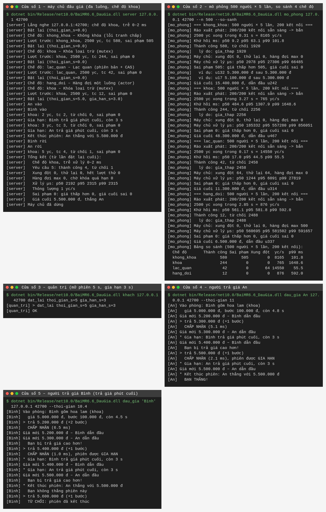

# Bài mở rộng MR6.6 – Đấu giá trực tuyến: n người cùng tranh một món hàng (C#)

| Thông tin | Nội dung |
|---|---|
| Loại | **Bài mở rộng**, không có trong giáo trình và không có mã giả tương ứng. Bài đầu của nhóm "tranh chấp tài nguyên" MR6.6–MR6.14 |
| Liên hệ với giáo trình | Chương 6: Bài 6.1 (server đa luồng, một luồng mỗi kết nối), Bài 6.7 (kiểm thử tải); Chương 3: Bài 3.2 (định khung thông điệp theo dòng); bài mở rộng MR5.4/MR5.5 (luồng, đồng bộ) |
| Thư viện | .NET 10 BCL: `System.Net.Sockets` (`TcpListener`, `Socket`), `System.Threading` (`Thread`, `lock`/`Monitor`, `Interlocked`, `Volatile`, `Barrier`, `ManualResetEventSlim`), `System.Collections.Concurrent` (`BlockingCollection`, `ConcurrentQueue`), `System.Text.Json.Nodes`; bản giao diện: Windows Forms (`net10.0-windows`). Không dùng gói NuGet |
| Bản ngôn ngữ khác | [Python](../../../python/Chuong06/BaiMR6.6_DauGia/), [Java](../../../java/Chuong06/BaiMR6.6_DauGia/), [Rust](../../../rust/Chuong06/BaiMR6.6_DauGia/), [Go](../../../go/Chuong06/BaiMR6.6_DauGia/) |

## Mục tiêu
Bài mô phỏng một phòng đấu giá trực tuyến. Một món hàng có giá khởi điểm và bước giá. **n người cùng trả giá**, và giá chỉ được nhận khi **≥ giá hiện tại + bước giá**. Đồng hồ đếm ngược đóng phiên; ai trả giá trong 10 giây cuối thì phiên được **gia hạn 10 giây** (đóng mềm, chống "bắn tỉa" phút cuối). Hết giờ, máy chủ công bố người thắng. Máy chủ TCP đa luồng (một `Thread` mỗi kết nối) giữ trạng thái. Mỗi lần trả giá là một thao tác "đọc → kiểm tra (giả lập độ trễ cơ sở dữ liệu 0–2 ms) → ghi", xử lý theo **bốn cách** chọn được ngay lúc đang chạy: không khóa, khóa loại trừ, điều khiển đồng thời lạc quan, hàng đợi một luồng. **Sổ kiểm toán** độc lập đếm sai phạm, còn **bộ mô phỏng tải** (500 người × 5 lần trên 200 kết nối, rào xuất phát, pipelining) cho thấy bằng số liệu thật: chỉ chế độ không khóa sinh sai phạm, ba chế độ còn lại cho 0 sai phạm nhưng khác nhau về thông lượng và độ trễ.

Bản C# dùng **đúng giao thức, mã lỗi, câu chữ và định dạng dòng in** của bản Python: máy chủ C# phục vụ được bộ mô phỏng/người dùng Python và ngược lại. Phần khung (`Chung.cs`, `Khach.cs`, phần KHUNG của `MoPhong.cs`, `GiaoDien/GiaoDienChung.cs`) dùng chung cho các bài MR6.6–MR6.14.

## Kiến thức chính
Số liệu dưới đây lấy từ `ket_qua.txt`, là một lần chạy thật trên máy cục bộ (127.0.0.1, .NET 10 trên Linux, độ trễ xử lý ngẫu nhiên 0–2 ms). Mỗi lần chạy, số liệu lệch đi đôi chút.

```
  Chế độ       Thành công Sai phạm Xung đột  yc/s  p99 ms
  khong_khoa          580      505        0  8165   101.8
  khoa                244        0        0   765  1648.6
  lac_quan             42        0       64 14550    55.5
  hang_doi             12        0        0   876   592.0
```
(500 người × 5 lần trả giá = 2500 yêu cầu/chế độ, 200 kết nối. "Thành công" là số giá được chấp nhận, "Sai phạm" do sổ kiểm toán đếm, "Xung đột" là số lần so sánh-và-đổi thất bại, "yc/s" và "p99" (khứ hồi) đo ở bộ mô phỏng.)

- **Tranh chấp (race condition) và mất cập nhật.** Chế độ `khong_khoa` làm "đọc giá → chờ 0–2 ms → kiểm tra → ghi" mà không đồng bộ. Hàng trăm luồng cùng đọc một giá cũ, ai cũng qua được kiểm tra, ai cũng nhận "CHẤP NHẬN", và bản ghi sau đè bản ghi trước. Kết quả: 580 giá được chấp nhận, trong đó **505** giá thấp hơn (giá cao nhất đã chấp nhận trước + bước giá), ví dụ `u17 5.100.000 đ` được chấp nhận *sau* `5.300.000 đ`. CLR chạy các luồng song song thật trên nhiều lõi (không có GIL như Python), nên khe "đọc → ghi" bị nhiều luồng chen vào cùng lúc. C# vẫn an toàn bộ nhớ ở chế độ này: mỗi ô giữ một tham chiếu tới **record bất biến** (`Mon`), đọc/ghi một tham chiếu là nguyên tử, nên chỉ mất *cập nhật* chứ không hỏng dữ liệu. Chế độ này chỉ dùng để minh họa lỗi trong phòng lab (loopback).
- **Vùng găng (critical section) và khóa theo tài nguyên.** Chế độ `khoa` cho mỗi ô tài nguyên một đối tượng khóa riêng và giữ khóa suốt đọc – kiểm tra – ghi bằng `Monitor.TryEnter(khóa, 2 s)` / `Monitor.Exit` (chính là câu lệnh `lock`, thêm hạn chờ để phát hiện khóa chết). Sai phạm bằng 0, nhưng mọi yêu cầu (kể cả yêu cầu sẽ bị từ chối) phải đi qua một khóa duy nhất, nên thông lượng chỉ còn ≈ 1 / (thời gian xử lý trung bình) ≈ 765 yc/s. **Monitor của .NET không công bằng** (không xếp hàng FIFO: luồng vừa nhả có thể giành lại ngay), nên một số kết nối được phục vụ liên tục, trả giá mới ngay với giá vừa đọc và được nhận (244 thành công so với 20 ở bản Python), còn kết nối khác chờ rất lâu: khứ hồi p99 1648,6 ms, xử lý ở máy chủ p99 856 ms. Khung khóa nhiều ô **theo thứ tự tên ô đã sắp xếp** để không khóa chết; tùy chọn `KhoaNgayTho` (MR6.12) cho thấy điều ngược lại.
- **Điều khiển đồng thời lạc quan (optimistic concurrency, Kung & Robinson 1981).** Chế độ `lac_quan` đọc (giá trị, **phiên bản**) dưới một khóa rất ngắn, xử lý *ngoài* khóa, rồi **so sánh-và-đổi**: chỉ ghi khi phiên bản chưa đổi. Phiên bản đã đổi thì đó là xung đột, thao tác thử lại (tối đa 5 lần, nghỉ ngẫu nhiên 0–1 ms). Sai phạm bằng 0 và thông lượng **cao nhất** (14 550 yc/s): phần lớn yêu cầu bị từ chối ngay sau lần đọc ("giá thấp") mà không chờ ai; 64 xung đột, 64 lần thử lại, không yêu cầu nào hết lượt thử. Với **một** biến, phần cứng có sẵn phép so sánh-và-đổi: `Interlocked.CompareExchange(ref ô, giá_trị_mới, giá_trị_đã_đọc)`; khung cần so sánh *nhiều ô* cùng lúc (MR6.7, MR6.8, MR6.12) nên làm phép kiểm tra phiên bản dưới một khóa ngắn – cùng ý nghĩa, mở rộng cho nhiều ô.
- **Hàng đợi một luồng (mô hình actor, vòng lặp sự kiện).** Chế độ `hang_doi` cho luồng kết nối đặt yêu cầu vào `BlockingCollection` rồi đọc tiếp ngay. **Một** luồng xử lý lần lượt, đến trước phục vụ trước, không cần khóa vì chỉ luồng này chạm vào trạng thái (bản bất đồng bộ tương đương là `System.Threading.Channels.Channel<T>` với một người đọc). Sai phạm bằng 0, thông lượng 876 yc/s, hàng đợi dài tối đa **500** (đúng bằng số người đang chờ trả lời); khứ hồi p50 ≈ p99 ≈ 0,56–0,59 s chính là thời gian xếp hàng – công bằng hơn hẳn `khoa`.
- **Sổ kiểm toán.** Sổ ghi mọi giao dịch được chấp nhận dưới khóa riêng, ngay trong vùng găng của chế độ (hàm gọi lại `khiGhi`), nên thứ tự trong sổ đúng là thứ tự ghi. Luật của bài: một giá chấp nhận phải ≥ (giá cao nhất đã chấp nhận + bước giá), và giá/người dẫn đầu cuối cùng phải đúng là giá cao nhất trong sổ. Sổ không ngăn lỗi, chỉ *phát hiện* lỗi sau buổi chạy, giống đối soát cuối ngày.
- **Rào xuất phát, pipelining, idempotency.** Bộ mô phỏng mở 200 kết nối (mỗi kết nối một `Thread`), mỗi kết nối chở 2–3 người ảo (`"so_nguoi"` trong lời chào, tên người ở trường `"nguoi"`). Mọi luồng chờ ở `System.Threading.Barrier` (k + 1 bên, bên cuối là luồng chính) rồi cùng bắn; lỗi trước rào thì hủy qua `CancellationToken`. Mỗi kết nối gửi yêu cầu của mọi người mình chở trong **một** lần `Send`, nhận trả lời nào (ghép theo `ma_yc`) thì gửi ngay lần trả giá kế tiếp của người đó. Một `ma_yc` đã xử lý bị gửi lại thì máy chủ không trả giá lần nữa mà gửi lại kết quả cũ kèm `"lap_lai": true`.
- **Đẩy trạng thái có gộp.** Mỗi khi trạng thái đổi, máy chủ chỉ đặt một cờ. Luồng nền cứ 100 ms gửi **một** `cap_nhat` (giá, người dẫn đầu, thời gian còn lại, 12 giá gần nhất) cho mọi client, nên dù có 14 000 yc/s thì mỗi client cũng chỉ nhận tối đa 10 cập nhật mỗi giây. Đồng hồ đếm ngược chạy cục bộ ở client theo `con_lai_ms`.
- **Đóng mềm (soft close).** Trong lượt chạy dòng lệnh (phiên 5 s, gia hạn 3 s), Bình trả giá khi còn ≈ 0,9 s nên phiên được gia hạn; An trả giá phút cuối nên phiên được gia hạn lần nữa; không còn ai trả giá thì phiên đóng: "Kết thúc phiên: An thắng với 5.500.000 đ". Lần trả giá sau đó của Bình nhận "TỪ CHỐI: phiên đã kết thúc". Việc đóng phiên cũng là một thao tác ghi đi qua cùng chế độ xử lý tranh chấp, nên không thể "chen" một giá vào sau khi đã đóng.

### API tương đương giữa các ngôn ngữ
| Khái niệm | C# | Python | Java | Rust | Go |
|---|---|---|---|---|---|
| Khóa loại trừ | `lock` / `Monitor` (`TryEnter` có hạn chờ) | `threading.Lock` | `synchronized` / `ReentrantLock` | `std::sync::Mutex` | `sync.Mutex` |
| So sánh-và-đổi | `Interlocked.CompareExchange` | (khóa ngắn + phiên bản) | `AtomicReference.compareAndSet` | `AtomicU64::compare_exchange` | `atomic.CompareAndSwap…` |
| Hàng đợi một luồng | `BlockingCollection<T>` / `Channel<T>` | `queue.Queue` | `BlockingQueue` | `std::sync::mpsc` | channel |
| Rào xuất phát | `Barrier` | `threading.Barrier` | `CyclicBarrier` | `std::sync::Barrier` | đóng một channel / `sync.WaitGroup` |

### Giao thức (giống hệt ở 5 ngôn ngữ)
TCP, mỗi dòng một JSON UTF-8 kết thúc `\n`, tối đa 64 KB một dòng. Mọi yêu cầu có `ma_yc` (số nguyên do client đánh), và trả lời mang lại đúng `ma_yc` đó.

| Chiều | Thông điệp |
|---|---|
| client → server | `{"loai":"chao","ten":"An","vai_tro":"nguoi_dung"\|"quan_tri"}` (đầu tiên, tên 1–16 ký tự); kết nối gộp của bộ mô phỏng thêm `"so_nguoi":m` |
| người dùng → server | `{"loai":"tra_gia","ma_yc":k,"gia":5300000}` (kết nối gộp thêm `"nguoi":"u17"`) |
| quản trị → server | `{"loai":"che_do","ma_yc":k,"gia_tri":"khoa"}`, `{"loai":"tre","ma_yc":k,"ms":2}`, `{"loai":"dat_lai","ma_yc":k,"thoi_gian_s":120,"gia_han_s":10,"gia_khoi_diem":…,"buoc_gia":…,"ten_mon":…}`, `{"loai":"thong_ke","ma_yc":k}` |
| server → client | `{"loai":"chao","ma":id,"che_do":"khoa","may_chu":"Đấu giá MR6.6"}`, ngay sau đó là một `cap_nhat`; `{"loai":"loi","ly_do":…}` khi sai giao thức |
| server → client | `{"loai":"kq","ma_yc":k,"ok":true,"gia":…,"nguoi_dan_dau":…,"gia_han":bool}` hoặc `{"loai":"kq","ma_yc":k,"ok":false,"ma_loi":"gia_thap"\|"het_phien"\|"xung_dot"\|"khoa_cho_lau"\|"sai_du_lieu"\|"khong_quyen"\|"khong_ho_tro"\|…,"ly_do":…,"gia":…}` |
| server → tất cả | `{"loai":"cap_nhat","che_do":…,"mon":{"ten","gia_khoi_diem","buoc_gia","gia_han_s"},"gia","nguoi_dan_dau","so_lan","con_lai_ms"(null = không giới hạn),"ket_thuc","lich_su":[{"nguoi","gia","gio","gia_han"}…]}` (≤ 10 lần/s); `{"loai":"su_kien","noi_dung":"Kết thúc phiên: An thắng với …"}` |
| server → quản trị | `{"loai":"thong_ke","ma_yc":k,"che_do","tre_ms","so_yc","thanh_cong","tu_choi","xung_dot","thu_lai","het_lan_thu","khoa_cho_lau","hang_doi_max","ma_loi","yc_s","thong_luong","p50_us","p95_us","p99_us","hang_doi","sai_pham":[{"ma","ten","so"}],"sai_pham_tong","vi_du_sai_pham","tom_tat","so_ket_noi","so_nguoi"}` |

## Cấu trúc tệp
- `Chung.cs`: **khung chung** gồm giao thức (`GuiJson`, `MaHoa`, `DocDong`, `DocLenhStdin`, `DocThamSo`), `PhanVi`, `ThongKe`, `KhoTranhChap` (4 chế độ, cổng `TamDung`), `SoKiemToan`, `KhachKetNoi`, `MayChuCoSo` (máy chủ TCP đa luồng), các hàm in `DongThongKe`, `BangSoSanh`, `Tien`, `G` (như `%g`), `DoiSo` (đối số dòng lệnh), `WinMM` (hẹn giờ 1 ms trên Windows).
- `MayChu.cs`: nghiệp vụ đấu giá `MayChuDauGia` (trả giá, gia hạn, đóng phiên), record `Mon`, `SoKiemToanDauGia`; `Server.cs` là bản dòng lệnh của máy chủ.
- `Khach.cs`: lõi client `KetNoiKhach` (pipelining, ghép theo `ma_yc`), `QuanTri` và công cụ quản trị dòng lệnh.
- `MoPhong.cs`: bộ mô phỏng tải (`ChayLuot`, `SoSanh`); phần NGHIỆP VỤ là `NguCanh`, `NguoiAo`.
- `DauGia.cs`: người trả giá bản dòng lệnh. `Program.cs`: chọn vai trò `server | mo_phong | khach | dau_gia`.
- `GiaoDien/`: dự án WinForms `BaiMR6.6_GiaoDien.csproj` (dùng chung mọi tệp lõi ở thư mục cha qua `<Compile Include="..\*.cs">`): `GiaoDienChung.cs` (khung `FormServerCoSo`, `FormNguoiDungCoSo`, tiện ích), `FormServer.cs`, `FormDauGia.cs` (kèm hình "Bình gốm hoa lam" vẽ bằng GDI+), `DemoGui.cs`, `Program.cs`, `demo.json`.
- `demo.json`, `ket_qua.txt`, `ket_qua.png`: kịch bản và kết quả thực thi thật.

## Cách chạy
Cần .NET 10 SDK. Chạy trong thư mục bài:
```bash
dotnet build -c Release
dotnet run -c Release -- server 127.0.0.1 9000                        # cửa sổ 1 (gõ lệnh ở đây)
dotnet run -c Release -- mo_phong 127.0.0.1 9000 --n 500 --so-sanh    # cửa sổ 2: bảng so sánh 4 chế độ
dotnet run -c Release -- mo_phong 127.0.0.1 9000 --n 2000 --k 200 --che-do lac_quan --dat-lai
dotnet run -c Release -- khach 127.0.0.1 9000 dat_lai thoi_gian_s=60 gia_han_s=10   # mở phiên 60 s
dotnet run -c Release -- dau_gia An 127.0.0.1 9000                    # cửa sổ 3, 4…: gõ tang 1 / tra 5300000
```
- Lệnh của máy chủ: `che_do khong_khoa|khoa|lac_quan|hang_doi`, `tre <ms>`, `dat_lai [khoa=giá_trị …]`, `thong_ke`, `thoat`. Tùy chọn khi chạy: `--che-do`, `--tre-ms`, `--thoi-gian` (0 = không giới hạn), `--gia`, `--buoc`, `--gia-han`. Cứ 5 giây, nếu có yêu cầu mới, máy chủ in một dòng số liệu; Ctrl+C in tổng kết rồi dừng.
- Lệnh của `dau_gia`: `tang [n]` (trả giá hiện tại + n bước), `tra <giá>`, `thoat`. Dòng `@t lệnh` chờ tới giây thứ t rồi mới chạy lệnh.
- Chạy chéo: thay bất kỳ vai trò nào bằng bản Python (`python3 server.py …`, `python3 mo_phong.py …`, `python3 dau_gia.py …`) hay Java/Rust/Go – cùng giao thức.

Muốn tái lập kết quả, chạy từ thư mục gốc của kho: `python3 tools/demo.py csharp/Chuong06/BaiMR6.6_DauGia`.

## Ứng dụng giao diện


*(Ảnh `ket_qua_gui.png` và `ket_qua_gui_tranh_chap.png` do vai trò `demo` tự chụp khi chạy trên Windows – WinForms không chạy trên Linux nên bản trong kho chưa có ảnh.)*

Hai loại cửa sổ có cùng điều khiển và bố cục như bản Python, dùng đúng giao thức của bản dòng lệnh nên chạy chéo được với mọi ngôn ngữ:
- **Máy chủ** (`server_gui`): IP, cổng, START/STOP; **4 nút chọn chế độ** (đổi được khi đang chạy); độ trễ xử lý; **chỉ số trực tiếp**: kết nối/người, yêu cầu/giây, tổng, thành công, từ chối (theo mã lỗi), xung đột/thử lại, hàng đợi (lớn nhất), xử lý p50/p95/p99, **SAI PHẠM** (xanh khi bằng 0, đỏ khi > 0) kèm ví dụ; **tài nguyên**: hình món hàng, giá hiện tại, người dẫn đầu/thắng, đồng hồ phiên, ba giá gần nhất, tham số đặt lại (giá khởi điểm, bước giá, thời gian phiên, gia hạn) và nút **Đặt lại**; **mô phỏng tải**: n, k, số lần/người, **Bắn đồng loạt** (chế độ hiện tại), **So sánh 4 chế độ** (bảng `ListView`, dòng có sai phạm tô đỏ); nhật ký.
- **Phòng đấu giá** (`dau_gia_gui`): hình "Bình gốm hoa lam" vẽ bằng GDI+; **giá hiện tại** cỡ lớn; người dẫn đầu và số lượt; **đồng hồ đếm ngược** (đỏ khi còn dưới 10 s, chớp "GIA HẠN!"); dòng thông báo ("Bạn đang dẫn đầu", "Bạn bị trả giá cao hơn!", "Bị từ chối: giá đã thay đổi", "BẠN THẮNG!", "Kết thúc – … thắng"); nút **+1/+2/+5 bước** ghi sẵn giá sẽ trả; ô nhập giá; lịch sử trả giá (giá của mình tô xanh); thanh trạng thái hiện chế độ của máy chủ và thời gian khứ hồi.

Kịch bản `demo` (cùng các bước và dòng `[demo] …` như `demo_gui.py`): START SERVER; An, Bình, Chi kết nối; chế độ `khoa`: Bình và Chi cùng bấm "+1 bước" → một người "Bị từ chối: giá đã thay đổi"; chế độ `khong_khoa`, trễ 0–20 ms: ba người cùng bấm → cả ba cùng được chấp nhận ở cùng một giá → SAI PHẠM, chụp `ket_qua_gui_tranh_chap.png`; So sánh 4 chế độ (500 người); phiên 8 s, gia hạn 4 s, trả giá phút cuối → gia hạn hai lần → kết thúc; chụp 4 cửa sổ (`Control.DrawToBitmap`) thành `ket_qua_gui.png`; STOP SERVER.

### Cách chạy
**Windows** (cần .NET 10 SDK: `winget install Microsoft.DotNet.SDK.10`):
```powershell
cd csharp\Chuong06\BaiMR6.6_DauGia\GiaoDien
dotnet build -c Release
dotnet run -c Release -- server_gui 127.0.0.1 42702        # bấm START SERVER (phiên mặc định 120 s)
dotnet run -c Release -- dau_gia_gui An 127.0.0.1 42702
dotnet run -c Release -- dau_gia_gui Bình 127.0.0.1 42702
```
- Kịch bản tự động (từ thư mục gốc kho): `powershell -NoProfile -ExecutionPolicy Bypass -File tools\demo_windows.ps1 csharp\Chuong06\BaiMR6.6_DauGia\GiaoDien` – chạy `demo 127.0.0.1 42702 ..\ket_qua_gui.png`.
- Chạy riêng từng cửa sổ (không qua `demo`): mọi dòng nhật ký (tiền tố `[server]`, `[An]`…) và cứ 5 giây một dòng số liệu cũng in ra dòng lệnh, chuyển hướng được vào tệp (`dotnet run -c Release -- server_gui > server.txt`).
- Thử trên nhiều máy: máy chủ nghe trên IP card mạng (hoặc `0.0.0.0`) và mở tường lửa cho cổng; mỗi sinh viên chạy `dau_gia_gui` (hoặc bản Python `dau_gia_gui.py`) với IP của máy thầy. Khi đó **chỉ dùng `khoa`, `lac_quan`, `hang_doi`**, còn `khong_khoa` để dành cho phần minh họa lỗi.
- **Linux/macOS:** WinForms chỉ chạy trên Windows; phần lõi (`MayChuDauGia`, `KetNoiKhach`, `MoPhong`) là .NET thuần và chạy được trên Linux (bản dòng lệnh dùng đúng các lớp này).

## Kết quả thực thi


## Ghi chú
- **Chạy chéo đã kiểm tra:** bộ mô phỏng C# → máy chủ Python (khong_khoa 478 thành công / 452 sai phạm; khoa 15 / 0; lac_quan 34 / 0, 89 xung đột; hang_doi 12 / 0) và bộ mô phỏng Python → máy chủ C# (616 / 541; 126 / 0; 79 / 0, 41 xung đột; 16 / 0); người trả giá Python với máy chủ C# (phiên 4 s: chấp nhận, kết thúc, "BẠN THẮNG!").
- `Thread.Sleep` chỉ nhận số nguyên mili giây, nên độ trễ giả lập "ngẫu nhiên 0–2 ms" được làm tròn ngẫu nhiên (1,3 ms → 1 ms với xác suất 0,7, 2 ms với xác suất 0,3): trung bình vẫn đúng. Trên Windows, chương trình gọi `timeBeginPeriod(1)` (winmm) để `Thread.Sleep(1)` ngủ ≈ 1 ms thay vì ≈ 15,6 ms.
- Đổi chế độ hoặc đặt lại đi qua "cổng" `TamDung()` (`Monitor.Wait`/`PulseAll`): đóng cổng, chờ mọi thao tác đang chạy và đang xếp hàng xong, rồi mới đổi. Đặt lại dựng một bảng ô mới rồi thay nguyên bảng, nên luồng hiển thị không bao giờ đọc phải bảng đang dựng dở. Bảng ô là `ConcurrentDictionary` để bài có thể thêm ô khi đang chạy (MR6.9 thêm ô cho từng người quay, MR6.13 thêm ô lượt mua) mà không phải chép cả bảng; khung này giống hệt nhau ở cả chín bài MR6.6–MR6.14.
- "Xử lý µs" ở máy chủ tính từ lúc đọc xong yêu cầu tới lúc gửi trả lời (`Stopwatch`), gồm cả thời gian chờ khóa/hàng đợi. Phân vị tính theo hạng gần nhất trên tối đa 200 000 mẫu từ lần đặt lại cuối. Số thực in bằng `CultureInfo.InvariantCulture` (dấu chấm) ở mọi máy.
- Kiểm thử: bản dòng lệnh chạy trên Linux (.NET 10.0.114). Ứng dụng WinForms đã kiểm tra biên dịch với assembly tham chiếu WinForms, **chưa chạy – cần Windows**.

## Bài tập gợi ý
1. Chạy `mo_phong --so-sanh` với `--tre-ms 0`, `2`, `10`. Sai phạm của `khong_khoa` và thông lượng của `khoa` thay đổi thế nào? Hãy giải thích bằng độ rộng của khe "đọc → ghi".
2. So sánh `khoa` của bản C# và bản Python: vì sao C# có nhiều "thành công" hơn nhưng p99 lớn hơn nhiều? Thay `Monitor` bằng một khóa công bằng (ví dụ hàng đợi vé – ticket lock, hoặc `SemaphoreSlim` kèm hàng đợi FIFO tự viết) rồi đo lại.
3. Ở `lac_quan`, sửa `NguoiAo` cho mọi người trả đúng "giá hiện tại + 1 bước". Đếm số yêu cầu hết lượt thử ("xung đột, thử lại sau"). Tăng `SoLanThu` có giải quyết được không?
4. Viết chế độ thứ năm chỉ dùng `Interlocked.CompareExchange` trên tham chiếu `Mon` (không khóa CAS). Đo thông lượng và so với `lac_quan`.
5. Thêm nhiều món hàng (ô `mon_1`, `mon_2`, …) và cho mô phỏng chia người ra các món. So sánh `khoa` (khóa theo từng món) với `hang_doi` (một luồng cho tất cả) khi số món tăng.
6. Giao diện: vẽ trên khung tài nguyên của máy chủ biểu đồ giá theo thời gian. Ở `khong_khoa`, đường giá có "tụt xuống" không?

## Đọc thêm
- H. T. Kung, J. T. Robinson (1981). *On Optimistic Methods for Concurrency Control*. ACM Transactions on Database Systems 6(2).
- E. G. Coffman, M. J. Elphick, A. Shoshani (1971). *System Deadlocks*. ACM Computing Surveys 3(2): điều kiện khóa chết và cách phòng bằng thứ tự khóa (khung dùng cho chế độ `khoa`).
- Tài liệu .NET: [câu lệnh `lock`](https://learn.microsoft.com/dotnet/csharp/language-reference/statements/lock), [`Monitor`](https://learn.microsoft.com/dotnet/api/system.threading.monitor), [`Interlocked.CompareExchange`](https://learn.microsoft.com/dotnet/api/system.threading.interlocked.compareexchange), [`BlockingCollection<T>`](https://learn.microsoft.com/dotnet/api/system.collections.concurrent.blockingcollection-1), [`System.Threading.Channels`](https://learn.microsoft.com/dotnet/core/extensions/channels), [`Barrier`](https://learn.microsoft.com/dotnet/api/system.threading.barrier), [`TcpListener`](https://learn.microsoft.com/dotnet/api/system.net.sockets.tcplistener).

Mã nguồn của bài được viết mới cho kho này.
