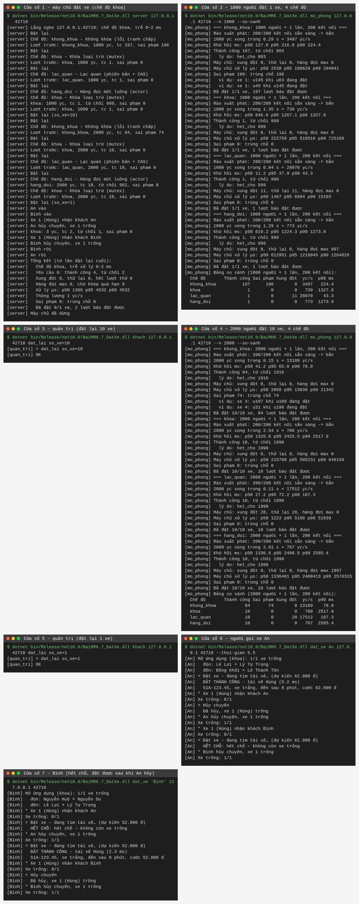

# Bài mở rộng MR6.7 – Đặt xe: n người cùng bấm "Đặt xe" cho một chỗ (C#)

| Thông tin | Nội dung |
|---|---|
| Loại | **Bài mở rộng**, không có trong giáo trình và không có mã giả tương ứng. Bài thứ hai của nhóm "tranh chấp tài nguyên" MR6.6–MR6.14, dùng chung khung của [MR6.6](../BaiMR6.6_DauGia/) |
| Liên hệ với giáo trình | Chương 6: Bài 6.1 (server đa luồng, một luồng mỗi kết nối), Bài 6.7 (kiểm thử tải); Chương 3: Bài 3.2 (định khung thông điệp theo dòng); bài mở rộng MR5.4/MR5.5 (luồng, đồng bộ) |
| Thư viện | .NET 10 BCL: `System.Net.Sockets`, `System.Threading` (`Thread`, `lock`/`Monitor`, `Interlocked`, `Volatile`, `Barrier`), `System.Collections.Concurrent`, `System.Text.Json.Nodes`; bản giao diện: Windows Forms (`net10.0-windows`, bản đồ vẽ bằng GDI+). Không dùng gói NuGet |
| Bản ngôn ngữ khác | [Python](../../../python/Chuong06/BaiMR6.7_DatXe/), [Java](../../../java/Chuong06/BaiMR6.7_DatXe/), [Rust](../../../rust/Chuong06/BaiMR6.7_DatXe/), [Go](../../../go/Chuong06/BaiMR6.7_DatXe/) |

## Mục tiêu
Bài mô phỏng một ứng dụng gọi xe. Có **m chiếc xe** (mặc định 1), mỗi xe **một chỗ**. **n người cùng bấm "Đặt xe"**: máy chủ giao xe trống gần điểm đón nhất, hết xe thì báo "Hết chỗ". Người đặt được có thể hủy chuyến để trả xe. Mỗi lần đặt là một thao tác "đọc trạng thái các xe → chọn xe (giả lập độ trễ cơ sở dữ liệu 0–2 ms) → ghi", xử lý theo **bốn cách** chọn được ngay lúc đang chạy: không khóa, khóa loại trừ, lạc quan, hàng đợi một luồng. **Sổ kiểm toán** đếm số lần một chỗ đã có người lại được giao cho người thứ hai. **Bộ mô phỏng tải** (1000 người cùng đặt 1 xe; 2000 người cùng đặt 10 xe; 200 kết nối, rào xuất phát, pipelining) cho thấy bằng số liệu thật: chỉ chế độ không khóa "bán" một chỗ cho nhiều người.

Phần khung (`Chung.cs`, `Khach.cs`, phần KHUNG của `MoPhong.cs`, `GiaoDien/GiaoDienChung.cs`) chép nguyên từ MR6.6 (chỉ khác dòng `namespace`). Bài này chỉ viết nghiệp vụ (`MayChu.cs`, phần NGHIỆP VỤ của `MoPhong.cs`), người dùng dòng lệnh (`DatXe.cs`), ứng dụng gọi xe, khung tài nguyên của máy chủ và kịch bản demo. Giao thức, mã lỗi, câu chữ và định dạng dòng in giống hệt bản Python – chạy chéo được.

## Kiến thức chính
Số liệu dưới đây lấy từ `ket_qua.txt`, là một lần chạy thật trên máy cục bộ (127.0.0.1, .NET 10 trên Linux, độ trễ xử lý ngẫu nhiên 0–2 ms). Mỗi lần chạy, số liệu lệch đi đôi chút.

```
1000 người cùng đặt 1 xe:
  Chế độ       Thành công Sai phạm Xung đột  yc/s  p99 ms
  khong_khoa          197      196        0  3497   224.4
  khoa                  1        0        0   739  1327.6
  lac_quan              1        0       11 28070    43.3
  hang_doi              1        0        0   773  1273.9
2000 người cùng đặt 10 xe:
  Chế độ       Thành công Sai phạm Xung đột  yc/s  p99 ms
  khong_khoa           84       74        0 13109    78.0
  khoa                 10        0        0   788  2517.9
  lac_quan             10        0       28 17512   107.3
  hang_doi             10        0        0   767  2585.4
```
(Mỗi người bấm một lần, 200 kết nối. "Thành công" là số người được báo "Đặt thành công", "Sai phạm" do sổ kiểm toán đếm, "Xung đột" là số lần so sánh-và-đổi thất bại, "yc/s" và "p99" (khứ hồi) đo ở bộ mô phỏng.)

- **Tranh chấp (race condition): một chỗ, nhiều người.** Ở `khong_khoa`, thao tác đặt xe làm "đọc các xe → chờ 0–2 ms → chọn xe trống → ghi" mà không đồng bộ. Mọi luồng đọc được trước lần ghi đầu tiên đều thấy "xe 1 trống", đều được báo "Đặt thành công – tài xế Hùng", và bản ghi sau đè bản ghi trước. Với 1 xe, **197 người** cùng được báo thành công cho **một** chỗ, sổ kiểm toán đếm **196** lần "trùng chỗ" (ví dụ `xe 1: u145 khi u63 đang đặt`). Bản Python chỉ ra 7 người, vì GIL cho mỗi lúc một luồng chạy; CLR chạy hàng trăm luồng song song thật trên nhiều lõi nên cả "lô" yêu cầu đầu tiên của 200 kết nối cùng lọt vào khe. Với 10 xe, 84 người được báo thành công cho 10 chỗ (74 sai phạm). Người bị đè không hề biết: trên giao diện, họ thấy "Tài xế Hùng đã nhận khách khác!" khi bản cập nhật kế tiếp tới. Chế độ này chỉ dùng để minh họa lỗi trong phòng lab (loopback).
- **Khe tranh chấp mở một lần cho mỗi chỗ.** Khe chỉ mở từ lúc luồng đầu tiên đọc tới lúc nó ghi xong; mọi người đọc sau lần ghi đó đều thấy "Hết chỗ" và bị từ chối đúng. Vì vậy số sai phạm tăng theo số *lần mở khe* (số chỗ, số lần đặt lại) chứ không theo số người – khác MR6.6 (đấu giá), nơi mỗi lần trả giá lại mở khe mới.
- **Vùng găng nhiều ô.** Để biết người đặt đã có chuyến chưa và xe trống nào gần nhất, mỗi lần đặt đọc **cả m ô** `xe1…xem`. Chế độ `khoa` giữ khóa của mọi ô (`Monitor.TryEnter` theo thứ tự tên ô, nên không khóa chết) suốt đọc – chọn – ghi, và sai phạm bằng 0. Đổi lại, mọi yêu cầu đi qua cùng một bộ khóa, nên thông lượng chỉ còn ≈ 740–790 yc/s, như `hang_doi`. Khóa theo từng tài nguyên chỉ có lợi khi mỗi thao tác chạm vào ít ô, như ghế rạp ở [MR6.8](../BaiMR6.8_DatVePhim/).
- **Lạc quan (Kung & Robinson 1981).** Chế độ `lac_quan` đọc (giá trị, phiên bản) của các ô dưới một khóa rất ngắn, chọn xe *ngoài* khóa, rồi so sánh-và-đổi: chỉ ghi nếu không ô nào đổi phiên bản (mở rộng cho nhiều ô của `Interlocked.CompareExchange`). Chỉ vài yêu cầu đầu thật sự ghi, nên xung đột ít (11 với 1 xe, 28 với 10 xe), và mọi người đến sau bị từ chối "hết chỗ" ngay sau lần đọc. Vì vậy thông lượng cao nhất (28 070 và 17 512 yc/s) và p99 thấp nhất.
- **Hàng đợi một luồng (actor).** Chế độ `hang_doi` cho một luồng xử lý lần lượt từ `BlockingCollection`, đến trước phục vụ trước. Sai phạm bằng 0, nhưng hàng đợi dài tối đa **997** (1000 người) và **1997** (2000 người), và khứ hồi p99 ≈ 1,3–2,6 s chính là thời gian xếp hàng.
- **Ảnh chụp trạng thái có số thứ tự.** Máy chủ đẩy `cap_nhat` gộp 10 lần/giây, nên một bản cập nhật chụp *trước* lần ghi của mình có thể tới *sau* trả lời `kq`. Vì vậy mỗi lần ghi được đánh số (`Interlocked.Increment`, gửi trong `kq["phien"]`) và mỗi `cap_nhat` mang `"phien"` đọc *trước* khi chụp các ô. Client chỉ kết luận "xe đã nhận khách khác" từ một bản cập nhật có `phien` ≥ số của lần đặt của mình – cùng ý tưởng với phiên bản trong điều khiển đồng thời lạc quan, nhưng dùng ở phía client.
- **Idempotency và pipelining.** Bộ mô phỏng gửi mọi yêu cầu của 5–10 người trên một kết nối trong một lần `Send`, sau khi qua `Barrier`. Một `ma_yc` gửi lại không bị đặt lần hai; máy chủ gửi lại kết quả cũ kèm `"lap_lai": true`.
- **Hủy chuyến và hết chỗ.** Lượt dòng lệnh với 1 xe: An đặt được (tài xế Hùng, 8 phút, 62.000 đ) rồi hủy; Bình bấm khi xe đang chở An nhận "HẾT CHỖ", bấm lại sau khi An hủy thì được; An bấm lần hai khi Bình đang đi nhận "HẾT CHỖ".

### Giao thức (giống hệt ở 5 ngôn ngữ)
Khung giao thức như [MR6.6](../BaiMR6.6_DauGia/) (TCP, mỗi dòng một JSON, `ma_yc`, `chao`, `cap_nhat` gộp, `su_kien`, quản trị `che_do`/`tre`/`dat_lai`/`thong_ke`). Phần riêng của bài:

| Chiều | Thông điệp |
|---|---|
| người dùng → server | `{"loai":"dat_xe","ma_yc":k,"don":[0.1,0.3],"den":[0.9,0.5]}` (điểm là ngã tư trên lưới 5 × 5, mặc định đón [0.5,0.5], đến [0.9,0.9]); `{"loai":"huy","ma_yc":k}`; kết nối gộp thêm `"nguoi":"u17"` |
| quản trị → server | `{"loai":"dat_lai","ma_yc":k,"so_xe":10}` (1–50) |
| server → client | `{"loai":"kq","ma_yc":k,"ok":true,"xe":1,"khach":"An","tai_xe":"Hùng","bien_so":"51A-123.45","mau":"trắng","phut":8,"cuoc":62000,"phien":n}`; hủy: `{"ok":true,"xe","khach","tai_xe","phien"}`; từ chối: `"ma_loi":"het_cho"\|"da_dat"\|"chua_dat"\|"sai_du_lieu"\|"xung_dot"\|…` |
| server → tất cả | `{"loai":"cap_nhat","che_do":…,"phien":n,"so_xe":m,"trong":t,"xe":[{"ma","tai_xe","bien_so","mau","vi_tri":[x,y],"khach","don","den","gio","cuoc","phut"}…],"lich_su":[{"gio","loai","xe","tai_xe","nguoi"}…]}` |

## Cấu trúc tệp
- `Chung.cs`, `Khach.cs`: khung chung (chép từ MR6.6) – giao thức, `ThongKe`, `KhoTranhChap` (4 chế độ), `SoKiemToan`, `MayChuCoSo`, `KetNoiKhach`, `QuanTri`, các hàm in.
- `MayChu.cs`: `BanDoPho` (lưới phố, tên đường, `Km`, `Cuoc`, `PhutDen`), record `Xe`, `SoKiemToanDatXe`, `MayChuDatXe` (đặt xe, hủy, đánh số lần ghi); `Server.cs`: máy chủ dòng lệnh.
- `MoPhong.cs`: bộ mô phỏng tải; phần NGHIỆP VỤ là `NguCanh` (số xe trống), `NguoiAo` (đặt xe từ một ngã tư ngẫu nhiên, bị xung đột thì bấm lại).
- `DatXe.cs`: người gọi xe dòng lệnh (`dat`, `huy`, `thoat`). `Program.cs`: chọn vai trò `server | mo_phong | khach | dat_xe`.
- `GiaoDien/`: dự án WinForms `BaiMR6.7_GiaoDien.csproj` (dùng chung lõi ở thư mục cha): `GiaoDienChung.cs`, `FormServer.cs` (bản đồ thu nhỏ, danh sách xe), `FormGoiXe.cs` (ứng dụng gọi xe, điều khiển `BanDo`, hoạt hình xe), `DemoGui.cs`, `Program.cs`, `demo.json`.
- `demo.json`, `ket_qua.txt`, `ket_qua.png`: kịch bản và kết quả thực thi thật.

## Cách chạy
Cần .NET 10 SDK. Chạy trong thư mục bài:
```bash
dotnet build -c Release
dotnet run -c Release -- server 127.0.0.1 9000                         # cửa sổ 1 (1 xe)
dotnet run -c Release -- mo_phong 127.0.0.1 9000 --n 1000 --so-sanh    # 1000 người, 4 chế độ
dotnet run -c Release -- khach 127.0.0.1 9000 dat_lai so_xe=10         # đặt lại 10 xe
dotnet run -c Release -- mo_phong 127.0.0.1 9000 --n 2000 --so-sanh
dotnet run -c Release -- dat_xe An 127.0.0.1 9000                      # gõ dat / huy / thoat
```
- Lệnh của máy chủ: `che_do …`, `tre <ms>`, `dat_lai [so_xe=…]`, `thong_ke`, `thoat`; tùy chọn khi chạy: `--che-do`, `--tre-ms`, `--so-xe`.
- `dat_xe` dùng điểm đón/đến cố định theo tên (An: Lê Lợi × Lý Tự Trọng → Đồng Khởi × Lê Thánh Tôn), giống bản Python.
- Tái lập kết quả, từ thư mục gốc của kho: `python3 tools/demo.py csharp/Chuong06/BaiMR6.7_DatXe`.

## Ứng dụng giao diện


*(Ảnh `ket_qua_gui.png` và `ket_qua_gui_tranh_chap.png` do vai trò `demo` tự chụp khi chạy trên Windows – WinForms không chạy trên Linux nên bản trong kho chưa có ảnh.)*

- **Máy chủ** (`server_gui`): các phần chung như MR6.6 (START/STOP, 4 chế độ, độ trễ, chỉ số trực tiếp, SAI PHẠM, mô phỏng tải, So sánh 4 chế độ, nhật ký); khung **tài nguyên**: bản đồ thu nhỏ với các xe (xe đã có khách mờ đi, ghi tên khách), "Trống t/m xe" (xanh/đỏ), danh sách xe (mã, tài xế, biển số, khách – xe có khách chữ đỏ), ô **Số xe (1–50)** và nút **Đặt lại**.
- **Gọi xe** (`dat_xe_gui`): bản đồ phố vẽ bằng GDI+ (đường, đường chính tô vàng, công viên, hồ, tên phố); **chuột trái chọn điểm đón, chuột phải chọn điểm đến** (ngã tư gần nhất); ghim Đón/Đến, tuyến đường; các xe theo màu, xe đã có khách mờ đi; khoảng cách và **cước dự kiến**; nút **ĐẶT XE**; dòng trạng thái "Đang tìm tài xế…" / "Đặt thành công – tài xế …" / "Hết chỗ – không còn xe trống" / "**Tài xế … đã nhận khách khác (…)!**"; thẻ tài xế (chữ cái đầu, biển số, màu xe, phút tới, cước); xe chạy hoạt hình tới điểm đón (tuyến nét đứt) rồi tới điểm đến; nút **Hủy chuyến** / **Hoàn tất chuyến**.

Kịch bản `demo` (cùng các bước và dòng `[demo] …` như `demo_gui.py`): `khoa`, 1 xe: An, Bình, Chi cùng bấm ĐẶT XE → một người được, hai người "Hết chỗ"; người được hủy; `khong_khoa`, trễ 0–20 ms: ba người cùng bấm → cả ba "Đặt thành công" một tài xế, sau `cap_nhat` hai người thấy "đã nhận khách khác" → SAI PHẠM, chụp `ket_qua_gui_tranh_chap.png`; `khoa`, 3 xe, So sánh 4 chế độ (1000 người); đặt lại 3 xe, ba người cùng đặt → mỗi người một xe, xe chạy; chụp 4 cửa sổ thành `ket_qua_gui.png`; STOP SERVER.

### Cách chạy
**Windows** (cần .NET 10 SDK: `winget install Microsoft.DotNet.SDK.10`):
```powershell
cd csharp\Chuong06\BaiMR6.7_DatXe\GiaoDien
dotnet build -c Release
dotnet run -c Release -- server_gui 127.0.0.1 42712        # bấm START SERVER (1 xe)
dotnet run -c Release -- dat_xe_gui An 127.0.0.1 42712
dotnet run -c Release -- dat_xe_gui Bình 127.0.0.1 42712
```
- Kịch bản tự động (từ thư mục gốc kho): `powershell -NoProfile -ExecutionPolicy Bypass -File tools\demo_windows.ps1 csharp\Chuong06\BaiMR6.7_DatXe\GiaoDien`.
- Chạy riêng từng cửa sổ: nhật ký và cứ 5 giây một dòng số liệu cũng in ra dòng lệnh (chuyển hướng vào tệp được).
- Thử trên nhiều máy: máy chủ nghe IP card mạng (hoặc `0.0.0.0`), mở tường lửa cho cổng; sinh viên chạy `dat_xe_gui` (hoặc bản Python) với IP của máy thầy; chỉ dùng `khoa`, `lac_quan`, `hang_doi` khi thử thật.

## Kết quả thực thi


## Ghi chú
- **Chạy chéo đã kiểm tra:** bộ mô phỏng C# → máy chủ Python (1000 người, 1 xe: khong_khoa 9 thành công / 8 sai phạm; khoa, lac_quan (4 xung đột), hang_doi 1 / 0) và bộ mô phỏng Python → máy chủ C# (200 / 199; 1 / 0; 1 / 0 (5 xung đột); 1 / 0); người gọi xe C# với máy chủ Python và ngược lại (HẾT CHỖ, "bạn chưa đặt xe" khi hủy).
- Tọa độ ngã tư đi trên dây là số thực (`[0.1, 0.3]`); máy chủ làm tròn 2 chữ số rồi so với lưới (như `round(x, 2)` của Python), cước và số phút làm tròn kiểu ngân hàng (`Math.Round`, như `round()` của Python).
- Thứ tự lần ghi (`phien`) tăng mãi qua các lần đặt lại, để `cap_nhat` cũ của lượt trước không bị hiểu nhầm là mới.
- Kiểm thử: bản dòng lệnh chạy trên Linux (.NET 10.0.114). Ứng dụng WinForms đã kiểm tra biên dịch với assembly tham chiếu WinForms, **chưa chạy – cần Windows**.

## Bài tập gợi ý
1. Chạy `mo_phong --so-sanh --n 1000` với `--tre-ms 0`, `2`, `10` (1 xe). Số người "được báo thành công" ở `khong_khoa` thay đổi thế nào? Liên hệ với độ rộng khe "đọc → ghi".
2. Đặt `so_xe=50` rồi chạy 2000 người. `khoa` (khóa cả 50 ô mỗi lần đặt) còn bao nhiêu yc/s? Đề xuất cách chỉ khóa *một* xe (ví dụ: chọn xe ngoài khóa rồi khóa đúng xe đó và kiểm tra lại) và đo lại.
3. Viết lại `NguoiAo` để người bị "hết chỗ" chờ 1 s rồi bấm lại (tối đa 3 lần), kết hợp với một luồng hủy ngẫu nhiên. Sổ kiểm toán có phát hiện được tình huống "hủy trùng" không?
4. Thêm "giữ xe 10 s" trước khi xác nhận (giống giữ chỗ TTL ở MR6.8). Cần thêm trạng thái gì cho mỗi xe?
5. Giao diện: hiện trên bản đồ của máy chủ đường đi của mọi chuyến đang chạy.

## Đọc thêm
- H. T. Kung, J. T. Robinson (1981). *On Optimistic Methods for Concurrency Control*. ACM Transactions on Database Systems 6(2).
- E. G. Coffman, M. J. Elphick, A. Shoshani (1971). *System Deadlocks*. ACM Computing Surveys 3(2): thứ tự khóa để phòng khóa chết (khóa nhiều ô `xe1…xem`).
- Tài liệu .NET: [câu lệnh `lock`](https://learn.microsoft.com/dotnet/csharp/language-reference/statements/lock), [`Monitor`](https://learn.microsoft.com/dotnet/api/system.threading.monitor), [`Interlocked`](https://learn.microsoft.com/dotnet/api/system.threading.interlocked), [`BlockingCollection<T>`](https://learn.microsoft.com/dotnet/api/system.collections.concurrent.blockingcollection-1), [`System.Threading.Channels`](https://learn.microsoft.com/dotnet/core/extensions/channels), [`Barrier`](https://learn.microsoft.com/dotnet/api/system.threading.barrier), [GDI+ `Graphics`](https://learn.microsoft.com/dotnet/api/system.drawing.graphics).

Mã nguồn của bài được viết mới cho kho này.
