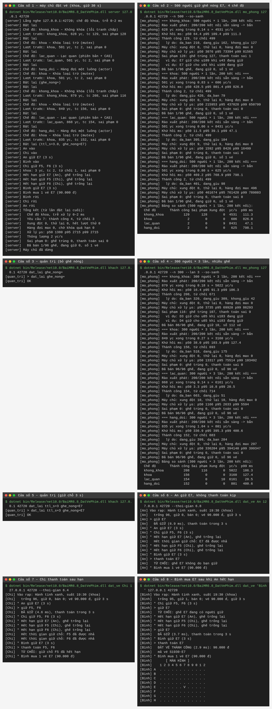

# Bài mở rộng MR6.8 – Đặt vé xem phim: giữ chỗ có thời hạn và tranh ghế (C#)

| Thông tin | Nội dung |
|---|---|
| Loại | **Bài mở rộng**, không có trong giáo trình và không có mã giả tương ứng. Bài thứ ba của nhóm "tranh chấp tài nguyên" MR6.6–MR6.13, dùng chung khung của [MR6.6](../BaiMR6.6_DauGia/) |
| Liên hệ với giáo trình | Chương 6: Bài 6.1 (server đa luồng, một luồng mỗi kết nối), Bài 6.7 (kiểm thử tải); Chương 3: Bài 3.2 (định khung thông điệp theo dòng); bài mở rộng MR5.4/MR5.5 (luồng, đồng bộ) |
| Thư viện | .NET 10 BCL: `System.Net.Sockets`, `System.Threading` (`Thread`, `lock`/`Monitor`, `Interlocked`, `Volatile`, `Barrier`), `System.Collections.Concurrent` (`BlockingCollection`, `ConcurrentDictionary`), `System.Text.Json.Nodes`; bản giao diện: Windows Forms (`net10.0-windows`, sơ đồ ghế vẽ bằng GDI+). Không dùng gói NuGet |
| Bản ngôn ngữ khác | [Python](../../../python/Chuong06/BaiMR6.8_DatVePhim/), [Java](../../../java/Chuong06/BaiMR6.8_DatVePhim/), [Rust](../../../rust/Chuong06/BaiMR6.8_DatVePhim/), [Go](../../../go/Chuong06/BaiMR6.8_DatVePhim/) |

## Mục tiêu
Bài mô phỏng một ứng dụng đặt vé xem phim. Phòng chiếu có **8 hàng (A–H) × 12 ghế**. Người dùng chọn ghế, bấm **Giữ chỗ** (giữ có thời hạn – TTL, mặc định 30 s; quá hạn máy chủ tự nhả), rồi **Thanh toán** trong thời hạn để nhận vé; có thể **Nhả** ghế đang giữ. **n người cùng nhắm một ghế "nóng"** (E7 – giữa phòng) hoặc cùng chọn ghế ngẫu nhiên. Mỗi thao tác là "đọc các ghế → kiểm tra (giả lập độ trễ cơ sở dữ liệu 0–2 ms) → ghi", xử lý theo **bốn cách** chọn được ngay lúc đang chạy. Mỗi ghế là **một ô riêng** nên chế độ `khoa` khóa theo từng ghế: nhiều người chọn ghế khác nhau không phải chờ nhau. **Sổ kiểm toán** đếm ghế bị giữ/bán cho hai người và thanh toán sai (ghế không do mình giữ, hoặc đã hết hạn giữ).

Phần khung (`Chung.cs`, `Khach.cs`, phần KHUNG của `MoPhong.cs`, `GiaoDien/GiaoDienChung.cs`) chép nguyên từ MR6.6 (chỉ khác dòng `namespace`). Giao thức, mã lỗi, câu chữ và định dạng dòng in giống hệt bản Python – chạy chéo được.

## Kiến thức chính
Số liệu dưới đây lấy từ `ket_qua.txt`, là một lần chạy thật trên máy cục bộ (127.0.0.1, .NET 10 trên Linux, độ trễ xử lý ngẫu nhiên 0–2 ms). Mỗi lần chạy, số liệu lệch đi đôi chút.

```
500 người cùng giữ ghế nóng E7 (giữ được thì thanh toán ngay):
  Chế độ       Thành công Sai phạm Xung đột  yc/s  p99 ms
  khong_khoa          129      128        0  4531   111.3
  khoa                  2        0        0   606   826.0
  lac_quan              2        0        9  8431    47.1
  hang_doi              2        0        0   625   798.1
300 người × 3 lần, không có ghế nóng (nhóm 1–2 ghế liền nhau ngẫu nhiên):
  Chế độ       Thành công Sai phạm Xung đột  yc/s  p99 ms
  khong_khoa          208      116        0  5022   106.3
  khoa                156        0        0  3160   127.4
  lac_quan            154        0       10  6161    20.5
  hang_doi            152        0        0   801   400.6
```
("Thành công" đếm cả lần giữ chỗ lẫn lần thanh toán được chấp nhận; một người mua được vé = 2 thành công. "Sai phạm" do sổ kiểm toán đếm, "Xung đột" là số lần so sánh-và-đổi thất bại, "yc/s" và "p99" (khứ hồi) đo ở bộ mô phỏng.)

- **Tranh chấp trên một ghế.** Ở `khong_khoa`, 500 người cùng giữ E7: mọi luồng đọc được trước lần ghi đầu đều thấy E7 trống, đều được "ĐÃ GIỮ", bản ghi sau đè bản ghi trước; sổ kiểm toán đếm **127** lần "ghế trùng" (ví dụ `E7 giữ cho u109 khi u43 đang giữ`) và **1** "thanh toán sai" (một người trả tiền cho ghế mà theo sổ người khác đang giữ). Cuối cùng chỉ 1 vé được bán – những người khác được báo giữ chỗ rồi bị từ chối khi thanh toán (`khong_giu` 127 lần). Chế độ này chỉ dùng để minh họa lỗi trong phòng lab (loopback).
- **Khóa theo từng tài nguyên (fine-grained locking).** Khi không có ghế nóng, người chọn ghế khác nhau không đụng nhau: `khoa` chỉ giữ khóa của 1–2 ghế trong yêu cầu (theo thứ tự tên ghế, nên không khóa chết), nên đạt **3160 yc/s** – gần gấp bốn lần `hang_doi` (801 yc/s, một luồng cho cả phòng) và hơn năm lần chính nó khi mọi người tranh một ghế (606 yc/s). So với MR6.6/MR6.7 (một điểm nóng), đây là trường hợp khóa theo tài nguyên phát huy tác dụng.
- **Lạc quan khi ít đụng nhau.** `lac_quan` đọc (giá trị, phiên bản) các ghế, kiểm tra ngoài khóa, so sánh-và-đổi dưới khóa rất ngắn. Khi người dùng chọn ghế khác nhau, xung đột rất hiếm (10 lần trên 868 yêu cầu) nên thông lượng cao nhất (6161 yc/s, p99 20,5 ms).
- **Giữ chỗ có thời hạn (TTL) và dọn ghế quá hạn.** Mỗi ghế lưu `HetHan` theo đồng hồ đơn điệu (`Stopwatch`); luồng nền của máy chủ 100 ms/lần "dọn" ghế quá hạn, và việc dọn cũng là một thao tác ghi đi qua cùng chế độ xử lý tranh chấp (không thể nhả nhầm một ghế vừa được thanh toán). Một lượt giữ quá hạn cũng bị coi là trống ngay cả khi chưa kịp dọn. Lượt dòng lệnh (giữ 3 s): An giữ E7 nhưng không thanh toán kịp → "Hết thời gian giữ chỗ: E7 đã được nhả"; Bình giữ E7 lúc An còn hạn bị "đang có người giữ", giữ lại sau khi hết hạn thì được và mua vé `S1930-E7`; An bấm thanh toán sau đó nhận "ghế E7 không do bạn giữ"; Chi thanh toán F5, F6 sau hạn nhận "giữ chỗ F5 đã hết hạn" (mã lỗi `het_han`).
- **Hàng đợi một luồng (actor).** `hang_doi` cho kết quả đúng và công bằng (FIFO) nhưng mọi thao tác của cả phòng chiếu đi qua một luồng: hàng đợi dài tối đa 496 (500 người) và 297 (300 người).
- **Ảnh chụp trạng thái có số thứ tự.** Như MR6.7: mỗi lần ghi được đánh số (`kq["phien"]`), `cap_nhat` mang `"phien"` đọc trước khi chụp; client chỉ kết luận "ghế đã bị người khác lấy mất" / "hết thời gian giữ chỗ" từ bản cập nhật có `phien` ≥ số của lần giữ chỗ của mình.
- **Khóa nhiều ghế.** Một yêu cầu giữ 1–8 ghế; `khoa` lấy khóa các ghế theo thứ tự tên ô (`Monitor.TryEnter`, chờ tối đa 2 s), `lac_quan` so sánh phiên bản của mọi ghế cùng lúc – giữ "tất cả hoặc không ghế nào" (không bao giờ giữ được E7 mà mất E8 của cùng một yêu cầu).

### Giao thức (giống hệt ở 5 ngôn ngữ)
Khung giao thức như [MR6.6](../BaiMR6.6_DauGia/). Phần riêng của bài:

| Chiều | Thông điệp |
|---|---|
| người dùng → server | `{"loai":"giu_cho","ma_yc":k,"ghe":["E7","E8"]}`, `{"loai":"thanh_toan","ma_yc":k,"ghe":["E7","E8"]}`, `{"loai":"nha","ma_yc":k,"ghe":["E7"]}` (1–8 mã ghế A1–H12, không trùng); kết nối gộp thêm `"nguoi":"u17"` |
| quản trị → server | `{"loai":"dat_lai","ma_yc":k,"ttl_s":30,"ghe_nong":"E7"\|"","gia_ve":90000,"phim":…,"suat":"19:30"}` |
| server → client | giữ: `{"loai":"kq","ok":true,"ghe":[…],"moi":[…],"het_han_ms":30000,"nguoi","phien"}`; thanh toán: `{"ok":true,"ghe","ma_ve":["S1930-E7"],"tien":90000,"nguoi","phien"}`; nhả: `{"ok":true,"ghe","nguoi","phien"}`; từ chối: `"ma_loi":"da_ban"\|"dang_giu"` (kèm `"ghe_ban":[…]`) `\|"het_han"\|"khong_giu"\|"sai_du_lieu"\|"xung_dot"\|…` |
| server → tất cả | `{"loai":"cap_nhat","che_do":…,"phien":n,"phim","suat","gia_ve","ttl_s","ghe_nong","hang":"ABCDEFGH","cot":12,"so_do":["....g.b.....",…],"chu":{"E7":"An",…},"con_lai_ms":{"E7":28500,…},"dem":{"trong","giu","ban"}}` |

## Cấu trúc tệp
- `Chung.cs`, `Khach.cs`: khung chung (chép từ MR6.6).
- `MayChu.cs`: `PhongChieu` (ghế, kiểm tra danh sách ghế), record `Ghe`, `SoKiemToanDatVe`, `MayChuDatVe` (giữ chỗ, thanh toán, nhả, dọn ghế quá hạn, đánh số lần ghi); `Server.cs`: máy chủ dòng lệnh.
- `MoPhong.cs`: bộ mô phỏng tải; phần NGHIỆP VỤ là `NguCanh` (sơ đồ ghế, ghế nóng, chọn nhóm ghế trống), `NguoiAo` (giữ ghế nóng trước, giữ được thì thanh toán ngay, bị từ chối thì chọn nhóm ghế khác).
- `DatVe.cs`: người đặt vé dòng lệnh (`giu`, `tt`, `nha`, `xem`, `thoat`). `Program.cs`: chọn vai trò `server | mo_phong | khach | dat_ve`.
- `GiaoDien/`: dự án WinForms `BaiMR6.8_GiaoDien.csproj` (dùng chung lõi ở thư mục cha): `GiaoDienChung.cs`, `FormServer.cs` (sơ đồ thu nhỏ, ghế nóng viền đỏ), `FormDatVe.cs` (điều khiển `SoDoGhe`, áp phích phim, đồng hồ giữ chỗ), `DemoGui.cs`, `Program.cs`, `demo.json`.
- `demo.json`, `ket_qua.txt`, `ket_qua.png`: kịch bản và kết quả thực thi thật.

## Cách chạy
Cần .NET 10 SDK. Chạy trong thư mục bài:
```bash
dotnet build -c Release
dotnet run -c Release -- server 127.0.0.1 9000                          # giữ chỗ 30 s, ghế nóng E7
dotnet run -c Release -- mo_phong 127.0.0.1 9000 --n 500 --so-sanh      # 500 người tranh E7
dotnet run -c Release -- khach 127.0.0.1 9000 dat_lai ghe_nong=         # bỏ ghế nóng: chọn ngẫu nhiên
dotnet run -c Release -- mo_phong 127.0.0.1 9000 --n 300 --lan 3 --so-sanh
dotnet run -c Release -- khach 127.0.0.1 9000 dat_lai ttl_s=10
dotnet run -c Release -- dat_ve An 127.0.0.1 9000                       # gõ giu E7 E8 / tt / nha / xem
```
- Lệnh của máy chủ: `che_do …`, `tre <ms>`, `dat_lai [ttl_s=… ghe_nong=… gia_ve=… phim=… suat=…]`, `thong_ke`, `thoat`; tùy chọn khi chạy: `--che-do`, `--tre-ms`, `--ttl`, `--ghe-nong`.
- `xem` in sơ đồ chữ: `.` trống, `g` người khác giữ, `b` đã bán, `G` mình giữ, `V` vé của mình.
- Tái lập kết quả, từ thư mục gốc của kho: `python3 tools/demo.py csharp/Chuong06/BaiMR6.8_DatVePhim`.

## Ứng dụng giao diện


*(Ảnh `ket_qua_gui.png` và `ket_qua_gui_tranh_chap.png` do vai trò `demo` tự chụp khi chạy trên Windows – WinForms không chạy trên Linux nên bản trong kho chưa có ảnh.)*

- **Máy chủ** (`server_gui`): các phần chung như MR6.6; khung **tài nguyên**: sơ đồ phòng chiếu thu nhỏ (trống / đang giữ / đã bán, **ghế nóng viền đỏ**), số ghế mỗi loại, ghế nóng và người đang giữ/mua nó, ô **Giữ chỗ (s)**, **Ghế nóng**, **Giá vé** và nút **Đặt lại**.
- **Đặt vé** (`dat_ve_gui`): **áp phích phim** vẽ bằng GDI+ (tên phim, suất, giá vé, thời hạn giữ chỗ); **sơ đồ phòng chiếu** 8 × 12 ghế với MÀN HÌNH, hai lối đi, nhãn hàng A–H; màu ghế: trống / đang chọn / người khác giữ / đã bán / bạn giữ / vé của bạn (kèm chú giải); **bấm ghế để chọn** (tối đa 8); nút **GIỮ CHỖ**; **đồng hồ giữ chỗ** đếm ngược (đỏ khi < 10 s); **THANH TOÁN** (ghi tổng tiền) và **Nhả ghế**; thông báo "Ghế … đã bị … lấy mất!", "Hết thời gian giữ chỗ – ghế đã được nhả", "Ghế … vừa có người giữ" (ghế đang chọn bị người khác giữ trước thì tự bỏ chọn); danh sách vé của bạn.

Kịch bản `demo` (cùng các bước và dòng `[demo] …` như `demo_gui.py`): `khoa`: cả ba chọn E7 rồi cùng bấm GIỮ CHỖ → một người giữ được, người đó thanh toán; `khong_khoa`, trễ 0–20 ms: cả ba cùng giữ E8 → máy chủ trả lời "ĐÃ GIỮ" cho nhiều người, sau `cap_nhat` người thua thấy "Ghế E8 đã bị … lấy mất!" → SAI PHẠM, chụp `ket_qua_gui_tranh_chap.png`; `khoa`, So sánh 4 chế độ (500 người tranh E7); giữ chỗ 6 s: An giữ F5, F6 không thanh toán → hết hạn; Bình mua F5, F6, Chi mua G7, G8; An giữ E5, E6, Chi chọn H6; chụp 4 cửa sổ thành `ket_qua_gui.png`; STOP SERVER.

### Cách chạy
**Windows** (cần .NET 10 SDK: `winget install Microsoft.DotNet.SDK.10`):
```powershell
cd csharp\Chuong06\BaiMR6.8_DatVePhim\GiaoDien
dotnet build -c Release
dotnet run -c Release -- server_gui 127.0.0.1 42722        # bấm START SERVER (giữ chỗ 30 s)
dotnet run -c Release -- dat_ve_gui An 127.0.0.1 42722
dotnet run -c Release -- dat_ve_gui Bình 127.0.0.1 42722
```
- Kịch bản tự động (từ thư mục gốc kho): `powershell -NoProfile -ExecutionPolicy Bypass -File tools\demo_windows.ps1 csharp\Chuong06\BaiMR6.8_DatVePhim\GiaoDien`.
- Chạy riêng từng cửa sổ: nhật ký và cứ 5 giây một dòng số liệu cũng in ra dòng lệnh (chuyển hướng vào tệp được).
- Thử trên nhiều máy: máy chủ nghe IP card mạng (hoặc `0.0.0.0`), mở tường lửa cho cổng; cả lớp cùng mở `dat_ve_gui` (hoặc bản Python) tới máy thầy và tranh ghế giữa phòng; chỉ dùng `khoa`, `lac_quan`, `hang_doi` khi thử thật.

## Kết quả thực thi


## Ghi chú
- **Chạy chéo đã kiểm tra:** bộ mô phỏng C# → máy chủ Python (500 người tranh E7: khong_khoa 12 thành công / 10 sai phạm; khoa, lac_quan (19 xung đột), hang_doi 2 / 0) và bộ mô phỏng Python → máy chủ C# (73 / 72; 2 / 0; 2 / 0 (20 xung đột); 2 / 0); người đặt vé C# với máy chủ Python và ngược lại (giữ E5, E6 → thanh toán 180.000 đ, mã vé `S1930-E5, S1930-E6`, sơ đồ `xem` giống hệt).
- Thời điểm hết hạn chỉ nằm ở máy chủ (đồng hồ đơn điệu); client nhận `het_han_ms`/`con_lai_ms` (số nguyên ms) và tự đếm ngược – không phụ thuộc giờ của từng máy.
- Các trường nội bộ của kết quả (`_luc`, `_het_han`, dùng cho sổ kiểm toán) bị bỏ trước khi gửi client.
- Kiểm thử: bản dòng lệnh chạy trên Linux (.NET 10.0.114). Ứng dụng WinForms đã kiểm tra biên dịch với assembly tham chiếu WinForms, **chưa chạy – cần Windows**.

## Bài tập gợi ý
1. Với 300 người × 3 lần (không ghế nóng), tăng `--tre-ms` lên 10. Khoảng cách thông lượng giữa `khoa` (khóa từng ghế) và `hang_doi` (một luồng) thay đổi thế nào? Vì sao?
2. Đặt `ttl_s=1` rồi cho `NguoiAo` chờ ngẫu nhiên 0–2 s trước khi thanh toán. Đếm số lần `het_han`. Sổ kiểm toán có báo "thanh toán sai" ở chế độ `khoa` không? Ở `khong_khoa`?
3. Thêm luật "không để trống một ghế lẻ giữa hai ghế đã chọn" (luật của nhiều rạp). Kiểm tra luật này cần đọc những ô nào? Ảnh hưởng thế nào tới khóa theo ghế?
4. Sửa chế độ `khoa` để khóa cả hàng ghế thay vì từng ghế. Đo lại bảng 300 người × 3 lần và giải thích.
5. Giao diện: hiện trên sơ đồ ghế của máy chủ đồng hồ còn lại của từng ghế đang giữ (`con_lai_ms`).

## Đọc thêm
- H. T. Kung, J. T. Robinson (1981). *On Optimistic Methods for Concurrency Control*. ACM Transactions on Database Systems 6(2).
- E. G. Coffman, M. J. Elphick, A. Shoshani (1971). *System Deadlocks*. ACM Computing Surveys 3(2): thứ tự khóa khi giữ nhiều ghế.
- Tài liệu .NET: [câu lệnh `lock`](https://learn.microsoft.com/dotnet/csharp/language-reference/statements/lock), [`Monitor`](https://learn.microsoft.com/dotnet/api/system.threading.monitor), [`Interlocked`](https://learn.microsoft.com/dotnet/api/system.threading.interlocked), [`ConcurrentDictionary<TKey,TValue>`](https://learn.microsoft.com/dotnet/api/system.collections.concurrent.concurrentdictionary-2), [`BlockingCollection<T>`](https://learn.microsoft.com/dotnet/api/system.collections.concurrent.blockingcollection-1), [`System.Threading.Channels`](https://learn.microsoft.com/dotnet/core/extensions/channels), [`Stopwatch`](https://learn.microsoft.com/dotnet/api/system.diagnostics.stopwatch).

Mã nguồn của bài được viết mới cho kho này.
