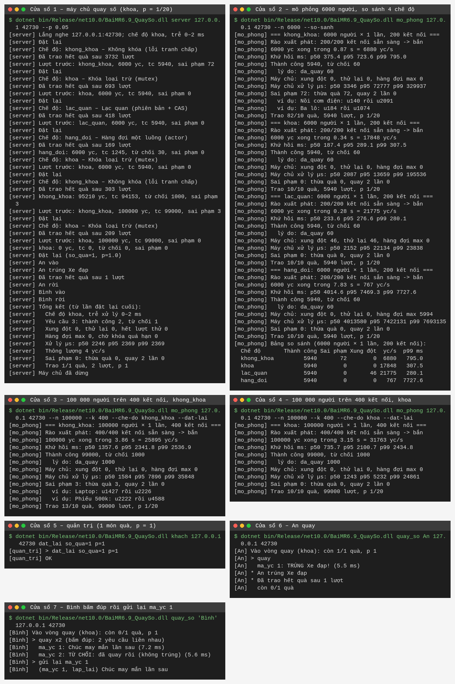

# Bài mở rộng MR6.9 – Quay số trúng thưởng: 100 000 lượt quay tranh 10 món quà (C#)

| Thông tin | Nội dung |
|---|---|
| Loại | **Bài mở rộng**, không có trong giáo trình và không có mã giả tương ứng. Thuộc nhóm "tranh chấp tài nguyên" MR6.6–MR6.13, dùng chung khung của [MR6.6](../BaiMR6.6_DauGia/) |
| Liên hệ với giáo trình | Chương 6: Bài 6.1 (server đa luồng, một luồng mỗi kết nối), Bài 6.7 (kiểm thử tải); Chương 3: Bài 3.2 (định khung thông điệp theo dòng); bài mở rộng MR5.4/MR5.5 (luồng, đồng bộ) |
| Thư viện | .NET 10 BCL: `System.Net.Sockets`, `System.Threading` (`Thread`, `lock`/`Monitor`, `Interlocked`, `Volatile`, `Barrier`), `System.Collections.Concurrent` (`BlockingCollection`, `ConcurrentDictionary`), `System.Text.Json.Nodes`; bản giao diện: Windows Forms (`net10.0-windows`, bánh xe và ảnh quà vẽ bằng GDI+). Không dùng gói NuGet |
| Bản ngôn ngữ khác | [Python](../../../python/Chuong06/BaiMR6.9_QuaySo/), [Java](../../../java/Chuong06/BaiMR6.9_QuaySo/), [Rust](../../../rust/Chuong06/BaiMR6.9_QuaySo/), [Go](../../../go/Chuong06/BaiMR6.9_QuaySo/) |

## Mục tiêu
Bài mô phỏng chương trình khuyến mãi "Vòng quay may mắn". Kho có **10 món quà**, hàng chục nghìn khách hàng mỗi người được **quay đúng một lần**. Mỗi lượt trúng với xác suất **p** (mặc định 1/2000) nếu kho còn quà, và người trúng nhận ngẫu nhiên một món còn lại. Có hai tài nguyên bị tranh chấp:
- **kho quà** (một ô "nóng", mọi lượt trúng cùng ghi);
- **lượt quay của từng người** (một ô cho mỗi người). Hai thiết bị của cùng một người, hoặc một lần bấm đúp, cùng gửi yêu cầu `quay`.

Máy chủ TCP đa luồng xử lý thao tác "đọc → kiểm tra (giả lập độ trễ cơ sở dữ liệu 0–2 ms) → ghi" theo **bốn cách** chọn được ngay lúc đang chạy: không khóa, khóa loại trừ, lạc quan, hàng đợi một luồng. **Sổ kiểm toán** đếm hai sai phạm: **thừa quà** (một món đã trao lại được trao lần nữa, tức là tổng số quà trao lớn hơn số quà có) và **quay 2 lần** (một người có hai lượt quay được chấp nhận). Bộ mô phỏng tải dồn **100 000 người lên 400 kết nối** (pipelining) để đo thông lượng.

Phần khung (`Chung.cs`, `Khach.cs`, phần KHUNG của `MoPhong.cs`, `GiaoDien/GiaoDienChung.cs`) chép từ MR6.6–MR6.8 (khác dòng `namespace`; riêng `KhoTranhChap` dùng `ConcurrentDictionary` cho bảng ô để thêm ô khi đang chạy, và `SoKiemToan` có thêm `CongSaiPham` – xem Ghi chú). Giao thức, mã lỗi, câu chữ và định dạng dòng in giống hệt bản Python – chạy chéo được.

## Kiến thức chính
Số liệu dưới đây lấy từ `ket_qua.txt`, là một lần chạy thật trên máy cục bộ (127.0.0.1, .NET 10 trên Linux, độ trễ xử lý ngẫu nhiên 0–2 ms; để sai phạm hiện rõ, máy chủ chạy với p = 1/20 (`server --p 0.05`)). Mỗi lần chạy, số liệu lệch đi đôi chút; .NET chạy đa lõi thật (không có GIL như Python) nên tranh chấp ở `khong_khoa` và thông lượng khác bản Python.

```
6000 người × 1 lượt quay, 200 kết nối, 10 quà, p = 1/20:
  Chế độ       Thành công Sai phạm Xung đột  yc/s  p99 ms
  khong_khoa         5940       72        0  6880   795.0
  khoa               5940        0        0 17848   307.5
  lac_quan           5940        0       46 21775   280.1
  hang_doi           5940        0        0   767  7727.6
100 000 người trên 400 kết nối:
  khong_khoa  3,86 s  25 895 yc/s  99 000 / 1000  sai phạm 3 (trao 13/10 quà)
  khoa        3,15 s  31 763 yc/s  99 000 / 1000  sai phạm 0 (trao 10/10)
```
("Thành công" là số lượt quay được chấp nhận – trúng hoặc không; 60 yêu cầu còn lại là thiết bị thứ hai của 60 người và phải bị từ chối `da_quay`. "Sai phạm" do sổ kiểm toán đếm, "Xung đột" là số lần so sánh-và-đổi thất bại, "yc/s" và "p99" (khứ hồi) đo ở bộ mô phỏng.)

- **Tranh chấp trên kho quà.** Ở `khong_khoa`, hai lượt trúng gần như cùng lúc cùng đọc kho, cùng bốc một món rồi ghi lại – bản ghi sau đè bản trước, món vừa trao "sống lại" trong kho. Lượt 6000 người: sổ đếm **72 lần "thừa quà"**, tóm tắt "Trao 82/10 quà" (ví dụ `Nồi cơm điện: u140 rồi u2091`). Với 100 000 người, cuộc tranh chỉ diễn ra trong vài trăm lượt đầu nên vẫn trao 13/10. Chế độ này chỉ dùng để minh họa lỗi trong phòng lab (loopback).
- **Idempotency theo tên, không chỉ theo `ma_yc`.** Khung chống *gửi lại* cùng `ma_yc` (máy chủ trả lại kết quả cũ kèm `"lap_lai": true` – cửa sổ 7: `gui_lai 1` nhận lại "Chúc may mắn lần sau" mà không quay lần nữa). Bấm đúp hay hai thiết bị sinh **hai `ma_yc` khác nhau**, nên luật "mỗi người một lượt" nằm trong trạng thái: ô `ng:<tên>` ghi kết quả lượt quay, yêu cầu thứ hai nhận `da_quay` ("đã quay rồi (không trúng)").
- **Khóa theo tài nguyên, và chỉ khóa thứ thật sự tranh.** Rút thăm (`Random.Shared.NextDouble() < p`) làm **trước**, ngoài vùng găng. Lượt không trúng chỉ khóa ô của chính người đó nên hàng trăm lượt chạy song song; chỉ lượt trúng mới khóa thêm ô `qua` (hai khóa theo thứ tự tên ô – không khóa chết); kho hết thì không chạm ô `qua` nữa. Vì vậy `khoa` (17 848 yc/s) và `lac_quan` (21 775 yc/s, 46 xung đột) còn nhanh hơn `khong_khoa` trong lần chạy này, khác hẳn MR6.6 (một điểm nóng).
- **Ô tạo khi đang chạy.** Ô `ng:<tên>` được tạo lúc người đó quay lần đầu (dưới một khóa tạo ô riêng – không phải khóa nghiệp vụ). Với 100 000 người, khung cần bảng ô `ConcurrentDictionary` (thêm ô O(1)); bảng `Dictionary` chép lại mỗi lần thêm của MR6.6–MR6.8 sẽ tốn O(n²).
- **Hàng đợi một luồng (actor).** `hang_doi` đúng nhưng **tuần tự**: mọi lượt quay, kể cả lượt không trúng, đi qua một luồng – 767 yc/s, hàng đợi dài 5994, p99 khứ hồi 7,7 s; vì thế lượt 100 000 người chỉ chạy `khong_khoa` và `khoa`.
- **Pipelining, rào xuất phát.** 400 kết nối × 250 người ảo (`"so_nguoi"` trong lời chào, tên người ở `"nguoi"`); mọi luồng chờ ở `Barrier`, rồi mỗi kết nối gửi 250 yêu cầu trong một lần `Send`. Người thứ 100, 200, … mang tên người liền trước (thiết bị thứ hai) – đúng 1000 yêu cầu bị từ chối `da_quay`.

### Giao thức (giống hệt ở 5 ngôn ngữ)
Phần chung (chào, quản trị, `thong_ke`, `lap_lai`) như [MR6.6](../BaiMR6.6_DauGia/). Phần riêng của bài:

| Chiều | Thông điệp |
|---|---|
| người dùng → server | `{"loai":"quay","ma_yc":k}` (kết nối gộp thêm `"nguoi":"u17"`) |
| server → client | `{"loai":"kq","ma_yc":k,"ok":true,"trung":true,"qua":3,"ten_qua":"Tai nghe","nguoi":"An","con_lai":9}` · `{"loai":"kq","ma_yc":k,"ok":true,"trung":false,"qua":null,"nguoi":"An"}` · `{"loai":"kq","ma_yc":k,"ok":false,"ma_loi":"da_quay","ly_do":"đã quay rồi (trúng Tai nghe)","qua":3}` |
| server → tất cả | `{"loai":"cap_nhat","che_do":…,"so_qua":10,"p":0.0005,"con_lai":7,"qua":[{"ma","ten","con","nguoi"}…],"da_quay":12345,"so_trung":3,"nguoi_trung":[{"nguoi","qua","gio"}…]}` (≤ 10 lần/s); `{"loai":"su_kien","noi_dung":"An trúng Tai nghe"}` |
| quản trị → server | `{"loai":"dat_lai","ma_yc":k,"so_qua":10,"p":0.0005}` (số quà 1–10, p trong [0, 1]) |

## Cấu trúc tệp
- `Chung.cs`, `Khach.cs`: khung chung (giao thức, `ThongKe`, `KhoTranhChap` 4 chế độ, `SoKiemToan`, `MayChuCoSo`; `KetNoiKhach`, `QuanTri` và dòng lệnh quản trị).
- `MayChu.cs`: `Qua` (danh mục quà, `ChuP`), record `KhoQua`, `LuotQuay`, `SoKiemToanQuaySo`, `MayChuQuaySo` (ô `qua`, ô `ng:<tên>` tạo khi quay lần đầu, rút thăm ngoài vùng găng); `Server.cs`: máy chủ dòng lệnh.
- `MoPhong.cs`: bộ mô phỏng tải; phần NGHIỆP VỤ là `NguoiAo` (quay `lan` lần; người thứ 100, 200, … dùng tên người liền trước).
- `QuaySo.cs`: người quay dòng lệnh (`quay`, `quay x2`, `gui_lai [k]`). `Program.cs`: chọn vai trò `server | mo_phong | khach | quay_so`.
- `GiaoDien/`: dự án WinForms `BaiMR6.9_GiaoDien.csproj` (dùng chung lõi ở thư mục cha bằng `<Compile Include="..\*.cs">`): `GiaoDienChung.cs`, `FormServer.cs`, `FormVongQuay.cs` (bánh xe, ảnh 10 món quà `AnhQua`), `DemoGui.cs`, `Program.cs`, `demo.json`.
- `demo.json`, `ket_qua.txt`, `ket_qua.png`: kịch bản và kết quả thực thi thật.

## Cách chạy
Cần .NET 10 SDK. Chạy trong thư mục bài:
```bash
dotnet build -c Release
dotnet run -c Release -- server 127.0.0.1 9000 --p 0.05                      # gõ lệnh ở đây
dotnet run -c Release -- mo_phong 127.0.0.1 9000 --n 6000 --so-sanh
dotnet run -c Release -- mo_phong 127.0.0.1 9000 --n 100000 --k 400 --che-do khoa --dat-lai
dotnet run -c Release -- khach 127.0.0.1 9000 dat_lai so_qua=10 p=0.0005      # chương trình thật: 1/2000
dotnet run -c Release -- quay_so An 127.0.0.1 9000                            # gõ quay / quay x2 / gui_lai
```
- Lệnh của máy chủ: `che_do …`, `tre <ms>`, `dat_lai [so_qua=… p=…]`, `thong_ke`, `thoat`; tùy chọn khi chạy: `--che-do`, `--tre-ms`, `--so-qua`, `--p`.
- `quay_so`: `quay`; `quay x2` (hai yêu cầu, hai `ma_yc`); `gui_lai [k]` (gửi lại đúng `ma_yc` k); dòng `@t lệnh` chờ tới giây thứ t.
- Tái lập kết quả, từ thư mục gốc của kho: `python3 tools/demo.py csharp/Chuong06/BaiMR6.9_QuaySo`.

## Ứng dụng giao diện


*(Ảnh `ket_qua_gui.png` và `ket_qua_gui_tranh_chap.png` do vai trò `demo` tự chụp khi chạy trên Windows – WinForms không chạy trên Linux nên bản trong kho chưa có ảnh.)*

- **Máy chủ** (`server_gui`): các phần chung như MR6.6; khung **tài nguyên**: số quà còn lại và số đã trao (đỏ khi trao quá số quà), số lượt đã quay, p, ảnh 10 món quà (viền xanh là còn, xám kèm tên người nhận là đã trao), ô **Số quà**, **Xác suất p** và nút **Đặt lại**.
- **Vòng quay may mắn** (`vong_quay_gui`): bánh xe vẽ bằng GDI+ (`FillPie`, chữ xoay theo ô), mỗi món quà một ô màu, xen giữa là ô "May mắn lần sau", món đã trao chuyển xám "(đã trao)"; kim ở đỉnh, đèn viền nhấp nháy khi quay (Timer 30 ms). Bấm **QUAY**: bánh xe quay tự do ngay, khi có kết quả thì giảm tốc (ease-out, 2,6 s) và dừng **đúng ô kết quả**, rồi hiện "CHÚC MỪNG! Bạn trúng …", "Chúc bạn may mắn lần sau" hoặc "Bạn đã quay rồi – mỗi người 1 lượt"; nút chuyển thành "ĐÃ QUAY". Bên phải: số quà còn, số lượt đã quay, ảnh từng món kèm "còn" / "→ người nhận", danh sách **người trúng thưởng trực tiếp** (tên mình tô xanh).

Kịch bản `demo` (cùng các bước và dòng `[demo] …` như `demo_gui.py` của bản Python): `khoa`, 1 quà, p = 1: An, Bình, Bình (máy 2) cùng bấm QUAY → đúng một người trúng, thiết bị thứ hai của Bình bị từ chối; `khong_khoa`, trễ 0–20 ms: cùng thao tác → nhiều người trúng một món, SAI PHẠM, chụp `ket_qua_gui_tranh_chap.png`; So sánh 4 chế độ (10 000 người, p = 1/20); 10 quà, p = 0,8: An, Bình quay, Bình (máy 2) bị từ chối; bắn đồng loạt 500 người; chụp 4 cửa sổ thành `ket_qua_gui.png`; STOP SERVER.

### Cách chạy
**Windows** (cần .NET 10 SDK: `winget install Microsoft.DotNet.SDK.10`):
```powershell
cd csharp\Chuong06\BaiMR6.9_QuaySo\GiaoDien
dotnet build -c Release
dotnet run -c Release -- server_gui 127.0.0.1 42732        # bấm START SERVER
dotnet run -c Release -- vong_quay_gui An 127.0.0.1 42732
dotnet run -c Release -- vong_quay_gui Bình 127.0.0.1 42732
```
- Kịch bản tự động (từ thư mục gốc kho): `powershell -NoProfile -ExecutionPolicy Bypass -File tools\demo_windows.ps1 csharp\Chuong06\BaiMR6.9_QuaySo\GiaoDien`.
- Chạy riêng từng cửa sổ: nhật ký và cứ 5 giây một dòng số liệu cũng in ra dòng lệnh (chuyển hướng vào tệp được).
- Thử trên nhiều máy: máy chủ nghe IP card mạng (hoặc `0.0.0.0`), mở tường lửa cho cổng; cả lớp cùng mở `vong_quay_gui` (hoặc bản Python) tới máy thầy; chỉ dùng `khoa`, `lac_quan`, `hang_doi` khi thử thật.

## Kết quả thực thi


## Ghi chú
- **Chạy chéo đã kiểm tra:** bộ mô phỏng C# → máy chủ Python (3000 người, p = 1/20: khong_khoa 37 sai phạm; khoa, lac_quan (26 xung đột), hang_doi 0) và bộ mô phỏng Python → máy chủ C# (28; 0; 0 (23 xung đột); 0); `quay_so` C# với máy chủ Python và ngược lại (bấm đúp: một lượt trúng, lượt kia `da_quay`; `gui_lai 1` nhận kết quả cũ kèm `lap_lai`).
- **Khác với khung MR6.6–MR6.8 (C#):** bảng ô của `KhoTranhChap` là `ConcurrentDictionary` (trước đây: `Dictionary` chép cả bảng mỗi lần thêm ô) vì bài tạo ô `ng:<tên>` cho từng người khi đang chạy (100 000 ô); `SoKiemToan.CongSaiPham(ma, n)` cộng thẳng vào bộ đếm (như `self.dem[...] += n` của Python). Hành vi 4 chế độ, cổng tạm dừng khi đổi chế độ/đặt lại và định dạng in không đổi.
- Dòng 5 giây và dòng "Lượt trước" của máy chủ có thể dài 65–66 ký tự khi số yêu cầu lên tới 100 000 – định dạng của khung chung, giống bản Python.
- Kiểm thử: bản dòng lệnh chạy trên Linux (.NET 10.0.114, `tools/demo.py`). Ứng dụng WinForms đã kiểm tra biên dịch với assembly tham chiếu WinForms, **chưa chạy – cần Windows**.

## Bài tập gợi ý
1. Chạy `mo_phong --n 30000 --so-sanh` với p = 1/2000 (giá trị thật). `khong_khoa` có còn trao thừa quà không? Vì sao xác suất hai lượt trúng "đụng nhau" phụ thuộc vào p × (số yêu cầu đang xử lý cùng lúc) × (độ rộng khe đọc–ghi)?
2. Bỏ đoạn "hết quà thì khỏi chạm ô `qua`" trong `MayChu.cs`, rồi đo lại thông lượng của `khoa` với p = 1/20. Giải thích kết quả.
3. Gộp ô của mọi người thành một ô `da_quay` (một tập hợp tên). Thông lượng của `khoa` và số xung đột của `lac_quan` thay đổi thế nào? Đây là bài học về độ mịn của khóa (lock granularity).
4. Thêm luật "mỗi người quay tối đa 3 lần, trúng tối đa 1 lần". Cần đổi giá trị của ô `ng:<tên>` và luật của sổ kiểm toán ra sao?
5. Ở chế độ `lac_quan`, nếu rút thăm *bên trong* `xu_ly` (mỗi lần thử lại rút lại) thì xác suất trúng thực tế có còn là p không? Vì sao phải rút thăm một lần, ngoài vùng găng?
6. Giao diện: thêm âm thanh "tách tách" mỗi khi kim đi qua một ô (`System.Media.SystemSounds.Beep`), và cho bánh xe dừng có "nảy" nhẹ.

## Đọc thêm
- H. T. Kung, J. T. Robinson (1981). *On Optimistic Methods for Concurrency Control*. ACM Transactions on Database Systems 6(2).
- E. G. Coffman, M. J. Elphick, A. Shoshani (1971). *System Deadlocks*. ACM Computing Surveys 3(2): thứ tự khóa (lượt trúng giữ hai khóa: ô người và ô quà).
- Tài liệu .NET: [câu lệnh `lock`](https://learn.microsoft.com/dotnet/csharp/language-reference/statements/lock), [`Monitor`](https://learn.microsoft.com/dotnet/api/system.threading.monitor) (`TryEnter` có thời gian chờ), [`Interlocked`](https://learn.microsoft.com/dotnet/api/system.threading.interlocked) (`Increment`, `CompareExchange`), [`Barrier`](https://learn.microsoft.com/dotnet/api/system.threading.barrier), [`ConcurrentDictionary<TKey,TValue>`](https://learn.microsoft.com/dotnet/api/system.collections.concurrent.concurrentdictionary-2), [`BlockingCollection<T>`](https://learn.microsoft.com/dotnet/api/system.collections.concurrent.blockingcollection-1), [`System.Threading.Channels`](https://learn.microsoft.com/dotnet/core/extensions/channels), [`Random.Shared`](https://learn.microsoft.com/dotnet/api/system.random.shared), [`Graphics.FillPie`](https://learn.microsoft.com/dotnet/api/system.drawing.graphics.fillpie).

Mã nguồn của bài được viết mới cho kho này.
