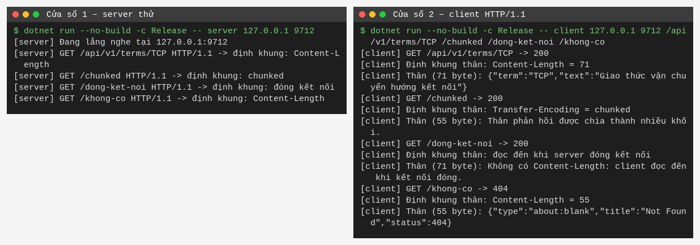

# Bài 7.1 – Client HTTP/1.1 tối giản trên socket TCP (C#)

| Thông tin | Nội dung |
|---|---|
| Mã giả tương ứng | Mã giả 7.1 (Client HTTP/1.1 tối giản trên socket TCP) |
| Mục giáo trình | 7.2.1 HTTP/1.1 |
| Kế thừa | Mã giả 2.2 (SAFE_CONNECT), Mã giả 3.4 (RECV_EXACT), Mã giả 3.5 (READ_LINE, Reader) |
| Thư viện | BCL: `System.Net.Sockets` (`Socket`), `System.Text.Encoding` |

## Mục tiêu
Cài đặt `HTTP_REQUEST`, `READ_HEADERS`, `READ_CHUNKED`: ghép dòng yêu cầu và tiêu đề (có `Host` kèm cổng, `Connection: close`, dòng trống), đọc dòng trạng thái, đọc tiêu đề đến dòng trống và đọc thân theo đúng một trong ba cách định khung của HTTP/1.1: `Transfer-Encoding: chunked`, `Content-Length`, hoặc đọc đến khi server đóng kết nối. Server thử đi kèm trả về cả ba kiểu để kiểm tra từng nhánh của mã giả.

## Tệp
- `MiniHttpClient.cs` – Mã giả 7.1: `HttpRequest`, `ReadHeaders`, `ReadChunked`.
- `NetUtil.cs` – `Reader` (READ_LINE, READ_EXACT, READ_UNTIL_CLOSE) và `SafeConnect`.
- `ServerThu.cs` – server thử tuần tự trả về ba kiểu định khung thân.
- `Program.cs`, `Bai7.1_HttpClient.csproj` – điểm vào, phân nhánh `client`/`server`.
- `demo.json` – kịch bản chạy minh họa (dùng với `tools/demo.py`).
- `ket_qua.txt`, `ket_qua.png` – kết quả thực thi thật.

## Cách chạy
```bash
dotnet build -c Release
```
```bash
# Cửa sổ 1 – server thử
dotnet run -- server 0.0.0.0 8080
# Cửa sổ 2 – client
dotnet run -- client 127.0.0.1 8080 /api/v1/terms/TCP /chunked /dong-ket-noi /khong-co
```

## Kết quả thực thi


Bốn yêu cầu đi qua ba nhánh định khung. Thân JSON có 58 ký tự nhưng `Content-Length` = 71 byte vì chữ tiếng Việt chiếm 2–3 byte UTF-8; thân chunked gồm ba khối (khối đầu có phần mở rộng `;vi-du=mo-rong`, cuối có trailer `X-So-Khoi`) được ghép lại đủ 55 byte; nhánh không có độ dài đọc đến khi server đóng kết nối; mã 404 vẫn có thân `application/problem+json`.

## Ghi chú
- Lớp được đặt tên `MiniHttpClient` để không trùng với `System.Net.Http.HttpClient` – thư viện nên dùng trong ứng dụng thật.
- `READ_EXACT(r, n)` lấy phần dư `pending` của bộ đọc trước rồi mới nhận tiếp từ socket, đúng như chú thích của mã giả; đọc thẳng trên socket sẽ mất phần đầu của thân đã đến cùng tiêu đề.
- Theo dòng 29 của Mã giả 7.1, `READ_HEADERS` báo `ConnectionClosedException` khi `READ_LINE` trả NULL (server đóng kết nối khi chưa gửi hết phần tiêu đề), và dừng bình thường khi gặp dòng trống. `READ_LINE` từ chối cả dòng có LF nhưng dài hơn `max_len` (dòng 5 của Mã giả 3.5).
- Client chỉ minh họa cấu trúc giao thức: không hỗ trợ TLS, chuyển hướng, nén, giữ kết nối. Ứng dụng thật dùng thư viện HTTP của nền tảng (Mục 7.2.1).
- Thời gian chờ nhận 5 000 ms (không có trong mã giả) để client không treo nếu server không trả lời.
- `HEX_TO_INT` là `Convert.ToInt32(s, 16)`; `SEND_ALL` là vòng lặp `Socket.Send` đến khi gửi hết.
- Kiểm thử: Linux, .NET SDK 10.0.114.
