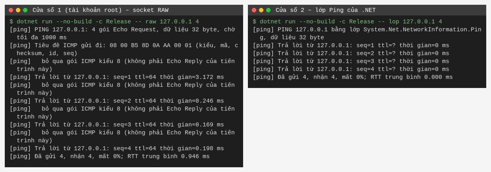

# Bài 7.7 – Gửi ICMP Echo Request và đo thời gian khứ hồi (C#)

| Thông tin | Nội dung |
|---|---|
| Mã giả tương ứng | Mã giả 7.8 (Gửi ICMP Echo Request và đo thời gian khứ hồi) |
| Mục giáo trình | 7.5.3 ICMP và chương trình ping |
| Kế thừa | Mã giả 4.4 (cùng mẫu gửi rồi chờ phản hồi có hạn giờ, bỏ qua gói không khớp) |
| Thư viện | BCL: `System.Net.Sockets` (`SocketType.Raw`, `ProtocolType.Icmp`), `System.Net.NetworkInformation.Ping` |

## Mục tiêu
Cài đặt `INET_CHECKSUM` (RFC 1071) và `PING`: tạo gói Echo Request (kiểu 8, mã 0, tổng kiểm tra, mã định danh = PID, số thứ tự, 32 byte dữ liệu ngẫu nhiên), gửi qua socket RAW, nhận gói có cả tiêu đề IPv4, tính độ dài tiêu đề từ IHL, chỉ chấp nhận Echo Reply (kiểu 0) đúng mã định danh và số thứ tự, đọc TTL ở byte 8 của tiêu đề IP và đo thời gian khứ hồi. Bản C# có thêm chế độ `lop` dùng lớp `Ping` của .NET (gọi API ICMP của hệ điều hành, không cần tự tạo gói) để so sánh.

## Tệp
- `RawPing.cs` – Mã giả 7.8: `InetChecksum`, `Ping` trên socket RAW và vòng ping có thống kê.
- `ClassPing.cs` – cùng việc bằng `System.Net.NetworkInformation.Ping`.
- `Program.cs`, `Bai7.7_Ping.csproj` – điểm vào, phân nhánh `raw`/`lop`.
- `demo.json` – kịch bản chạy minh họa (dùng với `tools/demo.py`).
- `ket_qua.txt`, `ket_qua.png` – kết quả thực thi thật.

## Cách chạy
```bash
dotnet build -c Release
# socket RAW theo mã giả – cần quyền quản trị (Linux: sudo; Windows: Run as administrator)
sudo dotnet run -- raw 127.0.0.1 4 1000
# lớp Ping của .NET
dotnet run -- lop 127.0.0.1 4 1000
```

## Kết quả thực thi


Chế độ `raw` cho kết quả như mã giả: TTL 64, RTT tính bằng `Stopwatch` (lần đầu chậm hơn do khởi động JIT), và mỗi Echo Request của chính máy bị bỏ qua trước khi nhận Echo Reply. Chế độ `lop` cũng nhận đủ bốn phản hồi nhưng `RoundtripTime` là số nguyên mili giây (0 ms qua loopback) và trên Linux `PingReply.Options` bằng null nên không có TTL (in `?`).

## Ghi chú
- Kịch bản minh họa chạy bằng tài khoản root nên không cần `sudo`.
- Lớp `Ping` trên Linux dùng socket ICMP của hệ điều hành hoặc gọi chương trình `ping` của hệ thống khi không có quyền; trên Windows lớp này gọi API ICMP và có TTL trong `Options`.
- Theo dòng 21–23 của Mã giả 7.8, thời gian chờ được tính theo một hạn chót chung: mỗi lần `RECVFROM` chỉ chờ phần thời gian còn lại (tối thiểu 1 ms), nên các gói ICMP lạ (ví dụ phản hồi của chương trình ping khác) không kéo dài thời gian chờ quá `timeout_ms`.
- Mỗi lần ping mở một socket mới như mã giả; giữa hai lần ping có khoảng nghỉ 1 giây như lệnh ping của hệ điều hành; cuối cùng in số gói gửi, nhận, tỉ lệ mất và RTT trung bình.
- Bài tập cuối chương (ping 5 máy trong mạng lab, so sánh TTL 64/128) chạy cùng chương trình với địa chỉ các máy đó; kịch bản minh họa chỉ ping 127.0.0.1.
- Kiểm thử: Linux, .NET SDK 10.0.114.
