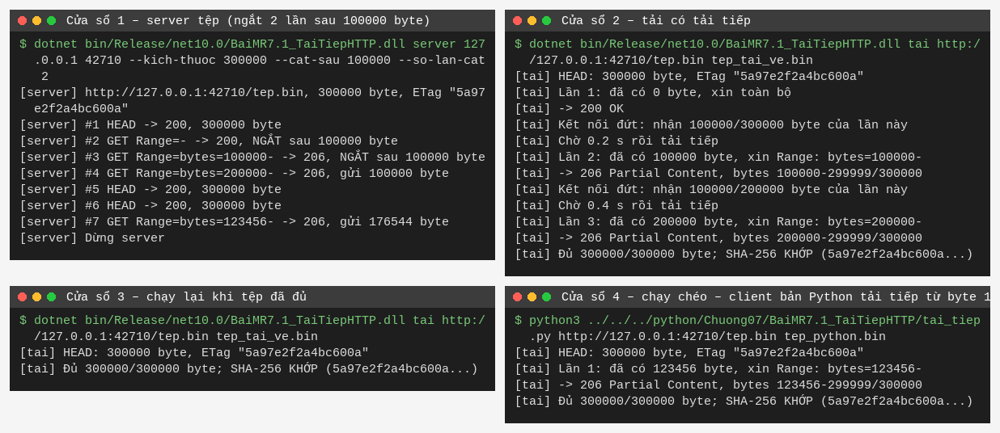

# Bài mở rộng MR7.1 – Tải tệp HTTP có tải tiếp (Range, If-Range) (C#)

| Thông tin | Nội dung |
|---|---|
| Loại | **Bài mở rộng** – không có trong giáo trình, không có mã giả tương ứng |
| Liên hệ với giáo trình | Chương 7: Bài 7.1 (client HTTP); Chương 5: Bài 5.5 (tải tệp), Bài 5.6 (thử lại có lùi thời gian); Chương 3: Bài 3.4 (kiểm tra SHA-256) |
| Thư viện | .NET 10 BCL: `HttpClient` (`RangeHeaderValue`, `RangeConditionHeaderValue`), `TcpListener`, `System.Security.Cryptography.SHA256` |
| Bản ngôn ngữ khác | [Python](../../../python/Chuong07/BaiMR7.1_TaiTiepHTTP/), [Go](../../../go/Chuong07/BaiMR7.1_TaiTiepHTTP/), [Java](../../../java/Chuong07/BaiMR7.1_TaiTiepHTTP/), [Rust](../../../rust/Chuong07/BaiMR7.1_TaiTiepHTTP/) |

## Mục tiêu
Khi tải tệp lớn mà kết nối đứt giữa chừng, tải lại từ đầu là lãng phí. HTTP cho phép xin một phần tài nguyên (RFC 9110): client gửi `Range: bytes=<đã_có>-`, server trả `206 Partial Content` kèm `Content-Range`. Tiêu đề `If-Range: <ETag>` bảo đảm chỉ nối tiếp khi tệp trên server chưa đổi (nếu đã đổi, server trả `200` toàn bộ). Server trong bài giả lập sự cố: hai yêu cầu GET đầu tiên bị ngắt sau 100 000 byte; client tự thử lại có lùi thời gian, nối tiếp từ chỗ dừng và kiểm tra SHA-256 khi xong.

## Tệp
- `BaiMR7.1_TaiTiepHTTP.csproj` – dự án console `net10.0`; vai trò `server` hoặc `tai`.
- `Program.cs` – chọn vai trò.
- `ServerTep.cs` – server tệp viết trên `TcpListener`: HEAD, GET có `Range`/`If-Range`, 416, giả lập ngắt kết nối.
- `TaiTiep.cs` – client tải tiếp bằng `HttpClient`: `Head`, `GetRange`, vòng thử lại, kiểm tra SHA-256.
- `demo.json` – kịch bản chạy minh họa (dùng với `tools/demo.py`); cửa sổ 4 chạy chéo client bản Python.
- `ket_qua.txt`, `ket_qua.png` – kết quả thực thi thật.

## Cách chạy
Trong thư mục bài (lệnh giống nhau trên Windows và Linux):
```bash
dotnet build -c Release
dotnet bin/Release/net10.0/BaiMR7.1_TaiTiepHTTP.dll server 127.0.0.1 8000 --kich-thuoc 300000 --cat-sau 100000 --so-lan-cat 2   # cửa sổ 1
dotnet bin/Release/net10.0/BaiMR7.1_TaiTiepHTTP.dll tai http://127.0.0.1:8000/tep.bin tep_tai_ve.bin                             # cửa sổ 2
```
Có thể thay `dotnet bin/Release/net10.0/BaiMR7.1_TaiTiepHTTP.dll` bằng `dotnet run --`. Thử thêm bằng curl: `curl -H "Range: bytes=10-19" -o - http://127.0.0.1:8000/tep.bin | xxd` (206), `-H "Range: bytes=400000-"` (416), `-H "Range: bytes=10-" -H 'If-Range: "khac"'` (200 toàn bộ) – cả ba đã thử với server C#. Kịch bản `demo.json` xóa `tep_tai_ve.bin` trước và sau khi chạy.

Tái lập kết quả từ thư mục gốc của kho: `python3 tools/demo.py csharp/Chuong07/BaiMR7.1_TaiTiepHTTP` (cổng 42710).

## Kết quả thực thi


Lần 1 xin toàn bộ, nhận `200` nhưng chỉ được 100 000/300 000 byte thì kết nối đứt; lần 2 xin `bytes=100000-`, nhận `206` nhưng lại đứt sau 100 000 byte; lần 3 xin `bytes=200000-` và nhận đủ phần còn lại. Thời gian chờ giữa các lần tăng gấp đôi (0,2 s rồi 0,4 s). Tệp ghép lại có SHA-256 khớp với giá trị server công bố. Lần chạy thứ hai thấy tệp đã đủ nên không gửi GET nào. Bản C# cho kết quả giống từng dòng bản Python và bản Go (cùng nội dung tệp, cùng ETag `"5a97e2f2a4bc600a"`). Cửa sổ 4 chạy chéo: client bản Python bắt đầu với 123 456 byte có sẵn, xin `bytes=123456-` từ server C#, nhận `206` và SHA-256 khớp.

## Ghi chú
- ETag ở đây là 16 ký tự đầu của SHA-256 nội dung (ETag mạnh). `X-Checksum-SHA256` là tiêu đề tự đặt cho bài; chuẩn hiện hành cho mã băm nội dung là trường `Repr-Digest` (RFC 9530).
- Server C# tự phân tích `Range` bằng biểu thức chính quy `^bytes=(\d+)-(\d*)$` để thấy cơ chế, chỉ hỗ trợ một dải dạng `a-` hoặc `a-b` (không hỗ trợ nhiều dải `multipart/byteranges` hay dạng hậu tố `-n`).
- Khác `http.client` của Python (im lặng trả chuỗi rỗng khi kết nối đóng sớm), `HttpClient` của .NET ném `HttpIOException` (*The response ended prematurely*) khi luồng nội dung kết thúc trước `Content-Length`; client bắt ngoại lệ đó rồi vẫn so số byte đã nhận với `Content-Length` (cùng bài học “TCP EOF chưa chắc là đủ dữ liệu” ở Chương 3).
- Tiêu đề `Range`, `If-Range` dùng kiểu có sẵn `RangeHeaderValue(from, null)` → `bytes=<from>-` và `RangeConditionHeaderValue(EntityTagHeaderValue)`; `Content-Range` đọc qua `Content.Headers.ContentRange`.
- `HttpClient` tạo với `SocketsHttpHandler { UseProxy = false }` vì máy chủ thử ở cục bộ: nếu máy đặt biến môi trường `HTTP_PROXY`, yêu cầu tới `127.0.0.1` không bị đẩy qua proxy.
- Server tự ghi dòng trạng thái và tiêu đề trên `TcpListener` (không dùng `HttpListener`) để có thể cố ý `Shutdown` giữa chừng khi giả lập đứt kết nối.
- Kiểm thử: Linux, .NET SDK 10.0.114.

## Đọc thêm
- Matt Butcher, Matt Farina, *Go in Practice*, Manning, 2016, Chương 8 (Technique 49 *Detecting timeouts*, Technique 50 *Timing out and resuming with HTTP*).
- M. O. Faruque Sarker, *Python Network Programming Cookbook*, Packt, 2014, Chương 4 (công thức *Writing an HTTP fail-over client with resume and partial downloading*; sách dùng `urllib.FancyURLopener` của Python 2, không còn trong Python 3).

Mã nguồn của bài được viết mới cho kho này; sách trên chỉ là tài liệu tham khảo ý tưởng.
