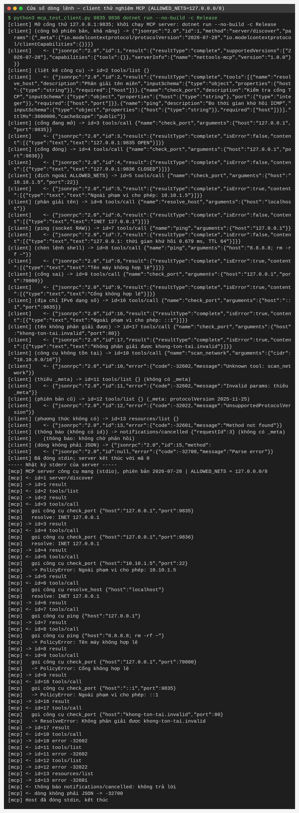

# Bài 8.3 – MCP server công cụ mạng qua kênh stdio (C#)

| Thông tin | Nội dung |
|---|---|
| Mã giả tương ứng | Mã giả 8.4 (MCP server công cụ mạng qua kênh stdio), Mã giả 8.5 (Thực thi công cụ có kiểm soát đầu vào), Mã giả 8.7 (Kiểm soát đích của công cụ mạng) |
| Mục giáo trình | 8.3.2–8.3.5 Model Context Protocol, 8.5.4 An toàn của MCP server |
| Kế thừa | Mã giả 3.5 (READ_LINE), Mã giả 1.1 (RESOLVE_HOST), Mã giả 1.2 (PORT_CHECK), Mã giả 7.8 (PING) |
| Thư viện | BCL: `System.Text.Json.Nodes`, `System.Net.Sockets` (socket RAW cho ICMP), `System.Net.IPNetwork` |

## Mục tiêu
Xây dựng MCP server qua kênh stdio theo đặc tả 2026-07-28 như giáo trình trình bày: JSON-RPC 2.0, mỗi thông điệp một dòng UTF-8 trên stdin/stdout, nhật ký chỉ ghi ra stderr; không có bắt tay `initialize`, mỗi yêu cầu mang `_meta` với `io.modelcontextprotocol/protocolVersion` và `io.modelcontextprotocol/clientCapabilities` (thiếu → −32602, phiên bản không hỗ trợ → −32022 UnsupportedProtocolVersion); `server/discover`, `tools/list` (kèm `ttlMs`, `cacheScope`), `tools/call`; mọi kết quả có `resultType`. Ba công cụ `resolve_host`, `check_port`, `ping` cài đặt bằng socket API, không gọi shell. Lỗi thực thi và lỗi chính sách trả về kết quả `isError: true`; công cụ không tồn tại trả lỗi JSON-RPC −32602. Đích của `check_port`, `ping` phải nằm trong `ALLOWED_NETS` (Mã giả 8.7): mọi địa chỉ phân giải được đều được kiểm tra, công cụ kết nối đúng địa chỉ đã kiểm tra (chống DNS rebinding).

## Tệp
- `Program.cs` – điểm vào.
- `McpServer.cs` – Run (MCP_STDIO_SERVER), Dispatch, WriteMsg (Mã giả 8.4), CallTool (Mã giả 8.5).
- `NetTools.cs` – ResolveHost, PortCheck, Ping (socket RAW) và NetError.
- `Validate.cs` – Mã giả 8.7 và PolicyError.
- `Bai8.3_McpServer.csproj` – dự án console .NET 10.
- `mcp_test_client.py` – client thử nghiệm đóng vai host (Python, thư viện chuẩn), dùng chung cho cả ba ngôn ngữ: khởi chạy server như tiến trình con, gửi 15 thông điệp (discover, list, các lời gọi công cụ hợp lệ và bị chặn, lỗi giao thức, thông báo, dòng JSON hỏng), in phản hồi, thu riêng stderr của server và in ở cuối; mở sẵn một cổng TCP để `check_port` thấy trạng thái OPEN.
- `demo.json` – kịch bản chạy minh họa (dùng với `tools/demo.py`).
- `ket_qua.txt`, `ket_qua.png` – kết quả thực thi thật.

## Cách chạy
```bash
dotnet build -c Release
ALLOWED_NETS=127.0.0.0/8 python3 mcp_test_client.py 9000 9001 dotnet run --no-build -c Release
```

Trên Windows (PowerShell) đặt biến trước: `$env:ALLOWED_NETS = "127.0.0.0/8"`. Để dùng với một host MCP thật (ứng dụng chat hỗ trợ MCP, MCP Inspector), cấu hình host khởi chạy đúng lệnh chạy server ở trên (không kèm `mcp_test_client.py`) và đặt `ALLOWED_NETS` là dải mạng lab, ví dụ `10.10.0.0/16`. Công cụ `ping` dùng socket RAW nên cần quyền quản trị (root hoặc Administrator).

## Kết quả thực thi


Cổng đang mở cho `127.0.0.1:<cổng> OPEN`, cổng không có chương trình lắng nghe cho `CLOSED`; đích 10.10.1.5 ngoài `ALLOWED_NETS`, chuỗi `8.8.8.8; rm -rf ~`, cổng 70000, địa chỉ IPv6 `::1` (qua được `VALIDATE_NAME` nhưng nằm ngoài `127.0.0.0/8`) và tên `khong-ton-tai.invalid` không phân giải được đều bị từ chối dưới dạng kết quả `isError: true`; công cụ lạ, thiếu `_meta`, phiên bản 2025-11-25, phương thức lạ và dòng JSON hỏng nhận các mã lỗi −32602, −32602, −32022, −32601, −32700; thông báo không có `id` không được trả lời. Nhật ký stderr cho thấy stdout chỉ chứa thông điệp JSON.

## Ghi chú
- `DISCOVER_RESULT` không được giáo trình mô tả chi tiết; bài dùng các trường `resultType`, `supportedVersions`, `capabilities`, `serverInfo` (công bố phiên bản, khả năng và định danh như Mục 8.3.4). Cần đối chiếu đặc tả và SDK chính thức của MCP trước khi dùng thật.
- `TOOL(tên, mô tả, tham số)` được mã hóa thành `{name, description, inputSchema}` với `inputSchema` là JSON Schema kiểu `object`, mọi tham số bắt buộc.
- Theo Mã giả 8.5, `VALIDATE_PORT` báo `PolicyError` nên cổng sai kiểu/phạm vi trả về `isError: true` (không phải lỗi JSON-RPC như câu "tham số sai kiểu" trong đoạn văn trước mã giả).
- Theo dòng 17 của Mã giả 8.5, `CALL_TOOL` bắt `NetError`, `PolicyError`, `ResolveError` (tên không phân giải được trong `VALIDATE_TARGET`) và `Timeout` (`PING` không nhận được phản hồi trước hạn chót) và trả về kết quả `isError: true`. Bổ sung so với mã giả: lỗi ngoài dự kiến khi xử lý một yêu cầu trả −32603 Internal error thay vì làm dừng server; thông điệp JSON không phải đối tượng được coi như không có `id`.
- Theo dòng 3 của Mã giả 8.7, `VALIDATE_NAME` chấp nhận ngay địa chỉ IP viết bằng số (`IS_IP_ADDRESS`: `IPAddress.TryParse`), kể cả IPv6 như `::1`; tên máy khác chỉ được chứa ký tự `[A-Za-z0-9.-]`. Địa chỉ dạng số vẫn phải qua bước so khớp `ALLOWED_NETS` trong `VALIDATE_TARGET`. `ALLOWED_NETS` vắng hoặc rỗng → chặn mọi đích.
- `resolve_host` chỉ kiểm tra tên (Mã giả 8.5), không áp dụng `ALLOWED_NETS`.
- `Ping` dùng `Socket(InterNetwork, Raw, Icmp)` đúng như Mã giả 7.8 (không dùng lớp `System.Net.NetworkInformation.Ping`, vì trên Linux khi không có quyền root lớp này gọi chương trình `ping` của hệ điều hành).
- stdout được ghi trực tiếp bằng `Console.OpenStandardOutput()` (byte UTF-8, `Flush` sau mỗi dòng); nhật ký ghi bằng `Console.Error`.
- `ALLOWED_NETS` phân tích bằng `IPNetwork.Parse`, yêu cầu CIDR chuẩn (phần máy bằng 0).
- Kiểm thử: Linux, .NET SDK 10.0.114.
