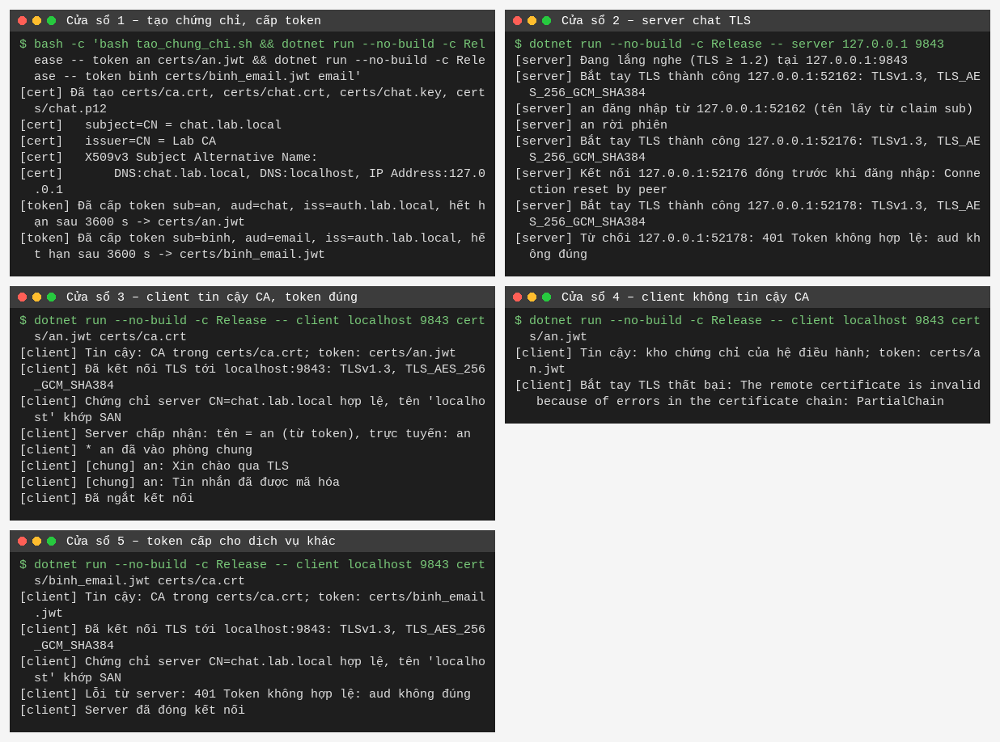

# Bài 8.4 – Bổ sung TLS và xác thực token cho hệ thống chat (C#)

| Thông tin | Nội dung |
|---|---|
| Mã giả tương ứng | Mã giả 8.6 (Bổ sung TLS và xác thực token cho hệ thống chat) |
| Mục giáo trình | 8.4.5 Lập trình socket an toàn với TLS, 8.4.6 Quản lý khóa bí mật |
| Kế thừa | Mã giả 6.5, 6.6 (server chat), Mã giả 5.5 (ChatClient), Mã giả 5.1 (khung JSON bất đồng bộ), Mã giả 2.2 (SAFE_CONNECT); kiểm tra JWT theo Mục 7.2.4 |
| Thư viện | BCL: `SslStream`, `X509CertificateLoader`, `X509ChainPolicy` (tin cậy CA nội bộ), `HMACSHA256`, `System.Threading.Channels` |

## Mục tiêu
Bọc kết nối TCP của server và client chat bằng TLS (tối thiểu TLS 1.2, thư viện thương lượng TLS 1.3 khi hai bên hỗ trợ) mà không sửa giao thức khung JSON và logic chat. Server bắt tay TLS ngay sau ACCEPT (TLS_SESSION), ghi nhật ký và đóng kết nối khi bắt tay lỗi. Client bọc TLS sau khi kết nối TCP với `server_name ← host`, kiểm tra chuỗi chứng chỉ tới CA tin cậy và tên máy trong SAN; không bao giờ tắt kiểm tra chứng chỉ. Thông điệp `hello` mang token JWT (HS256) thay cho tên tự khai báo; server kiểm tra thuật toán, chữ ký, `exp`, `iss`, `aud = "chat"` và lấy tên người dùng từ claim `sub`. Chứng chỉ do CA nội bộ của phòng lab cấp, tạo bằng OpenSSL; bí mật (mật khẩu khóa riêng, khóa ký JWT) chỉ lấy từ biến môi trường.

## Tệp
- `Program.cs` – phân nhánh `server` / `client` / `token`.
- `ChatServer.cs` – TlsSession, ChatSession có Jwt.Verify, Broadcast, Writer.
- `ChatClient.cs` – SafeConnectAsync, Connect (bọc `SslStream`), ReceiveLoop, Send có khóa.
- `Jwt.cs` – ký, kiểm tra JWT HS256 và công cụ cấp token.
- `Frame.cs` – RecvJsonAsync, SendJsonAsync (Mã giả 5.1).
- `Bai8.4_TlsChat.csproj` – dự án console .NET 10.
- `tao_chung_chi.sh`, `tao_chung_chi.ps1` – tạo CA nội bộ và chứng chỉ server (SAN: `chat.lab.local`, `localhost`, `127.0.0.1`) theo các lệnh OpenSSL của Mục 8.4.5, xuất thêm `chat.p12` (PKCS12) bằng `openssl pkcs12 -export`. Kết quả nằm trong `certs/` (chứa khóa riêng, đã có trong `.gitignore`).
- `demo.json` – kịch bản chạy minh họa (dùng với `tools/demo.py`).
- `ket_qua.txt`, `ket_qua.png` – kết quả thực thi thật.

## Cách chạy
```bash
export TLS_KEY_PASS=matkhau-lab CHAT_JWT_KEY=khoa-ky-jwt-cua-phong-lab-0123456789 TLS_CERT=certs/chat.p12
bash tao_chung_chi.sh                                   # Windows: powershell -File tao_chung_chi.ps1
dotnet build -c Release
dotnet run --no-build -c Release -- token an certs/an.jwt
dotnet run --no-build -c Release -- server 0.0.0.0 9200                              # cửa sổ 1
dotnet run --no-build -c Release -- client localhost 9200 certs/an.jwt certs/ca.crt   # cửa sổ 2
```
Trên Windows (PowerShell) đặt biến bằng `$env:TEN = "giá trị"`. Bỏ tham số tệp CA ở client để thấy bắt tay bị từ chối; cấp token với đối tượng khác (tham số thứ ba, ví dụ `email`) để thấy server từ chối mã 401. Giá trị mật khẩu, khóa ở trên chỉ dùng cho phòng lab.

## Kết quả thực thi


Client tin cậy CA nội bộ bắt tay TLSv1.3 (`TLS_AES_256_GCM_SHA384`), được server chấp nhận với tên `an` lấy từ token và nhận lại tin của chính mình trong phòng `chung`. Client chỉ dùng kho tin cậy mặc định từ chối chứng chỉ của server (CA nội bộ không có trong kho). Token cấp cho đối tượng `email` bị server từ chối với mã 401 "aud không đúng" dù kênh TLS hợp lệ.

## Ghi chú
- Lệnh tạo CA trong giáo trình không có trường `keyUsage`; Python 3.13 bật kiểm tra X.509 chặt chẽ mặc định và từ chối CA như vậy ("CA cert does not include key usage extension"). Script bổ sung `-addext "basicConstraints=critical,CA:TRUE" -addext "keyUsage=critical,keyCertSign,cRLSign"` cho CA và `authorityKeyIdentifier`, `keyUsage`, `extendedKeyUsage=serverAuth` cho chứng chỉ server.
- SAN có thêm `localhost` và `127.0.0.1` để chạy thử trên một máy mà không sửa tệp hosts. Kết nối bằng một tên không có trong SAN sẽ bị client từ chối do tên không khớp.
- Server chat là bản rút gọn của Mã giả 6.5–6.6: hỗ trợ `hello`, `join`, `msg`, `ping` (loại khác nhận lỗi 400); `welcome` có thêm trường `name` (tên lấy từ token) và lỗi có trường `text`. Token sai trả mã 401 (giáo trình không quy định mã cho trường hợp này).
- Token được cấp bằng công cụ đi kèm đóng vai server ủy quyền giản lược (khóa đối xứng HS256 dùng chung qua `CHAT_JWT_KEY`, `iss = auth.lab.local`); hệ thống thật nên dùng token do server ủy quyền OAuth 2.0 cấp, ký bất đối xứng (RS256/ES256).
- Sau khi gửi các dòng nhập, client gửi `ping` và chỉ ngắt khi nhận `pong`: vì mỗi client có một tác vụ ghi theo thứ tự, `pong` đến sau mọi tin trước đó.
- Với TLS 1.3, server hoàn tất phần bắt tay của mình trước khi client kiểm tra chứng chỉ; khi client từ chối chứng chỉ, tùy thư viện, server ghi nhận lỗi bắt tay hoặc kết nối đóng trước khi đăng nhập.
- `tao_chung_chi.ps1` chưa chạy trong môi trường biên soạn (không có PowerShell); script `.sh` đã chạy trong demo.
- `TLS_CERT` trỏ tới tệp `chat.p12`, mật khẩu lấy từ `TLS_KEY_PASS`; nạp bằng `X509CertificateLoader.LoadPkcs12FromFile`.
- Tối thiểu TLS 1.2 được biểu diễn bằng `EnabledSslProtocols = Tls12 | Tls13`.
- Client tin cậy CA nội bộ bằng `X509ChainPolicy` với `TrustMode = CustomRootTrust` (vẫn kiểm tra chuỗi và tên máy qua `TargetHost`); `RevocationMode = NoCheck` vì CA của phòng lab không phát hành CRL.
- Server không xử lý Ctrl+C riêng nên không in dòng dừng server.
- Kiểm thử: Linux, .NET SDK 10.0.114.
