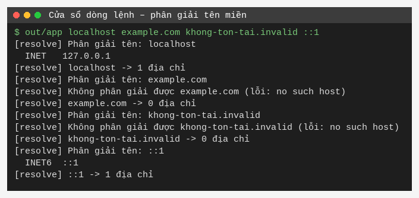

# Bài 1.1 – Phân giải tên miền thành danh sách địa chỉ (Go)

| Thông tin | Nội dung |
|---|---|
| Mã giả tương ứng | Mã giả 1.1 (RESOLVE_HOST – phân giải tên miền thành danh sách địa chỉ) |
| Mục giáo trình | 1.2.3 Địa chỉ IP và tên miền |
| Kế thừa | Không (thủ tục gốc; được dùng lại ở Bài 1.2) |
| Thư viện | Thư viện chuẩn Go: `net` (`net.LookupIP`) |

## Mục tiêu
Minh họa lệnh `RESOLVE`: một tên có thể ánh xạ tới nhiều địa chỉ thuộc hai họ INET (IPv4) và INET6 (IPv6); lỗi phân giải được bắt trong `CATCH` và chuyển thành danh sách rỗng thay vì làm dừng chương trình.

## Tệp
- `main.go` – chương trình chính, phân giải lần lượt các tên nhận từ dòng lệnh.
- `resolver.go` – thủ tục `ResolveHost(name)` (Mã giả 1.1) và `Family(a)`.
- `demo.json` – kịch bản chạy minh họa (dùng với `tools/demo.py`).
- `ket_qua.txt`, `ket_qua.png` – kết quả thực thi thật.

## Cách chạy
```bash
go run . localhost example.com
```
Không có tham số thì chương trình phân giải `localhost`. Có thể biên dịch trước rồi chạy tệp thực thi: `go build -o out/app .` rồi `out/app localhost example.com` (kịch bản `demo.json` làm theo cách này).

## Kết quả thực thi


`localhost` được phân giải thành `127.0.0.1` theo tệp hosts của máy kiểm thử (tệp này không khai báo `::1`). Môi trường kiểm thử chặn truy vấn DNS ra Internet nên `example.com` không phân giải được (`no such host`), giống tên `khong-ton-tai.invalid` vốn được dành riêng để không bao giờ tồn tại (RFC 6761); trên máy có Internet, `example.com` trả về cả địa chỉ IPv4 và IPv6. Chuỗi `::1` là địa chỉ dạng số nên được trả lại nguyên dạng với họ INET6.

## Ghi chú
- `ResolveError` của mã giả tương ứng với giá trị `error` khác `nil` do `net.LookupIP` trả về (thường là `*net.DNSError`); `e.code` tương ứng với trường `Err` của `*net.DNSError` (chuỗi mô tả như `no such host`). Go không trả mã số `EAI_*` như Python.
- Trên Linux, Go mặc định dùng bộ phân giải viết bằng Go (đọc `/etc/hosts`, `/etc/resolv.conf`) thay cho `getaddrinfo` của thư viện C; muốn dùng `getaddrinfo` đặt biến môi trường `GODEBUG=netdns=cgo`. Kết quả hai cách thường giống nhau.
- Go trả về lỗi như một giá trị thay vì ném ngoại lệ, nên khối `TRY … CATCH` của mã giả được viết thành `if err != nil { … }`.
- Kiểm thử: Linux, Go 1.24.7.
