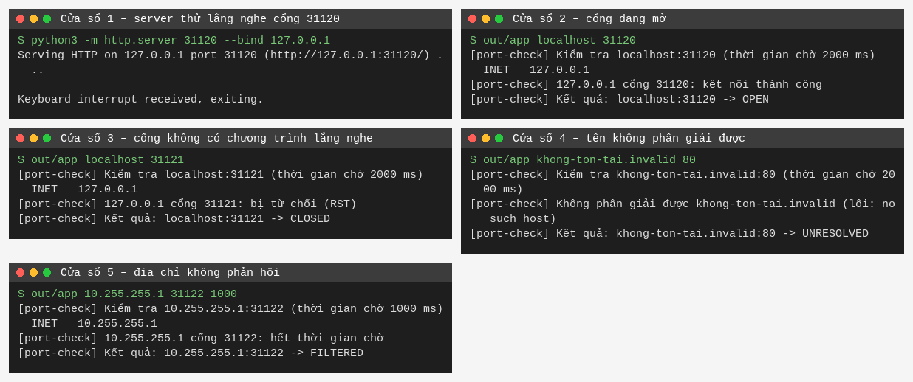

# Bài 1.2 – Kiểm tra trạng thái một cổng TCP (Go)

| Thông tin | Nội dung |
|---|---|
| Mã giả tương ứng | Mã giả 1.2 (PORT_CHECK – kiểm tra trạng thái một cổng TCP) |
| Mục giáo trình | 1.2.4 Cổng và bộ năm thông số, 1.2.5 Socket |
| Kế thừa | Mã giả 1.1 (RESOLVE_HOST, chép từ Bài 1.1) |
| Thư viện | Thư viện chuẩn Go: `net` (`net.Dialer`), `errors`, `syscall` |

## Mục tiêu
Minh họa cách kết hợp phân giải tên, socket và cổng: thử kết nối TCP tới lần lượt từng địa chỉ của tên máy với thời gian chờ, rồi kết luận một trong bốn trạng thái: `OPEN` (bắt tay ba bước thành công), `CLOSED` (nhận gói RST), `FILTERED` (không địa chỉ nào phản hồi trong thời gian chờ hoặc không có đường đi), `UNRESOLVED` (tên không phân giải được). Chỉ kiểm tra trên máy và mạng thuộc quyền quản lý của người thực hiện.

## Tệp
- `main.go` – chương trình chính: đọc `<host> <port> [timeout_ms]`, gọi `PortCheck` và in kết quả.
- `portcheck.go` – hàm `PortCheck` (Mã giả 1.2).
- `resolver.go` – `ResolveHost` (Mã giả 1.1, chép từ Bài 1.1).
- `loimang.go` – `isRefused`, `isReset`, `isUnreachable`: nhận biết lỗi kết nối bị từ chối, bị đặt lại, không có đường đi theo cả mã POSIX (Linux, macOS) và mã Winsock (Windows).
- `demo.json` – kịch bản chạy minh họa (dùng với `tools/demo.py`).
- `ket_qua.txt`, `ket_qua.png` – kết quả thực thi thật.

## Cách chạy
Mở hai cửa sổ dòng lệnh trong thư mục bài:
```bash
# Cửa sổ 1 – một server bất kỳ để có cổng đang mở (ví dụ server HTTP của Python)
python3 -m http.server 9000 --bind 127.0.0.1
# Cửa sổ 2 – kiểm tra cổng: <host> <port> [timeout_ms], mặc định timeout_ms = 2000
go run . localhost 9000
go run . localhost 9001
go run . khong-ton-tai.invalid 80
go run . 10.255.255.1 9000 1000      # FILTERED nếu địa chỉ không phản hồi
```
Dừng server bằng Ctrl+C. Kịch bản `demo.json` biên dịch một lần bằng `go build -o out/app .` rồi chạy `out/app` với các tham số trên (cổng 31120, 31121, 31122).

## Kết quả thực thi


Server thử (`python3 -m http.server`) chỉ lắng nghe trên `127.0.0.1`; cổng của server cho `OPEN`, cổng kế bên không có chương trình lắng nghe nên hệ điều hành trả RST và kết quả là `CLOSED`; tên `khong-ton-tai.invalid` (dành riêng theo RFC 6761) cho `UNRESOLVED` mà không có lỗi nào thoát khỏi hàm; địa chỉ `10.255.255.1` (không có máy nào trả lời trong mạng kiểm thử) hết thời gian chờ 1000 ms và cho `FILTERED`.

## Ghi chú
- `SOCKET(FAMILY(a), STREAM)` và `SETOPT(s, CONNECT_TIMEOUT, timeout_ms)` tương ứng với `net.Dialer{Timeout: …}` và mạng `"tcp4"` hoặc `"tcp6"` theo họ địa chỉ; `Dial` tạo socket, kết nối và tự đóng socket khi kết nối thất bại, nên `FINALLY CLOSE(s)` chỉ còn lại `conn.Close()` ở nhánh thành công.
- `ConnectionRefused` tương ứng với lỗi có mã `ECONNREFUSED` (Windows: `WSAECONNREFUSED`, hàm `isRefused`); `Timeout` là `net.Error` có `Timeout()` bằng `true`; `NetworkUnreachable`, `HostUnreachable` là `ENETUNREACH`, `EHOSTUNREACH` (hàm `isUnreachable`). Các lỗi khác được trả ra ngoài (`main` in "Lỗi không mong đợi" và thoát với mã 1), đúng như mã giả không bắt chúng. Ví dụ trên máy kiểm thử không bật IPv6, `go run . ::1 9000` cho lỗi `address family not supported by protocol`.
- Trong môi trường kiểm thử, mạng ảo chấp nhận ngay kết nối ra ngoài tới cổng 80 (`10.255.255.1:80` cho `OPEN`, do bộ chuyển tiếp của môi trường), còn với cổng khác như 31122 thì gói SYN không được trả lời, nên `FILTERED` được minh họa bằng cổng 31122. Trên mạng thật, `10.255.255.1` thường cho `FILTERED` ở mọi cổng.
- Tệp hosts của máy kiểm thử chỉ khai báo `127.0.0.1` cho `localhost`, nên tình huống `::1` trả RST trước khi `127.0.0.1` kết nối được (Mục 1.2.5, giải thích bước 7) không xuất hiện.
- Các dòng `[port-check] <địa chỉ> cổng <n>: …` được in thêm để quan sát kết quả của từng lần thử; mã giả chỉ trả về trạng thái. Bản Go kiểm tra thêm số cổng (1–65535) và in "Cổng không hợp lệ: …" khi sai.
- Kiểm thử: Linux, Go 1.24.7.
