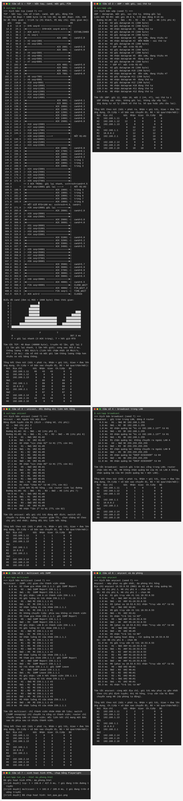
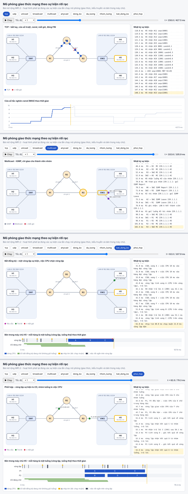

# Bài mở rộng MR1.2 – Mô phỏng giao thức và kiểu truyền: TCP, UDP, unicast, broadcast, multicast, anycast (Go)

| Thông tin | Nội dung |
|---|---|
| Loại | **Bài mở rộng** – không có trong giáo trình, không có mã giả tương ứng |
| Liên hệ với giáo trình | Chương 1 (Mục 1.2: địa chỉ, cổng, giao thức; Bài 1.1, 1.2); là “bản đồ” trước khi lập trình thật ở Chương 3 (TCP, Bài 3.1), Chương 4 (UDP, Bài 4.1, 4.4), Chương 6 (broadcast, multicast – Bài 6.5, 6.6) |
| Thư viện | Thư viện chuẩn Go: `container/heap`, `encoding/json`, `html/template`, `embed`, `flag`; không mở socket. Playwright + Pillow (Python) chỉ dùng để chụp ảnh hoạt hình trong kịch bản minh họa |
| Bản ngôn ngữ khác | [C#](../../../csharp/Chuong01/BaiMR1.2_MoPhongGiaoThuc/), [Java](../../../java/Chuong01/BaiMR1.2_MoPhongGiaoThuc/), [Python](../../../python/Chuong01/BaiMR1.2_MoPhongGiaoThuc/), [Rust](../../../rust/Chuong01/BaiMR1.2_MoPhongGiaoThuc/) |

## Mục tiêu
Trước khi viết socket thật, sinh viên cần “nhìn thấy” gói tin đi trong mạng: TCP bắt tay, trượt cửa sổ và phản ứng khi mất gói ra sao; UDP khác TCP ở chỗ nào; vì sao quảng bá dừng ở router; multicast chỉ tới thành viên nhóm thế nào; anycast chọn máy phục vụ gần nhất và tự chuyển sang máy khác khi một máy hỏng. Bài xây dựng một **bộ mô phỏng sự kiện rời rạc** nhỏ: mỗi gói là một đối tượng, mỗi bước chuyển trên liên kết là một sự kiện có thời điểm (trễ lan truyền + thời gian đẩy gói theo băng thông + hàng đợi FIFO). Kết quả **tất định**: cùng `--seed` thì cùng kết quả, và bản Python, bản Go in ra giống hệt nhau.

Topo: hai đoạn LAN nối qua ba router; đường R1–R3 là đường dự phòng chi phí cao.
```text
 H1 ─┐                                        ┌─ H4
 H2 ─┼─ SW1 ── R1 ──(1)── R2 ──(1)── R3 ── SW2 ─┼─ H5
 H3 ─┘          └──────────(3)───────┘          └─ H6
 LAN A 192.168.1.0/24              LAN B 192.168.2.0/24
 trong LAN: 100 Mbit/s, 0,5 ms     giữa router: 10 Mbit/s, 5 ms (R1–R3: 8 ms)
```

| Kịch bản | Nội dung |
|---|---|
| `tcp` | H1 gửi 40 đoạn × 1000 byte tới H5: bắt tay ba bước, khởi đầu chậm (slow start), tránh tắc nghẽn (congestion avoidance), mất đoạn #20 → 3 ACK trùng → gửi lại nhanh; bản gửi lại cũng mất → hết giờ RTO → cwnd về 1; đóng bằng FIN. In **sơ đồ thời gian – trình tự** dạng văn bản và **biểu đồ cwnd** ASCII |
| `udp` | H2 gửi 12 datagram tới H6; liên kết R2–R3 mất gói 20 % và trễ dao động 0–15 ms → mất gói, sai thứ tự, không ai gửi lại |
| `unicast` | H1→H2 (cùng LAN, switch chỉ chuyển ra một cổng), H1→H5 (qua 3 router, TTL 64→61); liên kết R1–R2 hỏng → định tuyến tính lại, đi đường R1–R3 |
| `broadcast` | H1 quảng bá 192.168.1.255, H4 quảng bá 255.255.255.255: switch gửi tràn trong LAN, router chặn |
| `multicast` | H2, H5, H6 tham gia/rời nhóm 239.1.1.1 bằng IGMP; switch có IGMP snooping, router chỉ chuyển sang LAN có thành viên |
| `anycast` | Địa chỉ 10.53.0.53 do H3 và H6 cùng phục vụ: H1 tới H3 (chi phí 2), H5 tới H6; H3 hỏng → H1 được chuyển sang H6 (chi phí 6) |

Mỗi kịch bản in nhật ký từng bước và **bảng tổng kết theo nút**: số gói phát ra, nhận, đưa lên ứng dụng, chuyển tiếp, bỏ.

## Kiến thức chính
- **Mô phỏng sự kiện rời rạc:** hàng đợi ưu tiên theo thời điểm (`container/heap`), đồng hồ nhảy tới sự kiện kế tiếp; cùng thời điểm thì theo thứ tự thêm vào – nhờ đó kết quả tất định.
- **Trễ trên một chặng** = thời gian chờ hàng đợi + thời gian đẩy gói (kích thước / băng thông) + trễ lan truyền. Đoạn 1000 byte trên liên kết 10 Mbit/s mất 0,8 ms để đẩy lên dây.
- **TCP (rút gọn theo Reno):** bắt tay SYN/SYN+ACK/ACK; xác nhận tích lũy; cửa sổ = cwnd; slow start (+1 MSS mỗi ACK ⇒ gấp đôi mỗi RTT) tới `ssthresh`, sau đó congestion avoidance (+MSS²/cwnd mỗi ACK ⇒ +1 MSS mỗi RTT); 3 ACK trùng ⇒ gửi lại nhanh, `ssthresh = cwnd = max(đang bay/2, 2 MSS)`; hết giờ ⇒ `cwnd = 1 MSS`, RTO gấp đôi; đóng bốn bước FIN/ACK, TIME_WAIT.
- **UDP:** không kết nối, không xác nhận, không sắp xếp lại; ứng dụng phải tự đánh số thứ tự nếu cần (như Bài 4.4).
- **Định tuyến theo chi phí:** Dijkstra từ mọi nút; host không làm nút trung chuyển; khi liên kết/nút hỏng thì tính lại.
- **Kiểu địa chỉ:** unicast (một đích), broadcast (mọi máy trong một LAN – router là biên của miền quảng bá), multicast (thành viên nhóm, IGMP Report/Leave, IGMP snooping ở switch), anycast (nhiều máy cùng một địa chỉ, định tuyến chọn máy gần nhất).
- **Bộ sinh ngẫu nhiên có seed:** xorshift32 tự viết (không dùng `math/rand`) để bản Python và Go sinh cùng dãy số.

## Cấu trúc tệp
- `main.go` – chương trình chính: đọc tham số (`flag`), chạy kịch bản, in kết quả, ghi HTML.
- `mang.go` – lõi mô phỏng: topo, hàng đợi sự kiện, Dijkstra, quy tắc chuyển tiếp của host/switch/router, bảng tổng kết.
- `tcp.go` – kịch bản TCP: bên gửi (cwnd, ssthresh, bộ hẹn giờ RTO), bên nhận (ACK tích lũy, giữ đoạn đến sớm), sơ đồ thời gian, biểu đồ cwnd.
- `kichban.go` – các kịch bản UDP, unicast, broadcast, multicast, anycast.
- `khung_hoat_hinh.html` – khung trang hoạt hình (HTML + JavaScript thuần, vẽ trên `<canvas>`), nhúng vào tệp chạy bằng `//go:embed`; `html/template` chèn dữ liệu JSON của lần chạy (kiểu `template.JS`) vào hằng `DATA`.
- `chup_hoat_hinh.py` – chụp ảnh trang hoạt hình bằng Playwright (chỉ cho kịch bản minh họa).
- `demo.json` – kịch bản chạy minh họa (dùng với `tools/demo.py`).
- `ket_qua.txt`, `ket_qua.png` – kết quả thực thi thật; `mo_phong.html` – tệp hoạt hình sinh ra từ lần chạy đó; `ket_qua_gui.png` – ảnh chụp tệp hoạt hình.

## Cách chạy
Trong thư mục bài (Windows: `go build -o out\app.exe .` rồi chạy `out\app.exe ...`):
```bash
go build -o out/app .                    # hoặc thay out/app bằng go run .
out/app tcp                              # TCP, mặc định 40 đoạn, mất đoạn #20 hai lần
out/app tcp --mat 12 --doan 30           # chỉ mất #12 một lần: chỉ có gửi lại nhanh
out/app tcp --mat "" --loss 0.05 --seed 3   # mất ngẫu nhiên 5 % trên R2–R3
out/app udp --seed 42                    # đổi seed: mẫu mất gói/sai thứ tự khác
out/app multicast
out/app tat_ca --html mo_phong.html      # chạy cả 6 kịch bản và ghi hoạt hình
```
Mở `mo_phong.html` bằng trình duyệt bất kỳ (không cần mạng, không cần server): chọn kịch bản, bấm Chạy/Dừng, đổi tốc độ, kéo thanh thời gian; có thể mở thẳng một thời điểm bằng `mo_phong.html#kb=tcp&t=150000&dung=1` (t tính bằng µs).

Tái lập kết quả từ thư mục gốc của kho: `python3 tools/demo.py go/Chuong01/BaiMR1.2_MoPhongGiaoThuc` (bước chụp ảnh cần `pip install playwright pillow && playwright install chromium`).

## Kết quả thực thi


Ảnh hoạt hình (trên: TCP lúc t = 150 ms – đoạn #20 vừa mất trên R2→R3, các ACK đang về; dưới: multicast lúc luồng #3 đang tới hai thành viên H5, H6 của LAN B):



Diễn giải (seed 7):
- **TCP:** RTT ≈ 26 ms. cwnd tăng 1→2→4→8 MSS trong ba vòng đầu (slow start) rồi chỉ tăng ~1 MSS mỗi vòng (8,1; 8,2; …) khi vượt `ssthresh` = 8. Đoạn #20 mất; ba đoạn #21–#23 sinh ba ACK trùng `ACK 19001` → t = 160,3 ms gửi lại nhanh, `ssthresh = cwnd = 4,5`. Bản gửi lại cũng bị ép mất, không còn đủ ACK trùng → t = 257,0 ms hết giờ RTO (100 ms), cwnd = 1. Khi #20 tới nơi, bên nhận đã giữ sẵn #21–#28 nên trả `ACK 28001` một lần. 40 đoạn truyền 42 lần, xong sau 363,2 ms, thông lượng ≈ 881 kbit/s – rất xa 10 Mbit/s vì cửa sổ nhỏ và hai lần mất gói. Đóng kết nối: FIN → ACK → FIN → ACK, H1 vào TIME_WAIT.
- **UDP:** 12 gửi, 10 nhận; #4 và #7 mất trên R2→R3; #2 đến sau #3 (sai thứ tự) do trễ dao động. Không có gửi lại.
- **Unicast:** gói H1→H5 qua 3 router nên TTL còn 61; khi R1–R2 hỏng, đường mới H1→SW1→R1→R3→SW2→H5 (chi phí 7, TTL còn 62).
- **Broadcast:** SW1 gửi tràn tới H2, H3, R1; R1 chặn. Tương tự R3 chặn quảng bá của H4. Bảng tổng kết: H4–H6 nhận 0 gói từ LAN A.
- **Multicast:** luồng #1 chỉ tới H2, R1 không chuyển đi vì phía sau không có thành viên; sau khi H5 tham gia, luồng #2 tới H2 và H5 (H4, H6 không nhận); sau khi H6 tham gia và H2 rời, luồng #3 chỉ tới H5, H6 – trên mỗi liên kết chỉ có một bản sao.
- **Anycast:** truy vấn của H1 tới H3 (chi phí 2 so với 6), của H5 tới H6; H3 ngừng hoạt động lúc 40 ms → truy vấn #2 của H1 được định tuyến tới H6.

Hai bản Python và Go cho kết quả trùng từng ký tự (cùng thuật toán, cùng bộ sinh ngẫu nhiên).

## Ghi chú
- Đây là mô hình giảng dạy, đã đơn giản hóa: RTO cố định 100 ms (RFC 6298 tính từ RTT đo được), không thổi phồng cwnd trong khôi phục nhanh (Fast Recovery của RFC 5681 §3.2), không có ACK trễ, cửa sổ bên nhận đủ lớn; không mô phỏng ARP, Ethernet, kiểm tra tổng.
- Thông tin thành viên multicast được trao đổi giữa các router một cách lý tưởng (thực tế dùng PIM); switch có IGMP snooping (RFC 4541), nếu không có thì switch gửi tràn multicast như quảng bá.
- Anycast trong bài chọn theo chi phí định tuyến nội bộ; trên Internet, anycast thường được thực hiện bằng BGP (RFC 4786).
- `--loss` áp dụng cho cả hai chiều của liên kết R2–R3. Thời gian in ra là thời điểm gói **tới** nút (µs làm tròn xuống 0,1 ms).
- `html/template` tự bỏ các chú thích HTML/JavaScript khi sinh trang, nên `mo_phong.html` của bản Go không còn chú thích (xem chú thích trong `khung_hoat_hinh.html`).
- Kiểm thử: Linux, Go 1.24.7; ảnh hoạt hình chụp bằng Playwright (Chromium không màn hình).

## Bài tập gợi ý
1. Chạy `udp` với vài seed khác nhau và `--loss 0`, `0.1`, `0.4`; ghi tỉ lệ mất gói đo được, giải thích vì sao với 12 datagram tỉ lệ đo khác 10 %, 40 %.
2. Chạy `tcp --mat 12` rồi `tcp --mat 12,12`: so sánh thời gian hoàn thành, số lần gửi lại và hình dạng biểu đồ cwnd giữa “chỉ gửi lại nhanh” và “có hết giờ”.
3. Thêm cửa sổ bên nhận `rwnd` (ví dụ 4 đoạn) vào `tcp.go`: bên gửi dùng `min(cwnd, rwnd)`. Quan sát cwnd vẫn tăng nhưng thông lượng không tăng – phân biệt điều khiển luồng và điều khiển tắc nghẽn.
4. Cài đặt Fast Recovery đầy đủ (RFC 5681 §3.2: `cwnd = ssthresh + 3 MSS`, tăng 1 MSS mỗi ACK trùng) và tính RTO theo RFC 6298 (SRTT, RTTVAR). So sánh kết quả.
5. (Nâng cao) Thêm hàng đợi giới hạn (ví dụ 8 gói) ở R2 hướng R3 và bỏ `--mat`: để TCP tự gây tắc nghẽn bằng slow start và quan sát hình răng cưa của cwnd; thêm một luồng TCP thứ hai H2→H6 để thấy chia sẻ băng thông.

## Đọc thêm
- RFC 9293 – *Transmission Control Protocol (TCP)*, 2022 (§3.5 thiết lập kết nối, §3.6 đóng kết nối).
- RFC 5681 – *TCP Congestion Control*, 2009 (slow start, congestion avoidance, fast retransmit/fast recovery); RFC 6298 – *Computing TCP's Retransmission Timer*, 2011.
- RFC 768 – *User Datagram Protocol*, 1980.
- RFC 919 – *Broadcasting Internet Datagrams*, 1984; RFC 1112 – *Host Extensions for IP Multicasting*, 1989; RFC 2236 – *Internet Group Management Protocol, Version 2*, 1997; RFC 4541 – *Considerations for IGMP and MLD Snooping Switches*, 2006.
- RFC 4786 – *Operation of Anycast Services*, 2006.
- Ilya Grigorik, *High Performance Browser Networking*, O'Reilly, 2013, Chương 2 *Building Blocks of TCP* và Chương 3 *Building Blocks of UDP*.
- James F. Kurose, Keith W. Ross, *Computer Networking: A Top-Down Approach*, Pearson, Chương 3 (tầng giao vận: TCP, điều khiển tắc nghẽn).

Mã nguồn của bài được viết mới cho kho này; các tài liệu trên chỉ là nguồn tham khảo kiến thức.
