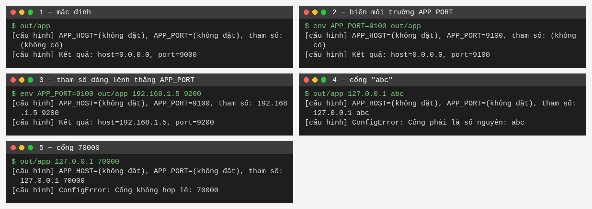

# Bài 2.1 – Đọc cấu hình địa chỉ và cổng (Go)

| Thông tin | Nội dung |
|---|---|
| Mã giả tương ứng | Mã giả 2.1 (PARSE_ENDPOINT – đọc địa chỉ và cổng từ tham số dòng lệnh, biến môi trường) |
| Mục giáo trình | 2.1.3 Tham số hóa địa chỉ và cổng |
| Kế thừa | Không (thủ tục gốc, được dùng lại ở mọi server và client từ Chương 3) |
| Thư viện | Thư viện chuẩn Go: `os` (`os.Args`, `os.LookupEnv`), `strconv` |

## Mục tiêu
Minh họa thứ tự ưu tiên cấu hình: tham số dòng lệnh > biến môi trường `APP_HOST`, `APP_PORT` > giá trị mặc định (`0.0.0.0`, `9000`), cùng việc chuyển chuỗi sang số và kiểm tra phạm vi cổng 1–65535 với lỗi `ConfigError` rõ ràng.

## Tệp
- `endpoint.go` – kiểu lỗi `ConfigError` và hàm `ParseEndpoint` (Mã giả 2.1).
- `main.go` – chương trình in dữ liệu vào và cấu hình nhận được.
- `demo.json` – kịch bản chạy minh họa năm trường hợp (dùng với `tools/demo.py`).
- `ket_qua.txt`, `ket_qua.png` – kết quả thực thi thật.

## Cách chạy
```bash
# Linux/macOS
go run .                                   # mặc định
APP_PORT=9100 go run .                     # biến môi trường
APP_PORT=9100 go run . 192.168.1.5 9200
go run . 127.0.0.1 abc                     # cổng không phải số
go run . 127.0.0.1 70000                   # cổng ngoài phạm vi
```
```powershell
# Windows PowerShell
$env:APP_PORT="9100"; go run .
Remove-Item Env:APP_PORT
```

## Kết quả thực thi


Năm tiến trình cho đúng kết quả nêu trong giáo trình: giá trị mặc định `0.0.0.0:9000`; cổng 9100 lấy từ `APP_PORT`; tham số `192.168.1.5 9200` thắng `APP_PORT=9100`; cổng `abc` và `70000` bị từ chối bằng `ConfigError` với thông báo cụ thể. Trong `demo.json`, chương trình được biên dịch thành `out/app` và biến môi trường được đặt riêng cho từng tiến trình bằng lệnh `env`.

## Ghi chú
- Chương trình trả mã thoát 2 khi gặp `ConfigError`.
- Go không có ngoại lệ: `ParseEndpoint` trả thêm giá trị `error` (kiểu `*ConfigError`), nơi gọi kiểm tra `err != nil` thay cho `CATCH ConfigError`.
- `os.LookupEnv` phân biệt biến không đặt với biến đặt bằng chuỗi rỗng, đúng với điều kiện "biến môi trường có giá trị" của mã giả; `APP_PORT=` (rỗng) cho lỗi "Cổng phải là số nguyên".
- `strconv.Atoi` chấp nhận dấu `+` ở đầu (`"+9000"` → 9000) nhưng không chấp nhận khoảng trắng hay dấu gạch dưới (khác `int()` của Python); mã giả không đề cập các trường hợp này.
- Thủ tục không kiểm tra `host` (đúng như mã giả); địa chỉ sai được phát hiện ở bước kết nối (Bài 2.2).
- Kiểm thử: Linux, Go 1.24.7.
