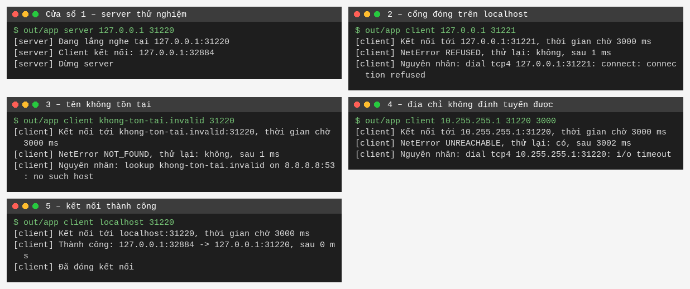

# Bài 2.2 – Kết nối có thời gian chờ và phân loại lỗi (Go)

| Thông tin | Nội dung |
|---|---|
| Mã giả tương ứng | Mã giả 2.2 (SAFE_CONNECT – kết nối có thời gian chờ và phân loại lỗi) |
| Mục giáo trình | 2.2.3 Khung xử lý lỗi dùng chung |
| Kế thừa | Mã giả 1.2 (PORT_CHECK), Mã giả 2.1 (PARSE_ENDPOINT, chép từ Bài 2.1) |
| Thư viện | Thư viện chuẩn Go: `net`, `errors`, `syscall`, `os/signal` |

## Mục tiêu
Cài đặt thủ tục kết nối thử lần lượt các địa chỉ của một tên, luôn đặt thời gian chờ, đóng socket khi thất bại và gom mọi lỗi về `NetError` với ba loại: `NOT_FOUND` (tên không tồn tại, không thử lại), `REFUSED` (mọi địa chỉ trả RST, không thử lại), `UNREACHABLE` (hết thời gian chờ hoặc không có đường đi, có thể thử lại).

## Tệp
- `main.go` – chọn vai trò `server` hoặc `client` theo tham số đầu tiên.
- `safeconnect.go` – kiểu `NetError` và hàm `SafeConnect` (Mã giả 2.2).
- `client.go` – client gọi `SafeConnect`, in kết quả hoặc loại lỗi.
- `testserver.go` – server thử nghiệm tối giản: chấp nhận kết nối rồi đóng ngay, chỉ để tạo trường hợp thành công.
- `endpoint.go` – `ParseEndpoint` (Mã giả 2.1, chép từ Bài 2.1).
- `loimang.go` – `isRefused`, `isReset`, `isUnreachable`: nhận biết lỗi kết nối bị từ chối, bị đặt lại, không có đường đi theo cả mã POSIX (Linux, macOS) và mã Winsock (Windows).
- `demo.json` – kịch bản chạy minh họa (dùng với `tools/demo.py`).
- `ket_qua.txt`, `ket_qua.png` – kết quả thực thi thật.

## Cách chạy
```bash
# Cửa sổ 1 – server thử nghiệm
go run . server 127.0.0.1 9000
# Cửa sổ 2 – client: [host] [port] [timeout_ms]
go run . client localhost 9000              # thành công
go run . client 127.0.0.1 9001              # REFUSED
go run . client khong-ton-tai.invalid 9000  # NOT_FOUND
go run . client 10.255.255.1 9000 3000      # UNREACHABLE (hết thời gian chờ)
```
Dừng server bằng Ctrl+C. Kịch bản `demo.json` biên dịch một lần thành `out/app` rồi chạy `out/app server …`, `out/app client …` (cổng 31220, 31221).

## Kết quả thực thi


Cổng đóng trên máy cục bộ bị từ chối gần như ngay lập tức (`REFUSED`, không thử lại); tên thuộc miền `.invalid` không phân giải được (`NOT_FOUND`); địa chỉ `10.255.255.1` không phản hồi nên thủ tục dừng sau đúng khoảng 3000 ms (`UNREACHABLE`, có thể thử lại); kết nối tới `localhost` thành công và server ghi nhận đúng cổng nguồn của client.

## Ghi chú
- `CONNECT_TIMEOUT` được cài bằng trường `Timeout` của `net.Dialer`; khác Python, giá trị này chỉ áp dụng cho bước kết nối, không áp dụng cho các thao tác đọc, ghi sau đó (Go dùng `SetDeadline` cho việc này, xem Chương 3).
- `RAISE NetError(...)` được viết thành giá trị trả về `error` kiểu `*NetError`; nơi gọi dùng `errors.As` để lấy `Kind`, `Retry`, `Cause`.
- `ConnectionRefused`, `NetworkUnreachable`, `HostUnreachable` được nhận ra theo mã lỗi của hệ điều hành `ECONNREFUSED`, `ENETUNREACH`, `EHOSTUNREACH` (Windows: mã Winsock tương ứng) bằng các hàm `isRefused`, `isUnreachable` trong `loimang.go`; `Timeout` là `net.Error` có `Timeout()` bằng `true` (thông báo `i/o timeout`). Các lỗi khác được trả thẳng cho nơi gọi, đúng như mã giả.
- `net.Dial` tự đóng socket khi kết nối thất bại, nên nhánh `FINALLY IF NOT ok THEN CLOSE(s)` không cần viết tường minh; khi thành công, kết nối được trả cho nơi gọi và nơi gọi đóng nó.
- Server dùng `net.Listen("tcp4", …)`, gộp `SOCKET`, `SETOPT(REUSEADDR)` (Go tự bật trên Linux), `BIND`, `LISTEN`; nhấn Ctrl+C thì socket lắng nghe được đóng và server in "Dừng server".
- Thời gian (ms) in ra phụ thuộc máy chạy; trên mạng khác `10.255.255.1` có thể cho `HostUnreachable` sớm hơn.
- Kiểm thử: Linux, Go 1.24.7.
