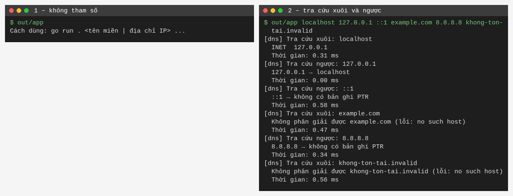

# Bài 2.3 – Client tra cứu DNS (Go)

| Thông tin | Nội dung |
|---|---|
| Mã giả tương ứng | Mã giả 2.3 (client tra cứu DNS dùng bộ phân giải của hệ điều hành) |
| Mục giáo trình | 2.5 Ví dụ: client tra cứu DNS |
| Kế thừa | Mã giả 1.1 (RESOLVE_HOST, chép từ Bài 1.1) |
| Thư viện | Thư viện chuẩn Go: `net` (`LookupIP`, `LookupAddr`, `ParseIP`), `time` |

## Mục tiêu
Nhận một hoặc nhiều tham số; với tên miền, in danh sách địa chỉ IPv4/IPv6 (tra cứu xuôi qua `net.LookupIP`); với địa chỉ IP, tra cứu ngược bản ghi PTR (`net.LookupAddr`); in thời gian tra cứu của từng tham số. Lỗi của một tham số không làm dừng các tham số còn lại.

## Tệp
- `main.go` – `IsIPAddress` và chương trình chính (Mã giả 2.3).
- `resolver.go` – `ResolveHost` (Mã giả 1.1, chép từ Bài 1.1).
- `demo.json` – kịch bản chạy minh họa (dùng với `tools/demo.py`).
- `ket_qua.txt`, `ket_qua.png` – kết quả thực thi thật.

## Cách chạy
```bash
go run .                                                     # in cách dùng
go run . localhost 127.0.0.1 www.ut.edu.vn 8.8.8.8 khong-ton-tai.invalid
```

## Kết quả thực thi


Không có tham số, chương trình in cách dùng. `localhost` phân giải thành `127.0.0.1` (tệp hosts của máy kiểm thử không khai báo `::1`) và `127.0.0.1` tra ngược ra `localhost` (lấy từ tệp hosts nên gần như không tốn thời gian). Môi trường kiểm thử không truy cập được máy chủ DNS bên ngoài nên `example.com` không phân giải được và `8.8.8.8` không có bản ghi PTR; trên mạng thông thường, `8.8.8.8` cho tên `dns.google`. Tên `khong-ton-tai.invalid` đi vào nhánh `ResolveError`.

## Ghi chú
- Chương trình in thêm dòng tiêu đề `[dns] Tra cứu xuôi/ngược: …` trước kết quả của mỗi tham số để dễ đọc; mã giả không có dòng này.
- `IS_IP_ADDRESS` được cài bằng `net.ParseIP(q) != nil`.
- `REVERSE_RESOLVE` tương ứng `net.LookupAddr`, trả danh sách tên kết thúc bằng dấu chấm (tên đầy đủ, ví dụ `dns.google.`); chương trình bỏ dấu chấm cuối và in tên đầu tiên.
- `ResolveError` tương ứng giá trị `error` khác `nil` (thường là `*net.DNSError`); Go không có mã số `EAI_*` nên in trường `Err` (ví dụ `no such host`).
- Thời gian được đo bằng `time.Now()` và `time.Since`, in theo mili giây với hai chữ số thập phân.
- Kiểm thử: Linux, Go 1.24.7.
