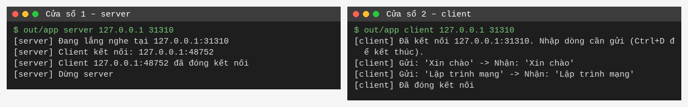

# Bài 3.1 – TCP Echo Server và Echo Client (Go)

| Thông tin | Nội dung |
|---|---|
| Mã giả tương ứng | Mã giả 3.1 (TCP Echo Server tuần tự), Mã giả 3.2 (TCP Echo Client) |
| Mục giáo trình | 3.2.2 Server tuần tự, 3.2.3 Client |
| Kế thừa | Mã giả 2.1 (đọc địa chỉ, cổng), Mã giả 2.2 (kết nối có thời gian chờ), Mã giả 3.3 (SEND_ALL) |
| Thư viện | Thư viện chuẩn Go: `net`, `bufio`, `os/signal` |

## Mục tiêu
Minh họa vòng đời socket TCP: server `Listen` (SOCKET – BIND – LISTEN) – `Accept` – `Read`/`Write` – `Close`; client `Dial` (CONNECT) – `Write` – `Read` – `CloseWrite` (SHUTDOWN) – `Close`.

## Tệp
- `main.go` – chọn vai trò `server` hoặc `client` theo tham số đầu tiên.
- `echoserver.go` – server tuần tự (Mã giả 3.1), gửi trả nguyên văn dữ liệu nhận được.
- `echoclient.go` – client (Mã giả 3.2) đọc từng dòng từ bàn phím, gửi và in phản hồi.
- `netutil.go` – `ParseEndpoint` (Mã giả 2.1), `SafeConnect` (Mã giả 2.2), `SendAll` (Mã giả 3.3) và `StopOnCtrlC`, chép từ các bài trước.
- `loimang.go` – `isRefused`, `isReset`, `isUnreachable`: nhận biết lỗi kết nối bị từ chối, bị đặt lại, không có đường đi theo cả mã POSIX (Linux, macOS) và mã Winsock (Windows).
- `demo.json` – kịch bản chạy minh họa (dùng với `tools/demo.py`).
- `ket_qua.txt`, `ket_qua.png` – kết quả thực thi thật.

## Cách chạy
Mở hai cửa sổ dòng lệnh trong thư mục bài:
```bash
# Cửa sổ 1 – server
go run . server 0.0.0.0 9000
# Cửa sổ 2 – client
go run . client 127.0.0.1 9000
```
Nhập vài dòng ở cửa sổ client; nhấn Ctrl+D (Linux/macOS) hoặc Ctrl+Z rồi Enter (Windows) để kết thúc. Dừng server bằng Ctrl+C. Kịch bản `demo.json` biên dịch một lần thành `out/app` rồi chạy `out/app server …` và `out/app client …` (cổng 31310).

## Kết quả thực thi


Server in địa chỉ client khi kết nối và khi client đóng kết nối; client nhận lại đúng chuỗi đã gửi, kể cả chuỗi tiếng Việt có dấu (UTF-8).

## Ghi chú
- Client gọi `Read` với bộ đệm 4096 byte một lần cho mỗi dòng: chấp nhận được với dòng ngắn, nhưng sai khi thông điệp lớn vì TCP là luồng byte không giữ ranh giới thông điệp (Mục 3.4). Bài 3.2 bổ sung định khung.
- `net.Listen("tcp4", …)` gộp `SOCKET(INET, STREAM)`, `SETOPT(REUSEADDR)` (Go tự bật trên Linux), `BIND` và `LISTEN`; Go không cho chọn backlog mà dùng giá trị lớn nhất hệ điều hành cho phép (`/proc/sys/net/core/somaxconn`) thay cho 16.
- `RECV` trả 0 byte (client đã đóng chiều gửi) tương ứng `Read` trả lỗi `io.EOF`. `SETOPT(s, RECV_TIMEOUT, 5000)` được cài bằng `SetReadDeadline` trước mỗi lần đọc, vì deadline của Go là một mốc thời gian tuyệt đối chứ không phải khoảng chờ.
- Chuỗi Go vốn được lưu dưới dạng UTF-8 nên `ENCODE(line, "UTF-8")` chỉ là chuyển `string` sang `[]byte`.
- `SHUTDOWN(s, WRITE)` tương ứng `(*net.TCPConn).CloseWrite()`.
- Kiểm thử: Linux, Go 1.24.7.
