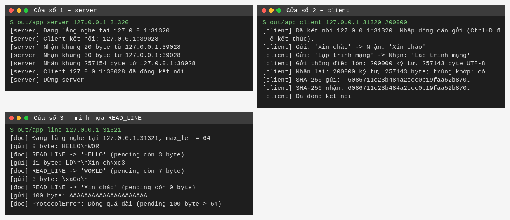

# Bài 3.2 – Thư viện định khung thông điệp (Go)

| Thông tin | Nội dung |
|---|---|
| Mã giả tương ứng | Mã giả 3.3 (SEND_ALL), Mã giả 3.4 (RECV_EXACT), Mã giả 3.5 (READ_LINE), Mã giả 3.6 (SEND_FRAME, RECV_FRAME, SEND_JSON, RECV_JSON) |
| Mục giáo trình | 3.2.4 Gửi và nhận dữ liệu, 3.4.1–3.4.4 Thiết kế giao thức trao đổi |
| Kế thừa | Mã giả 2.1, 2.2 (`netutil.go`); khung sườn Mã giả 3.1 (server) và 3.2 (client) |
| Thư viện | Thư viện chuẩn Go: `net`, `encoding/binary`, `encoding/json`, `crypto/sha256`, `unicode/utf8` |

## Mục tiêu
Xây dựng thư viện định khung dùng lại ở các bài sau: gửi hết dãy byte, nhận đúng n byte, đọc một dòng kết thúc bằng LF/CRLF, gửi và nhận khung `[4 byte độ dài big-endian][nội dung]` chứa JSON mã hóa UTF-8. Chương trình minh họa cho thấy một thông điệp 200 000 ký tự (257 143 byte UTF-8) được nhận đủ và trùng khớp, trường hợp mà client của Bài 3.1 (một lần `Read` 4096 byte) không xử lý được.

## Tệp
- `framing.go` – thư viện: `SendAll`, `RecvExact`, `Reader`/`ReadLine`, `SendFrame`, `RecvFrame`, `JsonEncode`, `JsonDecode`, `SendJSON`, `RecvJSON`; các lỗi `ConnectionClosed`, `ProtocolError`, `JsonError`; hằng `MaxFrame` = 1 MiB.
- `netutil.go` – `ParseEndpoint` (Mã giả 2.1), `SafeConnect` (Mã giả 2.2), lỗi `NetError` và `StopOnCtrlC`.
- `main.go` – chọn vai trò `server`, `client` hoặc `line`.
- `frameserver.go` – echo server dùng khung JSON: `{"text": …}` → `{"status": 200, "text": …}`; JSON sai hoặc thiếu trường `text` → `status` 400.
- `frameclient.go` – gửi từng dòng nhập từ bàn phím; tham số thứ ba (tùy chọn) là số ký tự của một thông điệp lớn gửi sau cùng, so sánh nội dung và mã băm SHA-256 hai chiều.
- `linedemo.go` – minh họa `READ_LINE`: tự mở một kết nối loopback, gửi các mảnh cắt ngang dòng (kể cả cắt giữa hai byte UTF-8 của chữ "à") và một dòng 100 byte vượt `max_len` = 64.
- `loimang.go` – `isRefused`, `isReset`, `isUnreachable`: nhận biết lỗi kết nối bị từ chối, bị đặt lại, không có đường đi theo cả mã POSIX (Linux, macOS) và mã Winsock (Windows).
- `demo.json` – kịch bản chạy minh họa (dùng với `tools/demo.py`).
- `ket_qua.txt`, `ket_qua.png` – kết quả thực thi thật.

## Cách chạy
Mở các cửa sổ dòng lệnh trong thư mục bài:
```bash
# Cửa sổ 1 – server
go run . server 0.0.0.0 9000
# Cửa sổ 2 – client: gửi các dòng nhập, sau đó một thông điệp 200 000 ký tự
go run . client 127.0.0.1 9000 200000
# Cửa sổ 3 – minh họa READ_LINE (một chương trình, tự kết nối tới chính nó)
go run . line 127.0.0.1 9001
```
Kết thúc nhập ở client bằng Ctrl+D (Linux/macOS) hoặc Ctrl+Z rồi Enter (Windows); dừng server bằng Ctrl+C. Kịch bản `demo.json` biên dịch một lần thành `out/app` (cổng 31320, 31321).

## Kết quả thực thi


Server nhận khung 257 154 byte (nội dung JSON `{"text":"…"}`); client nhận lại đủ 200 000 ký tự và mã băm hai chiều trùng nhau (trùng cả với mã băm của bản Python). Ở cửa sổ 3, `READ_LINE` lần lượt trả về "HELLO", "WORLD" (đã bỏ CR), "Xin chào" (ghép đúng hai nửa của chữ "à") và giữ phần dư trong `pending`; dòng 100 byte không có LF gây lỗi `ProtocolError: Dòng quá dài`.

## Ghi chú
- `SendAll` viết vòng lặp tường minh theo Mã giả 3.3; thực ra `conn.Write` của Go đã bảo đảm gửi hết hoặc trả lỗi. `RecvExact` tương đương `io.ReadFull` của thư viện chuẩn nhưng báo `ConnectionClosed` kèm số byte đã nhận.
- `UINT32_BE`, `FROM_UINT32_BE` tương ứng `binary.BigEndian.PutUint32`, `binary.BigEndian.Uint32` (kiểu `uint32` không dấu nên không cần phép AND như Java).
- JSON được mã hóa bằng `json.Encoder` với `SetEscapeHTML(false)` và bỏ ký tự xuống dòng cuối, nên chữ tiếng Việt cùng các ký tự `<`, `>`, `&` giữ nguyên dạng UTF-8 và độ dài khung giống bản Python. Đối tượng JSON được biểu diễn bằng `map[string]any`; số JSON được giải mã thành `float64`.
- `JsonDecode` gộp lỗi UTF-8, lỗi cú pháp và trường hợp JSON không phải đối tượng thành `JsonError`.
- `ReadLine` theo đúng Mã giả 3.5, gồm cả phép kiểm tra `i > max_len` khi đã tìm thấy LF; `ok = false` tương ứng giá trị `NULL` (đối tác đã đóng), phần dư không có LF khi đó bị bỏ qua.
- `frameserver.go` gọi `RecvFrame` rồi giải mã JSON (tách hai bước của `RECV_JSON`) chỉ để ghi kích thước khung vào nhật ký.
- `linedemo.go` nghỉ 300 ms giữa các mảnh để mỗi mảnh đến bên nhận riêng rẽ; Go bật sẵn `TCP_NODELAY` cho mọi kết nối TCP, lời gọi `SetNoDelay(true)` chỉ để thể hiện ý đồ.
- Kiểm thử: Linux, Go 1.24.7.
