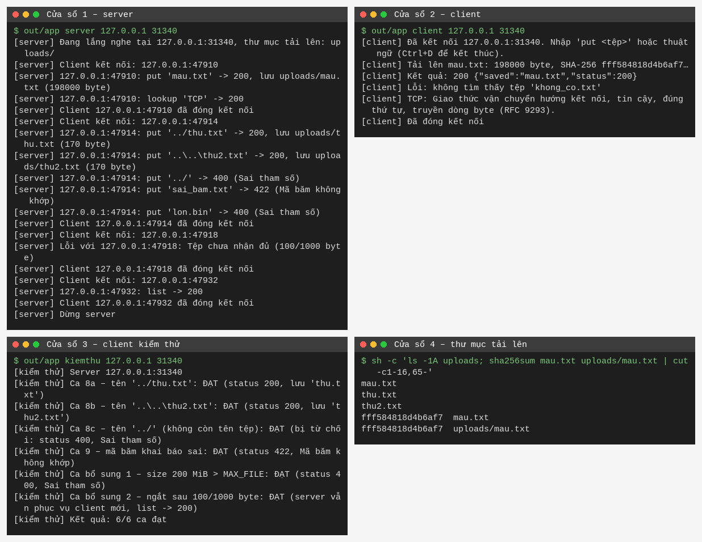

# Bài 3.4 – Tải tệp lên server có kiểm tra toàn vẹn (Go)

| Thông tin | Nội dung |
|---|---|
| Mã giả tương ứng | Mã giả 3.9 (Server nhận tệp có kiểm tra mã băm), Mã giả 3.10 (Client tải tệp lên server) |
| Mục giáo trình | 3.5.2 Truyền tệp có kiểm tra toàn vẹn, 3.5.3 (ca kiểm thử 8, 9) |
| Kế thừa | Mã giả 3.7 (HANDLE_LOOKUP, thêm nhánh `IF req.op = "put" THEN HANDLE_PUT(conn, req); CONTINUE`), Mã giả 3.8 (client tra cứu), Mã giả 3.6 (khung JSON), Mã giả 3.3 (SEND_ALL), Mã giả 2.1, 2.2 |
| Thư viện | Thư viện chuẩn Go: `net`, `encoding/json`, `crypto/sha256`, `encoding/hex`, `os`, `path/filepath` |

## Mục tiêu
Mở rộng dịch vụ tra cứu để client tải tệp lên server trong cùng một phiên, kết hợp hai cách định khung: phần điều khiển dùng khung JSON, nội dung tệp là dòng byte thô có độ dài khai báo trước trong tiêu đề. Trình tự bốn bước:

1. Client gửi `{"op":"put","name":…,"size":…,"sha256":…}` (mã băm SHA-256 dạng hex chữ thường).
2. Server kiểm tra tham số, trả `{"status":100}` (sẵn sàng) hoặc `{"status":400,"error":"Sai tham số"}`.
3. Client gửi đúng `size` byte nội dung, đọc tệp theo từng khối 64 KiB.
4. Server ghi tệp tạm `.part`, tính lại mã băm, trả `{"status":200,"saved":…}` nếu khớp (đổi tên tệp tạm thành tệp chính thức) hoặc `{"status":422,"error":"Mã băm không khớp"}` (xóa tệp tạm).

Ba biện pháp an toàn theo giáo trình: chỉ lấy phần tên tệp (chặn duyệt đường dẫn kiểu `../../etc/passwd`), giới hạn `MAX_FILE` = 100 MiB, ghi vào tệp `.part` và chỉ đổi tên khi mã băm khớp.

## Tệp
- `main.go` – chọn vai trò `server`, `client` hoặc `kiemthu`.
- `putserver.go` – server: `ProcessRequest` (tra cứu), `Basename`, `HandlePut` (Mã giả 3.9), `HandleLookup` có nhánh `put`.
- `putclient.go` – client: `PutFile` (Mã giả 3.10) và tra cứu trong cùng một kết nối.
- `kiemthu.go` – client kiểm thử tự tạo tiêu đề và nội dung cho ca 8, 9 và hai ca bổ sung (kích thước vượt giới hạn, ngắt giữa chừng).
- `framing.go`, `netutil.go` – thư viện định khung (Bài 3.2) và tiện ích kết nối (Mã giả 2.1, 2.2), chép nguyên để bài tự chứa.
- `glossary.json` – từ điển thuật ngữ dùng cho thao tác tra cứu (như Bài 3.3).
- `loimang.go` – `isRefused`, `isReset`, `isUnreachable`: nhận biết lỗi kết nối bị từ chối, bị đặt lại, không có đường đi theo cả mã POSIX (Linux, macOS) và mã Winsock (Windows).
- `demo.json`, `ket_qua.txt`, `ket_qua.png` – kịch bản và kết quả thực thi thật. Bước chuẩn bị của `demo.json` xóa thư mục `uploads/` cũ, tạo tệp mẫu `mau.txt` (3 000 dòng, 198 000 byte, cùng nội dung với bản Python) rồi biên dịch `out/app`; các tệp này không lưu trong kho mã.

## Cách chạy
Mở các cửa sổ dòng lệnh trong thư mục bài (server đọc `glossary.json` và ghi tệp vào `uploads/` ở thư mục hiện hành):
```bash
# Cửa sổ 1 – server
go run . server 0.0.0.0 9100
# Cửa sổ 2 – client: nhập ví dụ  put mau.txt  hoặc  TCP
go run . client 127.0.0.1 9100
# Cửa sổ 3 – client kiểm thử
go run . kiemthu 127.0.0.1 9100
```
Ở cửa sổ client, nhập `put <đường dẫn tệp>` để tải tệp lên hoặc nhập một thuật ngữ để tra cứu; kết thúc nhập bằng Ctrl+D (Linux/macOS) hoặc Ctrl+Z rồi Enter (Windows). Tệp nhận được nằm trong thư mục `uploads/` của thư mục chạy server; so sánh mã băm bằng `sha256sum` (Linux) hoặc `Get-FileHash` (Windows PowerShell). Dừng server bằng Ctrl+C. Kịch bản `demo.json` dùng cổng 31340.

## Kết quả thực thi


Tệp `mau.txt` (198 000 byte) được lưu với mã băm trùng tệp gốc (cửa sổ 4). Tên `../thu.txt` và `..\..\thu2.txt` chỉ được lưu thành `thu.txt`, `thu2.txt` trong `uploads/` (ca 8); tên `../` không còn phần tên tệp nên bị từ chối với 400; mã băm khai báo sai nhận 422 (ca 9); kích thước 200 MiB bị từ chối; client ngắt sau 100/1000 byte được ghi nhật ký "Tệp chưa nhận đủ" và thư mục `uploads/` không còn tệp `.part` nào.

## Ghi chú
- `Basename` được tự cài đặt, tách theo cả `/` và `\` trên mọi hệ điều hành: `filepath.Base` trên Linux không coi `\` là dấu phân cách, nên một tên như `..\..\x` sẽ nguy hiểm khi cùng mã chạy trên Windows. Tên `.` và `..` bị từ chối như mã giả.
- Tham số được kiểm tra như mã giả: `size` phải là số nguyên trong khoảng 0–`MAX_FILE` (`IS_INTEGER`; chuỗi, `true`/`false`, số có phần lẻ bị từ chối), `sha256` phải là chuỗi đúng 64 chữ số thập lục phân (`IS_HEX(req.sha256, 64)`). Vì số JSON được giải mã thành `float64`, giá trị `1.0` được coi là số nguyên 1.
- Bản cài đặt xóa tệp `.part` với mọi lỗi trong vòng nhận (`CATCH ANY`: đối tác đóng kết nối, kết nối bị đặt lại, hết thời gian chờ) rồi trả lỗi lên vòng ACCEPT, để không còn tệp dở dang.
- `RENAME` dùng `os.Rename`, ghi đè tệp đích cùng tên trên cả Linux và Windows.
- Thư mục `uploads/` được tạo khi server khởi động (bước này không có trong mã giả).
- `encoding/json` của Go sắp xếp khóa của `map` theo thứ tự chữ cái, nên phản hồi in ra là `{"saved":"mau.txt","status":200}` (bản Python in `{"status":200,"saved":"mau.txt"}`); nội dung JSON tương đương.
- So sánh mã băm phân biệt hoa thường như mã giả; client gửi hex chữ thường. Mã băm không khóa chỉ phát hiện sai lệch ngẫu nhiên, chống sửa đổi có chủ đích cần HMAC hoặc TLS (Mục 3.5.2).
- Client nhận lệnh dạng `put <tệp>` (mã giả chỉ định nghĩa thủ tục `PUT_FILE(s, path)`); tệp không tồn tại được báo lỗi và phiên vẫn tiếp tục. Cửa sổ 4 của bản demo dùng `ls` và `sha256sum` của Linux.
- Kiểm thử: Linux, Go 1.24.7.
