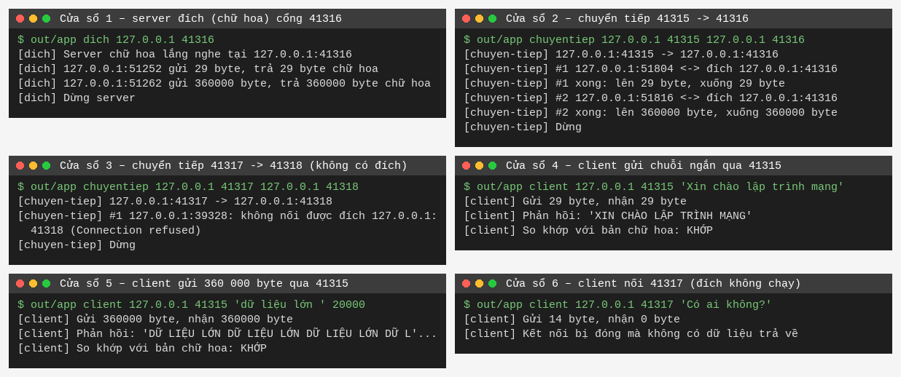

# Bài mở rộng MR3.1 – Bộ chuyển tiếp cổng TCP (TCP port forwarder) (Go)

| Thông tin | Nội dung |
|---|---|
| Loại | **Bài mở rộng** – không có trong giáo trình, không có mã giả tương ứng |
| Liên hệ với giáo trình | Chương 3: Bài 3.1 (vòng đời socket, `SHUTDOWN` một chiều), Bài 3.2 (`SEND_ALL`); Chương 6: Bài 6.1 (mỗi kết nối một luồng) |
| Thư viện | Thư viện chuẩn Go: `net` (`TCPConn.CloseWrite`), `io` (`io.Copy`), `sync` |
| Bản ngôn ngữ khác | [Python](../../../python/Chuong03/BaiMR3.1_ChuyenTiepCong/) |

## Mục tiêu
Viết một bộ chuyển tiếp: mỗi client nối vào cổng nghe được ghép với một kết nối mới tới máy đích, hai luồng (goroutine) bơm dữ liệu theo hai chiều. Điểm mấu chốt là **đóng một chiều (half-close)**: khi một chiều gặp EOF, bộ chuyển tiếp gọi `SHUTDOWN(WRITE)` trên socket bên kia để chuyển tiếp gói FIN, chứ không đóng hẳn, vì chiều ngược lại có thể vẫn đang truyền. Server đích trong bài chỉ trả lời **sau khi** thấy EOF, nên nếu bộ chuyển tiếp làm sai, client và server sẽ chờ nhau mãi. Đây là nguyên lý của `ssh -L`, `socat`, proxy TCP và cân bằng tải lớp 4.

## Tệp
- `main.go` – chọn vai trò: `dich`, `chuyentiep`, `client`.
- `forward.go` – bộ chuyển tiếp: `serve`, `pump` (`io.Copy` + `CloseWrite`).
- `backend.go` – server đích “chữ hoa”; `client.go` – client thử.
- `demo.json` – kịch bản chạy minh họa (dùng với `tools/demo.py`).
- `ket_qua.txt`, `ket_qua.png` – kết quả thực thi thật.

## Cách chạy
Trong thư mục bài:
```bash
go build -o out/app .        # hoặc thay out/app bằng go run .
# Cửa sổ 1, 2, 3
out/app dich 127.0.0.1 9001
out/app chuyentiep 127.0.0.1 9000 127.0.0.1 9001
out/app client 127.0.0.1 9000 "Xin chào"
out/app client 127.0.0.1 9000 "dữ liệu lớn " 20000
```
Dừng server đích và bộ chuyển tiếp bằng Ctrl+C. Kịch bản `demo.json` chạy thêm một bộ chuyển tiếp trỏ tới cổng không có server.

Tái lập kết quả từ thư mục gốc của kho: `python3 tools/demo.py go/Chuong03/BaiMR3.1_ChuyenTiepCong`.

## Kết quả thực thi


Hai client đi qua bộ chuyển tiếp nhận đúng bản chữ hoa, kể cả 360 000 byte (20 000 lần chuỗi 18 byte UTF-8); số byte lên bằng số byte xuống. Server đích chỉ thấy địa chỉ của bộ chuyển tiếp (127.0.0.1 với một cổng tạm), không thấy client gốc – vì vậy proxy thật thường thêm thông tin nguồn (ví dụ giao thức PROXY, tiêu đề `X-Forwarded-For`). Với bộ chuyển tiếp trỏ tới cổng không có server, kết nối tới đích bị từ chối nên bộ chuyển tiếp đóng kết nối của client; client nhận 0 byte.

## Ghi chú
- Khi một bên đóng socket trong lúc bộ đệm nhận vẫn còn dữ liệu chưa đọc, TCP gửi RST thay vì FIN. Ở tình huống đích không chạy, kết quả phụ thuộc thời điểm: nếu dữ liệu của client tới trước lúc đóng, client thấy *Connection reset* (RST); nếu không, client thấy EOF bình thường.
- Bộ chuyển tiếp không có xác thực hay giới hạn: chỉ nghe trên `127.0.0.1` và chỉ dùng trong máy, mạng phòng thí nghiệm.
- `io.Copy` tự lặp `Read`/`Write` (và `Write` của Go luôn gửi hết, tương đương `SEND_ALL`); `CloseWrite` của `*net.TCPConn` tương đương `shutdown(SHUT_WR)`.
- Kiểm thử: Linux, Go 1.24.7 (`gofmt`, `go vet` sạch).

## Đọc thêm
- M. O. Faruque Sarker, *Python Network Programming Cookbook*, Packt, 2014, Chương 3 (công thức *Forwarding a local port to a remote host*; sách dùng mô-đun `asyncore` đã bị loại khỏi Python 3.12, bài này viết lại bằng socket và luồng).

Mã nguồn của bài được viết mới cho kho này; sách trên chỉ là tài liệu tham khảo ý tưởng.
