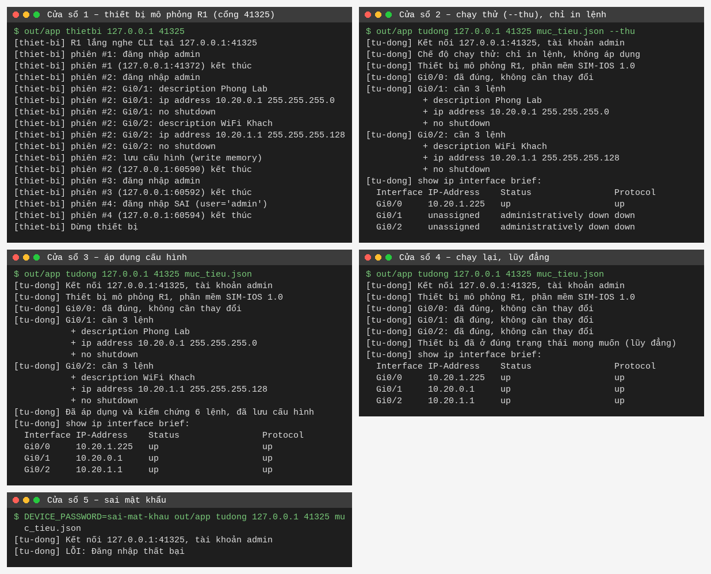

# Bài mở rộng MR3.2 – Tự động hóa cấu hình thiết bị qua CLI (kiểu expect/Netmiko, chỉ dùng socket) (Go)

| Thông tin | Nội dung |
|---|---|
| Loại | **Bài mở rộng** – không có trong giáo trình, không có mã giả tương ứng |
| Liên hệ với giáo trình | Chương 3: Bài 3.2 (định khung – ở đây là đọc tới dấu nhắc), Bài 3.1; Chương 6: Bài 6.1 (server nhiều phiên); Chương 2: Bài 2.1 (bí mật lấy từ biến môi trường); MR1.1 (địa chỉ trong `muc_tieu.json`) |
| Thư viện | Thư viện chuẩn Go: `net`, `bufio`, `regexp`, `net/netip`, `encoding/json` |
| Bản ngôn ngữ khác | [Python](../../../python/Chuong03/BaiMR3.2_TuDongHoaCLI/) |

## Mục tiêu
Luyện tự động hóa thiết bị mạng mà không cần thiết bị thật. Thiết bị mô phỏng R1 có CLI kiểu Telnet (đăng nhập, dấu nhắc `R1>` `R1#` `R1(config)#` `R1(config-if)#`, vọng lại lệnh, phân trang `--More--`). Dữ liệu CLI là luồng byte **không có khung thông điệp**, nên client phải *đọc cho tới khi gặp dấu nhắc* (READ_UNTIL bằng biểu thức chính quy) – cùng ý tưởng với `READ_LINE` ở Bài 3.2. Client tự động hóa: đọc cấu hình hiện tại, so với trạng thái mong muốn và **chỉ sinh lệnh cho phần khác biệt** (lũy đẳng – chạy lại không thay đổi gì), có chế độ chạy thử `--thu`, đọc lại để kiểm chứng rồi mới lưu cấu hình.

## Tệp
- `main.go` – chọn vai trò: `thietbi`, `tudong`.
- `device.go` – thiết bị mô phỏng R1; `client.go` – client tự động hóa (`readUntil`, `command`, `diffCommands`).
- `ipmask.go` – đổi mặt nạ ↔ độ dài tiền tố; `muc_tieu.json` – trạng thái mong muốn.
- `demo.json` – kịch bản chạy minh họa (dùng với `tools/demo.py`).
- `ket_qua.txt`, `ket_qua.png` – kết quả thực thi thật.

## Cách chạy
Trong thư mục bài:
```bash
go build -o out/app .        # hoặc thay out/app bằng go run .
export DEVICE_USER=admin DEVICE_PASSWORD=lab123
out/app thietbi 127.0.0.1 9000                        # cửa sổ 1
out/app tudong 127.0.0.1 9000 muc_tieu.json --thu     # cửa sổ 2: chỉ in lệnh
out/app tudong 127.0.0.1 9000 muc_tieu.json           # áp dụng
```
Có thể nối tay vào thiết bị bằng `nc 127.0.0.1 9000` (hoặc `telnet`) để gõ lệnh và thấy phân trang `--More--` khi chưa gõ `terminal length 0`.

Tái lập kết quả từ thư mục gốc của kho: `python3 tools/demo.py go/Chuong03/BaiMR3.2_TuDongHoaCLI`.

## Kết quả thực thi


Lần chạy thử chỉ in 6 lệnh cần cho `Gi0/1`, `Gi0/2` (cổng `Gi0/0` đã đúng) và thiết bị không ghi nhận thay đổi nào. Lần áp dụng gửi đúng 6 lệnh đó, đọc lại để kiểm chứng rồi `write memory`; bảng `show ip interface brief` chuyển hai cổng sang `up`. Lần chạy thứ ba không gửi lệnh cấu hình nào (lũy đẳng). Sai mật khẩu: thiết bị ghi nhận đăng nhập sai, client báo *Đăng nhập thất bại* và thoát với mã 1. Hai bản Python và Go cho kết quả giống nhau.

## Ghi chú
- Thiết bị mô phỏng gửi mật khẩu dạng rõ như Telnet. Thiết bị thật phải dùng SSH: Python có Paramiko, Netmiko; Go có `golang.org/x/crypto/ssh` (không thuộc thư viện chuẩn). Logic `read_until` dấu nhắc, so sánh và sinh lệnh khác biệt giữ nguyên khi thay kênh Telnet bằng SSH.
- Cú pháp lệnh mô phỏng theo kiểu Cisco IOS nhưng tối giản (ba cổng, một vài lệnh); không phải phần mềm của hãng nào.
- Mẫu dấu nhắc chỉ được so ở **cuối** bộ đệm; dòng kết quả nào kết thúc bằng `#` hoặc `>` đúng lúc gói tin bị chia có thể bị nhầm là dấu nhắc – thư viện thật như Netmiko cũng gặp vấn đề này và cho phép chỉ định mẫu dấu nhắc chặt hơn.
- Thiết bị dùng `bufio.Reader` (`ReadString('\n')`, `ReadByte`); client đặt `SetReadDeadline` cho mỗi lần chờ dấu nhắc.
- Kiểm thử: Linux, Go 1.24.7 (`gofmt`, `go vet` sạch).

## Đọc thêm
- Eric Chou, *Mastering Python Networking*, 4th ed., Packt, 2023, Chương 2 *Low-Level Network Device Interactions* (Pexpect, Paramiko, Netmiko; mục *Idempotent network device interaction*).
- Claus Töpke, *Network Programming and Automation Essentials*, Packt, 2023, Chương 3 *Accessing the Network* (CLI, truy cập từ xa an toàn) và Chương 6 (thư viện truy cập thiết bị qua CLI).

Mã nguồn của bài được viết mới cho kho này; sách trên chỉ là tài liệu tham khảo ý tưởng.
