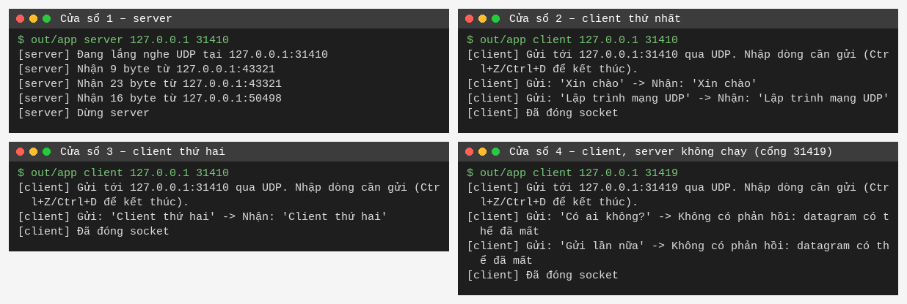

# Bài 4.1 – UDP Echo Server và UDP Echo Client có thời gian chờ (Go)

| Thông tin | Nội dung |
|---|---|
| Mã giả tương ứng | Mã giả 4.1 (UDP Echo Server), Mã giả 4.2 (UDP Echo Client có thời gian chờ) |
| Mục giáo trình | 4.2.1 Lưu đồ và mã giả; 4.2.2 Socket UDP "có kết nối" (xử lý ICMP port unreachable trên Windows) |
| Kế thừa | Mã giả 2.1 (đọc địa chỉ, cổng); vòng đọc dòng của Mã giả 3.2 |
| Thư viện | Thư viện chuẩn Go: `net` (`ListenPacket`, `ListenUDP`, `ReadFrom`, `WriteTo`) |

## Mục tiêu
Minh họa chuỗi lời gọi của chương trình UDP: server `SOCKET(DGRAM)` – `BIND` – lặp `RECVFROM`/`SENDTO`, không có `LISTEN`/`ACCEPT`; client `SOCKET` – `SENDTO` – `RECVFROM` có thời gian chờ 2 giây. Một socket server phục vụ mọi client; khi server không chạy, client chỉ nhận biết qua việc hết thời gian chờ.

## Tệp
- `main.go` – chọn vai trò `server` hoặc `client`.
- `udpechoserver.go` – Mã giả 4.1.
- `udpechoclient.go` – Mã giả 4.2.
- `netutil.go` – `ParseEndpoint` (Mã giả 2.1) và `StopOnCtrlC`.
- `loimang.go` – `isRefused`, `isReset`, `isUnreachable`: nhận biết lỗi kết nối bị từ chối, bị đặt lại, không có đường đi theo cả mã POSIX (Linux, macOS) và mã Winsock (Windows).
- `demo.json` – kịch bản chạy minh họa (dùng với `tools/demo.py`).
- `ket_qua.txt`, `ket_qua.png` – kết quả thực thi thật.

## Cách chạy
Trong thư mục bài:
```bash
# Cửa sổ 1 – server
go run . server 0.0.0.0 9000
# Cửa sổ 2, 3 – client
go run . client 127.0.0.1 9000
```
Nhập vài dòng ở các cửa sổ client; kết thúc client bằng Ctrl+D (Linux/macOS) hoặc Ctrl+Z rồi Enter (Windows). Để quan sát trường hợp mất phản hồi, dừng server (Ctrl+C) rồi gửi tiếp từ client, hoặc chạy client tới một cổng không có server. Kịch bản `demo.json` biên dịch một lần thành `out/app` (cổng 31410, cổng 31419 không có server).

## Kết quả thực thi


Hai client lần lượt được phục vụ bởi cùng một socket server; nhật ký server cho thấy hai cổng nguồn khác nhau. Client ở cửa sổ 4 gửi tới cổng 31419 không có server: mỗi datagram đều hết thời gian chờ 2 giây và client in "Không có phản hồi: datagram có thể đã mất".

## Ghi chú
- `net.ListenPacket("udp4", "host:port")` gộp `SOCKET(INET, DGRAM)` và `BIND`; client dùng `net.ListenUDP(network, nil)` để có một socket UDP chưa kết nối (cổng nguồn do hệ điều hành chọn) rồi gửi bằng `WriteToUDP`, đúng với `SENDTO` của mã giả. `net.DialUDP` sẽ tạo socket UDP "có kết nối" (Mục 4.2.2), không dùng ở bài này.
- `SETOPT(s, RECV_TIMEOUT, 2000)` được cài bằng `SetReadDeadline` trước mỗi lần nhận; hết thời gian chờ là `net.Error` có `Timeout()` bằng `true`.
- Server bỏ qua lỗi `ECONNRESET` (Windows báo gói ICMP port unreachable cho lời gọi nhận kế tiếp, kể cả trên socket chưa kết nối – Mục 4.2.2) rồi tiếp tục vòng lặp; client coi lỗi này như không có phản hồi. Trên Linux, socket chưa kết nối không nhận lỗi này nên client chỉ thấy hết thời gian chờ, như kết quả ở trên.
- Dòng đọc từ bàn phím được bỏ ký tự xuống dòng trước khi gửi; mỗi dòng là đúng một datagram.
- Thông báo "Dừng server" khi nhấn Ctrl+C được thêm để quan sát; mã giả không có bước này.
- Kiểm thử: Linux, Go 1.24.7.
