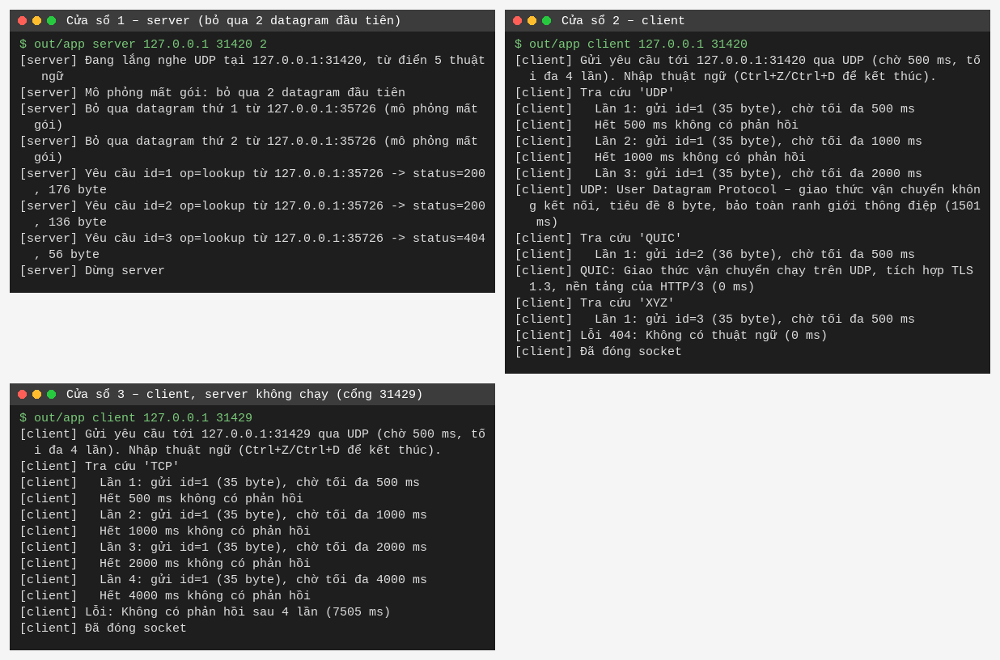

# Bài 4.2 – Dịch vụ tra cứu thuật ngữ trên UDP có gửi lại (Go)

| Thông tin | Nội dung |
|---|---|
| Mã giả tương ứng | Mã giả 4.3 (Server tra cứu thuật ngữ trên UDP), Mã giả 4.4 (UDP_REQUEST – gửi lại có lùi thời gian, ghép mã định danh) |
| Mục giáo trình | 4.3.1 Dịch vụ tra cứu thuật ngữ trên UDP |
| Kế thừa | Mã giả 4.1, 4.2 (vòng RECVFROM/SENDTO, thời gian chờ); `PROCESS_REQUEST`, `DICT` của server tra cứu TCP (Mục 3.5.1); Mã giả 2.1 |
| Thư viện | Thư viện chuẩn Go: `net`, `encoding/json`, `time` |

## Mục tiêu
Chuyển dịch vụ tra cứu của Chương 3 sang UDP: mỗi yêu cầu, mỗi phản hồi là một datagram JSON, không cần trường độ dài; yêu cầu mang `id` để ghép phản hồi; client gửi lại tối đa 4 lần với thời gian chờ 500 → 1000 → 2000 → 4000 ms. Server có tham số mô phỏng mất gói (bỏ qua N datagram đầu tiên) để quan sát cơ chế gửi lại.

## Tệp
- `main.go` – chọn vai trò `server` hoặc `client`.
- `udplookupserver.go` – Mã giả 4.3, `ProcessRequest` và `LoadGlossary`.
- `udplookupclient.go` – Mã giả 4.4 `UdpRequest` và vòng đọc thuật ngữ.
- `jsonutil.go` – mã hóa, giải mã JSON (`ToBytes`, `FromBytes`) và lấy trường (`GetString`, `GetInt`).
- `netutil.go` – `ParseEndpoint` (Mã giả 2.1) và `StopOnCtrlC`.
- `glossary.json` – từ điển 5 thuật ngữ (giống bản Python).
- `loimang.go` – `isRefused`, `isReset`, `isUnreachable`: nhận biết lỗi kết nối bị từ chối, bị đặt lại, không có đường đi theo cả mã POSIX (Linux, macOS) và mã Winsock (Windows).
- `demo.json` – kịch bản chạy minh họa (dùng với `tools/demo.py`).
- `ket_qua.txt`, `ket_qua.png` – kết quả thực thi thật.

## Cách chạy
Trong thư mục bài (nơi có `glossary.json`):
```bash
# Cửa sổ 1 – server, bỏ qua 2 datagram đầu tiên
go run . server 0.0.0.0 9100 2
# Cửa sổ 2 – client
go run . client 127.0.0.1 9100
```
Nhập tên thuật ngữ ở cửa sổ client (ví dụ `UDP`, `QUIC`, `XYZ`); tham số thứ ba của server là số datagram đầu tiên bị bỏ qua, bỏ trống hoặc 0 để không mô phỏng mất gói. Kịch bản `demo.json` biên dịch một lần thành `out/app` (cổng 31420, cổng 31429 không có server).

## Kết quả thực thi


Server bỏ qua hai datagram đầu tiên nên yêu cầu `UDP` (id=1) chỉ thành công ở lần gửi thứ ba, sau hai lần hết thời gian chờ 500 ms và 1000 ms (tổng khoảng 1,5 giây); cả ba lần gửi mang cùng `id`. Các yêu cầu sau thành công ngay lần đầu; `XYZ` nhận mã 404. Cửa sổ 3 gửi tới cổng không có server: sau 4 lần gửi (chờ tổng cộng 0,5 + 1 + 2 + 4 = 7,5 giây), hàm báo lỗi "Không có phản hồi sau 4 lần". Kích thước datagram (35, 176, 136, 56 byte) trùng với bản Python.

## Ghi chú
- Tham số thứ ba của server (số datagram bị bỏ qua) được thêm để mô phỏng mất gói; mã giả không có tham số này.
- Các dòng nhật ký `[client]   Lần k: ...`, `Hết ... ms không có phản hồi` trong hàm gửi yêu cầu là nhật ký minh họa, không có trong Mã giả 4.4.
- Dòng 8 của mã giả (`SETOPT(s, RECV_TIMEOUT, MAX(1, deadline - NOW()))`) được cài bằng `SetReadDeadline(deadline)`: deadline của Go là một mốc thời gian tuyệt đối nên tự động bằng phần thời gian còn lại và không có trường hợp giá trị 0 nghĩa là chờ vô hạn.
- Như mã giả, cả `Timeout` và `ConnectionReset` (lỗi `ECONNRESET` do ICMP port unreachable trên Windows) đều kết thúc lần thử hiện tại (`BREAK`) và chuyển sang lần gửi kế tiếp.
- `JsonError` gồm cả lỗi giải mã UTF-8 và trường hợp JSON hợp lệ nhưng không phải đối tượng (ví dụ `[1,2]`); server trả `{"error":"JSON sai","id":null,"status":400}`.
- JSON được ghi dạng gọn, giữ nguyên chữ có dấu (`SetEscapeHTML(false)`, không thoát `\uXXXX`), nên kích thước datagram giống bản Python, C#, Java; `encoding/json` sắp xếp khóa của `map` theo thứ tự chữ cái nên thứ tự trường khác, nội dung tương đương.
- `map` của Go không giữ thứ tự khóa; `LoadGlossary` lưu thêm danh sách khóa để thao tác `list` trả đúng thứ tự trong tệp.
- Chưa có phân trang cho thao tác `list`; với từ điển lớn, phản hồi vượt `MAX_DGRAM` = 1200 byte sẽ được thay bằng mã 413 như mã giả.
- Kiểm thử: Linux, Go 1.24.7.
