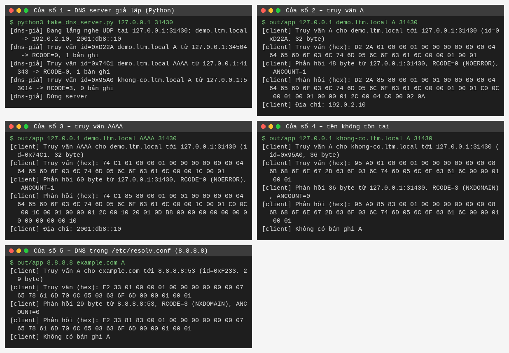

# Bài 4.3 – Tự tạo và phân tích truy vấn DNS qua UDP (Go)

| Thông tin | Nội dung |
|---|---|
| Mã giả tương ứng | Mã giả 4.5 (BUILD_QUERY, SKIP_NAME, DNS_QUERY) |
| Mục giáo trình | 4.3.2 Tự tạo truy vấn DNS theo RFC 1035 |
| Kế thừa | Client tra cứu DNS của Mục 2.5 – thay `RESOLVE` của hệ điều hành bằng truy vấn tự tạo |
| Thư viện | Thư viện chuẩn Go: `net`, `encoding/binary`, `crypto/rand` |

## Mục tiêu
Lập trình một giao thức nhị phân chuẩn: tạo thông điệp truy vấn DNS (tiêu đề 12 byte, QNAME dạng dãy nhãn, QTYPE, QCLASS), gửi qua UDP, kiểm tra địa chỉ nguồn và ID của phản hồi, đọc RCODE, ANCOUNT, nhảy qua tên (kể cả con trỏ nén `C0 0C`) và lấy bản ghi A/AAAA.

## Tệp
- `main.go` – đọc tham số dòng lệnh, gọi `DnsQuery` và in kết quả.
- `dnsquery.go` – Mã giả 4.5: `BuildQuery`, `SkipName`, `DnsQuery`.
- `punycode.go` – `ToASCIILabel`: chuyển nhãn có ký tự ngoài ASCII sang Punycode (RFC 3492), vì thư viện chuẩn Go không có gói IDNA.
- `fake_dns_server.py` – DNS server giả lập tối giản (Python, bản sao giống hệt tệp trong thư mục bài của C#, Java, Python; không thuộc mã giả): trả lời bản ghi A `192.0.2.10` và AAAA `2001:db8::10` cho đúng tên `demo.ltm.local`, tên khác trả RCODE = 3 (NXDOMAIN).
- `demo.json` – kịch bản chạy minh họa (dùng với `tools/demo.py`).
- `ket_qua.txt`, `ket_qua.png` – kết quả thực thi thật.

## Cách chạy
Trong thư mục bài:
```bash
# Cửa sổ 1 – DNS server giả lập (cần Python 3)
python3 fake_dns_server.py 127.0.0.1 5353
# Cửa sổ 2 – truy vấn tới server giả lập
go run . 127.0.0.1 demo.ltm.local A 5353
# Hoặc truy vấn DNS server thật (cổng 53)
go run . 8.8.8.8 example.com AAAA
```
Tham số: `<ip_dns_server> <ten_mien> [A|AAAA] [cong]`, mặc định kiểu A, cổng 53. Địa chỉ DNS server của máy có thể xem trong `/etc/resolv.conf` (Linux) hoặc bằng `ipconfig /all` (Windows). Kịch bản `demo.json` biên dịch một lần thành `out/app` (server giả lập ở cổng 31430).

## Kết quả thực thi


Truy vấn `demo.ltm.local` dài 32 byte, tiêu đề `xx xx 01 00 00 01 00 00 00 00 00 00` (cờ RD = 1, QDCOUNT = 1); phản hồi chép lại phần câu hỏi, bản ghi trả lời bắt đầu bằng con trỏ nén `C0 0C`, chương trình in đúng `192.0.2.10` và `2001:db8::10`. Tên không tồn tại cho RCODE = 3 (NXDOMAIN). Cửa sổ 5 gửi truy vấn tới DNS server ghi trong `/etc/resolv.conf` của môi trường kiểm thử (8.8.8.8): mạng của môi trường này trả lời NXDOMAIN cho mọi tên (kể cả `example.com`), nên kết quả được ghi lại đúng như nhận được; trên mạng thông thường, lệnh này trả về địa chỉ thật của `example.com`.

## Ghi chú
- Bổ sung so với mã giả, theo đoạn văn ngay sau Mã giả 4.5: kiểm tra mọi chỉ số `pos` không vượt quá độ dài thông điệp (phản hồi sai định dạng báo "Lỗi giao thức" thay vì làm chương trình dừng vì truy cập ngoài lát cắt) và kiểm tra cờ TC (bit 0x02 của byte thứ 3) trước khi đọc phần trả lời. `SkipName` không đi theo con trỏ nén nên không cần giới hạn số lần nhảy.
- Như mã giả, socket được tạo cùng họ với địa chỉ máy chủ (`udp4` hoặc `udp6`), nên có thể hỏi máy chủ DNS có địa chỉ IPv6. Thêm tham số cổng (mặc định 53) để chạy thử với DNS server giả lập ở cổng không đặc quyền; phép kiểm tra địa chỉ nguồn so sánh cả địa chỉ và cổng.
- `UINT16_BE`, `FROM_UINT16_BE` tương ứng `binary.BigEndian.AppendUint16`, `binary.BigEndian.Uint16`; `IPV4_TEXT`, `IPV6_TEXT` tương ứng `net.IP(rdata).String()`. Bản ghi A/AAAA chỉ được nhận khi RDLENGTH đúng 4/16 byte.
- Mã định danh lấy từ `crypto/rand` (bộ sinh số ngẫu nhiên an toàn mật mã), nên ID thay đổi ở mỗi lần chạy.
- Tên quốc tế được chuyển sang Punycode theo từng nhãn sau khi đổi về chữ thường (ví dụ `bücher.de` → `xn--bcher-kva.de`, `việt` → `xn--vit-5kz`, trùng kết quả `encode("idna")` của Python); bản tự cài đặt không kiểm tra đầy đủ các quy tắc IDNA.
- Mã giả chỉ gửi một lần; khi cần, có thể bọc bằng cơ chế gửi lại của Mã giả 4.4.
- Kiểm thử: Linux, Go 1.24.7.
